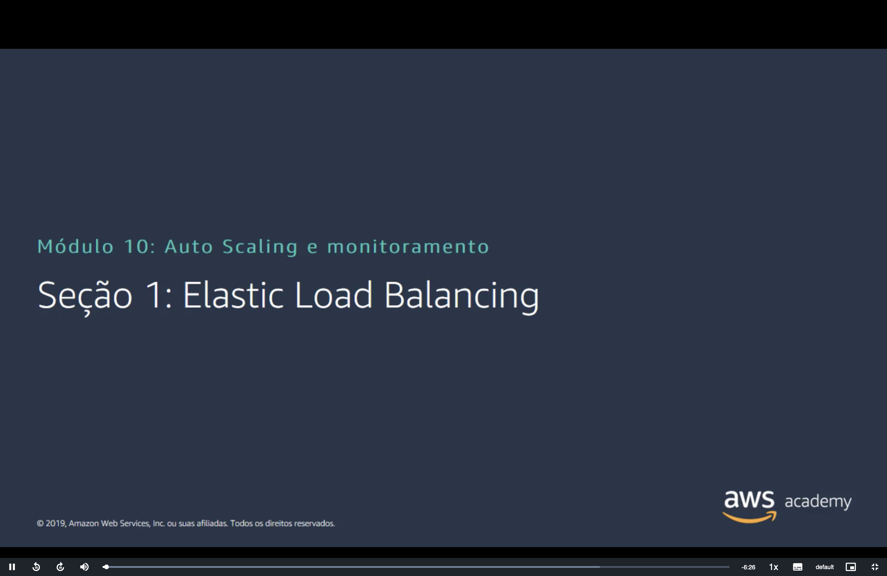
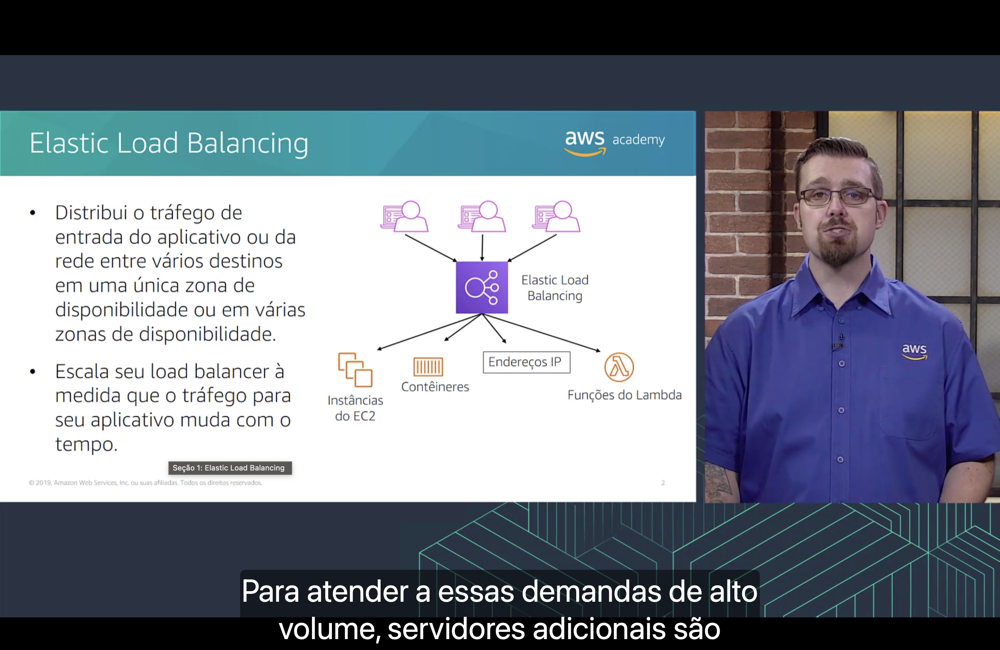
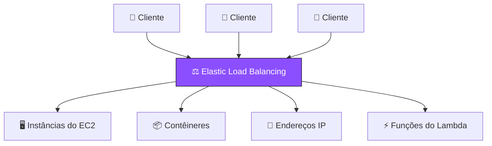
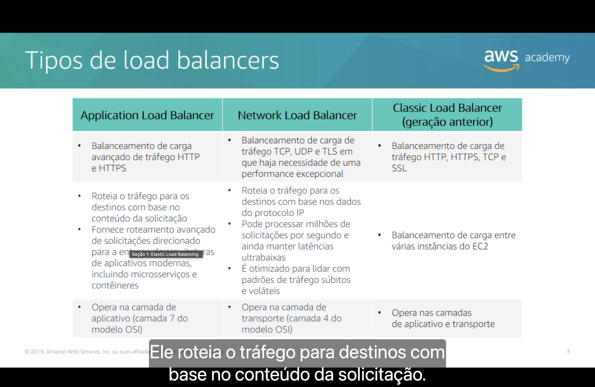
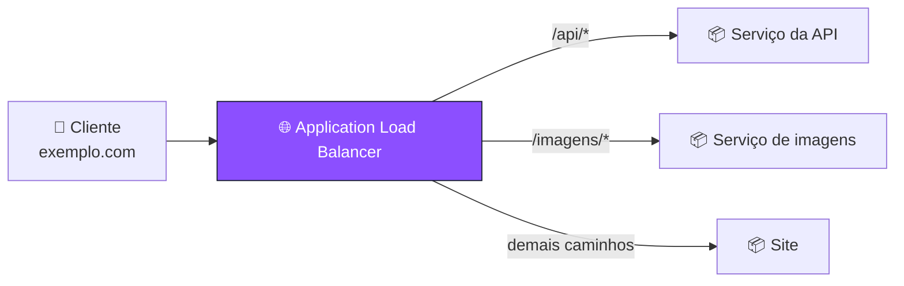
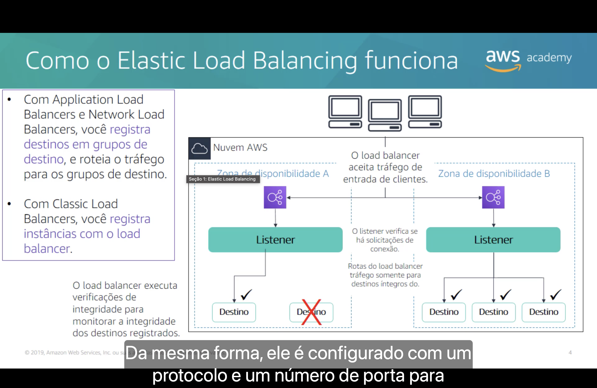
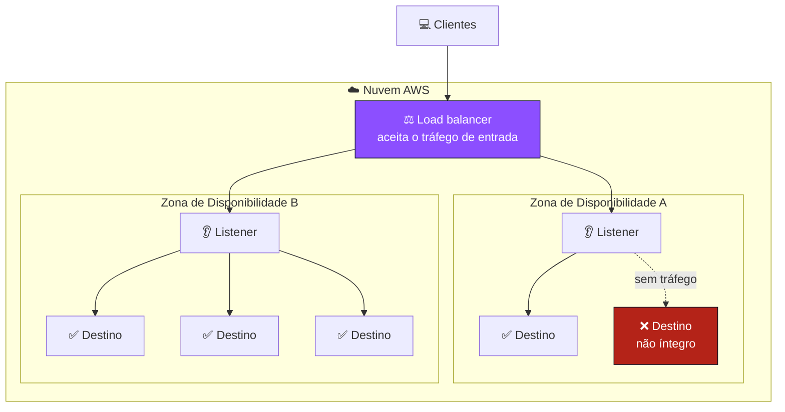
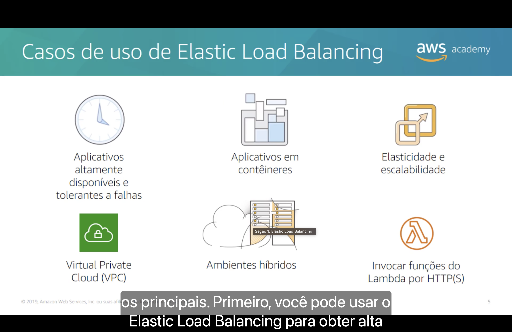
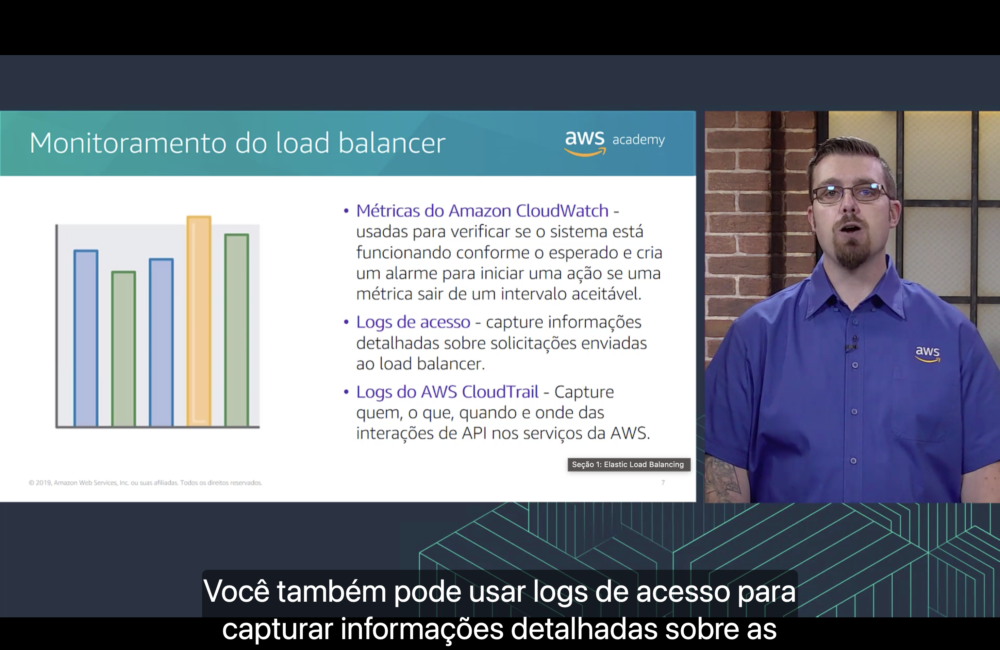

<h1 align="center">⚖️ Seção 1 – Elastic Load Balancing</h1>

  
  
   
  
  
  

  <a href="../README.md">🏠 Início</a> &nbsp;•&nbsp;
  <a href="./Seção%202%20-%20Amazon%20CloudWatch.md">Próxima: Amazon CloudWatch ➡️</a>

> [!NOTE]
> Esta seção abre o Módulo 10, sobre **Auto Scaling e monitoramento**. O Elastic Load Balancing já apareceu várias vezes de passagem: na [categoria de redes](../MÓDULO%203/Seção%202%20-%20Visão%20geral%20dos%20serviços%20e%20das%20categorias%20de%20serviços%20da%20AWS.md#redes) do Módulo 3, no diagrama de [failover de DNS](../MÓDULO%205/Seção%205%20-%20Amazon%20Route%2053.md#failover) do Route 53 e entre os recursos que o [Elastic Beanstalk](../MÓDULO%206/Seção%208%20-%20Introdução%20ao%20AWS%20Elastic%20Beanstalk.md#elastic-beanstalk) cria sozinho. Agora ele ganha uma seção própria. É a peça que coloca em prática a [escala horizontal](../MÓDULO%209/Seção%204%20-%20Pilar%20Confiabilidade.md#principios) e a [tolerância a falhas](../MÓDULO%209/Seção%207%20-%20Confiabilidade%20e%20disponibilidade.md#fatores) do Módulo 9.

## 📑 Sumário

| # | Tópico |
|:---:|---|
| 1 | [⚖️ Elastic Load Balancing](#elb) |
| 2 | [🧩 Tipos de load balancers](#tipos) |
| 3 | [⚙️ Como o Elastic Load Balancing funciona](#como-funciona) |
| 4 | [🎯 Casos de uso de Elastic Load Balancing](#casos-de-uso) |
| 5 | [📊 Monitoramento do load balancer](#monitoramento) |
| 🎯 | [Principais conclusões](#conclusoes) |

---

## 1. ⚖️ Elastic Load Balancing

O Elastic Load Balancing:

- 🔀 **distribui o tráfego de entrada** do aplicativo ou da rede **entre vários destinos**, em uma **única** Zona de Disponibilidade ou em **várias**;
- 📈 **escala o load balancer** à medida que o tráfego para o aplicativo **muda com o tempo**.

Segundo a narração, para atender a demandas de **alto volume**, o aplicativo passa a rodar em **servidores adicionais**, e alguém precisa repartir as solicitações entre eles. Esse é o papel do **load balancer** (balanceador de carga): os clientes falam só com ele, e ele escolhe para qual destino mandar cada solicitação.

O slide mostra quatro tipos de **destino**:

| Destino | Onde já vimos |
|---|---|
| 🖥️ **Instâncias do EC2** | O [Amazon EC2](../MÓDULO%206/Seção%202%20-%20Amazon%20EC2%20Parte%201.md#ec2) do Módulo 6 |
| 📦 **Contêineres** | O [Amazon ECS](../MÓDULO%206/Seção%206%20-%20Serviços%20de%20contêiner.md#ecs), que é integrado ao Elastic Load Balancing |
| 🔢 **Endereços IP** | Qualquer servidor com IP privado alcançável pela VPC, inclusive servidores **on-premises** ligados por [VPN](../MÓDULO%205/Seção%203%20-%20Redes%20VPC.md#vpn) ou [Direct Connect](../MÓDULO%205/Seção%203%20-%20Redes%20VPC.md#direct-connect) (veja os [casos de uso](#casos-de-uso)) |
| ⚡ **Funções do Lambda** | O Application Load Balancer é uma das [fontes de eventos](../MÓDULO%206/Seção%207%20-%20Introdução%20ao%20AWS%20Lambda.md#fontes) do Lambda |

> [!NOTE]
> **Elastic Load Balancing** (ELB) é o nome do **serviço**. Os **load balancers** são os recursos que você cria nele, de um dos [tipos](#tipos) do próximo tópico. O slide mantém "load balancer" em inglês, e esta anotação segue o slide.

> [!TIP]
> Com um único servidor, se ele cair, o aplicativo inteiro cai: é um **ponto único de falha**. Com um load balancer na frente de vários servidores em várias Zonas de Disponibilidade, a queda de um servidor tira só uma parte da capacidade. É a [escala horizontal](../MÓDULO%209/Seção%204%20-%20Pilar%20Confiabilidade.md#principios) do pilar confiabilidade na prática.

> [!NOTE]
> O slide é de 2019. O load balancer continua escalando sozinho, mas desde **novembro de 2024** o Application Load Balancer e o Network Load Balancer aceitam a **reserva de LCU** (*Load Balancer Capacity Unit Reservation*): você define uma **capacidade mínima** com antecedência para um pico **previsto**, como a abertura da venda de ingressos para um show ou o lançamento de um produto. Você paga pelas LCUs reservadas e pelo que passar da reserva.

## 2. 🧩 Tipos de load balancers

| | 🌐 **Application Load Balancer** | 🚀 **Network Load Balancer** | 🕰️ **Classic Load Balancer** (geração anterior) |
|---|---|---|---|
| **Tráfego** | Balanceamento de carga **avançado** de tráfego **HTTP e HTTPS** | Balanceamento de carga de tráfego **TCP, UDP e TLS** em que haja necessidade de uma **performance excepcional** | Balanceamento de carga de tráfego **HTTP, HTTPS, TCP e SSL** |
| **Roteamento** | Roteia o tráfego para os destinos com base no **conteúdo da solicitação**. Fornece **roteamento avançado** de solicitações para arquiteturas de aplicativos modernas, incluindo **microsserviços** e **contêineres** | Roteia o tráfego para os destinos com base nos **dados do protocolo IP**. Pode processar **milhões de solicitações por segundo** com **latências ultrabaixas**. É otimizado para padrões de tráfego **súbitos e voláteis** | Balanceamento de carga entre **várias instâncias do EC2** |
| **Camada OSI** | Camada de **aplicativo** (camada **7**) | Camada de **transporte** (camada **4**) | Camadas de **aplicativo e transporte** |

> [!NOTE]
> O rótulo do player cobre parte do texto do Application Load Balancer. A frase completa é "Fornece roteamento avançado de solicitações direcionado para a **entrega de arquiteturas** de aplicativos modernas".

As camadas são as do [modelo OSI](../MÓDULO%205/Seção%201%20-%20Noções%20básicas%20de%20redes.md#osi) do Módulo 5, cuja dica já antecipava esta divisão. A camada diz **o que o load balancer consegue ler** em cada solicitação:

| Tipo | Camada | O que ele enxerga | Exemplo de decisão |
|---|:---:|---|---|
| 🌐 **Application** | 7 | O conteúdo HTTP: **caminho** da URL, **nome do host**, cabeçalhos, método, parâmetros da URL | "Pedidos para `/api/*` vão para os servidores da API" |
| 🚀 **Network** | 4 | Só os dados de rede: **IP** e **porta** de origem e de destino e o protocolo (TCP ou UDP) | "Conexões na porta 443 vão para este grupo de servidores" |

Segundo a narração, o Application Load Balancer **roteia o tráfego para destinos com base no conteúdo da solicitação**. É isso que o torna bom para **microsserviços**: cada parte do aplicativo vira um serviço separado, e um único load balancer manda cada pedido para o serviço certo:

> [!TIP]
> Como escolher:
> - 🌐 **Aplicativo web ou API** (HTTP/HTTPS), principalmente com microsserviços ou contêineres: **Application Load Balancer**.
> - 🚀 **Tráfego TCP ou UDP** que precisa de desempenho extremo, como jogos on-line, ou de **IP fixo**: **Network Load Balancer**. Ele tem um **IP estático por Zona de Disponibilidade**, e você pode associar um **IP elástico** a cada um.
> - 🕰️ **Classic Load Balancer**: só para aplicativos antigos que já o usam.

> [!NOTE]
> O slide é de 2019, e a lista mudou:
> - Hoje são **quatro tipos**. Em **novembro de 2020**, a AWS lançou o **Gateway Load Balancer** (GWLB), que trabalha na **camada 3** (o nível do IP). Ele não serve aplicativos: distribui o tráfego entre **appliances virtuais** de parceiros, como **firewalls** e **sistemas de detecção e prevenção de intrusões**, comprados no AWS Marketplace. Ele troca o tráfego com esses appliances pelo protocolo **GENEVE**, na porta **6081**.
> - A documentação descreve o **Classic Load Balancer** como a **geração anterior** e recomenda **migrar** para um load balancer da geração atual.
> - O Application Load Balancer também aceita **gRPC**, além de HTTP e HTTPS.
> - O Network Load Balancer passou a aceitar **grupos de segurança** e pode ter um **Application Load Balancer** como destino.

## 3. ⚙️ Como o Elastic Load Balancing funciona

- 🗂️ Com **Application Load Balancers** e **Network Load Balancers**, você **registra destinos em grupos de destino** (*target groups*), e o load balancer roteia o tráfego para os grupos de destino.
- 🕰️ Com **Classic Load Balancers**, você **registra instâncias com o load balancer**, sem grupo de destino.
- 🩺 O load balancer executa **verificações de integridade** para monitorar a integridade dos destinos registrados.

O diagrama mostra o caminho de uma solicitação:

| Peça | O que faz |
|---|---|
| ⚖️ **Load balancer** | **Aceita o tráfego de entrada** dos clientes. É o único endereço que eles conhecem |
| 👂 **Listener** | **Verifica se há solicitações de conexão**. É configurado com um **protocolo** e uma **porta**, como HTTPS na porta 443 |
| 🗂️ **Grupo de destino** | O conjunto de destinos que recebem um tipo de tráfego. Um destino pode estar em mais de um grupo |
| 🎯 **Destino** | Quem de fato atende a solicitação: instância, contêiner, endereço IP ou função do Lambda |
| 🩺 **Verificação de integridade** | Testa cada destino de tempos em tempos. O load balancer roteia o tráfego **somente para destinos íntegros** |

Segundo a narração, o listener é configurado com um **protocolo** e um **número de porta** para as conexões dos clientes com o load balancer e, **da mesma forma**, para as conexões do load balancer com os destinos. No Application Load Balancer, o listener também tem **regras**, avaliadas em ordem de prioridade, que escolhem o grupo de destino de cada solicitação, como no [exemplo de microsserviços](#tipos).

> [!NOTE]
> A frase "Rotas do load balancer tráfego somente para destinos íntegros do." é uma tradução truncada de *The load balancer routes traffic to healthy targets only*: **o load balancer roteia o tráfego somente para destinos íntegros**. O rótulo do player também cobre "Zona de disponibilidade A".

### 🩺 Verificações de integridade

No diagrama, o segundo destino da Zona de Disponibilidade A está marcado com um **X**: falhou na verificação de integridade e parou de receber tráfego. Quando voltar a passar, ele volta a receber. Os valores padrão da verificação no Application Load Balancer, para instâncias e endereços IP:

| Configuração | Padrão | Comparação com o [Route 53](../MÓDULO%205/Seção%205%20-%20Amazon%20Route%2053.md#failover) |
|---|---|---|
| **Protocolo e caminho** | HTTP em `/` | – |
| **Intervalo** | 30 segundos | Igual ao intervalo padrão do Route 53 |
| **Tempo limite** | 5 segundos | – |
| **Falhas seguidas até "não íntegro"** | 2 | O Route 53 do slide usava 3 |
| **Sucessos seguidos até "íntegro"** | 5 | – |
| **Código de sucesso** | `200` | – |

> [!IMPORTANT]
> Se **todos** os destinos de um grupo ficarem não íntegros, o Application Load Balancer faz o contrário do esperado: manda o tráfego para **todos** eles, íntegros ou não. A documentação chama isso de **falhar aberto** (*fail open*). A lógica é que, se tudo parece quebrado, o mais provável é que a **verificação** esteja errada, e é melhor tentar atender do que derrubar o aplicativo inteiro.

> [!TIP]
> Repare que a Zona A tem **1** destino íntegro e a Zona B tem **3**. Cada Zona de Disponibilidade tem seu próprio **nó** do load balancer, e o tráfego dos clientes é dividido entre os nós, **50%** para cada. O que acontece depois depende do **balanceamento de carga entre zonas** (*cross-zone load balancing*):
>
> | | Destino da Zona A | Cada destino da Zona B |
> |---|:---:|:---:|
> | **Desligado**: cada nó só usa os destinos da própria zona | **50%** | cerca de **16,7%** |
> | **Ligado**: cada nó usa os destinos de todas as zonas | **25%** | **25%** |
>
> No **Application Load Balancer**, ele está sempre ligado no load balancer e só pode ser desligado no grupo de destino. No **Network Load Balancer** e no **Gateway Load Balancer**, vem **desligado** por padrão. No **Classic Load Balancer**, vem ligado se você o cria pelo console e desligado se cria pela API ou pela CLI.

## 4. 🎯 Casos de uso de Elastic Load Balancing

Segundo a narração, o slide reúne os **principais** casos de uso, começando por usar o Elastic Load Balancing para obter **alta disponibilidade**:

| Caso de uso | Como o ELB ajuda | Onde já vimos |
|---|---|---|
| 🕐 **Aplicativos altamente disponíveis e tolerantes a falhas** | Espalha os destinos por **várias Zonas de Disponibilidade** e tira do caminho os que falham nas verificações de integridade, sem intervenção humana | A [alta disponibilidade](../MÓDULO%209/Seção%207%20-%20Confiabilidade%20e%20disponibilidade.md#alta-disponibilidade) e a [tolerância a falhas](../MÓDULO%209/Seção%207%20-%20Confiabilidade%20e%20disponibilidade.md#fatores) do Módulo 9 |
| 📦 **Aplicativos em contêineres** | Distribui o tráfego entre os contêineres de um serviço, mesmo que vários rodem na **mesma instância** em **portas diferentes** | O [Amazon ECS](../MÓDULO%206/Seção%206%20-%20Serviços%20de%20contêiner.md#ecs), integrado ao ELB |
| ↗️ **Elasticidade e escalabilidade** | Junto com o **Amazon EC2 Auto Scaling**, as instâncias novas entram no grupo de destino e as removidas saem, sem mudar o endereço que os clientes usam | O EC2 Auto Scaling é o tema da [Seção 3](./Seção%203%20-%20Amazon%20EC2%20Auto%20Scaling.md) |
| 🔒 **Virtual Private Cloud (VPC)** | O load balancer fica **dentro da VPC**. Pode ser **voltado para a internet**, com IPs públicos, ou **interno**, só com IPs privados, para tráfego entre as camadas do aplicativo | As [VPCs e sub-redes](../MÓDULO%205/Seção%202%20-%20Amazon%20VPC.md#vpc-subredes) do Módulo 5 |
| 🏢 **Ambientes híbridos** | Com destinos por **endereço IP**, o mesmo load balancer distribui o tráfego entre servidores na AWS e servidores **on-premises** | A [VPN Site-to-Site](../MÓDULO%205/Seção%203%20-%20Redes%20VPC.md#vpn) e o [Direct Connect](../MÓDULO%205/Seção%203%20-%20Redes%20VPC.md#direct-connect), que ligam o datacenter à VPC |
| ⚡ **Invocar funções do Lambda por HTTP(S)** | O Application Load Balancer chama a função a cada solicitação HTTP ou HTTPS, sem servidor para gerenciar | As [fontes de eventos](../MÓDULO%206/Seção%207%20-%20Introdução%20ao%20AWS%20Lambda.md#fontes) do Lambda |

> [!TIP]
> Um uso clássico do load balancer **interno** é a arquitetura em camadas: um load balancer **voltado para a internet** recebe os clientes e distribui entre os servidores web, e um load balancer **interno** distribui os pedidos dos servidores web entre os servidores de aplicativo. Só a primeira camada fica exposta. É a evolução da [atividade de segurança da VPC](../MÓDULO%205/Seção%204%20-%20Segurança%20da%20VPC.md#atividade) do Módulo 5, que já sugeria um Elastic Load Balancing na frente dos dois servidores web.

> [!NOTE]
> Para os ambientes híbridos, o destino precisa ter um **IP privado** alcançável a partir da VPC. Endereços IP públicos da internet não podem ser registrados como destino.

## 5. 📊 Monitoramento do load balancer

| Ferramenta | Definição no slide | Pergunta que responde | Onde já vimos |
|---|---|---|---|
| 📈 **Métricas do Amazon CloudWatch** | Usadas para verificar se o sistema está funcionando **conforme o esperado** e criar um **alarme** para iniciar uma ação se uma métrica sair de um **intervalo aceitável** | O load balancer e os destinos estão saudáveis **agora**? | O [CloudWatch](../MÓDULO%206/Seção%204%20-%20Amazon%20EC2%20Parte%203.md#cloudwatch) do EC2. Detalhado na [próxima seção](./Seção%202%20-%20Amazon%20CloudWatch.md) |
| 📝 **Logs de acesso** | Capturam informações **detalhadas** sobre as **solicitações** enviadas ao load balancer | Quem pediu o quê, quando, e o que o load balancer respondeu? | Novidade desta seção |
| 🕵️ **Logs do AWS CloudTrail** | Capturam **quem, o que, quando e onde** das interações de **API** nos serviços da AWS | Quem **criou, alterou ou apagou** o load balancer? | A [Etapa 3](../MÓDULO%204/Seção%203%20-%20Proteção%20de%20uma%20nova%20conta%20da%20AWS.md#etapa3) da proteção de uma nova conta |

Segundo a narração, você também pode usar os **logs de acesso** para capturar informações detalhadas sobre as solicitações. Cada linha do log traz dados como a **hora** da solicitação, o **IP do cliente**, as **latências**, o **caminho** pedido e o **código de resposta** do servidor.

Alguns exemplos de métricas que o Application Load Balancer envia ao CloudWatch:

| Métrica | O que mede |
|---|---|
| `RequestCount` | Quantas solicitações o load balancer recebeu |
| `TargetResponseTime` | Quanto tempo os destinos levaram para responder |
| `HealthyHostCount` / `UnHealthyHostCount` | Quantos destinos estão íntegros e quantos não estão |
| `HTTPCode_Target_5XX_Count` | Quantas respostas de erro de servidor (5xx) os destinos devolveram |

> [!IMPORTANT]
> Logs de acesso e logs do CloudTrail parecem a mesma coisa, mas olham para lados diferentes:
> - 📝 **Logs de acesso**: as **solicitações dos clientes** que passam pelo load balancer, como um `GET /produtos` de um navegador.
> - 🕵️ **CloudTrail**: as **chamadas à API do serviço** Elastic Load Balancing, como alguém da equipe que criou um listener ou apagou o load balancer.

> [!TIP]
> O load balancer envia métricas ao CloudWatch a cada **60 segundos**, mas só quando há solicitações passando por ele. Os **logs de acesso** vêm **desativados** por padrão: ao ativar, você escolhe um **bucket do Amazon S3**, e cada nó do load balancer grava um arquivo a cada **5 minutos**. Não há cobrança extra pelos logs em si, só pelo armazenamento no S3.

> [!NOTE]
> O slide é de 2019. Hoje a documentação do Application Load Balancer lista mais três ferramentas de monitoramento:
> - **Logs de conexão**: o IP e a porta do cliente, o certificado do cliente, o resultado da conexão e as cifras TLS usadas.
> - **Logs de verificação de integridade**: o resultado detalhado das verificações de cada destino, guardado no Amazon S3.
> - **Rastreamento de solicitações**: o load balancer acrescenta a cada solicitação um **cabeçalho com um identificador**, que permite seguir a solicitação pelos destinos.

---

## 🎯 Principais conclusões

- ✅ O **Elastic Load Balancing** distribui o tráfego de entrada entre vários destinos (**instâncias do EC2**, **contêineres**, **endereços IP** e **funções do Lambda**), em uma ou em várias Zonas de Disponibilidade, e **escala sozinho** conforme o tráfego muda.
- ✅ O slide mostra três tipos: o **Application Load Balancer** (HTTP/HTTPS, **camada 7**, roteia pelo **conteúdo da solicitação**), o **Network Load Balancer** (TCP, UDP e TLS, **camada 4**, milhões de solicitações por segundo com latência ultrabaixa) e o **Classic Load Balancer** (geração anterior). Desde 2020 existe o quarto, o **Gateway Load Balancer**, para appliances de rede como firewalls.
- ✅ No ALB e no NLB, você registra destinos em **grupos de destino**. No Classic, registra as **instâncias** direto no load balancer.
- ✅ O **listener** verifica se há solicitações de conexão em um **protocolo** e uma **porta**.
- ✅ O load balancer faz **verificações de integridade** e roteia o tráfego **somente para destinos íntegros**.
- ✅ Os casos de uso incluem **alta disponibilidade**, **contêineres**, **elasticidade** (com o EC2 Auto Scaling), **VPC**, **ambientes híbridos** e **Lambda por HTTP(S)**.
- ✅ Para monitorar: **métricas do CloudWatch** (saúde e alarmes), **logs de acesso** (as solicitações dos clientes) e **logs do CloudTrail** (as chamadas à API do serviço).

---

  <a href="../README.md">🏠 Início</a> &nbsp;•&nbsp;
  <a href="./Seção%202%20-%20Amazon%20CloudWatch.md">Próxima: Amazon CloudWatch ➡️</a>

