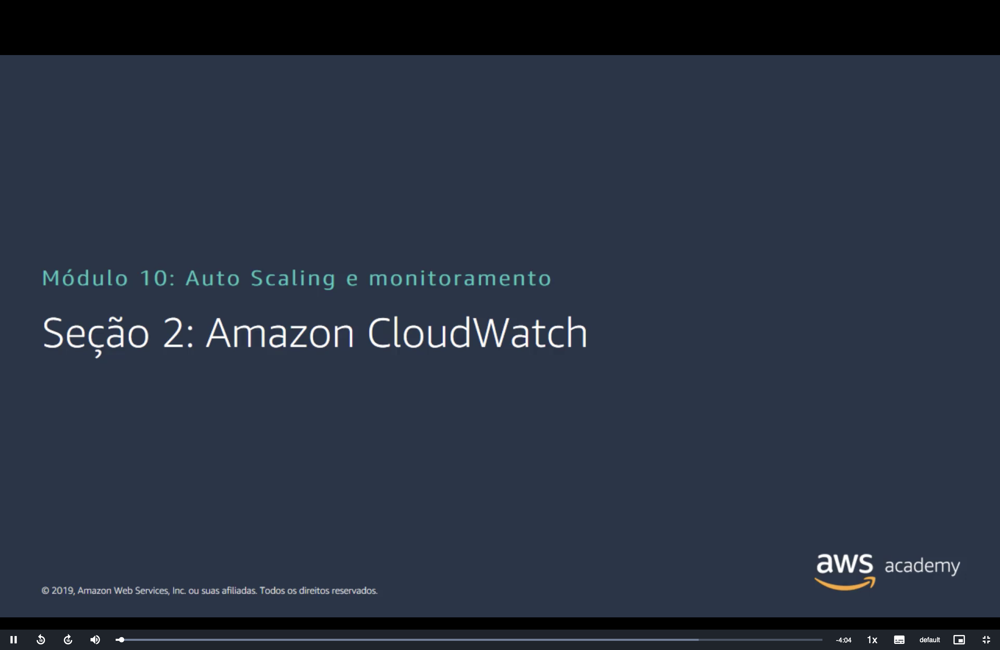
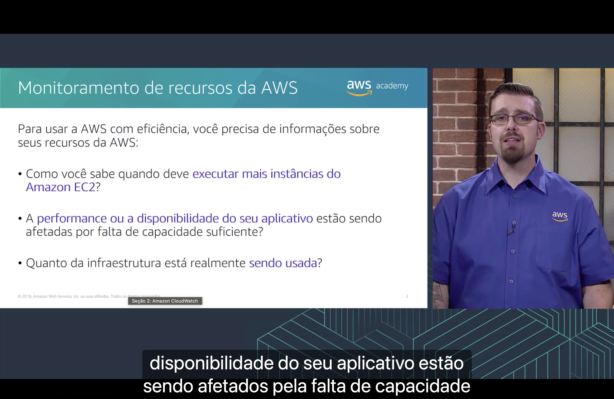
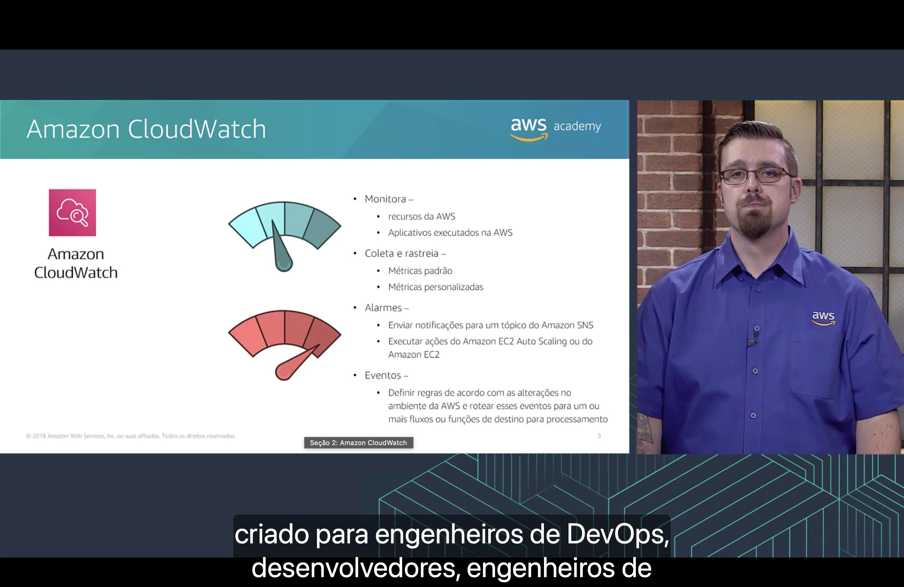
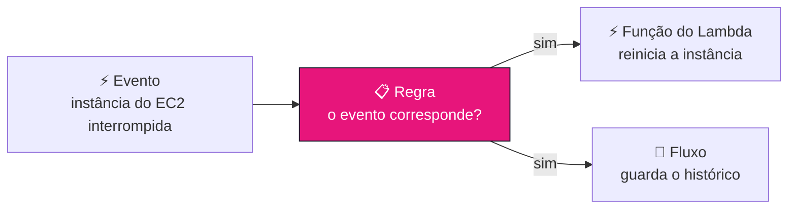
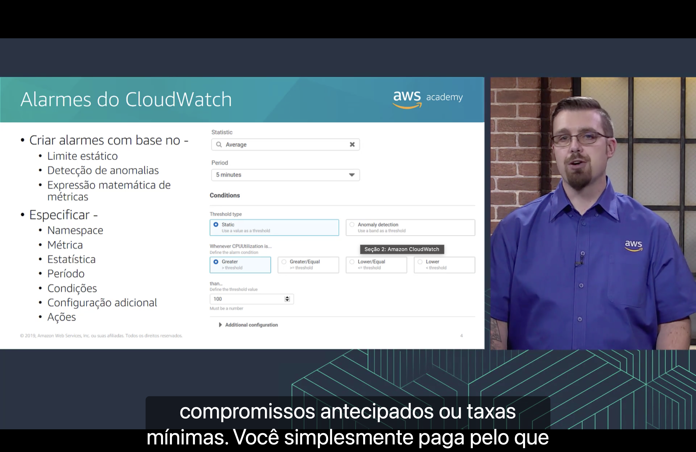
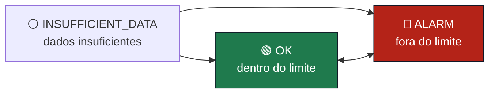

<h1 align="center">📈 Seção 2 – Amazon CloudWatch</h1>

  
  
   
  
  
  

  <a href="../README.md">🏠 Início</a> &nbsp;•&nbsp;
  <a href="./Seção%201%20-%20Elastic%20Load%20Balancing.md">⬅️ Anterior: Elastic Load Balancing</a> &nbsp;•&nbsp;
  <a href="./Seção%203%20-%20Amazon%20EC2%20Auto%20Scaling.md">Próxima: Amazon EC2 Auto Scaling ➡️</a>

> [!NOTE]
> O CloudWatch apareceu pela primeira vez no Módulo 6, no [monitoramento de instâncias do EC2](../MÓDULO%206/Seção%204%20-%20Amazon%20EC2%20Parte%203.md#cloudwatch), com o monitoramento **básico** (a cada 5 minutos, sem custo) e o **detalhado** (a cada 1 minuto, pago). Voltou na [seção anterior](./Seção%201%20-%20Elastic%20Load%20Balancing.md#monitoramento) como a primeira ferramenta para monitorar um load balancer. Aqui ele ganha uma seção própria, com foco em **métricas**, **alarmes** e **eventos**. Os alarmes são o que vai acionar o **EC2 Auto Scaling** da [próxima seção](./Seção%203%20-%20Amazon%20EC2%20Auto%20Scaling.md).

## 📑 Sumário

| # | Tópico |
|:---:|---|
| 1 | [🔍 Monitoramento de recursos da AWS](#monitoramento) |
| 2 | [📈 Amazon CloudWatch](#cloudwatch) |
| 3 | [🚨 Alarmes do CloudWatch](#alarmes) |
| 🎯 | [Principais conclusões](#conclusoes) |

---

## 1. 🔍 Monitoramento de recursos da AWS

Para usar a AWS **com eficiência**, você precisa de informações sobre seus recursos da AWS. O slide faz três perguntas:

| Pergunta | O que está em jogo | Onde já vimos |
|---|---|---|
| 🖥️ Como você sabe quando deve **executar mais instâncias do Amazon EC2**? | **Escalar** no momento certo | O princípio [pare de tentar adivinhar a capacidade](../MÓDULO%209/Seção%204%20-%20Pilar%20Confiabilidade.md#principios) do pilar confiabilidade |
| ⏱️ A **performance ou a disponibilidade do seu aplicativo** estão sendo afetadas por falta de capacidade suficiente? | **Desempenho** e **disponibilidade** | Os pilares [eficiência de desempenho](../MÓDULO%209/Seção%205%20-%20Pilar%20Eficiência%20de%20desempenho.md#pilar) e [confiabilidade](../MÓDULO%209/Seção%204%20-%20Pilar%20Confiabilidade.md#pilar) |
| 💲 Quanto da infraestrutura está realmente **sendo usada**? | **Custo**: pagar por servidores ociosos | O [tamanho certo](../MÓDULO%206/Seção%205%20-%20Otimização%20de%20custos%20do%20Amazon%20EC2.md#pilar1) das instâncias do EC2 e o pilar [otimização de custos](../MÓDULO%209/Seção%206%20-%20Pilar%20Otimização%20de%20custos.md#pilar) |

Segundo a narração, sem essas informações não dá para saber se a performance ou a disponibilidade do aplicativo estão sendo afetadas pela **falta de capacidade**.

> [!TIP]
> As três perguntas puxam em sentidos opostos: as duas primeiras pedem **mais** capacidade, e a terceira, **menos**. Só com números reais de uso dá para acertar o meio-termo. Sem monitoramento, a escolha é **adivinhar**, e a resposta da AWS para isso é o CloudWatch.

## 2. 📈 Amazon CloudWatch

| Função | O que faz |
|---|---|
| 👁️ **Monitora** | Os **recursos da AWS** e os **aplicativos executados na AWS** |
| 📊 **Coleta e rastreia** | **Métricas padrão** e **métricas personalizadas** |
| 🚨 **Alarmes** | **Enviar notificações** para um tópico do **Amazon SNS** e **executar ações** do **Amazon EC2 Auto Scaling** ou do **Amazon EC2** |
| ⚡ **Eventos** | **Definir regras** de acordo com as **alterações no ambiente da AWS** e **rotear** esses eventos para um ou mais **fluxos ou funções de destino** para processamento |

Segundo a narração, o CloudWatch foi criado para quem opera aplicativos na AWS, como **engenheiros de DevOps** e **desenvolvedores**. Os dois medidores do slide resumem a ideia: o **azul**, com o ponteiro no meio, é o sistema dentro do esperado, e o **vermelho**, com o ponteiro na zona de perigo, é a situação que deve disparar um alarme.

### 📊 Métricas padrão e personalizadas

| | 📦 **Métricas padrão** | ✍️ **Métricas personalizadas** |
|---|---|---|
| **Quem publica** | Os **próprios serviços da AWS**, automaticamente | **Você**, pela API (`PutMetricData`) ou pelo **agente do CloudWatch** instalado na instância |
| **Exemplos** | `CPUUtilization` e `NetworkIn` do EC2; `RequestCount` e `HealthyHostCount` do [load balancer](./Seção%201%20-%20Elastic%20Load%20Balancing.md#monitoramento) | Uso de **memória** e de **disco** da instância; métricas de negócio, como **pedidos por minuto** ou **usuários conectados** |
| **Custo** | As do monitoramento básico são **gratuitas** | Cobradas por métrica, depois do nível gratuito |

> [!IMPORTANT]
> O **uso de memória** e o **espaço em disco** **não** estão entre as métricas padrão do EC2. A AWS mede a instância **de fora** (CPU, rede, operações de disco), mas não enxerga o que acontece **dentro** do sistema operacional. Para ter essas métricas, é preciso instalar o **agente do CloudWatch**, que as publica como métricas personalizadas. É uma pegadinha comum na prova.

### ⚡ Eventos

Um **evento** é uma **alteração no ambiente** da AWS, como uma instância do EC2 que muda para o estado **interrompida** (*stopped*). Você cria uma **regra** que descreve os eventos que interessam, e o CloudWatch os entrega a um ou mais **destinos**:

As **funções de destino** do slide são, por exemplo, [funções do AWS Lambda](../MÓDULO%206/Seção%207%20-%20Introdução%20ao%20AWS%20Lambda.md#fontes), e os **fluxos** são fluxos de dados, como os do Amazon Kinesis.

> [!TIP]
> **Alarme** e **evento** respondem a perguntas diferentes:
> - 🚨 **Alarme**: um **número** passou de um limite? ("a CPU ficou acima de 80% por 10 minutos")
> - ⚡ **Evento**: **algo aconteceu**? ("uma instância foi interrompida", "alguém alterou um grupo de segurança")

### 📣 Amazon SNS

O **Amazon Simple Notification Service** (Amazon SNS) aparece aqui pela primeira vez como destino de alarmes. Ele trabalha com **tópicos**: o alarme publica **uma** mensagem no tópico, e o SNS entrega uma cópia a **cada assinante**, por **e-mail**, **SMS**, [função do Lambda](../MÓDULO%206/Seção%207%20-%20Introdução%20ao%20AWS%20Lambda.md#fontes) ou outros destinos. Assim, um único alarme avisa a equipe inteira. É o mesmo SNS que o [AWS Budgets](../MÓDULO%202/Seção%204%20-%20AWS%20Billing%20and%20Cost%20Management.md#budgets) usa para os alertas de orçamento.

> [!NOTE]
> O slide é de 2019, e duas coisas mudaram:
> - Os **eventos do CloudWatch** viraram o **Amazon EventBridge**, lançado em **2019**. A documentação diz que o EventBridge se chamava **Amazon CloudWatch Events**: ele usa a **mesma API** e a mesma infraestrutura, e o código antigo continua funcionando. O EventBridge acrescentou eventos de aplicativos SaaS de parceiros e um registro de esquemas.
> - Hoje o CloudWatch se apresenta como um serviço de **monitoramento e observabilidade** que coleta **métricas**, **logs** e **rastreamentos** (*traces*) de todo o ambiente da AWS, e não só métricas.

## 3. 🚨 Alarmes do CloudWatch

Um alarme pode ser criado com base em:

| Base | Como funciona | Exemplo |
|---|---|---|
| 📏 **Limite estático** | Um **valor fixo** (*Use a value as a threshold*) | CPU **acima de 80%** |
| 🤖 **Detecção de anomalias** | Uma **faixa** de valores esperados (*Use a band as a threshold*), calculada a partir do **histórico** da métrica | Tráfego **muito acima** do normal para uma terça-feira às 10h |
| ➗ **Expressão matemática de métricas** | O resultado de uma **fórmula** que combina métricas | **Taxa de erros** = `HTTPCode_Target_5XX_Count` / `RequestCount` × 100, com as métricas do [load balancer](./Seção%201%20-%20Elastic%20Load%20Balancing.md#monitoramento) |

> [!TIP]
> A **detecção de anomalias** resolve o problema das métricas que variam ao longo do dia. Um site com 1.000 acessos por minuto no horário comercial e 50 de madrugada não cabe em um limite estático: 300 acessos são normais às 15h e suspeitos às 3h. A faixa acompanha esse padrão.

Para criar o alarme, você especifica:

| Campo | O que é | No exemplo do slide |
|---|---|---|
| 🗂️ **Namespace** | O "contêiner" das métricas. Os serviços da AWS usam `AWS/<serviço>` | `AWS/EC2` (a métrica do exemplo é do EC2) |
| 📊 **Métrica** | A série de valores ao longo do tempo que será vigiada | `CPUUtilization` |
| 🧮 **Estatística** | Como os valores de cada período são resumidos: média, soma, mínimo, máximo, número de amostras ou percentis (como o p99) | **Average** (média) |
| ⏲️ **Período** | O intervalo de tempo de cada ponto avaliado | **5 minutes** |
| ⚖️ **Condições** | O tipo de limite e a comparação: **maior**, **maior ou igual**, **menor ou igual** ou **menor** que o limite | **Static**, **Greater** (>), **100** |
| ⚙️ **Configuração adicional** | Quantos pontos precisam passar do limite e como tratar dados ausentes | Recolhida no slide |
| 🔔 **Ações** | O que fazer quando o estado do alarme muda | Não aparece no slide |

Lido em voz alta, o exemplo diz: "dispare quando a **média** de `CPUUtilization` em **5 minutos** for **maior que 100**".

> [!NOTE]
> `CPUUtilization` é uma **porcentagem** e não passa de **100**. Com a condição **Greater** (> 100), esse alarme **nunca** dispararia. O valor serve só para mostrar a tela. Na prática, um alarme de CPU alta usa algo como **> 80**.

Segundo a narração, com o CloudWatch **não há compromissos antecipados nem taxas mínimas**: você simplesmente **paga pelo que usar**, como no [modelo de definição de preço](../MÓDULO%202/Seção%201%20-%20Fundamentos%20da%20definição%20de%20preço.md#pague-uso) do Módulo 2.

### 🚦 Estados do alarme

| Estado | Significado |
|---|---|
| 🟢 `OK` | A métrica está **dentro** do limite definido |
| 🔴 `ALARM` | A métrica está **fora** do limite definido |
| ⚪ `INSUFFICIENT_DATA` | O alarme **acabou de ser criado**, a métrica não está disponível ou **não há dados suficientes** para decidir |

As ações são executadas **quando o estado muda**, por exemplo de `OK` para `ALARM`.

### ⚙️ O que fica na "configuração adicional"

- 🔢 **Pontos de dados para alarme** (*Datapoints to alarm*): a regra "**M de N**". Com períodos de 5 minutos, **3 de 5** quer dizer que 3 dos últimos 5 pontos (25 minutos) precisam passar do limite, não necessariamente seguidos. Isso evita que **um pico isolado** dispare o alarme.
- 🕳️ **Tratamento de dados ausentes**: considerar o ponto que falta como **dentro** do limite (`notBreaching`), **fora** do limite (`breaching`), **ignorá-lo** e manter o estado atual (`ignore`) ou tratá-lo como **ausente** (`missing`), que é o **padrão**.

> [!TIP]
> Os alarmes ligam as três primeiras seções deste módulo: uma métrica do [load balancer](./Seção%201%20-%20Elastic%20Load%20Balancing.md#monitoramento) ou das instâncias passa do limite, o alarme vai para `ALARM` e aciona o **EC2 Auto Scaling**, que adiciona instâncias. Elas entram no grupo de destino do load balancer e começam a receber tráfego. É o tema da [Seção 3](./Seção%203%20-%20Amazon%20EC2%20Auto%20Scaling.md).

> [!NOTE]
> O nível gratuito do CloudWatch inclui as métricas do **monitoramento básico** (a cada 5 minutos), **10 métricas** personalizadas ou de monitoramento detalhado, **10 métricas de alarme** de resolução padrão, **1 milhão de solicitações de API**, **5 GB de logs** e **3 painéis** com até 50 métricas cada, por mês.

> [!NOTE]
> O slide é de 2019. Hoje os alarmes têm mais opções:
> - Além do SNS, do EC2 e do EC2 Auto Scaling, um alarme pode **invocar uma função do Lambda diretamente** (desde **dezembro de 2023**; antes era preciso passar por um tópico do SNS), criar um **OpsItem** ou um **incidente** no AWS Systems Manager e iniciar uma **investigação** no CloudWatch.
> - Os **alarmes compostos** combinam os estados de **outros alarmes** em uma regra, como "dispare só se a CPU **e** a latência estiverem em `ALARM`". Isso reduz o excesso de alertas. Eles não executam ações do EC2 nem do Auto Scaling.
> - O CloudWatch guarda as métricas por **15 meses**, como visto no [Módulo 6](../MÓDULO%206/Seção%204%20-%20Amazon%20EC2%20Parte%203.md#cloudwatch), mas perde detalhe com o tempo: os pontos de **1 minuto** ficam disponíveis por **15 dias**, os de **5 minutos** por **63 dias** e os de **1 hora** por **455 dias** (15 meses).

---

## 🎯 Principais conclusões

- ✅ Para usar a AWS com eficiência, é preciso saber **quando escalar**, se a **performance ou a disponibilidade** estão sofrendo por falta de capacidade e **quanto da infraestrutura** está sendo usada.
- ✅ O **Amazon CloudWatch** **monitora** recursos e aplicativos na AWS, **coleta e rastreia** métricas **padrão** e **personalizadas**, dispara **alarmes** e reage a **eventos**.
- ✅ Uso de **memória** e de **disco** não é métrica padrão do EC2: exige o **agente do CloudWatch**.
- ✅ Os **alarmes** podem enviar notificações para um tópico do **Amazon SNS** e executar ações do **EC2 Auto Scaling** ou do **EC2**.
- ✅ Os **eventos** usam **regras** para rotear alterações no ambiente para **fluxos** ou **funções** de destino. Hoje esse recurso é o **Amazon EventBridge**.
- ✅ Um alarme pode usar **limite estático**, **detecção de anomalias** ou **expressão matemática de métricas**, e você especifica **namespace**, **métrica**, **estatística**, **período**, **condições**, **configuração adicional** e **ações**.
- ✅ Um alarme fica em `OK`, `ALARM` ou `INSUFFICIENT_DATA`, e as ações rodam quando o estado **muda**.
- ✅ O CloudWatch não tem **compromisso antecipado nem taxa mínima**: você paga pelo que usar.

---

  <a href="../README.md">🏠 Início</a> &nbsp;•&nbsp;
  <a href="./Seção%201%20-%20Elastic%20Load%20Balancing.md">⬅️ Anterior: Elastic Load Balancing</a> &nbsp;•&nbsp;
  <a href="./Seção%203%20-%20Amazon%20EC2%20Auto%20Scaling.md">Próxima: Amazon EC2 Auto Scaling ➡️</a>

