<h1 align="center">↕️ Seção 3 – Amazon EC2 Auto Scaling</h1>

  
  
   
  
  
  

  <a href="../README.md">🏠 Início</a> &nbsp;•&nbsp;
  <a href="./Seção%202%20-%20Amazon%20CloudWatch.md">⬅️ Anterior: Amazon CloudWatch</a>

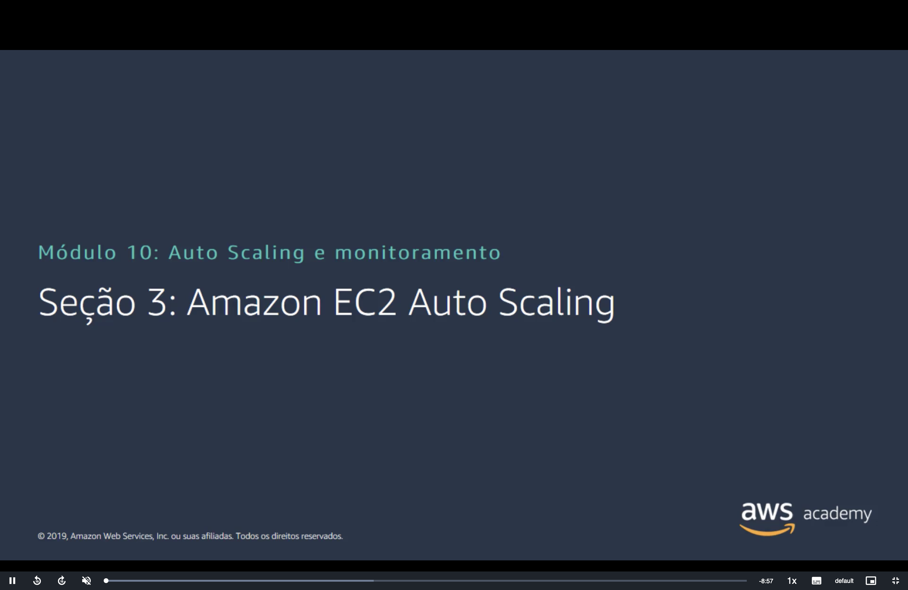

> [!NOTE]
> Esta é a última seção do Módulo 10, e ela junta as duas anteriores: o [Elastic Load Balancing](./Seção%201%20-%20Elastic%20Load%20Balancing.md) distribui o tráfego, o [CloudWatch](./Seção%202%20-%20Amazon%20CloudWatch.md) mede a carga, e o **EC2 Auto Scaling** ajusta o número de instâncias. A ideia vem desde o Módulo 1, com a vantagem [pare de tentar adivinhar a capacidade](../MÓDULO%201/Seção%202%20-%20Vantagens%20da%20Computação%20em%20Nuvem.md#capacidade), e reapareceu no pilar [aumentar a elasticidade](../MÓDULO%206/Seção%205%20-%20Otimização%20de%20custos%20do%20Amazon%20EC2.md#pilar2) do EC2 e na [escala horizontal](../MÓDULO%209/Seção%204%20-%20Pilar%20Confiabilidade.md#principios) do Módulo 9.

## 📑 Sumário

| # | Tópico |
|:---:|---|
| 1 | [📊 Por que a escalabilidade é importante?](#por-que) |
| 2 | [↕️ Amazon EC2 Auto Scaling](#ec2-auto-scaling) |
| 3 | [🛒 Tráfego de novembro para o site Amazon.com](#novembro) |
| 4 | [🗂️ Grupos de Auto Scaling](#grupos) |
| 5 | [↔️ Expansão versus redução](#expansao-reducao) |
| 6 | [⚙️ Como funciona o Amazon EC2 Auto Scaling](#como-funciona) |
| 7 | [🔁 Implementação da escalabilidade dinâmica](#dinamica) |
| 8 | [🧩 AWS Auto Scaling](#aws-auto-scaling) |
| 🎯 | [Principais conclusões](#conclusoes) |

---

## 1. 📊 Por que a escalabilidade é importante?

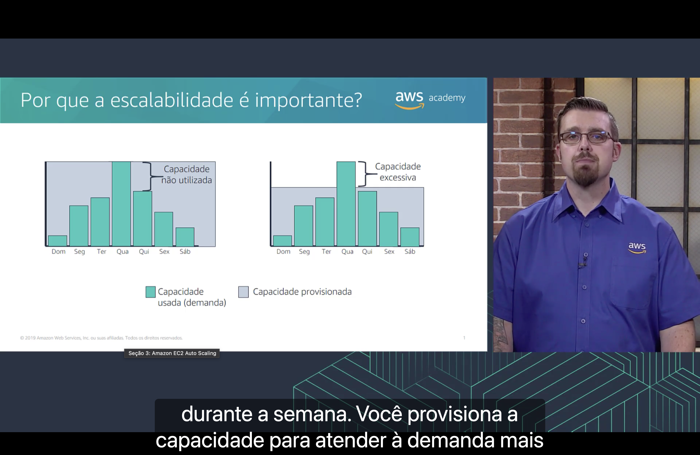

Os dois gráficos mostram a **demanda** de uma semana (barras verdes, com o pico na **quarta-feira**) contra a **capacidade provisionada** (área cinza), que é **fixa**:

| | ⬅️ Gráfico da esquerda | ➡️ Gráfico da direita |
|---|---|---|
| **Como a capacidade foi escolhida** | Para atender ao **pico** da semana | Para atender a um nível **médio** de demanda |
| **O que sobra ou falta** | **Capacidade não utilizada** em todos os outros dias | Na quarta-feira, a demanda **passa** da capacidade |
| **Problema** | Paga por servidores **ociosos** | Usuários **sem atendimento** ou com o aplicativo lento |

Segundo a narração, a demanda varia **durante a semana**, e, no gráfico da esquerda, você provisiona a capacidade para atender à demanda **mais alta**.

> [!NOTE]
> "Capacidade excessiva", no gráfico da direita, é a tradução de *over capacity*: a parte da demanda que **passa** da capacidade provisionada. Não é capacidade sobrando, e sim **faltando**.

> [!TIP]
> São os dois problemas da vantagem [pare de tentar adivinhar a capacidade](../MÓDULO%201/Seção%202%20-%20Vantagens%20da%20Computação%20em%20Nuvem.md#capacidade) do Módulo 1: com capacidade fixa, ou você paga por recursos parados, ou fica sem recursos no pico. A saída é a capacidade **acompanhar** a demanda, que é o que o EC2 Auto Scaling faz.

## 2. ↕️ Amazon EC2 Auto Scaling

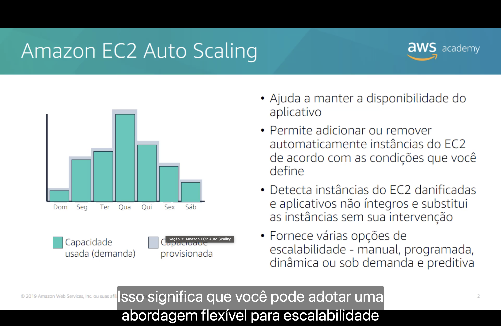

O Amazon EC2 Auto Scaling:

- 🟢 **ajuda a manter a disponibilidade** do aplicativo;
- ↕️ permite **adicionar ou remover automaticamente** instâncias do EC2 de acordo com as **condições que você define**;
- 🩺 **detecta instâncias do EC2 danificadas e aplicativos não íntegros** e **substitui** as instâncias **sem sua intervenção**;
- 🎛️ fornece várias opções de escalabilidade: **manual**, **programada**, **dinâmica** (ou sob demanda) e **preditiva**.

No gráfico, a área cinza da capacidade provisionada agora **acompanha** as barras da demanda, com uma pequena folga, dia a dia. Segundo a narração, isso significa que você pode adotar uma **abordagem flexível** para a escalabilidade.

> [!IMPORTANT]
> Por padrão, o EC2 Auto Scaling verifica a integridade das instâncias só pelas **verificações de status do EC2**: ele percebe se a **instância** parou, mas não se o **aplicativo** dentro dela travou. Para substituir instâncias com o aplicativo quebrado, é preciso **ativar** as [verificações de integridade do load balancer](./Seção%201%20-%20Elastic%20Load%20Balancing.md#como-funciona) no grupo. Quando uma instância é considerada não íntegra, o EC2 Auto Scaling a **substitui** por uma nova para manter a capacidade desejada.

> [!NOTE]
> O EC2 Auto Scaling **não tem custo adicional**: você paga só pelas instâncias do EC2, pelo CloudWatch (usado pelas políticas de escalabilidade) e pelos outros recursos que usar.

## 3. 🛒 Tráfego de novembro para o site Amazon.com

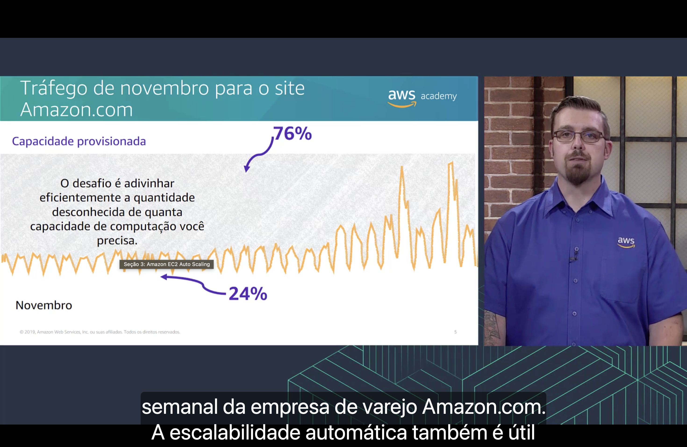

> **O desafio é adivinhar eficientemente a quantidade desconhecida de quanta capacidade de computação você precisa.**

Segundo a narração, o gráfico mostra o tráfego da empresa de varejo **Amazon.com** em **novembro**. A linha laranja é o tráfego: ele oscila todo dia e cresce no fim do mês, perto da Black Friday. O topo da área cinza é a **capacidade provisionada**, escolhida para aguentar o maior pico.

| Parte do gráfico | Porcentagem | O que significa |
|---|:---:|---|
| ⬆️ Acima da linha laranja | **76%** | Capacidade **paga e não utilizada** |
| ⬇️ Abaixo da linha laranja | **24%** | Capacidade **realmente usada** |

> [!TIP]
> Provisionando para o pico, **três quartos** da capacidade de novembro ficariam parados. É o gráfico da esquerda do [primeiro tópico](#por-que) em escala real, e mostra que nem a própria Amazon consegue adivinhar bem a capacidade com servidores fixos.

## 4. 🗂️ Grupos de Auto Scaling

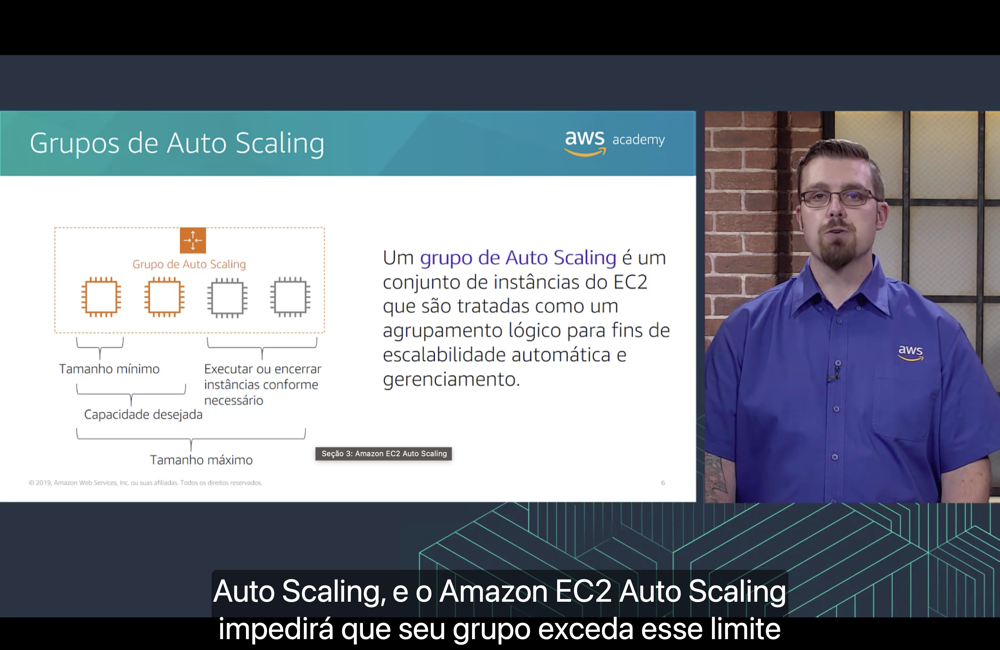

Um **grupo de Auto Scaling** é um **conjunto de instâncias do EC2** que são tratadas como um **agrupamento lógico** para fins de **escalabilidade automática e gerenciamento**.

O grupo tem três números:

| Configuração | O que garante | No diagrama |
|---|---|---|
| ⬇️ **Tamanho mínimo** | O grupo **nunca fica abaixo** desse número de instâncias | 1 instância |
| 🎯 **Capacidade desejada** | O número de instâncias que o grupo **deve ter agora** | 2 instâncias (as laranja, em execução) |
| ⬆️ **Tamanho máximo** | O grupo **nunca passa** desse número de instâncias | 4 instâncias |

Entre a capacidade desejada e o tamanho máximo, o grupo pode **executar ou encerrar instâncias conforme necessário** (as cinza do diagrama). Segundo a narração, se você define um tamanho máximo, o EC2 Auto Scaling **impede que o grupo exceda esse limite**.

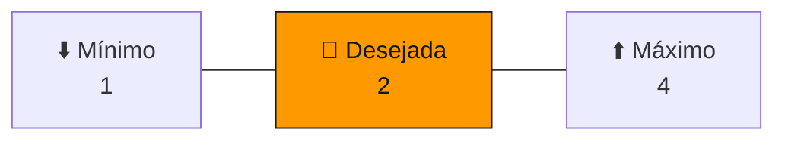

> [!TIP]
> Cada número protege uma coisa:
> - O **mínimo** protege a **disponibilidade**: mesmo de madrugada, sem tráfego, sempre há instâncias para atender.
> - O **máximo** protege o **custo**: um pico anormal, ou um ataque, não faz a conta explodir.
> - A **desejada** é o ponto em que o grupo está agora, e é ela que a escalabilidade muda, sempre entre o mínimo e o máximo.

> [!NOTE]
> O EC2 Auto Scaling também **equilibra** as instâncias entre as **Zonas de Disponibilidade** do grupo à medida que ele cresce ou diminui. Assim, a perda de uma AZ não leva todas as instâncias juntas.

## 5. ↔️ Expansão versus redução

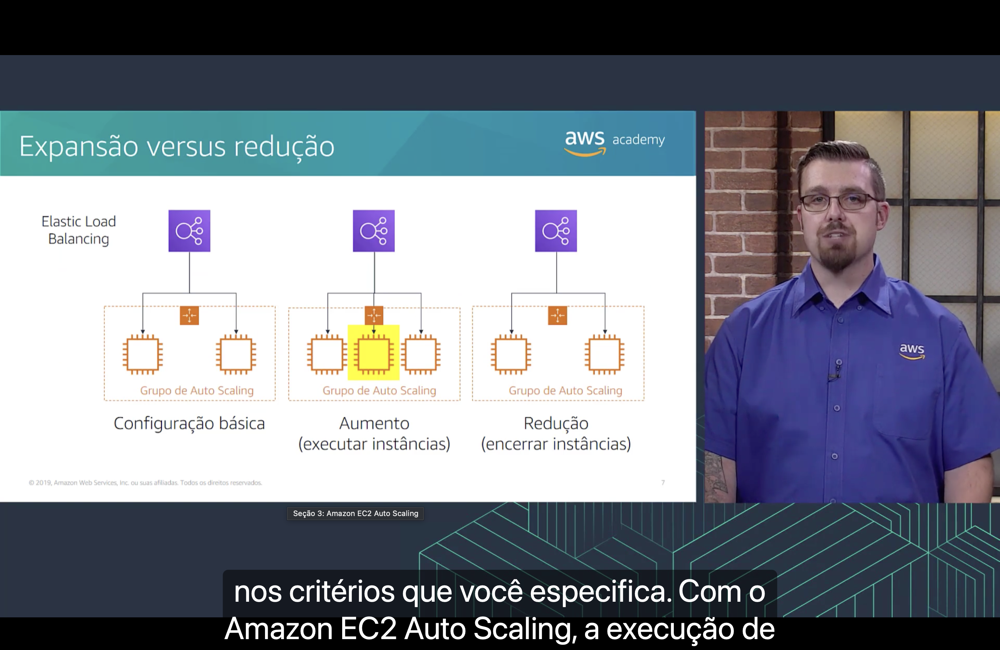

| Cenário | O que acontece | Instâncias no diagrama |
|---|---|:---:|
| ⚖️ **Configuração básica** | O load balancer distribui o tráfego entre as instâncias do grupo | 2 |
| ⬆️ **Aumento** (executar instâncias) | O grupo **executa** uma instância nova (em amarelo), que passa a receber tráfego do load balancer | 3 |
| ⬇️ **Redução** (encerrar instâncias) | O grupo **encerra** a instância que sobrou, e volta à configuração básica | 2 |

Segundo a narração, o grupo aumenta ou diminui com base **nos critérios que você especifica**.

> [!NOTE]
> "Aumento" e "redução" traduzem *scale out* e *scale in*: **acrescentar ou retirar instâncias**. É a escala **horizontal** do [pilar confiabilidade](../MÓDULO%209/Seção%204%20-%20Pilar%20Confiabilidade.md#principios). A escala **vertical** (*scale up* e *scale down*) seria trocar a instância por uma maior ou menor, e não é o que o EC2 Auto Scaling faz.

> [!TIP]
> Com o grupo ligado a um load balancer, a instância nova é **registrada no grupo de destino** sozinha, e só começa a receber tráfego depois de passar nas [verificações de integridade](./Seção%201%20-%20Elastic%20Load%20Balancing.md#como-funciona). Na redução, o load balancer para de mandar solicitações novas para a instância antes de ela ser encerrada. Os clientes continuam usando o mesmo endereço do load balancer o tempo todo.

## 6. ⚙️ Como funciona o Amazon EC2 Auto Scaling

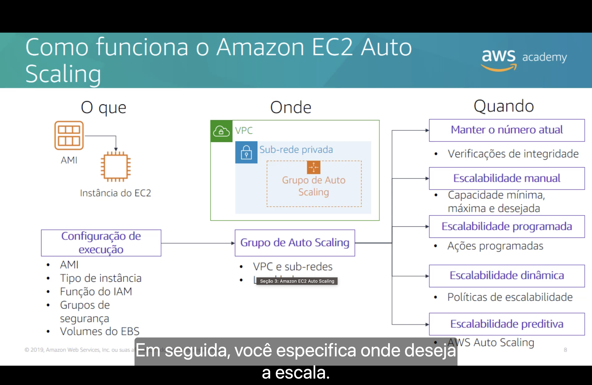

O slide divide a configuração em três perguntas:

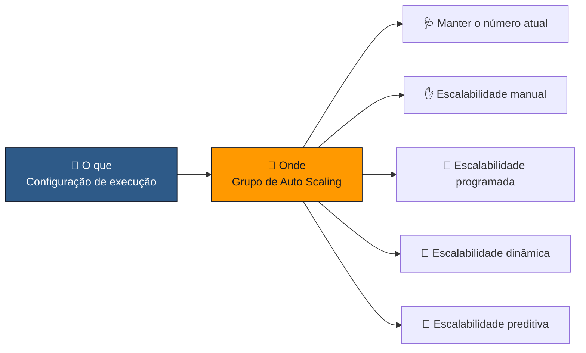

### 📄 O que: a configuração de execução

O "modelo" de cada instância que o grupo vai criar, a partir de uma **AMI**. Ela define:

| Item | Onde já vimos |
|---|---|
| 💿 **AMI** | A [Amazon Machine Image](../MÓDULO%206/Seção%202%20-%20Amazon%20EC2%20Parte%201.md#ami) do Módulo 6 |
| 🖥️ **Tipo de instância** | Os [tipos de instância](../MÓDULO%206/Seção%202%20-%20Amazon%20EC2%20Parte%201.md#tipo-instancia) do EC2 |
| 🔑 **Função do IAM** | A [função do IAM](../MÓDULO%206/Seção%203%20-%20Amazon%20EC2%20Parte%202.md#iam) anexada à instância |
| 🛡️ **Grupos de segurança** | Os [grupos de segurança](../MÓDULO%206/Seção%204%20-%20Amazon%20EC2%20Parte%203.md#grupo-seguranca) do EC2 |
| 💾 **Volumes do EBS** | As [opções de armazenamento](../MÓDULO%206/Seção%203%20-%20Amazon%20EC2%20Parte%202.md#opcoes) da instância |

> [!TIP]
> Como as instâncias são criadas e encerradas sozinhas, nenhuma delas pode ser configurada **à mão**. Tudo o que o servidor precisa tem que estar na AMI ou nos [dados do usuário](../MÓDULO%206/Seção%203%20-%20Amazon%20EC2%20Parte%202.md#dados-usuario), e os dados que precisam sobreviver devem ficar fora da instância, em um banco de dados ou no Amazon S3, por exemplo.

### 📍 Onde: o grupo de Auto Scaling

Segundo a narração, em seguida você especifica **onde** deseja a escala: a **VPC** e as **sub-redes** em que as instâncias serão executadas e o **load balancer** que vai distribuir o tráfego entre elas. No diagrama, o grupo fica em uma **sub-rede privada**, como as [sub-redes](../MÓDULO%205/Seção%202%20-%20Amazon%20VPC.md#vpc-subredes) do Módulo 5.

> [!NOTE]
> O rótulo do player cobre o segundo item do grupo de Auto Scaling, que começa com "L": é o **load balancer**.

> [!TIP]
> Escolha sub-redes em **mais de uma Zona de Disponibilidade**. É isso que permite ao grupo espalhar as instâncias e continuar no ar se uma AZ falhar. Com o load balancer em sub-redes **públicas** e as instâncias em sub-redes **privadas**, só o load balancer fica exposto à internet.

### ⏰ Quando: as opções de escalabilidade

| Opção | Como funciona | Exemplo |
|---|---|---|
| 🩺 **Manter o número atual** | Usa as **verificações de integridade** para substituir instâncias com problema e manter sempre a capacidade desejada | Uma instância trava, e o grupo cria outra no lugar |
| ✋ **Escalabilidade manual** | Você altera a **capacidade mínima, máxima e desejada** à mão | Aumentar a desejada de 2 para 4 antes de uma campanha |
| 📅 **Escalabilidade programada** | **Ações programadas** mudam a capacidade em data e hora definidas | Subir para 10 instâncias toda segunda às 8h e voltar para 2 às 20h |
| 🔁 **Escalabilidade dinâmica** | **Políticas de escalabilidade** reagem às métricas do CloudWatch | CPU média acima de 60% por 5 minutos (veja o [próximo tópico](#dinamica)) |
| 🔮 **Escalabilidade preditiva** | Usa o histórico para **prever** a demanda e escalar **antes** do pico. No slide, é feita pelo **AWS Auto Scaling** | Um site que todo dia tem pico às 9h já começa o dia com mais instâncias |

> [!NOTE]
> O slide é de 2019. Hoje a **configuração de execução** (*launch configuration*) está sendo abandonada em favor do **modelo de execução** (*launch template*):
> - Desde **1º de janeiro de 2023**, os tipos de instância novos não são aceitos em configurações de execução.
> - Contas criadas a partir de **1º de junho de 2023** não conseguem criar configurações de execução pelo console.
> - Contas criadas a partir de **1º de outubro de 2024** não conseguem criá-las por nenhum meio (console, API, CLI ou CloudFormation).
>
> A documentação recomenda **migrar para modelos de execução**. Eles definem os mesmos itens, aceitam **versões** e permitem que um grupo misture **tipos de instância** e instâncias **sob demanda** e **spot**.

## 7. 🔁 Implementação da escalabilidade dinâmica

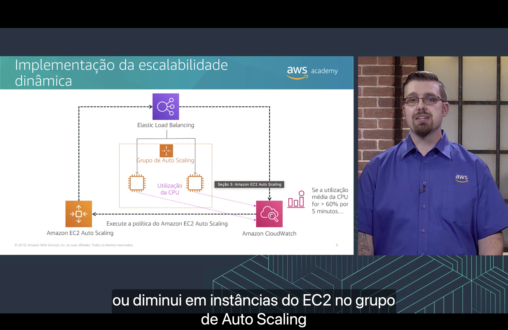

O diagrama junta as três seções do módulo em um ciclo:

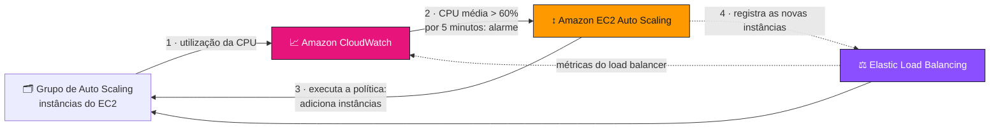

1. 📊 As instâncias do grupo enviam a **utilização da CPU** ao CloudWatch.
2. 🚨 Se a **utilização média da CPU** for **maior que 60% por 5 minutos**, o [alarme](./Seção%202%20-%20Amazon%20CloudWatch.md#alarmes) muda para `ALARM`.
3. ↕️ O alarme manda o EC2 Auto Scaling **executar a política** de escalabilidade, que adiciona instâncias ao grupo.
4. ⚖️ As instâncias novas entram no load balancer e começam a receber tráfego.

Segundo a narração, a política **aumenta ou diminui** o número de instâncias do EC2 no grupo de Auto Scaling.

> [!TIP]
> Um alarme só de CPU **alta** faz o grupo crescer e **nunca encolher**. Para reduzir, é preciso um segundo alarme, como "CPU média **abaixo de 30%** por 15 minutos", ligado a uma política que **remove** instâncias. O intervalo entre os dois limites evita que o grupo fique aumentando e reduzindo sem parar.

Hoje existem três tipos de política de escalabilidade dinâmica:

| Política | Como funciona |
|---|---|
| 🌡️ **Rastreamento de destino** (*target tracking*) | Você escolhe uma métrica e um **valor-alvo**, como "CPU média em 50%", e o grupo cresce e diminui para ficar perto dele, **como um termostato**. Os alarmes são criados e gerenciados pelo próprio EC2 Auto Scaling |
| 🪜 **Escalonamento em etapas** (*step scaling*) | O tamanho do ajuste depende de **quanto** a métrica passou do limite: um pouco acima, +1 instância; muito acima, +3 |
| 1️⃣ **Escalabilidade simples** (*simple scaling*) | Um único ajuste por alarme, com um **tempo de espera** (*cooldown*) entre uma ação e outra |

> [!IMPORTANT]
> A documentação **recomenda fortemente** o **rastreamento de destino**, com métricas como a **utilização média da CPU** ou a **média de solicitações por destino** do load balancer. Ele dispensa criar os alarmes à mão e cuida tanto do aumento quanto da redução.

## 8. 🧩 AWS Auto Scaling

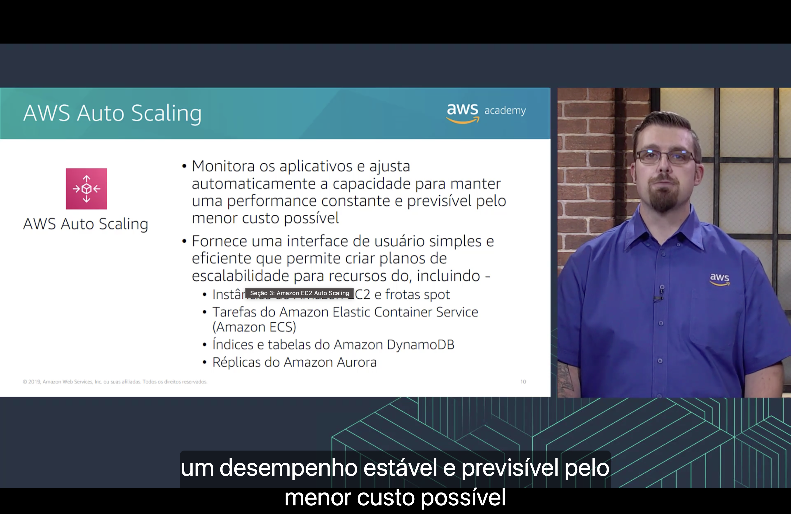

O **AWS Auto Scaling** é um serviço **separado** do EC2 Auto Scaling. Ele:

- 🎯 **monitora os aplicativos** e **ajusta automaticamente a capacidade** para manter uma **performance constante e previsível** pelo **menor custo possível**;
- 🧭 fornece uma **interface de usuário simples** para criar **planos de escalabilidade** para vários recursos, incluindo:

| Recurso | O que ele escala | Onde já vimos |
|---|---|---|
| 🖥️ **Instâncias do Amazon EC2 e frotas spot** | O número de instâncias | As [instâncias spot](../MÓDULO%206/Seção%205%20-%20Otimização%20de%20custos%20do%20Amazon%20EC2.md#modelos) do Módulo 6 |
| 📦 **Tarefas do Amazon ECS** | O número de tarefas (contêineres) de um serviço | O [Amazon ECS](../MÓDULO%206/Seção%206%20-%20Serviços%20de%20contêiner.md#ecs) |
| ⚡ **Índices e tabelas do Amazon DynamoDB** | A capacidade de leitura e gravação provisionada | O [Amazon DynamoDB](../MÓDULO%208/Seção%202%20-%20Amazon%20DynamoDB.md#dynamodb) |
| 🌊 **Réplicas do Amazon Aurora** | O número de réplicas de leitura | As [réplicas do Aurora](../MÓDULO%208/Seção%204%20-%20Amazon%20Aurora.md#alta-disponibilidade) |

Segundo a narração, o objetivo é manter um **desempenho estável e previsível pelo menor custo possível**.

> [!NOTE]
> O rótulo do player cobre o primeiro item da lista: "Instâncias do Amazon EC2 e frotas spot". E a frase "planos de escalabilidade para recursos do, incluindo" perdeu uma palavra na tradução: são recursos **de vários serviços**.

| | ↕️ Amazon EC2 Auto Scaling | 🧩 AWS Auto Scaling |
|---|---|---|
| **O que escala** | Só **grupos de Auto Scaling** (instâncias do EC2) | Recursos de **vários serviços**, inclusive grupos de Auto Scaling |
| **Como** | Grupos, políticas e ações programadas | **Planos de escalabilidade**, que reúnem as políticas de vários recursos de um aplicativo em um só lugar |

> [!NOTE]
> O slide é de 2019, e a divisão de trabalho mudou:
> - A **escalabilidade preditiva** passou a ser uma **política do próprio EC2 Auto Scaling**. Antes, ela só existia nos planos do AWS Auto Scaling. Ela analisa até **14 dias** de histórico, prevê a capacidade **hora a hora** para as **próximas 48 horas** e atualiza a previsão a cada **6 horas**. Precisa de pelo menos 24 horas de dados e começa no modo **só previsão**, sem escalar, para você conferir se ela acerta.
> - A documentação dos planos de escalabilidade **recomenda fortemente** que, se você usa um plano **só** para a escalabilidade preditiva, configure as **políticas preditivas direto nos recursos**.
> - Os outros serviços são escalados pelo **Application Auto Scaling**, que hoje cobre muito mais do que a lista do slide, como a simultaneidade provisionada do **AWS Lambda**, o **Amazon ElastiCache**, o **Amazon EMR** e o **Amazon Keyspaces**.
> - Os **grupos de aquecimento** (*warm pools*) mantêm instâncias **já inicializadas**, paradas ou em hibernação, ao lado do grupo. Elas entram em serviço mais rápido quando o grupo aumenta, o que ajuda aplicativos que demoram muito para iniciar.

---

## 🎯 Principais conclusões

- ✅ Com capacidade **fixa**, ou você paga por **capacidade não utilizada**, ou fica **sem capacidade** no pico. No exemplo da Amazon.com em novembro, provisionar para o pico deixaria **76%** da capacidade parada.
- ✅ O **Amazon EC2 Auto Scaling** adiciona e remove instâncias do EC2 **automaticamente**, de acordo com as condições que você define, e **substitui instâncias não íntegras** sem intervenção.
- ✅ Um **grupo de Auto Scaling** é um conjunto de instâncias tratadas como um **agrupamento lógico**, com **tamanho mínimo**, **capacidade desejada** e **tamanho máximo**.
- ✅ **Aumento** (*scale out*) executa instâncias e **redução** (*scale in*) encerra instâncias: é escala **horizontal**.
- ✅ A configuração diz **o que** executar (a **configuração de execução**, hoje **modelo de execução**: AMI, tipo de instância, função do IAM, grupos de segurança e volumes do EBS), **onde** (VPC, sub-redes e load balancer) e **quando**.
- ✅ As opções de "quando" são **manter o número atual**, escalabilidade **manual**, **programada**, **dinâmica** e **preditiva**.
- ✅ Na **escalabilidade dinâmica**, um **alarme do CloudWatch** aciona uma **política** do EC2 Auto Scaling, e o **load balancer** distribui o tráfego para as instâncias novas. A política recomendada é o **rastreamento de destino**.
- ✅ O **AWS Auto Scaling** cria **planos de escalabilidade** para recursos de vários serviços: instâncias do EC2 e frotas spot, tarefas do ECS, tabelas e índices do DynamoDB e réplicas do Aurora.
- ✅ O EC2 Auto Scaling **não tem custo adicional**: você paga pelas instâncias e pelo CloudWatch.

---

  <a href="../README.md">🏠 Início</a> &nbsp;•&nbsp;
  <a href="./Seção%202%20-%20Amazon%20CloudWatch.md">⬅️ Anterior: Amazon CloudWatch</a>

