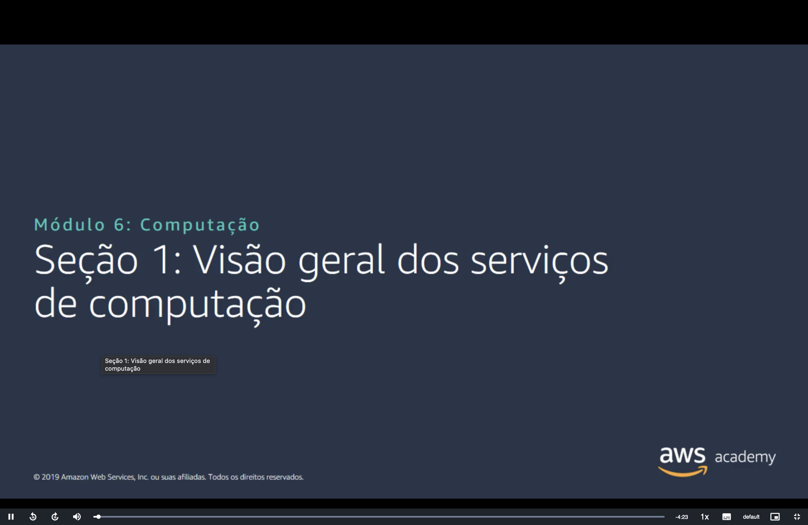
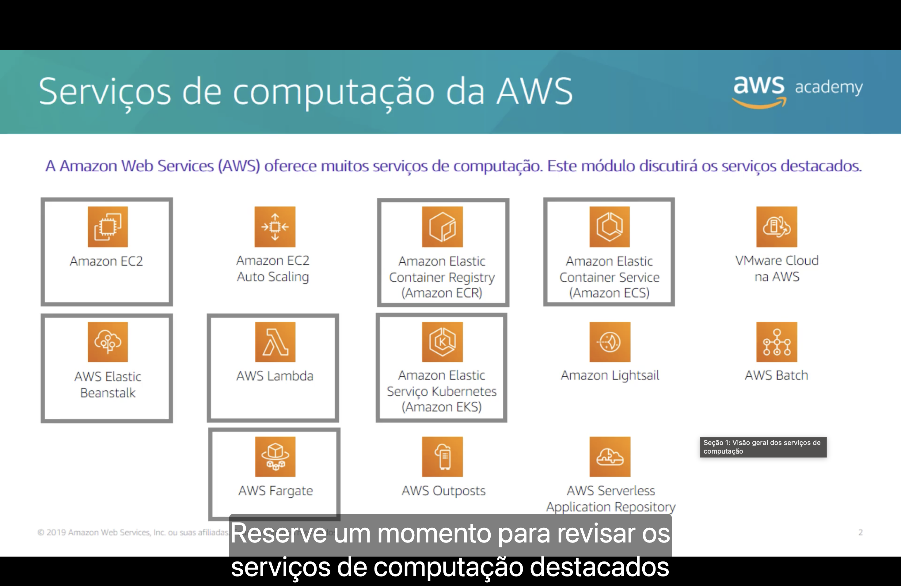
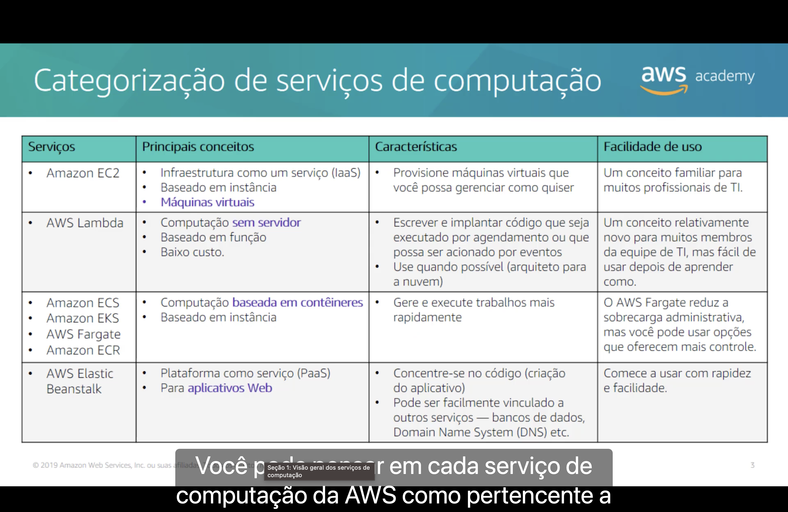
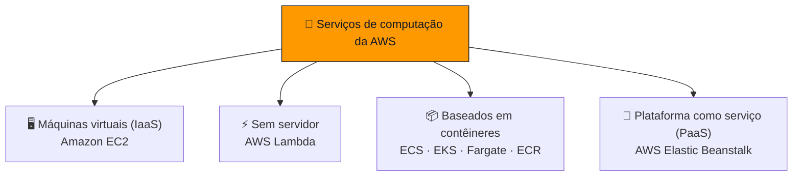
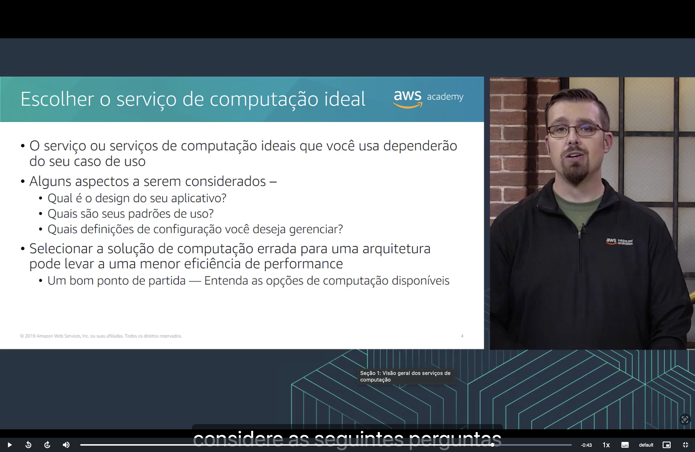

<h1 align="center">🖥️ Seção 1 – Visão geral dos serviços de computação</h1>

  
  
   
  
  
  

  <a href="../README.md">🏠 Início</a> &nbsp;•&nbsp;
  <a href="./Seção%202%20-%20Amazon%20EC2%20Parte%201.md">Próxima: Amazon EC2 Parte 1 ➡️</a>

> [!NOTE]
> Esta seção abre o Módulo 6 com um panorama: quais serviços de computação a AWS oferece, em quais categorias eles se encaixam e como começar a escolher entre eles.

## 📑 Sumário

| # | Tópico |
|:---:|---|
| 1 | [🧰 Serviços de computação da AWS](#servicos) |
| 2 | [🗂️ Categorização de serviços de computação](#categorizacao) |
| 3 | [🧭 Escolher o serviço de computação ideal](#escolher) |
| 🎯 | [Principais conclusões](#conclusoes) |

---

## 1. 🧰 Serviços de computação da AWS

A **Amazon Web Services (AWS)** oferece **muitos serviços de computação**. Este módulo discute os **serviços destacados** no slide:

| Serviço destacado | O que faz |
|---|---|
| 🖥️ **Amazon EC2** | Oferece **máquinas virtuais** (instâncias) que você configura e gerencia. |
| ⚡ **AWS Lambda** | Executa **código** em resposta a eventos, sem servidores para gerenciar. |
| 📦 **Amazon Elastic Container Service (Amazon ECS)** | **Orquestra contêineres**. |
| ☸️ **Amazon Elastic Kubernetes Service (Amazon EKS)** | Oferece **Kubernetes gerenciado** para orquestrar contêineres. |
| 🚀 **AWS Fargate** | Executa **contêineres sem servidor**, em conjunto com o ECS ou o EKS. |
| 🗄️ **Amazon Elastic Container Registry (Amazon ECR)** | **Armazena imagens** de contêiner. |
| 🌱 **AWS Elastic Beanstalk** | **Implanta e escala aplicativos web** sobre a infraestrutura da AWS. |

Os demais serviços do slide **não são o foco deste módulo**:

| Outro serviço | O que faz |
|---|---|
| 📈 **Amazon EC2 Auto Scaling** | **Adiciona ou remove instâncias** do EC2 automaticamente, conforme a demanda. |
| 🏢 **VMware Cloud na AWS** | Executa **cargas de trabalho VMware** na infraestrutura da AWS. |
| 💡 **Amazon Lightsail** | Oferece **servidores privados virtuais** simples, com preço mensal previsível. |
| 🧮 **AWS Batch** | Executa **trabalhos em lote** em grande escala. |
| 🏭 **AWS Outposts** | Leva **infraestrutura e serviços da AWS** para o seu próprio datacenter. |
| 📚 **AWS Serverless Application Repository** | Permite **encontrar, implantar e publicar** aplicativos sem servidor. |

> [!NOTE]
> No slide, o EKS aparece como "Amazon Elastic Serviço Kubernetes", uma tradução parcial. O nome oficial é **Amazon Elastic Kubernetes Service**.

## 2. 🗂️ Categorização de serviços de computação

Cada serviço de computação da AWS pertence a uma de **quatro categorias**:

| Serviços | Principais conceitos | Características | Facilidade de uso |
|---|---|---|---|
| 🖥️ **Amazon EC2** | **Infraestrutura como serviço (IaaS)**, baseado em **instância**, **máquinas virtuais**. | Provisione máquinas virtuais que você possa **gerenciar como quiser**. | Um conceito **familiar** para muitos profissionais de TI. |
| ⚡ **AWS Lambda** | Computação **sem servidor**, baseado em **função**, **baixo custo**. | Escreva e implante código **executado por agendamento** ou **acionado por eventos**. Use quando possível (arquitete para a nuvem). | Um conceito **relativamente novo** para muitos membros da equipe de TI, mas **fácil de usar** depois de aprender como. |
| 📦 **Amazon ECS**, **Amazon EKS**, **AWS Fargate**, **Amazon ECR** | Computação **baseada em contêineres**, baseado em **instância**. | Gere e execute trabalhos **mais rapidamente**. | O **AWS Fargate reduz a sobrecarga administrativa**, mas você pode usar opções que oferecem **mais controle**. |
| 🌱 **AWS Elastic Beanstalk** | **Plataforma como serviço (PaaS)**, para **aplicativos web**. | **Concentre-se no código** (criação do aplicativo). Pode ser facilmente vinculado a outros serviços, como bancos de dados e Domain Name System (DNS). | **Comece a usar** com rapidez e facilidade. |

> [!NOTE]
> Duas ressalvas sobre o slide. Na linha do Lambda, "arquiteto para a nuvem" é um erro de tradução: o sentido é o imperativo **"arquitete"**. Na linha dos contêineres, "baseado em instância" vale quando eles rodam em **instâncias do EC2**: com o **Fargate**, a execução é **sem servidor** e você não gerencia instâncias.

> [!TIP]
> Os quatro serviços de contêineres têm papéis complementares: o **ECR guarda** as imagens, o **ECS ou o EKS orquestram** os contêineres, e o **EC2 ou o Fargate fornecem** a capacidade de computação onde eles rodam.

## 3. 🧭 Escolher o serviço de computação ideal

O serviço ou os serviços ideais **dependem do seu caso de uso**. Alguns aspectos a considerar:

- 🏗️ Qual é o **design do seu aplicativo**?
- 📊 Quais são seus **padrões de uso**?
- ⚙️ Quais **definições de configuração** você deseja gerenciar?

Selecionar a solução errada para uma arquitetura pode levar a uma **menor eficiência de performance**. Um bom ponto de partida é **entender as opções de computação disponíveis**.

Como regra prática:

| Se você... | Considere |
|---|---|
| precisa de **controle total** sobre o sistema operacional e o ambiente | 🖥️ **Amazon EC2** |
| tem código **orientado a eventos** ou executado por agendamento | ⚡ **AWS Lambda** |
| já empacota o aplicativo em **contêineres** | 📦 **Amazon ECS** ou **Amazon EKS**, com **AWS Fargate** se não quiser gerenciar servidores |
| quer **focar no código** de um aplicativo web | 🌱 **AWS Elastic Beanstalk** |

> [!TIP]
> A escolha não é exclusiva: uma mesma arquitetura pode **combinar serviços**, como um aplicativo web no Elastic Beanstalk que aciona funções do Lambda para tarefas pontuais.

---

## 🎯 Principais conclusões

- ✅ A AWS oferece **muitos serviços de computação**; este módulo se concentra em **EC2, Lambda, ECS, EKS, Fargate, ECR e Elastic Beanstalk**.
- ✅ Os serviços se dividem em **quatro categorias**: máquinas virtuais (IaaS), sem servidor, baseados em contêineres e plataforma como serviço (PaaS).
- ✅ O **EC2** dá **controle total** sobre máquinas virtuais; o **Lambda** executa **funções** sem servidor, por agendamento ou eventos.
- ✅ **ECS, EKS, Fargate e ECR** formam a oferta de **contêineres**; o **Fargate** reduz a sobrecarga administrativa.
- ✅ O **Elastic Beanstalk** permite **concentrar-se no código** de aplicativos web.
- ✅ O serviço ideal **depende do caso de uso**: design do aplicativo, padrões de uso e configurações que você quer gerenciar.
- ✅ A escolha errada pode levar a uma **menor eficiência de performance**.

---

  <a href="../README.md">🏠 Início</a> &nbsp;•&nbsp;
  <a href="./Seção%202%20-%20Amazon%20EC2%20Parte%201.md">Próxima: Amazon EC2 Parte 1 ➡️</a>

