<h1 align="center">🖥️ Seção 2 – Amazon EC2 Parte 1</h1>

<p align="center">
  
  
  <br>
  
  
  
</p>

<p align="center">
  <a href="../README.md">🏠 Início</a> &nbsp;•&nbsp;
  <a href="./Seção%201%20-%20Visão%20geral%20dos%20serviços%20de%20computação.MD">⬅️ Anterior: Visão geral dos serviços de computação</a> &nbsp;•&nbsp;
  <a href="./Seção%203%20-%20Amazon%20EC2%20Parte%202.md">Próxima: Amazon EC2 Parte 2 ➡️</a>
</p>

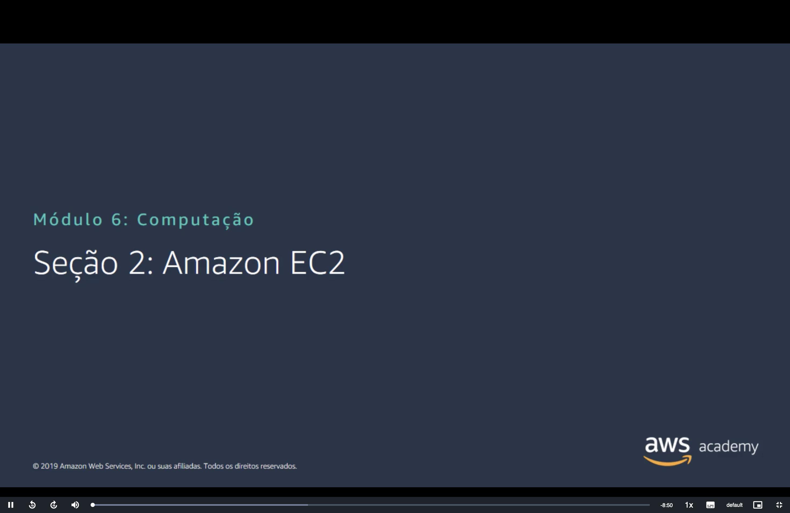

> [!NOTE]
> Esta é a **Parte 1** da seção sobre Amazon EC2. Ela apresenta o serviço e cobre as duas primeiras decisões para executar uma instância: a **AMI** e o **tipo de instância**.

## 📑 Sumário

| # | Tópico |
|:---:|---|
| 1 | [🖥️ Amazon Elastic Compute Cloud (Amazon EC2)](#ec2) |
| 2 | [🔎 Visão geral do Amazon EC2](#visao-geral) |
| 3 | [🚀 Executar uma instância do Amazon EC2](#executar) |
| 4 | [💿 Decisão 1: selecionar uma AMI](#ami) |
| 5 | [🛠️ Criação de uma nova AMI: exemplo](#nova-ami) |
| 6 | [📐 Decisão 2: selecionar um tipo de instância](#tipo-instancia) |
| 7 | [🔤 Nomeação e tamanhos de tipo de instância](#nomeacao) |
| 8 | [🧩 Selecionar o tipo de instância com base no caso de uso](#caso-de-uso) |
| 9 | [🌐 Tipos de instância: recursos de rede](#recursos-rede) |
| 🎯 | [Principais conclusões](#conclusoes) |

---

<a id="ec2"></a>
## 1. 🖥️ Amazon Elastic Compute Cloud (Amazon EC2)

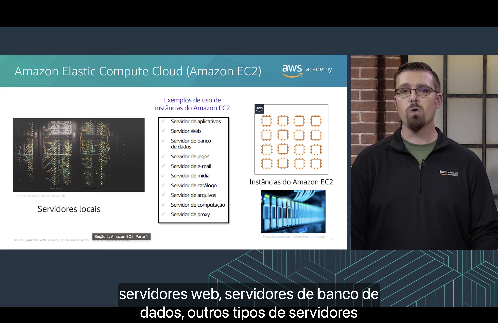

Os servidores que você executaria **localmente** também podem ser executados como **instâncias do Amazon EC2**. Exemplos de uso:

- 🧩 Servidor de **aplicativos**
- 🌐 Servidor **web**
- 🗃️ Servidor de **banco de dados**
- 🎮 Servidor de **jogos**
- 📧 Servidor de **e-mail**
- 🎬 Servidor de **mídia**
- 📖 Servidor de **catálogo**
- 📁 Servidor de **arquivos**
- 🧮 Servidor de **computação**
- 🔀 Servidor de **proxy**

<a id="visao-geral"></a>
## 2. 🔎 Visão geral do Amazon EC2

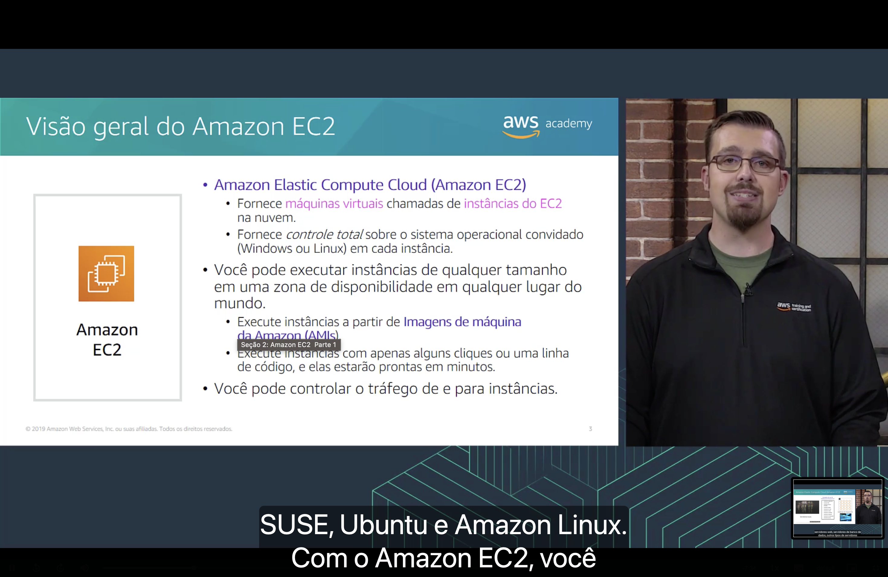

O **Amazon EC2**:

- 🖥️ fornece **máquinas virtuais**, chamadas de **instâncias do EC2**, na nuvem;
- 🎛️ fornece **controle total** sobre o **sistema operacional convidado** de cada instância: **Windows** ou **Linux** (como SUSE, Ubuntu e Amazon Linux).

Com ele, você pode:

- 🌍 executar instâncias **de qualquer tamanho** em uma **Zona de Disponibilidade** em qualquer lugar do mundo;
- 💿 executar instâncias a partir de **Imagens de máquina da Amazon (AMIs)**;
- ⏱️ executar instâncias com **alguns cliques ou uma linha de código**, e elas ficam prontas **em minutos**;
- 🛡️ **controlar o tráfego** de e para as instâncias, com os **grupos de segurança** vistos no [Módulo 5](../MÓDULO%205/Seção%204%20-%20Segurança%20da%20VPC.md).

<a id="executar"></a>
## 3. 🚀 Executar uma instância do Amazon EC2

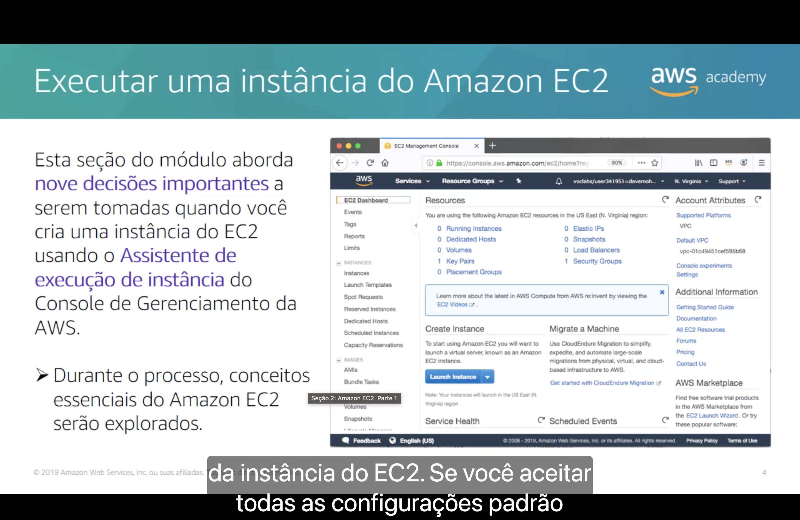

Ao criar uma instância com o **Assistente de execução de instância** do **Console de Gerenciamento da AWS**, você toma **nove decisões importantes**:

| # | Decisão | O que define |
|:---:|---|---|
| 1 | 💿 **AMI** | O modelo com o sistema operacional e, muitas vezes, software pré-instalado. |
| 2 | 📐 **Tipo de instância** | Memória, CPU, armazenamento e performance de rede. |
| 3 | 🌐 **Configurações de rede** | A rede em que a instância será executada. |
| 4 | 🪪 **Função do IAM** | As permissões da instância para acessar outros serviços da AWS. |
| 5 | 📜 **Dados de usuário** | O script executado quando a instância é iniciada. |
| 6 | 💾 **Opções de armazenamento** | Os volumes usados pela instância. |
| 7 | 🏷️ **Tags** | Os rótulos que ajudam a organizar os recursos. |
| 8 | 🛡️ **Grupo de segurança** | As regras de firewall para o tráfego da instância. |
| 9 | 🔑 **Par de chaves** | A credencial usada para se conectar à instância. |

> [!NOTE]
> O slide mostra o console de 2019. O assistente atual fica em **uma única página**, com os campos em outra ordem, mas as decisões são praticamente as mesmas.

<a id="ami"></a>
## 4. 💿 Decisão 1: selecionar uma AMI

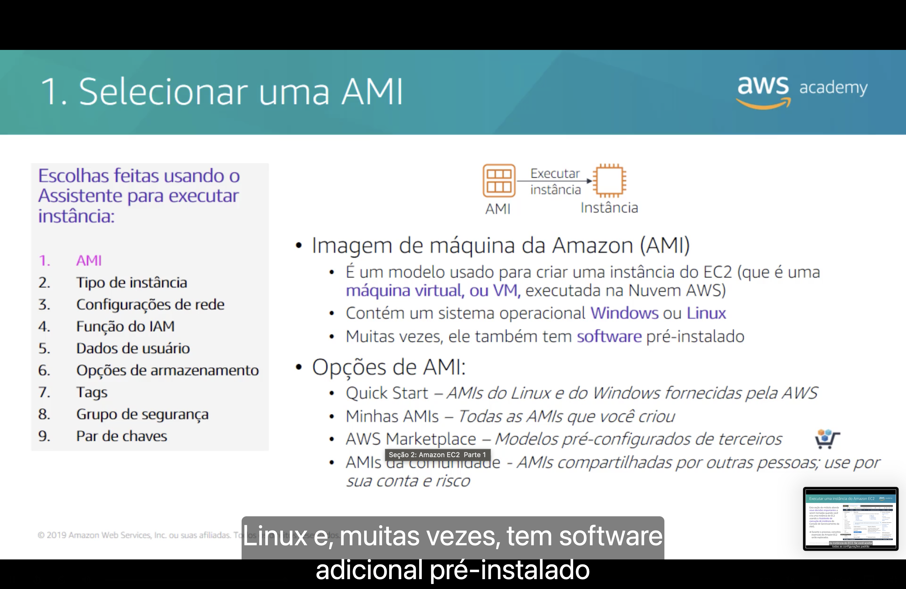

Uma **Imagem de máquina da Amazon (AMI)**:

- 🧬 é um **modelo** usado para criar uma instância do EC2 (uma **máquina virtual**, ou VM, executada na Nuvem AWS);
- 💽 contém um sistema operacional **Windows** ou **Linux**;
- 📦 muitas vezes também tem **software pré-instalado**.

| Opção de AMI | O que oferece |
|---|---|
| ⚡ **Quick Start** | AMIs do Linux e do Windows **fornecidas pela AWS**. |
| 👤 **Minhas AMIs** | Todas as AMIs que **você criou**. |
| 🛒 **AWS Marketplace** | **Modelos pré-configurados** de terceiros, que podem ter custo adicional de software. |
| 👥 **AMIs da comunidade** | AMIs **compartilhadas por outras pessoas**; use **por sua conta e risco**. |

> [!WARNING]
> A AWS **não garante** a integridade nem a segurança das AMIs compartilhadas por outros usuários. Antes de usar uma AMI da comunidade, confirme quem a publicou e o que ela contém.

<a id="nova-ami"></a>
## 5. 🛠️ Criação de uma nova AMI: exemplo

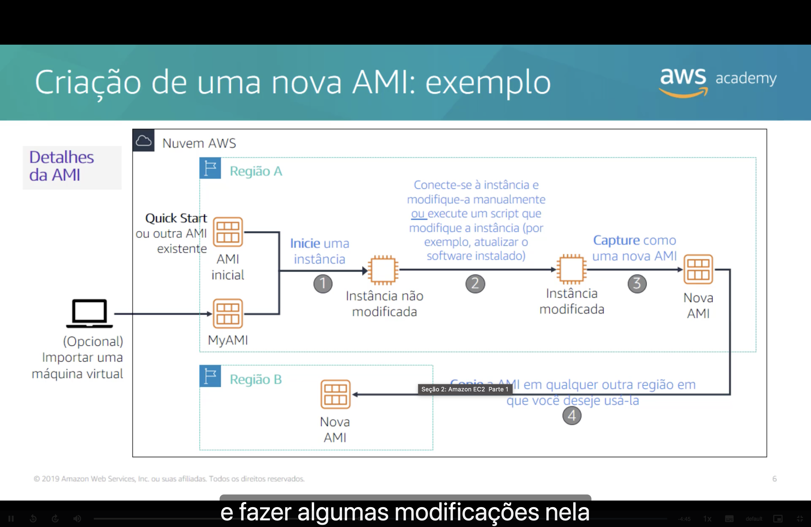

1. ▶️ **Inicie uma instância** a partir de uma AMI do Quick Start, de outra AMI existente ou de uma AMI sua. Opcionalmente, essa AMI pode vir da **importação de uma máquina virtual**.
2. 🔧 **Conecte-se à instância e modifique-a** manualmente, ou **execute um script** que faça isso (por exemplo, atualizar o software instalado).
3. 📸 **Capture a instância** modificada como uma **nova AMI**.
4. 🌍 **Copie a AMI** para qualquer outra Região em que deseje usá-la.

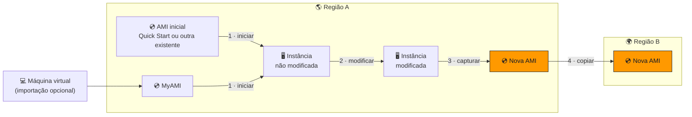

> [!IMPORTANT]
> Uma AMI pertence a **uma Região**. Para usá-la em outra, é preciso **copiá-la**, e a cópia recebe um **novo ID de AMI**.

> [!TIP]
> Uma AMI personalizada desse tipo costuma ser chamada de *golden image*: as novas instâncias já iniciam com o software configurado, sem repetir a instalação em cada uma.

<a id="tipo-instancia"></a>
## 6. 📐 Decisão 2: selecionar um tipo de instância

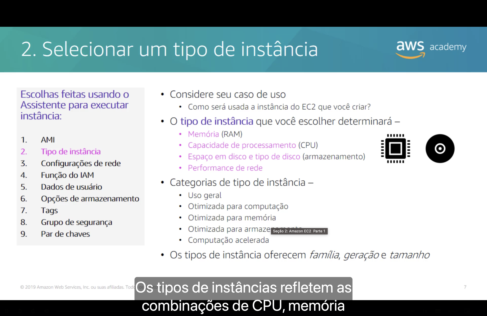

Comece pelo **caso de uso**: como a instância do EC2 será usada? O **tipo de instância** que você escolher determinará:

- 🧠 **Memória** (RAM);
- ⚡ **Capacidade de processamento** (CPU);
- 💾 **Espaço em disco e tipo de disco** (armazenamento);
- 🌐 **Performance de rede**.

Os tipos de instância se dividem em **cinco categorias**: **uso geral**, **otimizada para computação**, **otimizada para memória**, **otimizada para armazenamento** e **computação acelerada**. Cada tipo é definido por **família**, **geração** e **tamanho**.

<a id="nomeacao"></a>
## 7. 🔤 Nomeação e tamanhos de tipo de instância

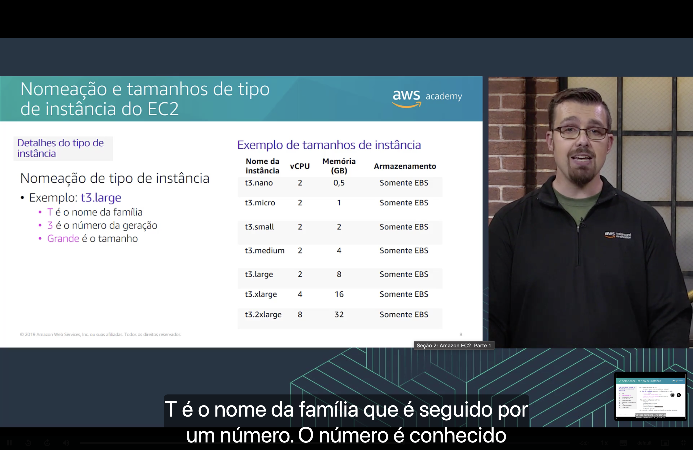

```text
t  3 . large
│  │     └── tamanho
│  └──────── número da geração
└─────────── nome da família
```

| Nome da instância | vCPU | Memória (GB) | Armazenamento |
|---|:---:|:---:|---|
| `t3.nano` | 2 | 0,5 | Somente EBS |
| `t3.micro` | 2 | 1 | Somente EBS |
| `t3.small` | 2 | 2 | Somente EBS |
| `t3.medium` | 2 | 4 | Somente EBS |
| `t3.large` | 2 | 8 | Somente EBS |
| `t3.xlarge` | 4 | 16 | Somente EBS |
| `t3.2xlarge` | 8 | 32 | Somente EBS |

Nesta tabela, cada tamanho **dobra a memória** do anterior. **Somente EBS** significa que o armazenamento vem apenas de volumes do **Amazon EBS**: essas instâncias não têm disco local.

> [!NOTE]
> No slide, o tamanho aparece traduzido como "Grande", mas no nome do tipo ele fica sempre em inglês: `t3.large`.

> [!TIP]
> Tipos mais novos podem trazer uma letra depois da geração, indicando um atributo. Em `m7g.large`, o **g** indica um processador **AWS Graviton**.

<a id="caso-de-uso"></a>
## 8. 🧩 Selecionar o tipo de instância com base no caso de uso

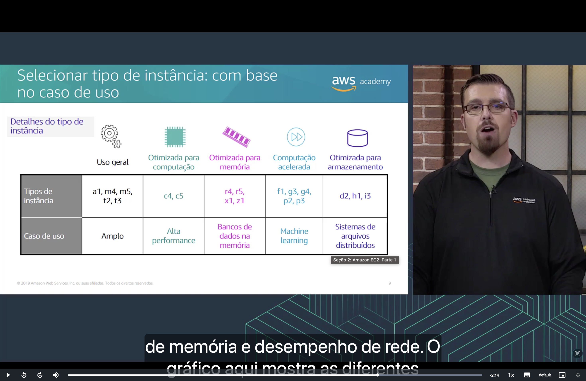

| Categoria | Tipos de instância | Caso de uso |
|---|---|---|
| ⚙️ **Uso geral** | `a1`, `m4`, `m5`, `t2`, `t3` | Amplo |
| ⚡ **Otimizada para computação** | `c4`, `c5` | Alta performance |
| 🧠 **Otimizada para memória** | `r4`, `r5`, `x1`, `z1` | Bancos de dados na memória |
| ⏩ **Computação acelerada** | `f1`, `g3`, `g4`, `p2`, `p3` | Machine learning |
| 🗄️ **Otimizada para armazenamento** | `d2`, `h1`, `i3` | Sistemas de arquivos distribuídos |

> [!NOTE]
> Os tipos listados são os do slide, de 2019. A AWS lançou gerações mais novas desde então, mas as **cinco categorias** continuam as mesmas.

> [!TIP]
> Macete não oficial para lembrar as famílias: **c** de *compute*, **r** de *RAM*, **g** de *graphics* e **i** de *I/O*.

<a id="recursos-rede"></a>
## 9. 🌐 Tipos de instância: recursos de rede

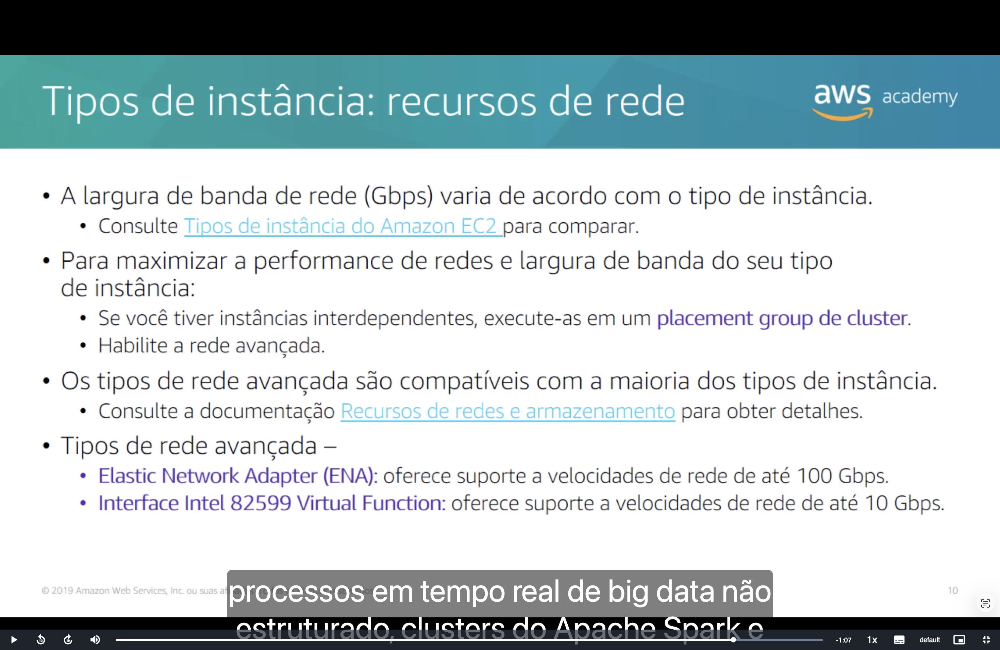

A **largura de banda de rede (Gbps) varia de acordo com o tipo de instância**. Para comparar, consulte [Tipos de instância do Amazon EC2](https://aws.amazon.com/pt/ec2/instance-types/).

Para maximizar a performance de rede e a largura de banda do seu tipo de instância:

- 📍 se você tiver instâncias **interdependentes**, execute-as em um **placement group de cluster**;
- 🚀 habilite a **rede avançada** (*enhanced networking*), compatível com a **maioria dos tipos de instância**.

| Tipo de rede avançada | Velocidade máxima |
|---|---|
| **Elastic Network Adapter (ENA)** | até **100 Gbps** |
| **Interface Intel 82599 Virtual Function** | até **10 Gbps** |

> [!TIP]
> Um **placement group de cluster** mantém as instâncias próximas dentro de **uma Zona de Disponibilidade**, o que reduz a latência entre elas. Em troca, uma falha de hardware pode afetar várias instâncias do grupo ao mesmo tempo.

> [!NOTE]
> Os valores são os do slide, de 2019. Hoje há tipos de instância com ENA bem acima de 100 Gbps, e a interface Intel 82599 VF só aparece em tipos antigos.

---

<a id="conclusoes"></a>
## 🎯 Principais conclusões

- ✅ O **Amazon EC2** fornece **máquinas virtuais** (instâncias) na nuvem, com **controle total** do sistema operacional convidado.
- ✅ Executar uma instância pelo assistente envolve **nove decisões**, começando pela **AMI** e pelo **tipo de instância**.
- ✅ Uma **AMI** é o **modelo** da instância e pode vir do **Quick Start**, de **Minhas AMIs**, do **AWS Marketplace** ou da **comunidade**.
- ✅ Você pode **capturar uma instância modificada** como nova AMI e **copiá-la** para outras Regiões.
- ✅ O **tipo de instância** determina **memória, CPU, armazenamento e performance de rede**.
- ✅ Em `t3.large`, **t** é a família, **3** é a geração e **large** é o tamanho.
- ✅ As **cinco categorias** são uso geral, otimizada para computação, otimizada para memória, otimizada para armazenamento e computação acelerada.
- ✅ A **largura de banda** varia conforme o tipo de instância; **placement groups de cluster** e **rede avançada** ajudam a maximizá-la.

---

<p align="center">
  <a href="../README.md">🏠 Início</a> &nbsp;•&nbsp;
  <a href="./Seção%201%20-%20Visão%20geral%20dos%20serviços%20de%20computação.MD">⬅️ Anterior: Visão geral dos serviços de computação</a> &nbsp;•&nbsp;
  <a href="./Seção%203%20-%20Amazon%20EC2%20Parte%202.md">Próxima: Amazon EC2 Parte 2 ➡️</a>
</p>
