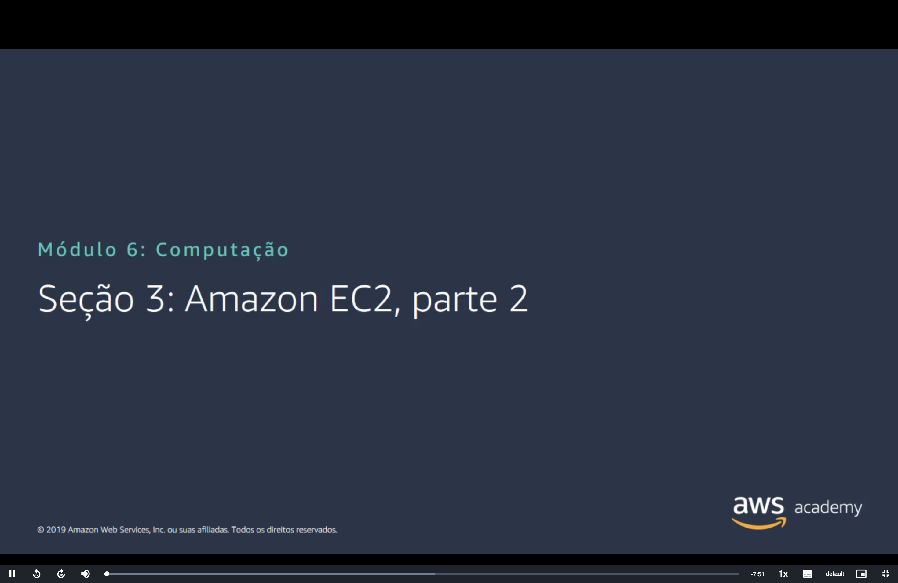
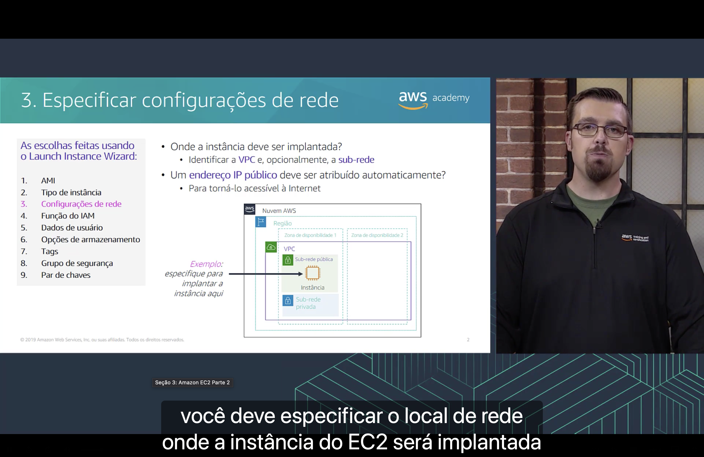
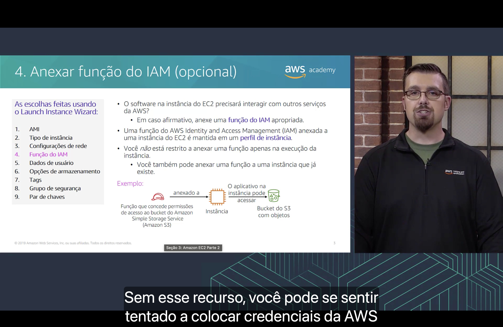
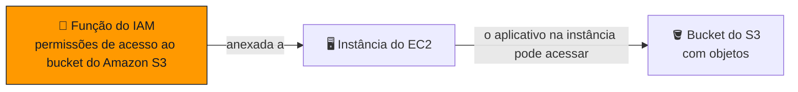
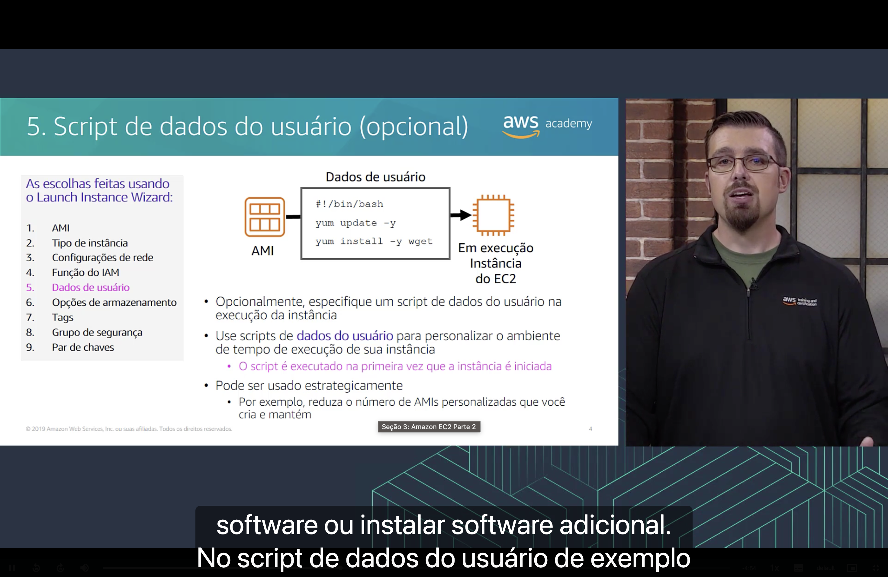
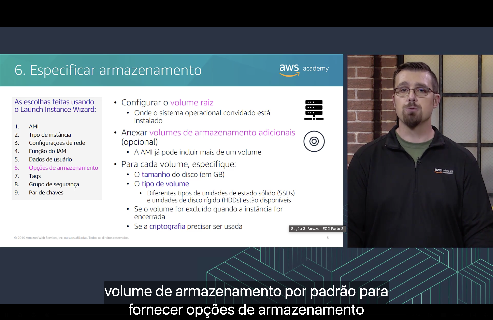
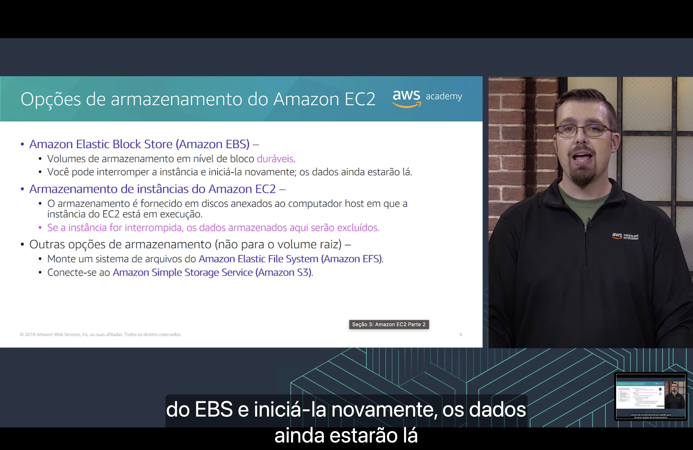
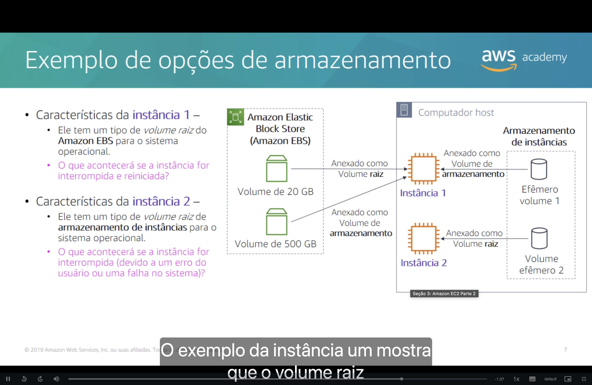
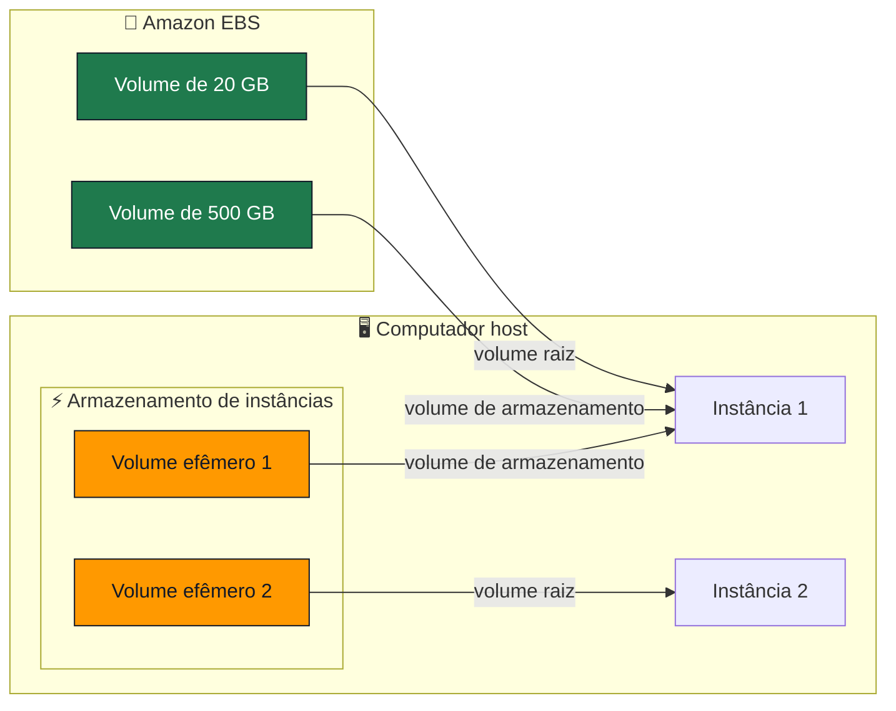

<h1 align="center">🖥️ Seção 3 – Amazon EC2 Parte 2</h1>

<p align="center">
  
  
  <br>
  
  
  
</p>

<p align="center">
  <a href="../README.md">🏠 Início</a> &nbsp;•&nbsp;
  <a href="./Seção%202%20-%20Amazon%20EC2%20Parte%201.md">⬅️ Anterior: Amazon EC2 Parte 1</a> &nbsp;•&nbsp;
  <a href="./Seção%204%20-%20Amazon%20EC2%20Parte%203.md">Próxima: Amazon EC2 Parte 3 ➡️</a>
</p>



> [!NOTE]
> Esta é a **Parte 2** da seção sobre Amazon EC2. Ela continua as [nove decisões do assistente de execução](./Seção%202%20-%20Amazon%20EC2%20Parte%201.md#executar) com as decisões 3 a 6: **rede**, **função do IAM**, **dados do usuário** e **armazenamento**.

## 📑 Sumário

| # | Tópico |
|:---:|---|
| 1 | [🌐 Decisão 3: especificar configurações de rede](#rede) |
| 2 | [🪪 Decisão 4: anexar função do IAM (opcional)](#iam) |
| 3 | [📜 Decisão 5: script de dados do usuário (opcional)](#dados-usuario) |
| 4 | [💾 Decisão 6: especificar armazenamento](#armazenamento) |
| 5 | [🗄️ Opções de armazenamento do Amazon EC2](#opcoes) |
| 6 | [🧪 Exemplo de opções de armazenamento](#exemplo) |
| 🎯 | [Principais conclusões](#conclusoes) |

---

<a id="rede"></a>
## 1. 🌐 Decisão 3: especificar configurações de rede



Ao executar uma instância, você especifica o **local de rede** em que ela será implantada:

| Pergunta | O que fazer |
|---|---|
| 📍 **Onde a instância deve ser implantada?** | Identifique a **VPC** e, opcionalmente, a **sub-rede**. |
| 🌍 **Um endereço IP público deve ser atribuído automaticamente?** | Atribua um para tornar a instância **acessível pela internet**. |

No exemplo do slide, a instância é implantada na **sub-rede pública** da Zona de Disponibilidade 1.

> [!TIP]
> O [IP público](../MÓDULO%205/Seção%202%20-%20Amazon%20VPC.md#ip-publico) sozinho não basta para a instância ser acessada pela internet: a sub-rede precisa de uma rota para um [gateway da internet](../MÓDULO%205/Seção%203%20-%20Redes%20VPC.md#igw), e o [grupo de segurança](../MÓDULO%205/Seção%204%20-%20Segurança%20da%20VPC.md#sg) precisa permitir o tráfego.

<a id="iam"></a>
## 2. 🪪 Decisão 4: anexar função do IAM (opcional)



- ❓ O software na instância do EC2 precisará **interagir com outros serviços da AWS**? Em caso afirmativo, anexe uma [função do IAM](../MÓDULO%204/Seção%202%20-%20AWS%20Identity%20and%20Access%20Management%20(IAM).md) apropriada.
- 📦 Uma função do **AWS Identity and Access Management (IAM)** anexada a uma instância do EC2 é mantida em um **perfil de instância**.
- 🔁 Você **não está restrito** a anexar a função na execução da instância: também pode anexá-la a uma **instância que já existe**.



> [!IMPORTANT]
> Sem uma função do IAM, você poderia se sentir tentado a colocar **credenciais da AWS** na instância. Evite isso: a função fornece **credenciais temporárias**, rotacionadas automaticamente.

> [!NOTE]
> Ao criar uma função para o EC2 pelo console, o **perfil de instância** é criado automaticamente, com o mesmo nome da função.

<a id="dados-usuario"></a>
## 3. 📜 Decisão 5: script de dados do usuário (opcional)



- ✍️ Opcionalmente, especifique um **script de dados do usuário** na execução da instância.
- ⚙️ Use esses scripts para **personalizar o ambiente de tempo de execução** da instância.
- ▶️ O script é executado **na primeira vez que a instância é iniciada**.
- ♟️ Eles podem ser usados **estrategicamente**, por exemplo, para **reduzir o número de AMIs personalizadas** que você cria e mantém.

O script do slide atualiza o sistema e instala um pacote:

```bash
#!/bin/bash
yum update -y
yum install -y wget
```

| Linha | O que faz |
|---|---|
| `#!/bin/bash` | Indica que o script será executado pelo **bash**. |
| `yum update -y` | **Atualiza** os pacotes instalados. |
| `yum install -y wget` | **Instala** o pacote `wget`. |

O `-y` responde "sim" automaticamente às confirmações, já que ninguém está no terminal durante a execução.

> [!TIP]
> Os comandos são executados como **root**, por isso o exemplo não usa `sudo`.

> [!NOTE]
> O `yum` é usado em distribuições como o Amazon Linux. Em outras, o comando muda: no Ubuntu, por exemplo, usa-se o `apt`.

<a id="armazenamento"></a>
## 4. 💾 Decisão 6: especificar armazenamento



- 💿 Configure o **volume raiz**, onde o sistema operacional convidado está instalado.
- ➕ Opcionalmente, anexe **volumes de armazenamento adicionais**. A AMI já pode incluir mais de um volume.

Para cada volume, especifique:

| Configuração | O que definir |
|---|---|
| 📏 **Tamanho** | O tamanho do disco, em GB. |
| 💽 **Tipo de volume** | Há diferentes tipos de **unidades de estado sólido (SSDs)** e **unidades de disco rígido (HDDs)**. |
| 🗑️ **Exclusão** | Se o volume será **excluído quando a instância for encerrada**. |
| 🔐 **Criptografia** | Se a **criptografia** será usada. |

> [!NOTE]
> Por padrão, o volume raiz do EBS é **excluído** quando a instância é encerrada, e os volumes EBS adicionais são **mantidos**.

<a id="opcoes"></a>
## 5. 🗄️ Opções de armazenamento do Amazon EC2



| Opção | Como funciona | Se a instância for interrompida |
|---|---|---|
| 🧱 **Amazon Elastic Block Store (Amazon EBS)** | Volumes de armazenamento em **nível de bloco duráveis**. | ✅ Os dados **permanecem** e ainda estarão lá quando você iniciar a instância novamente. |
| ⚡ **Armazenamento de instâncias do Amazon EC2** | Discos **anexados ao computador host** em que a instância está em execução. | ❌ Os dados são **excluídos**. |

Outras opções, que **não servem como volume raiz**:

- 📂 montar um sistema de arquivos do **Amazon Elastic File System (Amazon EFS)**;
- 🪣 conectar-se ao **Amazon Simple Storage Service (Amazon S3)**.

> [!IMPORTANT]
> O armazenamento de instâncias é **temporário**. Uma **reinicialização** (*reboot*) preserva os dados, mas eles são perdidos quando a instância é **interrompida, hibernada ou encerrada**, ou quando o disco falha.

<a id="exemplo"></a>
## 6. 🧪 Exemplo de opções de armazenamento





O slide faz uma pergunta sobre cada instância:

| Instância | Volume raiz | Pergunta | Resposta |
|---|---|---|---|
| **Instância 1** | Amazon EBS | O que acontecerá se ela for **interrompida e reiniciada**? | Os volumes EBS de 20 GB e 500 GB **mantêm os dados**. Os dados do volume efêmero 1 são **perdidos**. |
| **Instância 2** | Armazenamento de instâncias | O que acontecerá se ela for **interrompida** por um erro do usuário ou uma falha no sistema? | Os dados do volume efêmero 2, **incluindo o sistema operacional**, são **perdidos**. |

> [!NOTE]
> Na prática, uma instância com volume raiz no armazenamento de instâncias **não tem a opção de interromper** (*stop*): ela só pode ser reinicializada ou encerrada.

---

<a id="conclusoes"></a>
## 🎯 Principais conclusões

- ✅ Nas **configurações de rede**, você escolhe a **VPC**, opcionalmente a **sub-rede**, e define se a instância recebe um **IP público** automaticamente.
- ✅ Uma **função do IAM** dá à instância permissões para acessar outros serviços da AWS; ela fica em um **perfil de instância** e pode ser anexada a instâncias já existentes.
- ✅ Um **script de dados do usuário** personaliza a instância, é executado na **primeira vez** que ela é iniciada e ajuda a reduzir o número de AMIs personalizadas.
- ✅ Você configura o **volume raiz** e os volumes adicionais, definindo **tamanho, tipo, exclusão e criptografia**.
- ✅ O **Amazon EBS** é durável: os dados permanecem quando a instância é interrompida e iniciada novamente.
- ✅ O **armazenamento de instâncias** fica em discos do computador host, e os dados são excluídos se a instância for interrompida.
- ✅ O **Amazon EFS** e o **Amazon S3** são outras opções, mas não servem como volume raiz.

---

<p align="center">
  <a href="../README.md">🏠 Início</a> &nbsp;•&nbsp;
  <a href="./Seção%202%20-%20Amazon%20EC2%20Parte%201.md">⬅️ Anterior: Amazon EC2 Parte 1</a> &nbsp;•&nbsp;
  <a href="./Seção%204%20-%20Amazon%20EC2%20Parte%203.md">Próxima: Amazon EC2 Parte 3 ➡️</a>
</p>
