<h1 align="center">🖥️ Seção 4 – Amazon EC2 Parte 3</h1>

<p align="center">
  
  
  <br>
  
  
  
</p>

<p align="center">
  <a href="../README.md">🏠 Início</a> &nbsp;•&nbsp;
  <a href="./Seção%203%20-%20Amazon%20EC2%20Parte%202.md">⬅️ Anterior: Amazon EC2 Parte 2</a> &nbsp;•&nbsp;
  <a href="./Seção%205%20-%20Otimização%20de%20custos%20do%20Amazon%20EC2.md">Próxima: Otimização de custos do Amazon EC2 ➡️</a>
</p>

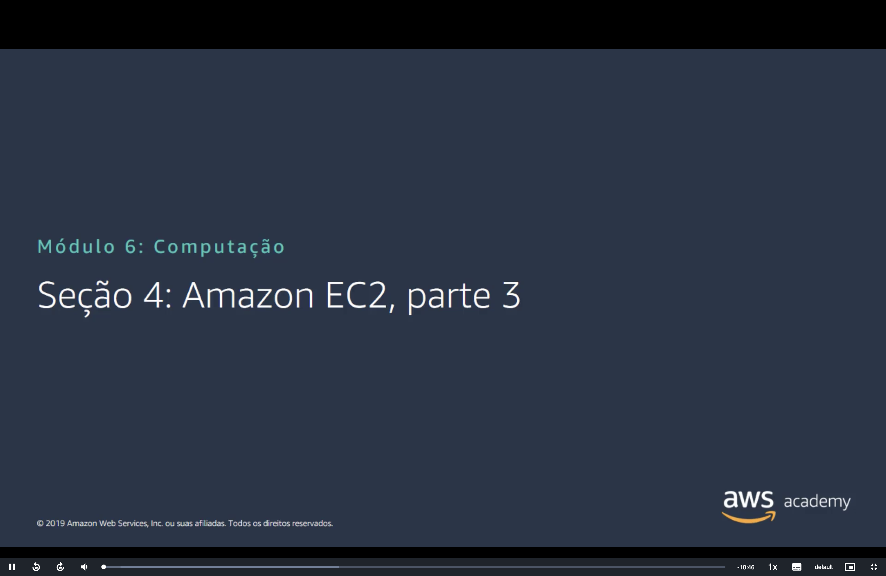

> [!NOTE]
> Esta é a **Parte 3** da seção sobre Amazon EC2. Ela conclui as [nove decisões do assistente de execução](./Seção%202%20-%20Amazon%20EC2%20Parte%201.md#executar) e depois trata da instância em execução: **console**, **CLI**, **ciclo de vida**, **IP elástico**, **metadados** e **monitoramento**.

## 📑 Sumário

| # | Tópico |
|:---:|---|
| 1 | [🏷️ Decisão 7: adicionar tags](#tags) |
| 2 | [🛡️ Decisão 8: configurações do grupo de segurança](#grupo-seguranca) |
| 3 | [🔑 Decisão 9: identificar ou criar o par de chaves](#par-chaves) |
| 4 | [🖥️ Instância em execução no console](#console) |
| 5 | [⌨️ Outra opção: executar uma instância com a CLI da AWS](#cli) |
| 6 | [🔄 Ciclo de vida da instância do Amazon EC2](#ciclo-vida) |
| 7 | [📌 Considere o uso de um endereço IP elástico](#ip-elastico) |
| 8 | [🧾 Metadados da instância do EC2](#metadados) |
| 9 | [📊 Amazon CloudWatch para monitoramento](#cloudwatch) |
| 🎯 | [Principais conclusões](#conclusoes) |

---

<a id="tags"></a>
## 1. 🏷️ Decisão 7: adicionar tags

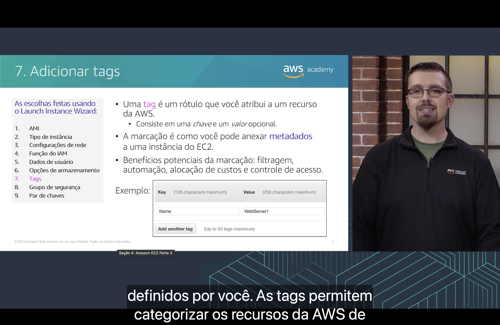

- 🏷️ Uma **tag** é um **rótulo** que você atribui a um recurso da AWS. Ela consiste em uma **chave** e um **valor opcional**.
- 📎 A **marcação** é a forma de anexar **metadados** a uma instância do EC2.
- 🎁 Benefícios potenciais: **filtragem**, **automação**, **alocação de custos** e **controle de acesso**.

Exemplo do slide, que permite até **50 tags**:

| Chave (máximo de 128 caracteres) | Valor (máximo de 256 caracteres) |
|---|---|
| `Name` | `WebServer1` |

> [!TIP]
> O valor da tag `Name` é o nome exibido na coluna **Name** da lista de instâncias do console. Chaves e valores **diferenciam maiúsculas de minúsculas**.

<a id="grupo-seguranca"></a>
## 2. 🛡️ Decisão 8: configurações do grupo de segurança

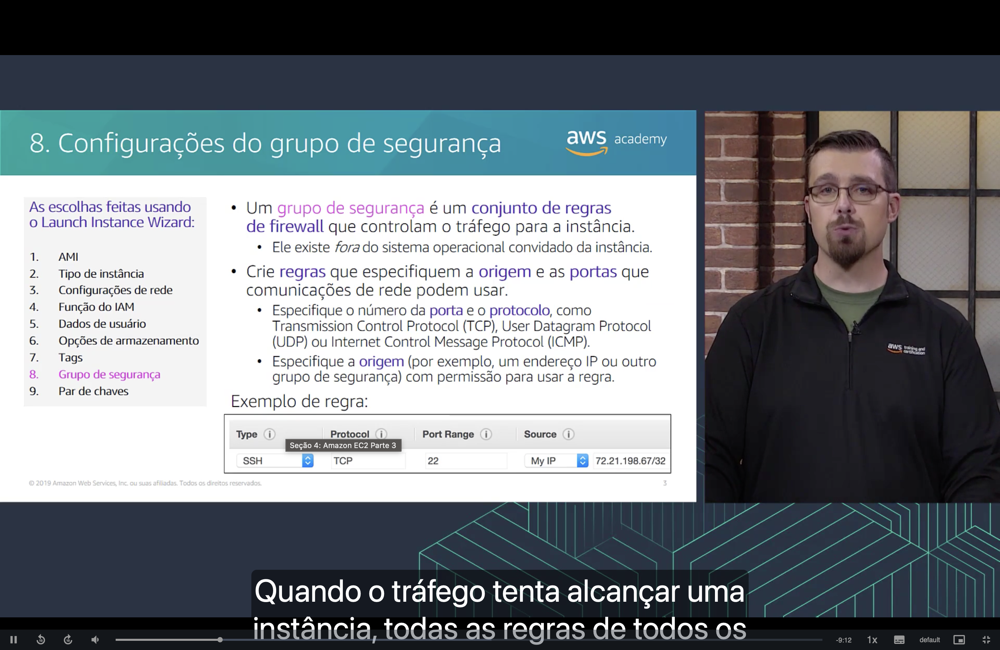

Um **grupo de segurança** é um **conjunto de regras de firewall** que controlam o tráfego para a instância. Ele existe **fora do sistema operacional convidado** da instância.

Crie **regras** que especifiquem:

- 🔌 o **número da porta** e o **protocolo**, como Transmission Control Protocol (**TCP**), User Datagram Protocol (**UDP**) ou Internet Control Message Protocol (**ICMP**);
- 📍 a **origem** com permissão para usar a regra, como um **endereço IP** ou **outro grupo de segurança**.

Quando o tráfego tenta alcançar uma instância, as regras de **todos os grupos de segurança** associados a ela são avaliadas.

Exemplo de regra:

| Tipo | Protocolo | Intervalo de portas | Origem |
|---|---|---|---|
| SSH | TCP | 22 | Meu IP (`72.21.198.67/32`) |

A regra libera o **SSH** somente para **um único endereço IP**, já que [`/32`](../MÓDULO%205/Seção%201%20-%20Noções%20básicas%20de%20redes.md#cidr) representa um único IP.

> [!WARNING]
> Evite usar `0.0.0.0/0` como origem da porta 22: isso expõe o acesso SSH a **qualquer endereço da internet**.

> [!TIP]
> Os demais detalhes dos grupos de segurança estão no [Módulo 5](../MÓDULO%205/Seção%204%20-%20Segurança%20da%20VPC.md#sg).

<a id="par-chaves"></a>
## 3. 🔑 Decisão 9: identificar ou criar o par de chaves

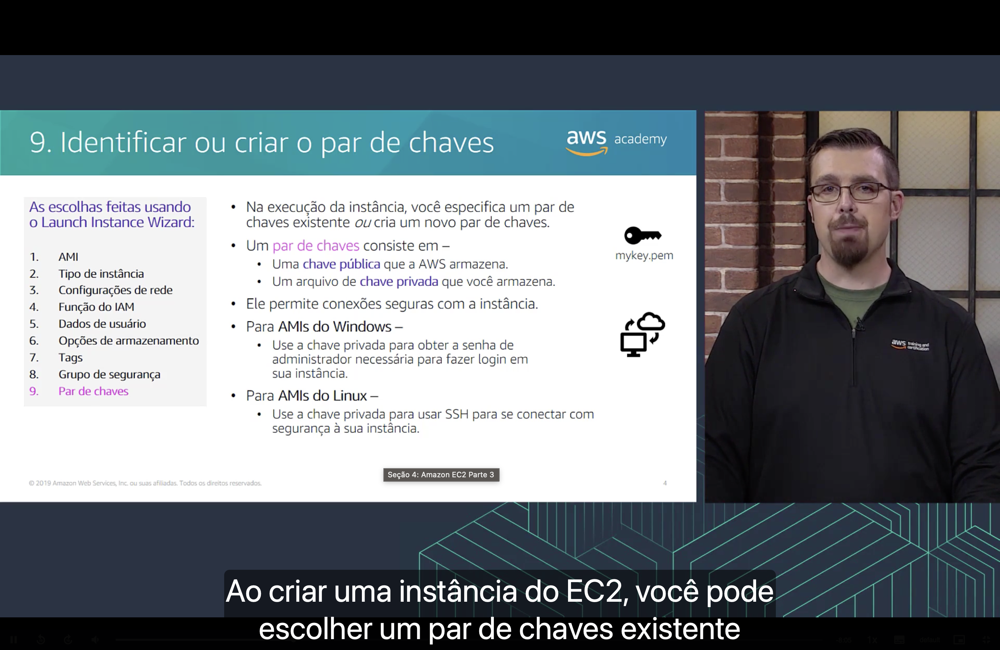

Na execução da instância, você **especifica um par de chaves existente** ou **cria um novo**. O par de chaves permite **conexões seguras** com a instância e consiste em:

| Parte | Quem armazena |
|---|---|
| 🔓 **Chave pública** | A AWS |
| 🔐 **Arquivo de chave privada** (por exemplo, `mykey.pem`) | Você |

| AMI | Para que serve a chave privada |
|---|---|
| 🪟 **Windows** | **Obter a senha de administrador** necessária para fazer login na instância. |
| 🐧 **Linux** | **Usar SSH** para se conectar com segurança à instância. |

> [!IMPORTANT]
> A AWS **não guarda a chave privada**. O arquivo só pode ser baixado na criação do par de chaves, e não há como obter outra cópia dele depois.

Em uma instância Linux, a conexão fica assim (`ec2-user` é o usuário padrão do Amazon Linux):

```bash
chmod 400 mykey.pem
ssh -i mykey.pem ec2-user@54.159.171.63
```

<a id="console"></a>
## 4. 🖥️ Instância em execução no console

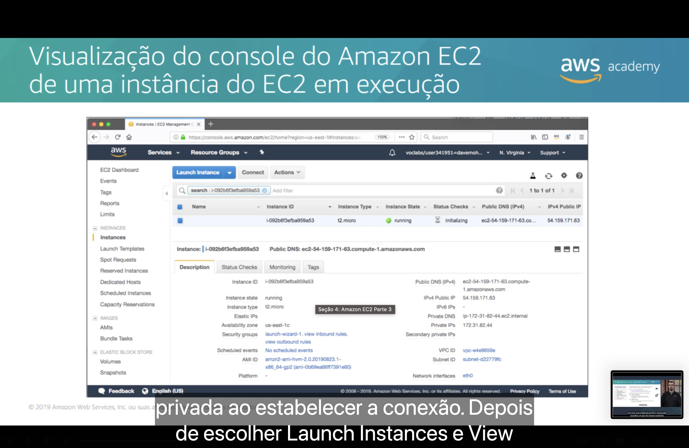

Depois de executar a instância, você pode vê-la na lista **Instances** do console do Amazon EC2, com as escolhas feitas no assistente:

| Campo | Exemplo no slide | De onde vem |
|---|---|---|
| **AMI ID** | `amzn2-ami-hvm-2.0.20190823.1-x86_64-gp2` | Decisão 1 |
| **Instance type** | `t2.micro` | Decisão 2 |
| **Availability zone** | `us-east-1c` | Decisão 3 (sub-rede) |
| **IPv4 Public IP** | `54.159.171.63` | Decisão 3 (IP público) |
| **Private IPs** | `172.31.82.44` | Atribuído dentro da VPC |
| **Security groups** | `launch-wizard-1` | Decisão 8 (nome gerado pelo assistente) |
| **Instance state** | `running` | [Ciclo de vida](#ciclo-vida) |

> [!NOTE]
> No exemplo, o estado já é `running`, mas as verificações de status ainda aparecem como `Initializing`: a instância acabou de ser iniciada e pode ainda não estar pronta para receber conexões.

<a id="cli"></a>
## 5. ⌨️ Outra opção: executar uma instância com a CLI da AWS

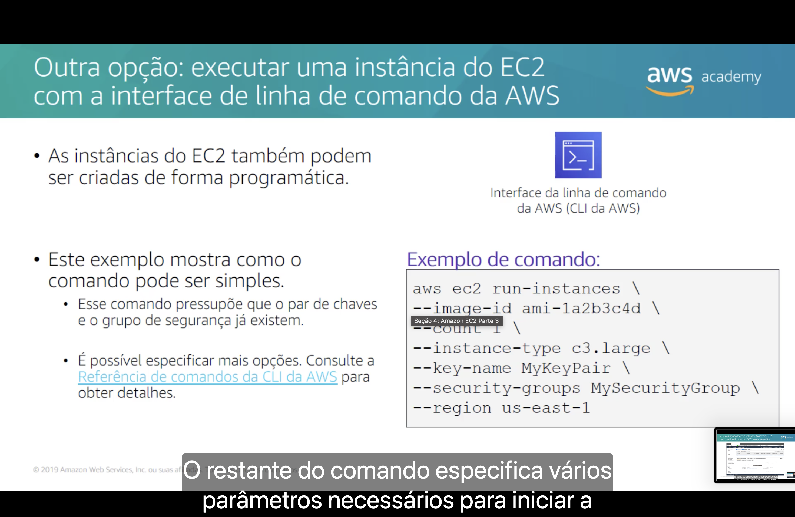

As instâncias do EC2 também podem ser criadas **de forma programática**, com a **interface da linha de comando da AWS (CLI da AWS)**:

```bash
aws ec2 run-instances \
--image-id ami-1a2b3c4d \
--count 1 \
--instance-type c3.large \
--key-name MyKeyPair \
--security-groups MySecurityGroup \
--region us-east-1
```

| Parâmetro | O que define |
|---|---|
| `--image-id` | A **AMI** (decisão 1). |
| `--count` | A **quantidade** de instâncias. |
| `--instance-type` | O **tipo de instância** (decisão 2). |
| `--key-name` | O **par de chaves** (decisão 9). |
| `--security-groups` | O **grupo de segurança** (decisão 8). |
| `--region` | A **Região** da AWS. |

Esse comando **pressupõe que o par de chaves e o grupo de segurança já existem**. É possível especificar mais opções: consulte a [Referência de comandos da CLI da AWS](https://docs.aws.amazon.com/cli/latest/reference/ec2/run-instances.html).

> [!NOTE]
> O parâmetro `--security-groups` recebe **nomes** e vale para a VPC padrão. Em outras VPCs, use `--security-group-ids`.

<a id="ciclo-vida"></a>
## 6. 🔄 Ciclo de vida da instância do Amazon EC2

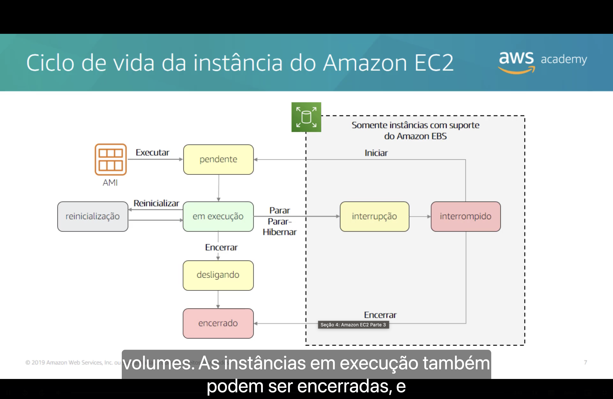

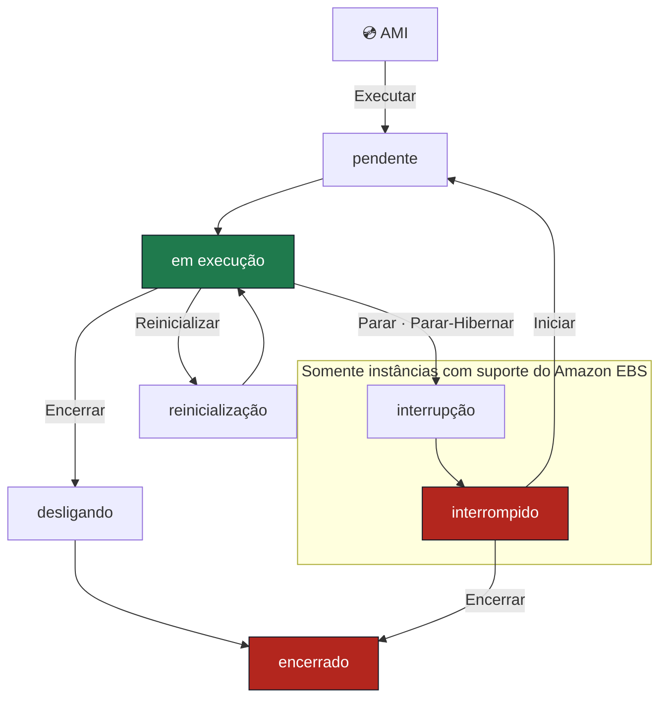

| Estado | O que significa | Cobrança da instância |
|---|---|---|
| ⏳ **pendente** (`pending`) | A instância está se preparando para entrar em execução. | Não |
| 🟢 **em execução** (`running`) | A instância está em execução e pronta para uso. | **Sim** |
| 🔁 **reinicialização** (*reboot*) | A instância é reinicializada e volta a ficar em execução. | **Sim** |
| ⏳ **interrupção** (`stopping`) | A instância está se preparando para ser interrompida. | Não, exceto ao preparar a hibernação |
| 🔴 **interrompido** (`stopped`) | A instância está desligada e pode ser iniciada novamente. | Não |
| ⏳ **desligando** (`shutting-down`) | A instância está se preparando para ser encerrada. | Não |
| 🔴 **encerrado** (`terminated`) | A instância foi excluída permanentemente. | Não |

> [!IMPORTANT]
> **Encerrar é permanente**: uma instância encerrada não pode ser iniciada novamente. Já uma instância **interrompida** pode voltar a ser executada.

> [!NOTE]
> Apenas instâncias com suporte do **Amazon EBS** podem ser interrompidas, como visto na [Parte 2](./Seção%203%20-%20Amazon%20EC2%20Parte%202.md#exemplo). Em uma instância interrompida, os **volumes do EBS continuam sendo cobrados**.

> [!TIP]
> Com **Parar-Hibernar**, o conteúdo da memória é salvo no volume raiz do EBS e restaurado quando a instância é iniciada novamente.

<a id="ip-elastico"></a>
## 7. 📌 Considere o uso de um endereço IP elástico

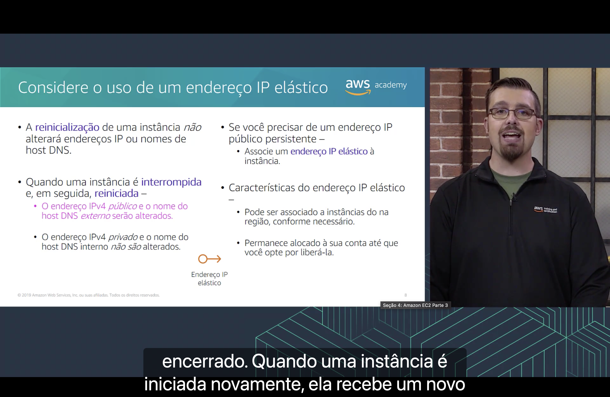

| Ação | IPv4 público e DNS externo | IPv4 privado e DNS interno |
|---|---|---|
| 🔁 **Reinicializar** a instância | Não mudam | Não mudam |
| ⏹️ **Interromper** e **iniciar** novamente | ⚠️ **Mudam** | Não mudam |

Se você precisar de um **endereço IP público persistente**, associe um **endereço IP elástico** à instância. Ele:

- 🔗 pode ser **associado a instâncias na Região**, conforme necessário;
- 🏦 **permanece alocado à sua conta** até que você opte por liberá-lo.

> [!WARNING]
> Libere os IPs elásticos que não estiver usando, porque eles continuam sendo cobrados enquanto estiverem alocados. Ver o aviso do [Módulo 5](../MÓDULO%205/Seção%202%20-%20Amazon%20VPC.md#ip-publico).

<a id="metadados"></a>
## 8. 🧾 Metadados da instância do EC2

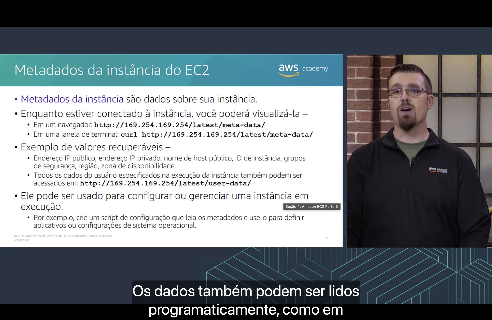

**Metadados da instância** são **dados sobre a sua instância**. Enquanto estiver conectado a ela, você pode acessá-los:

| Onde | Como |
|---|---|
| 🌐 **Navegador** | `http://169.254.169.254/latest/meta-data/` |
| 💻 **Terminal** | `curl http://169.254.169.254/latest/meta-data/` |

- 📋 **Exemplos de valores recuperáveis:** endereço IP público, endereço IP privado, nome de host público, ID de instância, grupos de segurança, Região e Zona de Disponibilidade.
- 📜 Os [**dados do usuário**](./Seção%203%20-%20Amazon%20EC2%20Parte%202.md#dados-usuario) especificados na execução também podem ser acessados em `http://169.254.169.254/latest/user-data/`.
- ⚙️ Os metadados podem ser usados para **configurar ou gerenciar uma instância em execução**: por exemplo, um script de configuração pode lê-los para definir aplicativos ou configurações do sistema operacional.

> [!NOTE]
> O comando do slide usa o **IMDSv1**. Instâncias configuradas para exigir o **IMDSv2**, como as do Amazon Linux 2023, respondem com erro `401` quando não há token. Nesses casos, obtenha um token primeiro:

```bash
TOKEN=$(curl -X PUT "http://169.254.169.254/latest/api/token" -H "X-aws-ec2-metadata-token-ttl-seconds: 21600")
curl -H "X-aws-ec2-metadata-token: $TOKEN" http://169.254.169.254/latest/meta-data/
```

> [!WARNING]
> Quem tem acesso à instância consegue ler os dados do usuário, então **não coloque senhas nem chaves** nesses scripts.

<a id="cloudwatch"></a>
## 9. 📊 Amazon CloudWatch para monitoramento

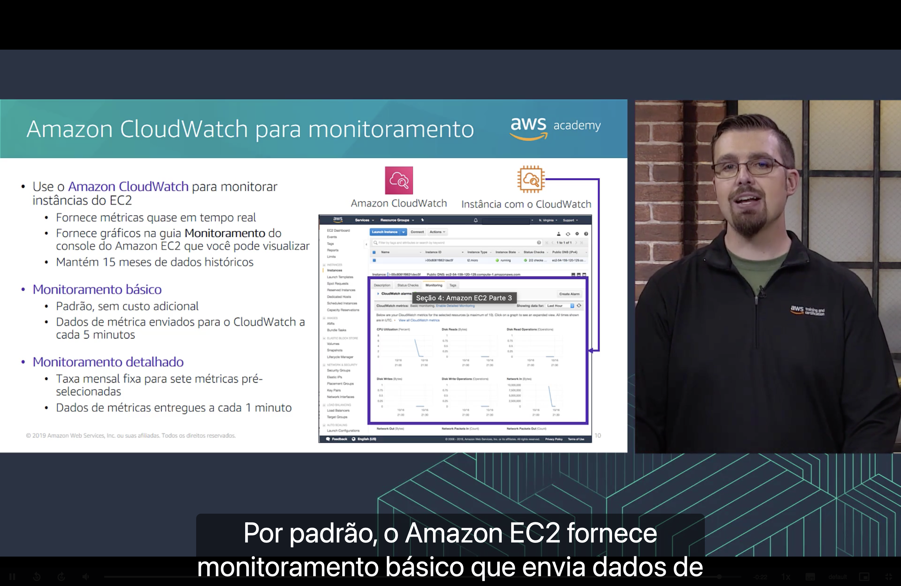

Use o **Amazon CloudWatch** para monitorar instâncias do EC2. Ele:

- ⏱️ fornece **métricas quase em tempo real**;
- 📈 fornece **gráficos** na guia **Monitoramento** do console do Amazon EC2;
- 🗓️ mantém **15 meses** de dados históricos.

| | 🆓 **Monitoramento básico** | 🔬 **Monitoramento detalhado** |
|---|---|---|
| **Custo** | **Padrão**, sem custo adicional. | **Taxa mensal fixa** para sete métricas pré-selecionadas. |
| **Frequência dos dados** | A cada **5 minutos**. | A cada **1 minuto**. |

> [!NOTE]
> O custo é o informado no slide, de 2019. Hoje o monitoramento detalhado é cobrado **por métrica enviada** ao CloudWatch.

---

<a id="conclusoes"></a>
## 🎯 Principais conclusões

- ✅ **Tags** são rótulos com **chave** e **valor opcional**, úteis para filtragem, automação, alocação de custos e controle de acesso.
- ✅ Um **grupo de segurança** é um conjunto de **regras de firewall** que existe fora do sistema operacional convidado.
- ✅ Em um **par de chaves**, a AWS armazena a **chave pública** e você armazena a **chave privada**.
- ✅ Instâncias também podem ser criadas de forma programática com a **CLI da AWS** (`aws ec2 run-instances`).
- ✅ Apenas instâncias com suporte do **Amazon EBS** podem ser **interrompidas**; uma instância **encerrada** não pode voltar.
- ✅ **Interromper e iniciar** muda o **IPv4 público** e o **DNS externo**; reinicializar não muda. Um **IP elástico** mantém o endereço público.
- ✅ Os **metadados** ficam em `169.254.169.254` e podem ser usados para configurar uma instância em execução.
- ✅ O **CloudWatch** monitora as instâncias: o básico envia dados a cada **5 minutos**, sem custo adicional, e o detalhado, a cada **1 minuto**.

---

<p align="center">
  <a href="../README.md">🏠 Início</a> &nbsp;•&nbsp;
  <a href="./Seção%203%20-%20Amazon%20EC2%20Parte%202.md">⬅️ Anterior: Amazon EC2 Parte 2</a> &nbsp;•&nbsp;
  <a href="./Seção%205%20-%20Otimização%20de%20custos%20do%20Amazon%20EC2.md">Próxima: Otimização de custos do Amazon EC2 ➡️</a>
</p>
