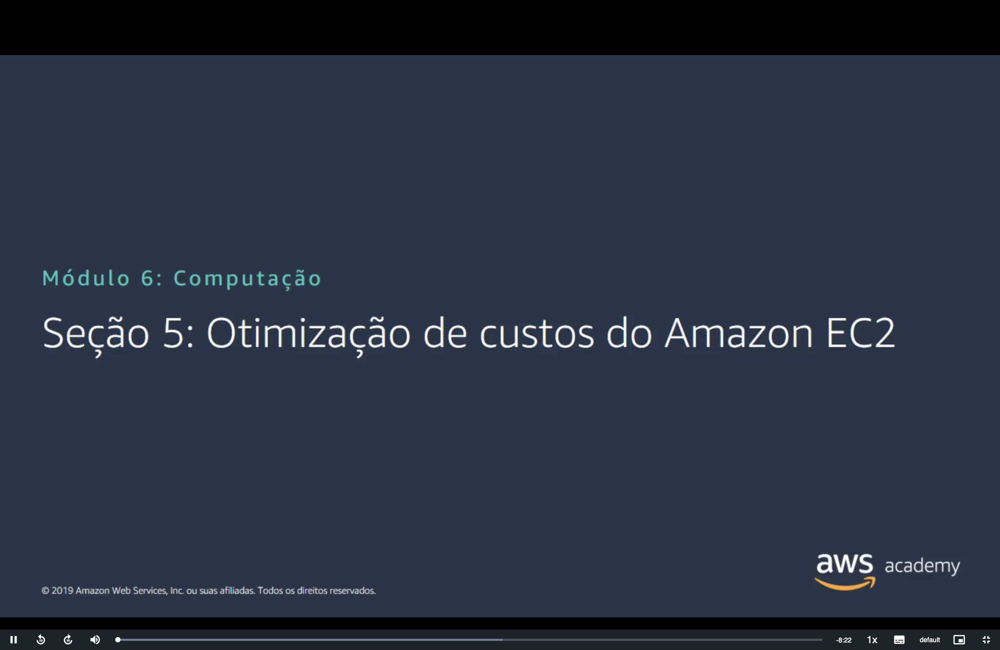
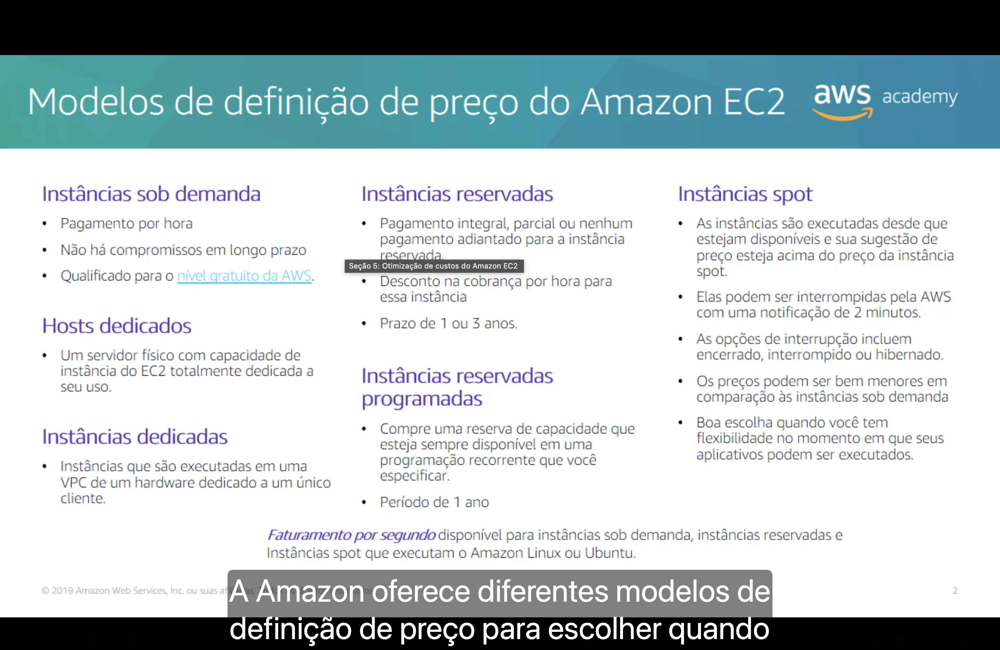
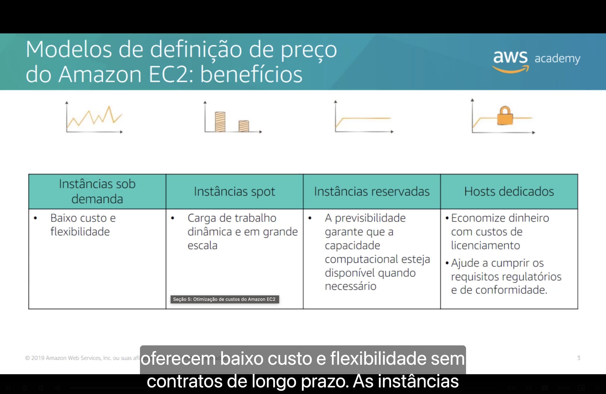
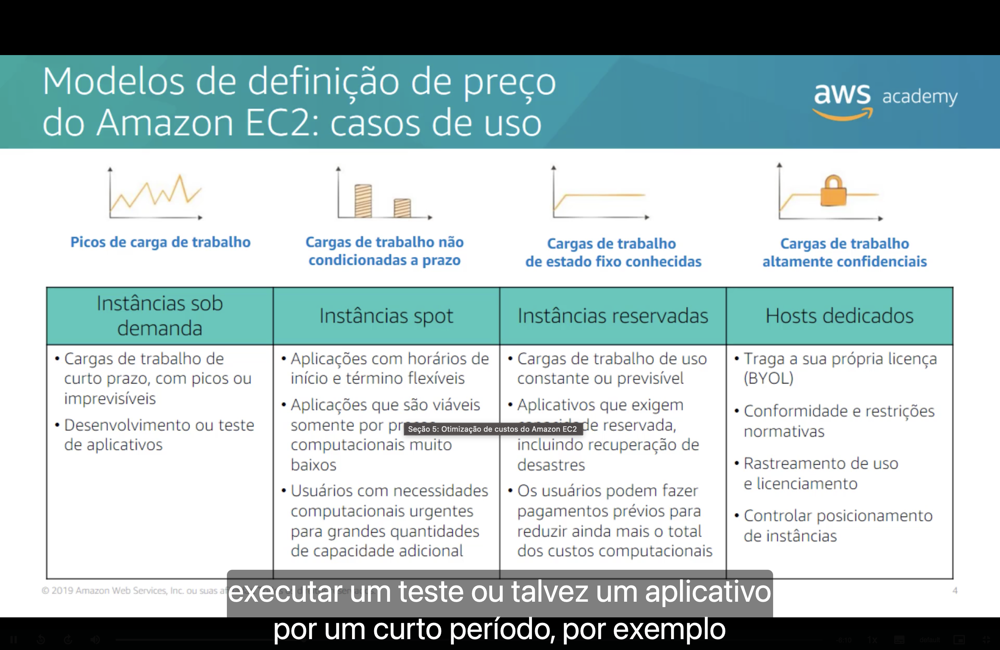
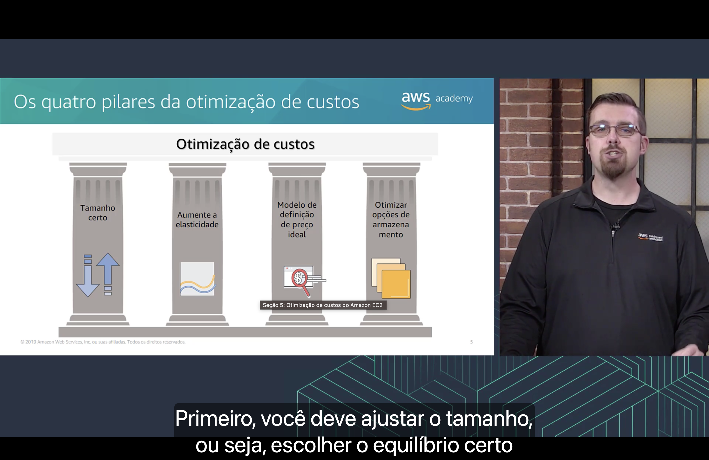
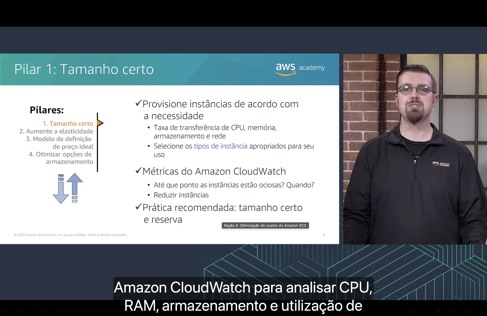
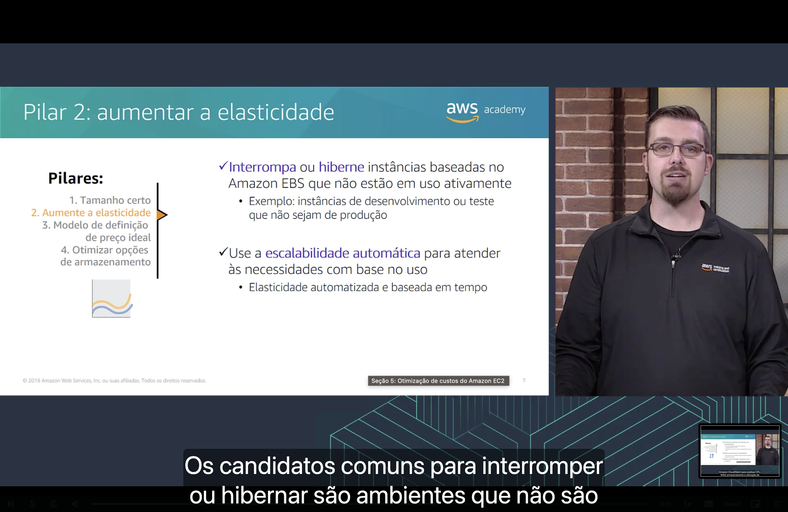
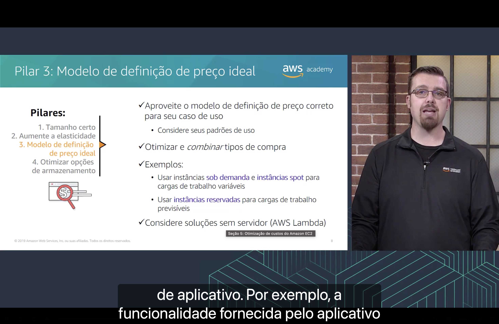
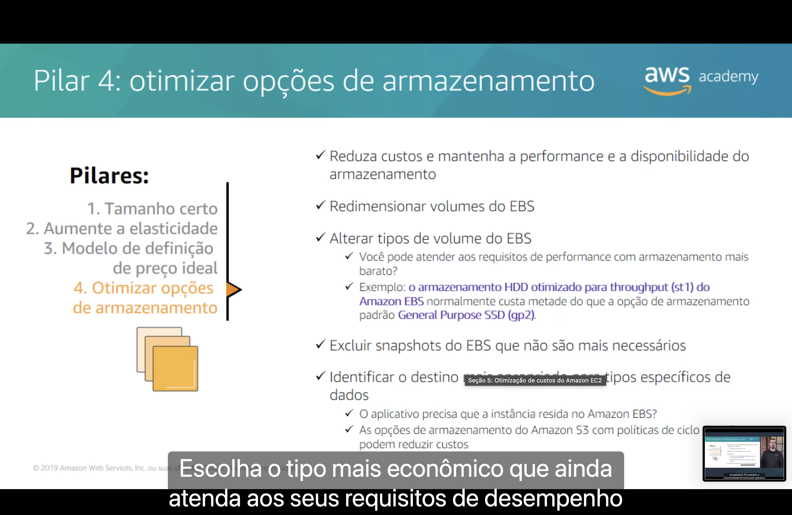
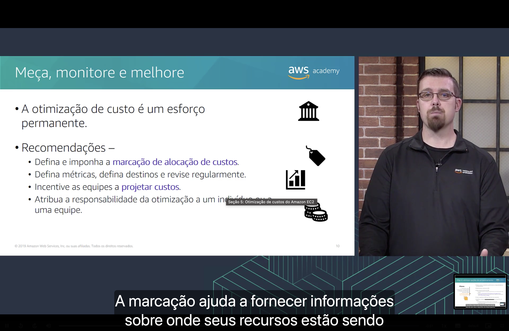

<h1 align="center">💰 Seção 5 – Otimização de custos do Amazon EC2</h1>

  
  
   
  
  
  

  <a href="../README.md">🏠 Início</a> &nbsp;•&nbsp;
  <a href="./Seção%204%20-%20Amazon%20EC2%20Parte%203.md">⬅️ Anterior: Amazon EC2 Parte 3</a> &nbsp;•&nbsp;
  <a href="./Seção%206%20-%20Serviços%20de%20contêiner.md">Próxima: Serviços de contêiner ➡️</a>

> [!NOTE]
> Esta seção responde a duas perguntas sobre as instâncias vistas até aqui: **como pagar por elas** (os modelos de definição de preço) e **como gastar menos** (os quatro pilares da otimização de custos).

## 📑 Sumário

| # | Tópico |
|:---:|---|
| 1 | [💳 Modelos de definição de preço do Amazon EC2](#modelos) |
| 2 | [🎁 Modelos de definição de preço: benefícios](#beneficios) |
| 3 | [🧩 Modelos de definição de preço: casos de uso](#casos-de-uso) |
| 4 | [🏛️ Os quatro pilares da otimização de custos](#pilares) |
| 5 | [📏 Pilar 1: tamanho certo](#pilar1) |
| 6 | [📈 Pilar 2: aumentar a elasticidade](#pilar2) |
| 7 | [💲 Pilar 3: modelo de definição de preço ideal](#pilar3) |
| 8 | [🗄️ Pilar 4: otimizar opções de armazenamento](#pilar4) |
| 9 | [🔁 Meça, monitore e melhore](#medir) |
| 🎯 | [Principais conclusões](#conclusoes) |

---

## 1. 💳 Modelos de definição de preço do Amazon EC2

| Modelo | Como funciona |
|---|---|
| 🕐 **Instâncias sob demanda** | Pagamento **por hora**, sem compromissos de longo prazo. Qualificadas para o [nível gratuito da AWS](../MÓDULO%202/Seção%201%20-%20Fundamentos%20da%20definição%20de%20preço.md#gratuito). |
| 📅 **Instâncias reservadas** | Pagamento **integral, parcial ou nenhum adiantado**, com **desconto na cobrança por hora**. Prazo de **1 ou 3 anos**. |
| 🗓️ **Instâncias reservadas programadas** | Reserva de capacidade **sempre disponível em uma programação recorrente** que você especifica. Período de **1 ano**. |
| ⚡ **Instâncias spot** | Executadas **desde que estejam disponíveis** e sua **sugestão de preço** esteja acima do preço da instância spot. Os preços podem ser **bem menores** que os das instâncias sob demanda. |
| 🖥️ **Hosts dedicados** | Um **servidor físico** com capacidade de instância do EC2 **totalmente dedicada ao seu uso**. |
| 🔒 **Instâncias dedicadas** | Instâncias executadas em uma **VPC**, em **hardware dedicado a um único cliente**. |

Sobre as **instâncias spot**:

- ⏱️ podem ser **interrompidas pela AWS** com uma notificação de **2 minutos**;
- 🔀 as opções de interrupção são **encerrar, interromper ou hibernar**;
- ✅ são boa escolha quando você tem **flexibilidade no momento em que seus aplicativos podem ser executados**.

O **faturamento por segundo** está disponível para instâncias sob demanda, instâncias reservadas e instâncias spot que executam **Amazon Linux** ou **Ubuntu**.

> [!TIP]
> Hosts dedicados e instâncias dedicadas usam hardware exclusivo. A diferença é que, no **host dedicado**, você tem visibilidade e controle sobre o servidor físico, como soquetes e núcleos. Por isso o **BYOL** aparece nos [casos de uso](#casos-de-uso).

> [!NOTE]
> O slide é de 2019, e alguns pontos mudaram:
> - **Instâncias reservadas programadas** não estão mais à venda. A AWS indica as **Reservas de Capacidade sob Demanda** para garantir capacidade e os **Savings Plans** para obter desconto.
> - **Instâncias reservadas** continuam existindo, mas a AWS recomenda os **Savings Plans** no lugar delas, com descontos semelhantes e mais flexibilidade.
> - **Instâncias spot** não exigem mais sugestão de preço: você paga o **preço spot atual**, que nunca passa do preço sob demanda. Definir um preço máximo é opcional e não recomendado, porque pode aumentar as interrupções.
> - O **faturamento por segundo** hoje também vale para **Windows** e **Red Hat Enterprise Linux**, entre outros, com **mínimo de 60 segundos**.
> - O **nível gratuito** mudou para contas criadas a partir de **15 de julho de 2025**: em vez de 12 meses de uso gratuito, elas recebem **créditos** (US$ 100 na criação e até US$ 100 adicionais).

## 2. 🎁 Modelos de definição de preço: benefícios

| Modelo | Benefícios |
|---|---|
| 🕐 **Instâncias sob demanda** | **Baixo custo** e **flexibilidade**. |
| ⚡ **Instâncias spot** | Carga de trabalho **dinâmica** e em **grande escala**. |
| 📅 **Instâncias reservadas** | A **previsibilidade** garante que a capacidade computacional esteja disponível quando necessário. |
| 🖥️ **Hosts dedicados** | **Economia com custos de licenciamento** e ajuda para cumprir **requisitos regulatórios e de conformidade**. |

> [!NOTE]
> Somente as instâncias reservadas **zonais** reservam capacidade em uma Zona de Disponibilidade. As **regionais** oferecem o desconto, sem reservar capacidade.

## 3. 🧩 Modelos de definição de preço: casos de uso

| Modelo | Padrão de carga de trabalho | Indicado para |
|---|---|---|
| 🕐 **Instâncias sob demanda** | **Picos** de carga de trabalho | Cargas de trabalho de curto prazo, com picos ou imprevisíveis. Desenvolvimento ou teste de aplicativos. |
| ⚡ **Instâncias spot** | Cargas de trabalho **não condicionadas a prazo** | Aplicações com horários de início e término flexíveis. Aplicações viáveis somente com preços computacionais muito baixos. Usuários com necessidades computacionais urgentes de grandes quantidades de capacidade adicional. |
| 📅 **Instâncias reservadas** | Cargas de trabalho de **estado fixo conhecidas** | Cargas de uso constante ou previsível. Aplicativos que exigem capacidade reservada, incluindo recuperação de desastres. Usuários que podem fazer pagamentos prévios para reduzir ainda mais o total dos custos computacionais. |
| 🖥️ **Hosts dedicados** | Cargas de trabalho **altamente confidenciais** | Traga a sua própria licença (**BYOL**). Conformidade e restrições normativas. Rastreamento de uso e licenciamento. Controle do posicionamento de instâncias. |

## 4. 🏛️ Os quatro pilares da otimização de custos

| Pilar | Foco |
|---|---|
| 1️⃣ [**Tamanho certo**](#pilar1) | Provisionar instâncias de acordo com a necessidade. |
| 2️⃣ [**Aumentar a elasticidade**](#pilar2) | Desligar o que não está em uso e escalar conforme a demanda. |
| 3️⃣ [**Modelo de definição de preço ideal**](#pilar3) | Usar o modelo de preço adequado a cada caso de uso. |
| 4️⃣ [**Otimizar opções de armazenamento**](#pilar4) | Reduzir custos mantendo a performance e a disponibilidade. |

## 5. 📏 Pilar 1: tamanho certo

- ✅ **Provisione instâncias de acordo com a necessidade:** considere a taxa de transferência de **CPU, memória, armazenamento e rede** e selecione os [tipos de instância](./Seção%202%20-%20Amazon%20EC2%20Parte%201.md#tipo-instancia) apropriados para seu uso.
- 📊 **Use as métricas do [Amazon CloudWatch](./Seção%204%20-%20Amazon%20EC2%20Parte%203.md#cloudwatch)** para descobrir **até que ponto as instâncias estão ociosas** e **quando**, e então **reduzir as instâncias**.
- 🏅 **Prática recomendada: tamanho certo e reserva**, nessa ordem. Ajuste o tamanho antes de reservar, para não assumir um compromisso de 1 ou 3 anos com uma instância maior do que o necessário.

> [!NOTE]
> Por padrão, o EC2 envia ao CloudWatch métricas como **CPU** e **rede**. Para acompanhar o uso de **memória** e de **disco no sistema operacional**, é preciso instalar o **agente do CloudWatch**, e essas métricas são cobradas como personalizadas.

## 6. 📈 Pilar 2: aumentar a elasticidade

- ⏸️ [**Interrompa ou hiberne**](./Seção%204%20-%20Amazon%20EC2%20Parte%203.md#ciclo-vida) instâncias baseadas no **Amazon EBS** que não estão em uso ativamente. Exemplo: instâncias de **desenvolvimento ou teste** que não sejam de produção.
- 📈 Use a [**escalabilidade automática**](./Seção%201%20-%20Visão%20geral%20dos%20serviços%20de%20computação.MD#servicos) para atender às necessidades com base no uso, com **elasticidade automatizada e baseada em tempo**.

> [!TIP]
> Uma instância interrompida deixa de ser cobrada, mas os **volumes do EBS continuam sendo cobrados**. Por isso, este pilar anda junto com o [Pilar 4](#pilar4).

## 7. 💲 Pilar 3: modelo de definição de preço ideal

- 🎯 Aproveite o **modelo de definição de preço correto** para seu caso de uso, considerando seus **padrões de uso**.
- 🧩 **Otimize e *combine* tipos de compra.** Exemplos:

| Carga de trabalho | O que usar |
|---|---|
| 🌊 **Variável** | Instâncias **sob demanda** e instâncias **spot** |
| 📐 **Previsível** | Instâncias **reservadas** |

- ☁️ Considere **soluções sem servidor** (**AWS Lambda**).

## 8. 🗄️ Pilar 4: otimizar opções de armazenamento

O objetivo é **reduzir custos e manter a performance e a disponibilidade do armazenamento**. Para isso:

- 📐 **Redimensione os [volumes do EBS](./Seção%203%20-%20Amazon%20EC2%20Parte%202.md#opcoes).**
- 🔄 **Altere os tipos de volume do EBS.** Você pode atender aos requisitos de performance com armazenamento mais barato? Por exemplo, o **HDD otimizado para throughput (`st1`)** normalmente custa **metade** da opção padrão **General Purpose SSD (`gp2`)**.
- 🗑️ **Exclua snapshots do EBS** que não são mais necessários.
- 🎯 **Identifique o destino mais apropriado** para tipos específicos de dados:
  - O aplicativo precisa que a instância resida no **Amazon EBS**?
  - As opções de armazenamento do **Amazon S3** com **políticas de ciclo de vida** podem reduzir custos.

> [!WARNING]
> Volumes `st1` **não podem ser o volume raiz** de uma instância. Eles servem para dados, não para inicializar o sistema operacional.

> [!NOTE]
> Depois do slide surgiu o **`gp3`**, cerca de **20% mais barato por GB** que o `gp2` (US$ 0,08 contra US$ 0,10 por GB-mês na Região Norte da Virgínia). Trocar `gp2` por `gp3` é uma forma direta de aplicar este pilar.

## 9. 🔁 Meça, monitore e melhore

A otimização de custo é um **esforço permanente**. Recomendações:

- 🏷️ Defina e imponha a **marcação de alocação de custos**, usando as [tags](./Seção%204%20-%20Amazon%20EC2%20Parte%203.md#tags).
- 📊 Defina **métricas**, defina **metas** (no slide, "destinos") e **revise regularmente**.
- 🏗️ Incentive as equipes a **projetar pensando em custos** (no slide, "projetar custos").
- 👤 Atribua a **responsabilidade da otimização** a um indivíduo ou a uma equipe.

---

## 🎯 Principais conclusões

- ✅ Instâncias **sob demanda** não exigem compromisso; **reservadas** dão desconto em troca de um prazo de **1 ou 3 anos**; **spot** custam bem menos, mas podem ser **interrompidas pela AWS** com aviso de **2 minutos**.
- ✅ **Hosts dedicados** oferecem um **servidor físico** exclusivo e ajudam com **licenciamento (BYOL)** e **conformidade**. **Instâncias dedicadas** são executadas em hardware dedicado a um único cliente.
- ✅ Cada modelo atende a um padrão: **picos** (sob demanda), **sem prazo definido** (spot), **estado fixo** (reservadas) e **altamente confidencial** (hosts dedicados).
- ✅ Os **quatro pilares** são **tamanho certo**, **aumentar a elasticidade**, **modelo de definição de preço ideal** e **otimizar opções de armazenamento**.
- ✅ Primeiro **ajuste o tamanho**, com base nas métricas do **CloudWatch**, e só depois **reserve**.
- ✅ **Interrompa ou hiberne** o que não está em uso e use a **escalabilidade automática** para acompanhar a demanda.
- ✅ **Combine tipos de compra**: sob demanda e spot para cargas variáveis, reservadas para cargas previsíveis.
- ✅ No armazenamento, **redimensione** e **troque o tipo** dos volumes do EBS, **exclua snapshots** desnecessários e escolha o **destino certo** para cada tipo de dado.
- ✅ A otimização de custos é um **esforço permanente**: marque os recursos, defina metas e atribua um responsável.

---

  <a href="../README.md">🏠 Início</a> &nbsp;•&nbsp;
  <a href="./Seção%204%20-%20Amazon%20EC2%20Parte%203.md">⬅️ Anterior: Amazon EC2 Parte 3</a> &nbsp;•&nbsp;
  <a href="./Seção%206%20-%20Serviços%20de%20contêiner.md">Próxima: Serviços de contêiner ➡️</a>

