<h1 align="center">📦 Seção 6 – Serviços de contêiner</h1>

  
  
   
  
  
  

  <a href="../README.md">🏠 Início</a> &nbsp;•&nbsp;
  <a href="./Seção%205%20-%20Otimização%20de%20custos%20do%20Amazon%20EC2.md">⬅️ Anterior: Otimização de custos do Amazon EC2</a> &nbsp;•&nbsp;
  <a href="./Seção%207%20-%20Introdução%20ao%20AWS%20Lambda.md">Próxima: Introdução ao AWS Lambda ➡️</a>

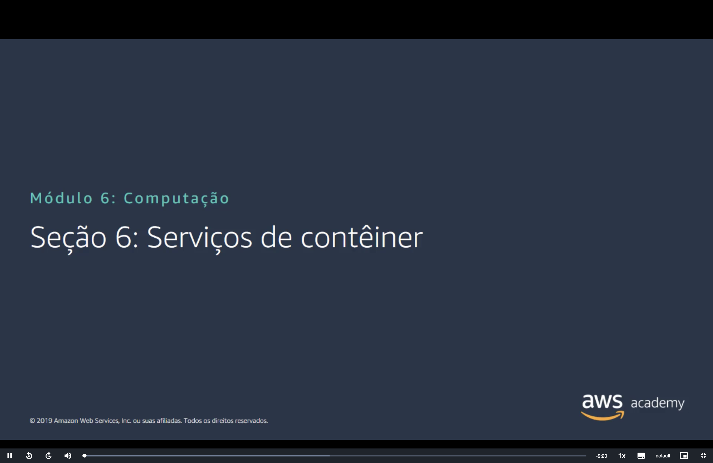

> [!NOTE]
> Esta seção detalha os serviços de contêiner apresentados na [Seção 1](./Seção%201%20-%20Visão%20geral%20dos%20serviços%20de%20computação.MD#servicos). Ela explica os conceitos de **contêiner**, **Docker** e **Kubernetes** e os serviços da AWS que os executam e armazenam: **Amazon ECS**, **AWS Fargate**, **Amazon EKS** e **Amazon ECR**.

## 📑 Sumário

| # | Tópico |
|:---:|---|
| 1 | [🧱 Noções básicas de contêiner](#nocoes) |
| 2 | [🐳 O que é o Docker?](#docker) |
| 3 | [⚖️ Contêineres versus máquinas virtuais](#versus-vms) |
| 4 | [📦 Amazon Elastic Container Service (Amazon ECS)](#ecs) |
| 5 | [🎼 O Amazon ECS orquestra contêineres](#orquestra) |
| 6 | [🔀 Opções de cluster do Amazon ECS](#opcoes-cluster) |
| 7 | [☸️ O que é o Kubernetes?](#kubernetes) |
| 8 | [🚢 Amazon Elastic Kubernetes Service (Amazon EKS)](#eks) |
| 9 | [🗄️ Amazon Elastic Container Registry (Amazon ECR)](#ecr) |
| 🎯 | [Principais conclusões](#conclusoes) |

---

## 1. 🧱 Noções básicas de contêiner

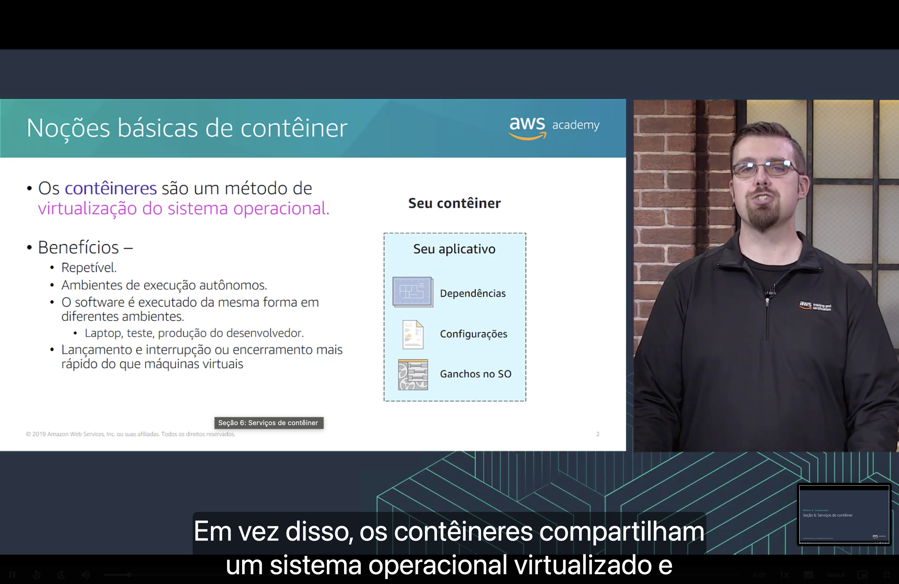

Os **contêineres** são um método de **virtualização do sistema operacional**. Um contêiner reúne **seu aplicativo**, as **dependências**, as **configurações** e os **ganchos no sistema operacional**.

Benefícios:

- 🔁 São **repetíveis**.
- 📦 São **ambientes de execução autônomos**.
- 💻 O software é **executado da mesma forma em diferentes ambientes**, como o laptop do desenvolvedor, o teste e a produção.
- ⚡ O **lançamento** e a **interrupção ou o encerramento** são **mais rápidos** do que os de máquinas virtuais.

## 2. 🐳 O que é o Docker?

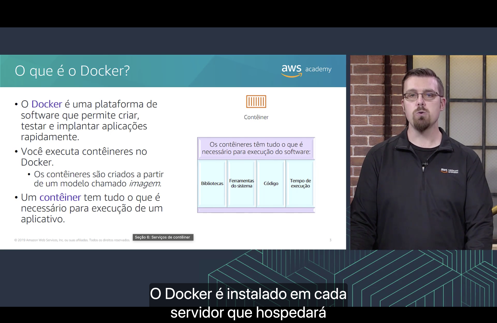

- 🐳 O **Docker** é uma plataforma de software que permite **criar, testar e implantar aplicações rapidamente**.
- ▶️ Você **executa contêineres no Docker**. Eles são criados a partir de um modelo chamado **imagem**.
- 📦 Um **contêiner** tem **tudo o que é necessário para a execução de um aplicativo**: **bibliotecas**, **ferramentas do sistema**, **código** e **tempo de execução** (*runtime*).

## 3. ⚖️ Contêineres versus máquinas virtuais

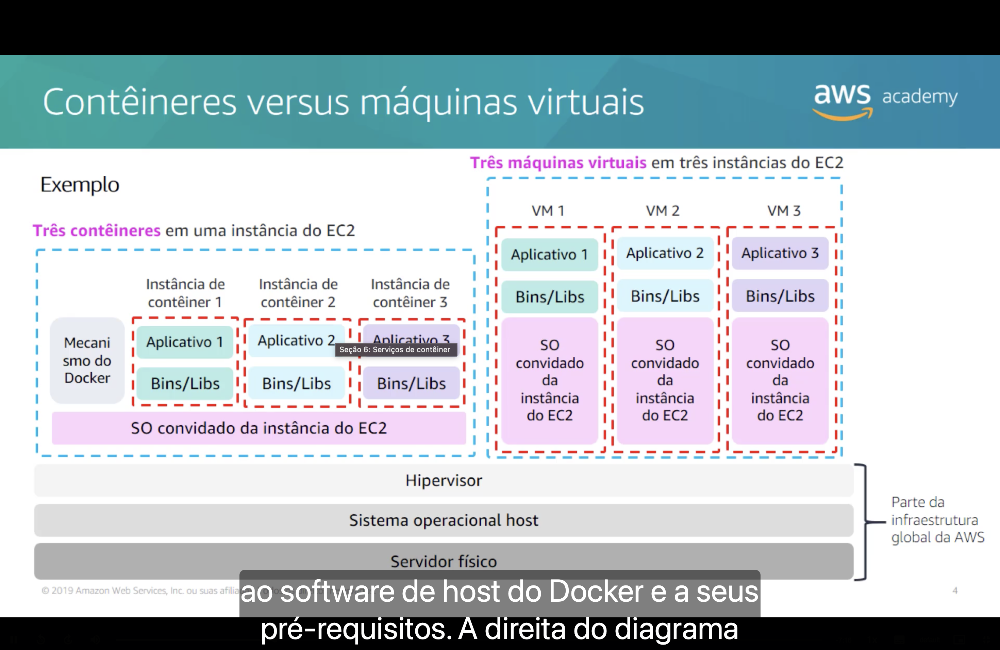

| Camada | 📦 Três contêineres em **uma** instância do EC2 | 🖥️ Três máquinas virtuais em **três** instâncias do EC2 |
|---|---|---|
| **Aplicativo e Bins/Libs** | Um conjunto em cada instância de contêiner | Um conjunto em cada VM |
| **Mecanismo do Docker** | **Um**, ao lado dos contêineres | Não há |
| **SO convidado da instância do EC2** | **Um**, compartilhado pelos três contêineres | **Três**, um por VM |
| **Hipervisor, sistema operacional host e servidor físico** | Parte da infraestrutura global da AWS | Parte da infraestrutura global da AWS |

A diferença está no **SO convidado**: os contêineres compartilham um único sistema operacional, enquanto cada máquina virtual precisa do seu.

## 4. 📦 Amazon Elastic Container Service (Amazon ECS)

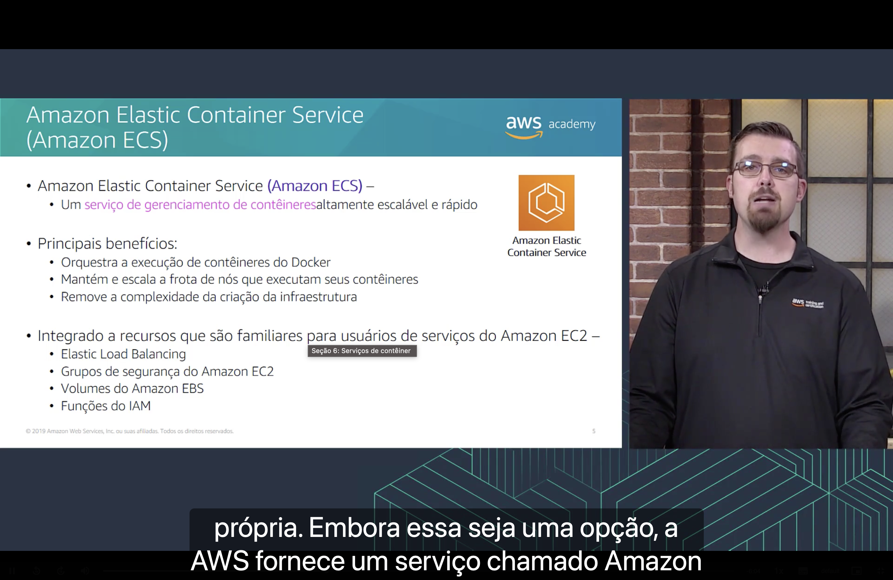

O **Amazon ECS** é um **serviço de gerenciamento de contêineres** altamente escalável e rápido. Principais benefícios:

- 🎼 **Orquestra** a execução de contêineres do Docker.
- 📈 **Mantém e escala a frota de nós** que executam seus contêineres.
- 🧹 **Remove a complexidade** da criação da infraestrutura.

É integrado a recursos familiares para usuários de serviços do Amazon EC2:

- ⚖️ **Elastic Load Balancing**
- 🛡️ [**Grupos de segurança** do Amazon EC2](./Seção%204%20-%20Amazon%20EC2%20Parte%203.md#grupo-seguranca)
- 💾 [**Volumes do Amazon EBS**](./Seção%203%20-%20Amazon%20EC2%20Parte%202.md#opcoes)
- 🔑 [**Funções do IAM**](./Seção%203%20-%20Amazon%20EC2%20Parte%202.md#iam)

## 5. 🎼 O Amazon ECS orquestra contêineres

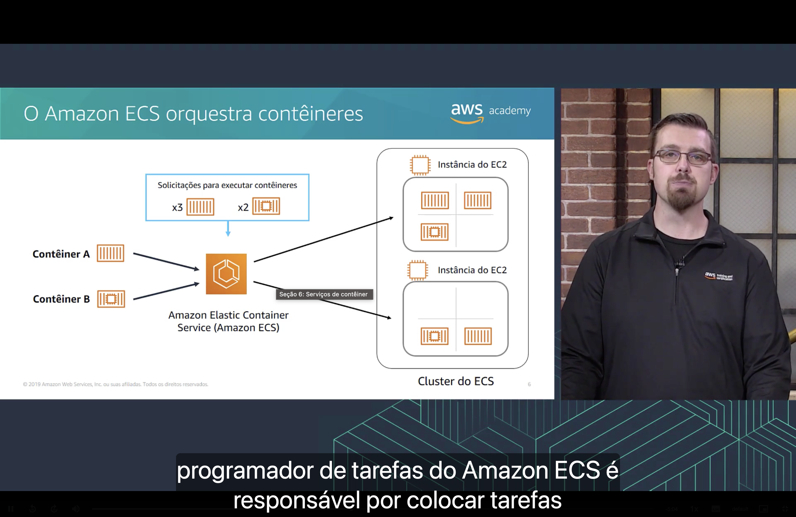

No exemplo do slide, há **solicitações para executar** três cópias do **contêiner A** e duas do **contêiner B**. O Amazon ECS distribui esses contêineres entre as **instâncias do EC2** de um **cluster do ECS**:

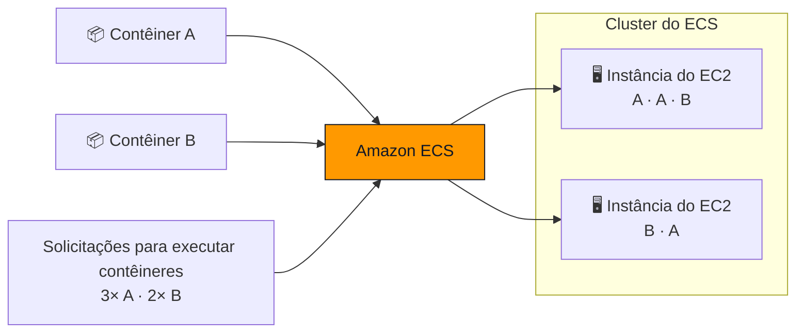

Segundo a narração, o **programador de tarefas** do Amazon ECS é responsável por **colocar as tarefas** nas instâncias do cluster.

## 6. 🔀 Opções de cluster do Amazon ECS

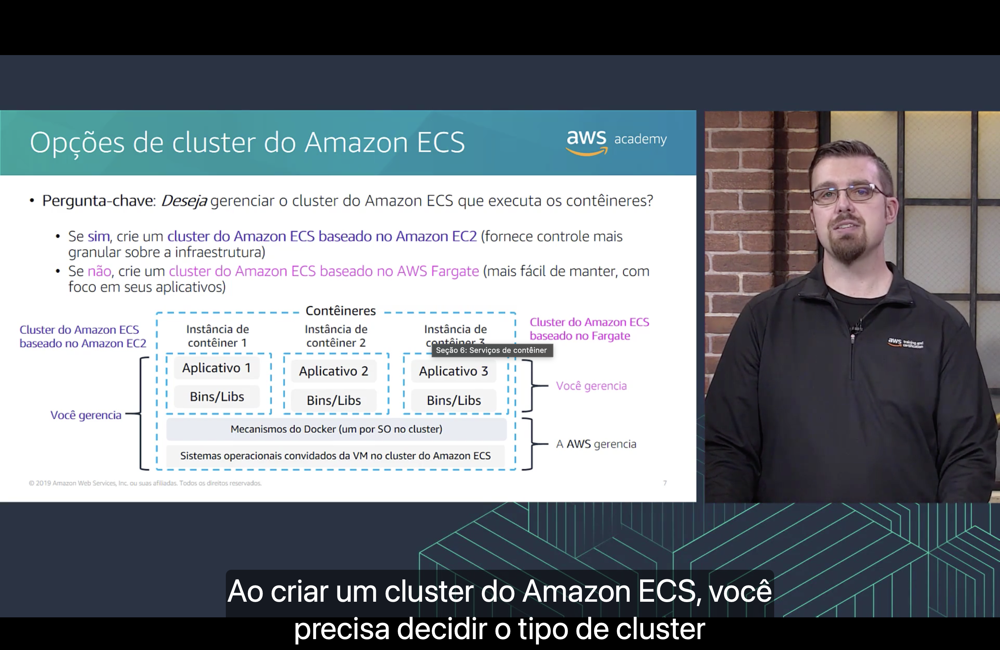

Ao criar um cluster, a pergunta-chave é se você **deseja gerenciar** o cluster que executa os contêineres:

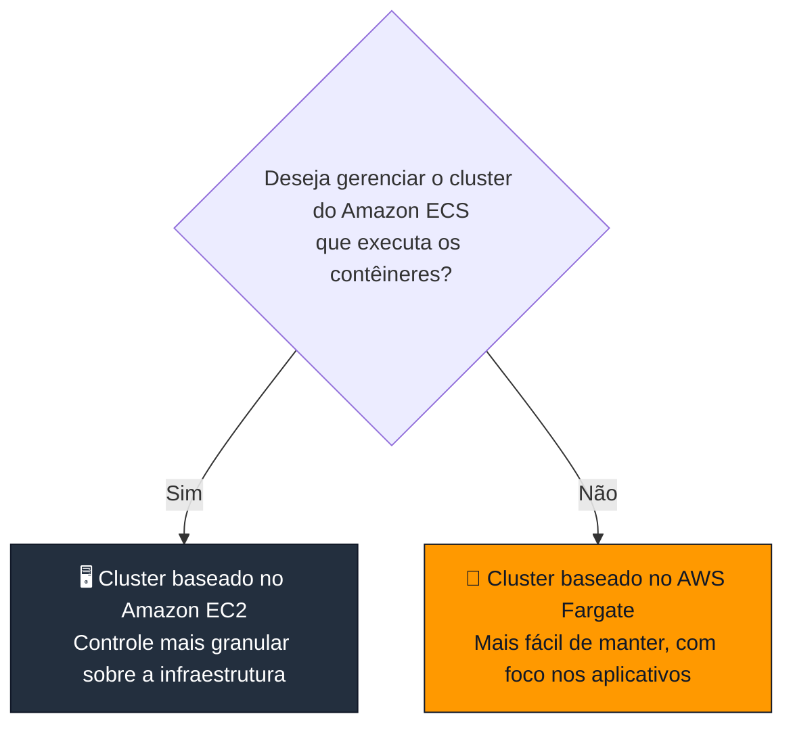

| Camada | 🖥️ Baseado no Amazon EC2 | 🚀 Baseado no AWS Fargate |
|---|---|---|
| **Instâncias de contêiner** (aplicativo e Bins/Libs) | Você gerencia | Você gerencia |
| **Mecanismos do Docker** (um por SO no cluster) | Você gerencia | A AWS gerencia |
| **Sistemas operacionais convidados da VM** no cluster | Você gerencia | A AWS gerencia |

> [!NOTE]
> Dois cuidados ao comparar o slide com a documentação atual:
> - No slide, **instância de contêiner** é cada contêiner em execução. Na documentação do ECS, *container instance* é outra coisa: a **instância do EC2 registrada no cluster** que executa o agente do ECS.
> - A escolha não precisa mais valer para o cluster inteiro. Um mesmo cluster pode misturar tarefas no **Fargate**, em **instâncias do EC2**, em instâncias externas e nas **ECS Managed Instances**, opção em que a AWS gerencia as instâncias.

## 7. ☸️ O que é o Kubernetes?

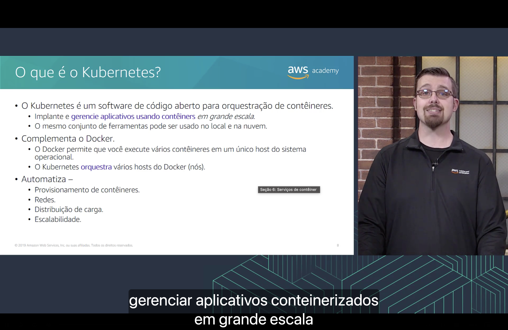

O **Kubernetes** é um **software de código aberto para orquestração de contêineres**:

- 🚀 Permite implantar e **gerenciar aplicativos usando contêineres em grande escala**.
- 🧰 O **mesmo conjunto de ferramentas** pode ser usado **no local e na nuvem**.

Ele **complementa o Docker**:

| Ferramenta | Papel |
|---|---|
| 🐳 **Docker** | Executa **vários contêineres** em **um único host** do sistema operacional. |
| ☸️ **Kubernetes** | **Orquestra vários hosts** do Docker (**nós**). |

O Kubernetes **automatiza** o **provisionamento de contêineres**, as **redes**, a **distribuição de carga** e a **escalabilidade**.

> [!NOTE]
> Na versão **1.24** (2022), o Kubernetes removeu o *dockershim*, componente que permitia usar o Docker Engine como runtime dos nós. No Amazon EKS, as AMIs oficiais usam o **containerd** desde essa versão. As imagens criadas com o Docker continuam funcionando normalmente.

## 8. 🚢 Amazon Elastic Kubernetes Service (Amazon EKS)

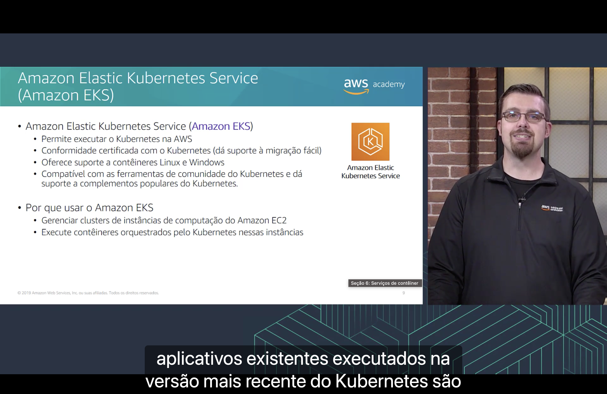

O **Amazon EKS**:

- ☸️ **permite executar o Kubernetes na AWS**;
- ✅ tem **conformidade certificada com o Kubernetes**, o que dá suporte à **migração fácil**;
- 🐧 **oferece suporte a contêineres Linux e Windows**;
- 🧩 é **compatível com as ferramentas de comunidade** do Kubernetes e dá suporte a **complementos populares**.

Por que usar o Amazon EKS:

- 🖥️ para **gerenciar clusters de instâncias de computação do Amazon EC2**;
- 📦 para **executar contêineres orquestrados pelo Kubernetes** nessas instâncias.

> [!NOTE]
> O slide cita apenas instâncias do EC2. Hoje o EKS também executa contêineres no **AWS Fargate** e oferece o **EKS Auto Mode**, em que a AWS cuida do provisionamento, da escalabilidade e das atualizações dos nós.

## 9. 🗄️ Amazon Elastic Container Registry (Amazon ECR)

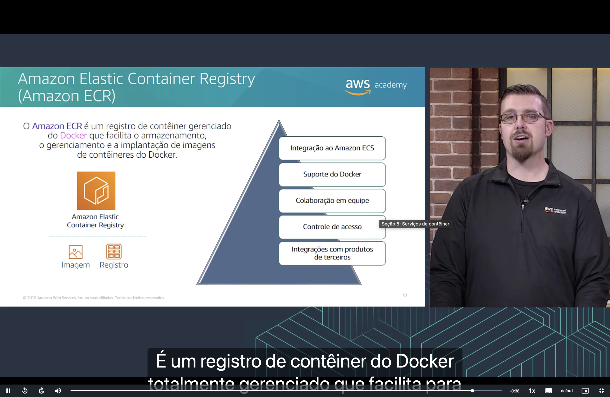

O **Amazon ECR** é um **registro de contêiner gerenciado** do Docker que facilita o **armazenamento**, o **gerenciamento** e a **implantação** de **imagens de contêineres** do Docker. Ele oferece:

- 🔗 **Integração ao Amazon ECS**
- 🐳 **Suporte do Docker**
- 👥 **Colaboração em equipe**
- 🔐 **Controle de acesso**
- 🧩 **Integrações com produtos de terceiros**

> [!NOTE]
> Além de imagens do Docker, o ECR hoje armazena **imagens OCI** e **artefatos compatíveis com OCI**, em registros **privados** ou **públicos** (Amazon ECR Public).

> [!TIP]
> Para ver como ECR, ECS, EKS e Fargate se complementam, volte à [Seção 1](./Seção%201%20-%20Visão%20geral%20dos%20serviços%20de%20computação.MD#categorizacao).

---

## 🎯 Principais conclusões

- ✅ **Contêineres** são um método de **virtualização do sistema operacional**: repetíveis, autônomos, executados da mesma forma em diferentes ambientes e mais rápidos de iniciar e parar do que máquinas virtuais.
- ✅ O **Docker** permite criar, testar e implantar aplicações. Os contêineres são criados a partir de uma **imagem**.
- ✅ Vários **contêineres** compartilham **um SO convidado**, enquanto cada **máquina virtual** tem **o seu**.
- ✅ O **Amazon ECS** orquestra contêineres e se integra ao Elastic Load Balancing, aos grupos de segurança, aos volumes do EBS e às funções do IAM.
- ✅ Em um **cluster baseado no EC2**, você gerencia toda a pilha e tem controle mais granular. No **Fargate**, a AWS gerencia os mecanismos do Docker e os sistemas operacionais convidados.
- ✅ O **Kubernetes** é um orquestrador de **código aberto** que automatiza provisionamento de contêineres, redes, distribuição de carga e escalabilidade.
- ✅ O **Amazon EKS** permite executar o Kubernetes na AWS, com conformidade certificada e suporte a contêineres Linux e Windows.
- ✅ O **Amazon ECR** é um registro gerenciado para **armazenar, gerenciar e implantar imagens** de contêiner.

---

  <a href="../README.md">🏠 Início</a> &nbsp;•&nbsp;
  <a href="./Seção%205%20-%20Otimização%20de%20custos%20do%20Amazon%20EC2.md">⬅️ Anterior: Otimização de custos do Amazon EC2</a> &nbsp;•&nbsp;
  <a href="./Seção%207%20-%20Introdução%20ao%20AWS%20Lambda.md">Próxima: Introdução ao AWS Lambda ➡️</a>

