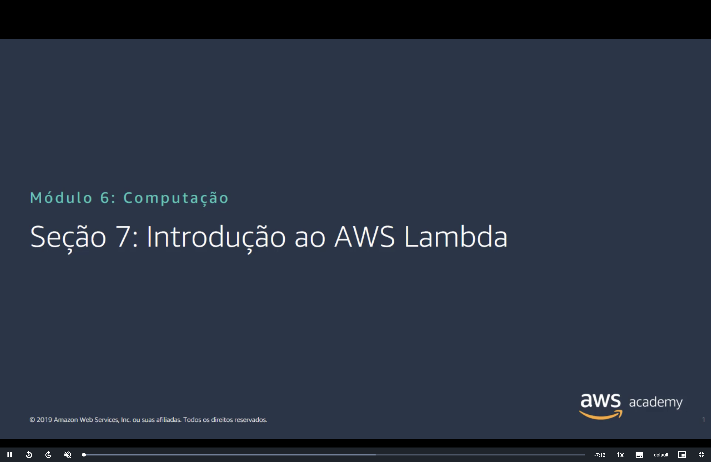
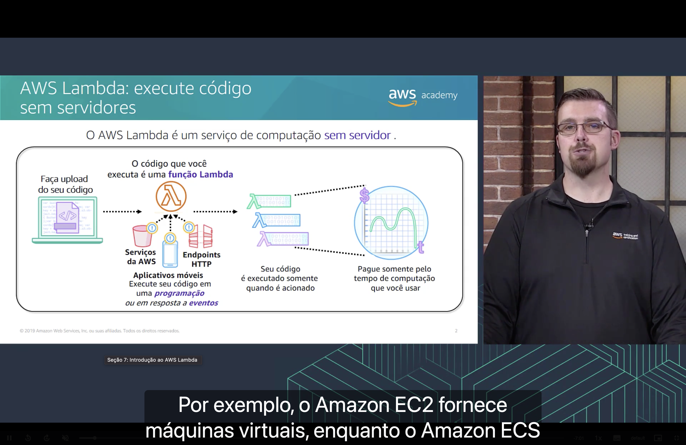
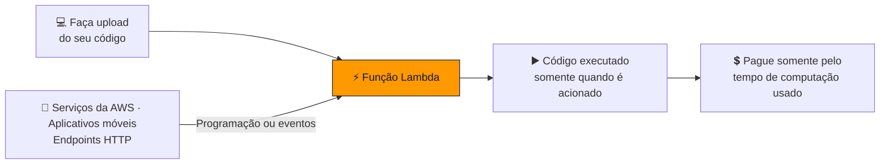
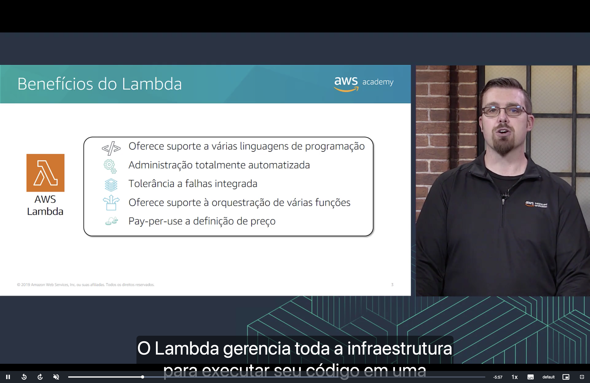
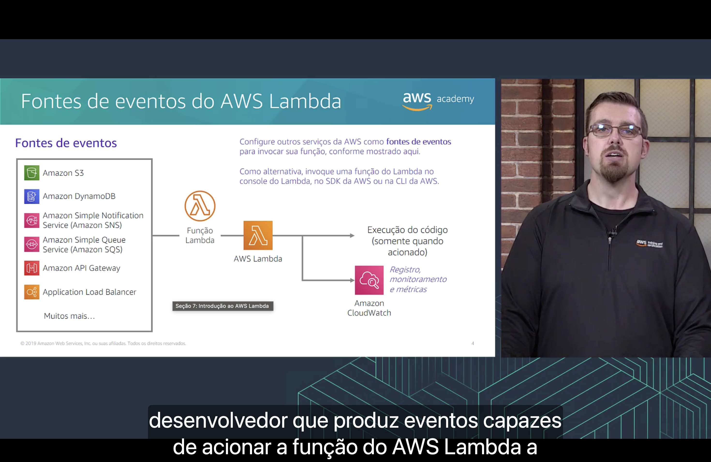
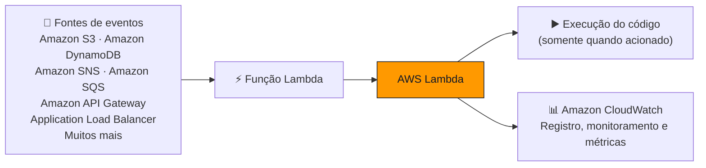
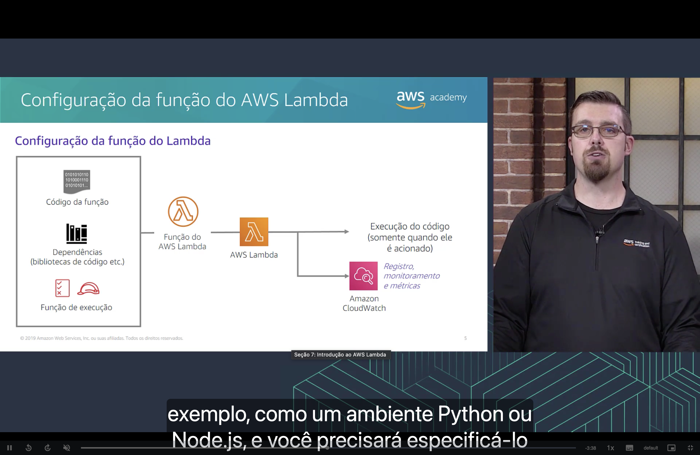
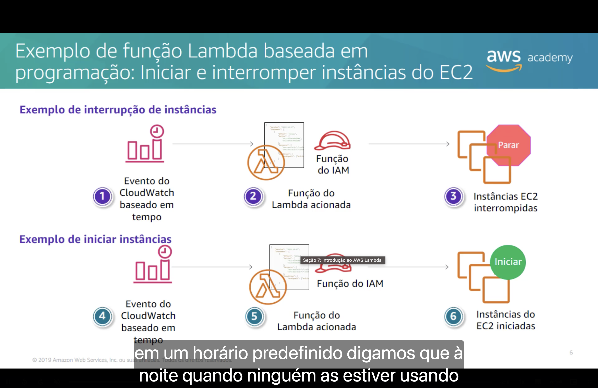
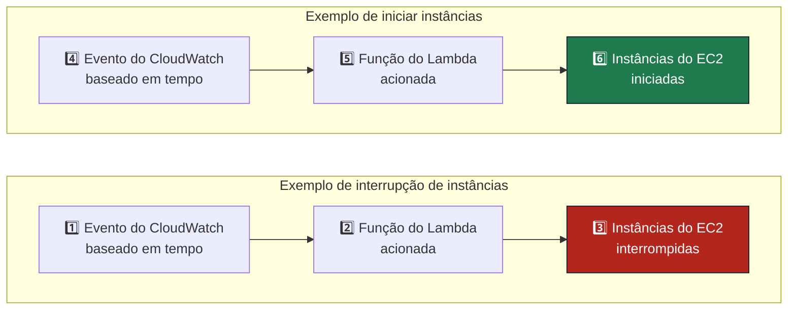
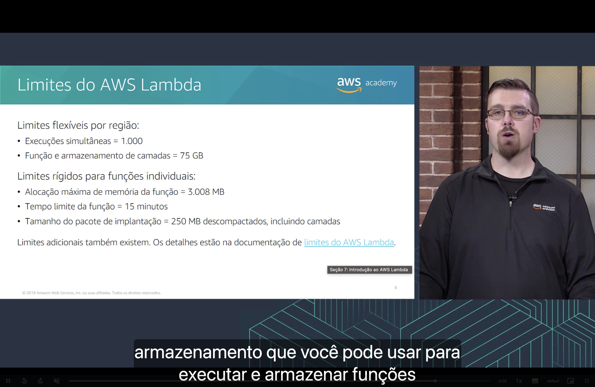

<h1 align="center">⚡ Seção 7 – Introdução ao AWS Lambda</h1>

  
  
   
  
  
  

  <a href="../README.md">🏠 Início</a> &nbsp;•&nbsp;
  <a href="./Seção%206%20-%20Serviços%20de%20contêiner.md">⬅️ Anterior: Serviços de contêiner</a> &nbsp;•&nbsp;
  <a href="./Seção%208%20-%20Introdução%20ao%20AWS%20Elastic%20Beanstalk.md">Próxima: Introdução ao AWS Elastic Beanstalk ➡️</a>

> [!NOTE]
> Esta seção detalha o **AWS Lambda**, apresentado na [Seção 1](./Seção%201%20-%20Visão%20geral%20dos%20serviços%20de%20computação.MD#servicos) como a opção **sem servidor** entre os serviços de computação.

## 📑 Sumário

| # | Tópico |
|:---:|---|
| 1 | [⚡ AWS Lambda: execute código sem servidores](#lambda) |
| 2 | [🎁 Benefícios do Lambda](#beneficios) |
| 3 | [🔔 Fontes de eventos do AWS Lambda](#fontes) |
| 4 | [⚙️ Configuração da função do AWS Lambda](#configuracao) |
| 5 | [⏰ Exemplo de função Lambda baseada em programação](#programacao) |
| 6 | [📏 Limites do AWS Lambda](#limites) |
| 🎯 | [Principais conclusões](#conclusoes) |

---

## 1. ⚡ AWS Lambda: execute código sem servidores

O **AWS Lambda** é um **serviço de computação sem servidor**.

- 📤 Você **faz upload do seu código**. O código que você executa é uma **função Lambda**.
- ⏰ O código é executado em uma **programação** ou **em resposta a eventos** de **serviços da AWS**, **aplicativos móveis** e **endpoints HTTP**.
- ▶️ Seu código é executado **somente quando é acionado**.
- 💲 Você **paga somente pelo tempo de computação** que usar.

## 2. 🎁 Benefícios do Lambda

- 💻 **Oferece suporte a várias linguagens de programação.**
- ⚙️ **Administração totalmente automatizada:** o Lambda gerencia toda a infraestrutura para executar seu código.
- 🛡️ **Tolerância a falhas integrada.**
- 🎼 **Oferece suporte à orquestração de várias funções**, por exemplo com o AWS Step Functions.
- 💰 **Definição de preço com pagamento por uso** (*pay-per-use*).

> [!NOTE]
> Hoje o Lambda cobra pelas **solicitações** e pela **duração**, medida em incrementos de **1 ms**. O nível gratuito inclui **1 milhão de solicitações** e **400.000 GB-segundos** por mês.

## 3. 🔔 Fontes de eventos do AWS Lambda

Configure **outros serviços da AWS como fontes de eventos** para invocar sua função:

Como alternativa, invoque a função no **console do Lambda**, no **SDK da AWS** ou na **CLI da AWS**.

## 4. ⚙️ Configuração da função do AWS Lambda

| Item | O que é |
|---|---|
| 💻 **Código da função** | O código que será executado. |
| 📚 **Dependências** | Bibliotecas de código e outros itens de que o código precisa. |
| 🎩 **Função de execução** | A [**função do IAM**](./Seção%203%20-%20Amazon%20EC2%20Parte%202.md#iam) que dá à função do Lambda permissão para acessar outros serviços e recursos da AWS. |

Segundo a narração, também é preciso especificar o **ambiente** em que o código é executado, como **Python** ou **Node.js**.

Depois de configurada, a função segue o [mesmo fluxo](#fontes): o código é executado **somente quando é acionado**, com registro, monitoramento e métricas no [**Amazon CloudWatch**](./Seção%204%20-%20Amazon%20EC2%20Parte%203.md#cloudwatch).

> [!IMPORTANT]
> Em português, **função** tem dois sentidos nesta seção. A **função do Lambda** (*function*) é o código. A **função do IAM** ou **função de execução** (*role*) é o conjunto de permissões que esse código usa.

## 5. ⏰ Exemplo de função Lambda baseada em programação

Duas funções do Lambda, acionadas por **eventos do CloudWatch baseados em tempo**, **interrompem** e **iniciam** instâncias do EC2. Cada uma usa uma **função do IAM** com as permissões necessárias:

Segundo a narração, as instâncias podem ser interrompidas em um **horário predefinido**, como à noite, quando ninguém as estiver usando. É uma forma de aplicar o [Pilar 2 da otimização de custos](./Seção%205%20-%20Otimização%20de%20custos%20do%20Amazon%20EC2.md#pilar2).

> [!NOTE]
> O CloudWatch Events hoje faz parte do **Amazon EventBridge**, e as regras baseadas em tempo são regras do EventBridge. Para agendamentos como este, há também o **EventBridge Scheduler**.

## 6. 📏 Limites do AWS Lambda

Limites **flexíveis** podem ser aumentados, e limites **rígidos**, não.

| Tipo | Limite | No slide (2019) | Hoje |
|---|---|---|---|
| 🟡 **Flexível, por Região** | Execuções simultâneas | 1.000 | 1.000 por padrão, podendo chegar a dezenas de milhares |
| 🟡 **Flexível, por Região** | Função e armazenamento de camadas | 75 GB | ⚠️ **300 GB** descompactados, sem possibilidade de aumento |
| 🔴 **Rígido, por função** | Alocação máxima de memória da função | 3.008 MB | ⚠️ **10.240 MB** |
| 🔴 **Rígido, por função** | Tempo limite da função | 15 minutos | 15 minutos |
| 🔴 **Rígido, por função** | Tamanho do pacote de implantação | 250 MB descompactados, incluindo camadas | 250 MB descompactados, incluindo camadas |

Também existem limites adicionais, descritos na documentação de [limites do AWS Lambda](https://docs.aws.amazon.com/lambda/latest/dg/gettingstarted-limits.html).

> [!NOTE]
> Contas novas da AWS começam com cotas reduzidas de simultaneidade e de memória, que a AWS aumenta automaticamente conforme o uso. Funções empacotadas como **imagem de contêiner** têm limite próprio, de **10 GB**.

---

## 🎯 Principais conclusões

- ✅ O **AWS Lambda** é um serviço de computação **sem servidor**: você faz upload do código, e ele é executado **somente quando é acionado**.
- ✅ O código que você executa é uma **função Lambda**, acionada em uma **programação** ou **em resposta a eventos**.
- ✅ Você **paga somente pelo tempo de computação** que usar.
- ✅ Os benefícios são **várias linguagens**, **administração totalmente automatizada**, **tolerância a falhas integrada**, **orquestração de várias funções** e **pagamento por uso**.
- ✅ As **fontes de eventos** incluem S3, DynamoDB, SNS, SQS, API Gateway e Application Load Balancer. A função também pode ser invocada pelo **console**, pelo **SDK** ou pela **CLI**.
- ✅ Uma função é configurada com **código**, **dependências** e **função de execução**, que é uma função do IAM.
- ✅ Uma função **baseada em programação** pode **iniciar e interromper instâncias do EC2** para reduzir custos.
- ✅ O **tempo limite** é de **15 minutos**, e a memória máxima, de 3.008 MB no slide, hoje é de **10.240 MB**.

---

  <a href="../README.md">🏠 Início</a> &nbsp;•&nbsp;
  <a href="./Seção%206%20-%20Serviços%20de%20contêiner.md">⬅️ Anterior: Serviços de contêiner</a> &nbsp;•&nbsp;
  <a href="./Seção%208%20-%20Introdução%20ao%20AWS%20Elastic%20Beanstalk.md">Próxima: Introdução ao AWS Elastic Beanstalk ➡️</a>

