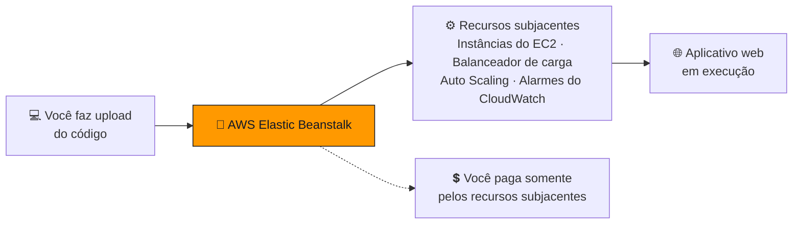
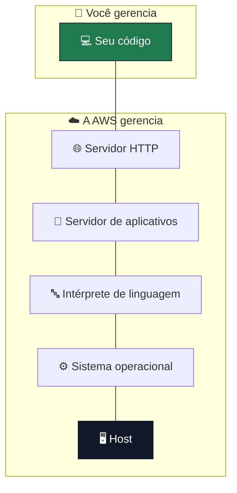

<h1 align="center">🌱 Seção 8 – Introdução ao AWS Elastic Beanstalk</h1>

  
  
   
  
  
  

  <a href="../README.md">🏠 Início</a> &nbsp;•&nbsp;
  <a href="./Seção%207%20-%20Introdução%20ao%20AWS%20Lambda.md">⬅️ Anterior: Introdução ao AWS Lambda</a>

> [!NOTE]
> Esta seção detalha o **AWS Elastic Beanstalk**, apresentado na [Seção 1](./Seção%201%20-%20Visão%20geral%20dos%20serviços%20de%20computação.MD#categorizacao) como a opção de **plataforma como serviço (PaaS)** entre os serviços de computação.

## 📑 Sumário

| # | Tópico |
|:---:|---|
| 1 | [🌱 AWS Elastic Beanstalk](#elastic-beanstalk) |
| 2 | [🚀 Implantações do AWS Elastic Beanstalk](#implantacoes) |
| 3 | [🎁 Benefícios do Elastic Beanstalk](#beneficios) |
| 🎯 | [Principais conclusões](#conclusoes) |

---

## 1. 🌱 AWS Elastic Beanstalk

O **AWS Elastic Beanstalk** é **uma maneira fácil de colocar aplicativos web em execução** na Nuvem AWS.

É um **serviço gerenciado** que lida automaticamente com:

| Tarefa | O que significa |
|---|---|
| 🏗️ **Provisionamento e configuração da infraestrutura** | Cria e configura os recursos em que o aplicativo roda, como [instâncias do EC2](./Seção%202%20-%20Amazon%20EC2%20Parte%201.md#ec2). |
| 🚀 **Implantação** | Coloca cada nova versão do código nos servidores. |
| ⚖️ **Balanceamento de carga** | Distribui o tráfego entre as instâncias, com o **Elastic Load Balancing**. |
| 📈 **Escalabilidade automática** | Adiciona ou remove instâncias conforme a demanda, com o **Amazon EC2 Auto Scaling**. É o [Pilar 2 da otimização de custos](./Seção%205%20-%20Otimização%20de%20custos%20do%20Amazon%20EC2.md#pilar2) feito pelo serviço. |
| 🩺 **Monitoramento de integridade** | Verifica se o aplicativo e as instâncias estão saudáveis, com métricas do [**Amazon CloudWatch**](./Seção%204%20-%20Amazon%20EC2%20Parte%203.md#cloudwatch). |
| 🔍 **Análise e depuração** | Ajuda a investigar erros e problemas de desempenho do aplicativo. |
| 📜 **Registro em log** | Coleta os logs dos servidores do ambiente. |

💲 **Não há custo adicional para o Elastic Beanstalk.** Você **paga somente pelos recursos subjacentes** que usar, como instâncias do EC2 e buckets do S3.

> [!IMPORTANT]
> O Elastic Beanstalk em si é **gratuito**, mas o aplicativo **não roda de graça**: as instâncias, o balanceador de carga e o armazenamento que ele cria são cobrados normalmente. Na prova, "sem custo adicional" quer dizer **sem taxa pelo serviço**, não **sem custo**.

O balanceamento de carga e a escalabilidade automática são detalhados no **Módulo 10**.

## 2. 🚀 Implantações do AWS Elastic Beanstalk

O Elastic Beanstalk **oferece suporte a aplicativos web escritos para plataformas comuns**:

> ☕ **Java** · 🪟 **.NET** · 🐘 **PHP** · 🟩 **Node.js** · 🐍 **Python** · 💎 **Ruby** · 🐹 **Go** · 🐳 **Docker**

Você **faz upload do seu código**:

- 🤖 O Elastic Beanstalk **lida automaticamente com a implantação**.
- 🖥️ Ele implanta em servidores como **Apache**, **NGINX**, **Passenger**, **Puma** e **Microsoft Internet Information Services (IIS)**.

Segundo a narração, você pode implantar o código pelo [**Console de Gerenciamento da AWS**](./Seção%204%20-%20Amazon%20EC2%20Parte%203.md#console), pela [**CLI da AWS**](./Seção%204%20-%20Amazon%20EC2%20Parte%203.md#cli), pelo **Visual Studio** e pelo **Eclipse**.

Cada plataforma usa um desses servidores:

| Plataforma | Servidor |
|---|---|
| ☕ **Java** com Tomcat | Apache Tomcat |
| 🐘 **PHP** · 🐍 **Python** | Apache HTTP Server |
| 🟩 **Node.js** | NGINX ou Apache HTTP Server |
| 💎 **Ruby** | Passenger ou Puma |
| 🪟 **.NET** | Microsoft IIS |

O slide divide a pilha do aplicativo em **duas responsabilidades**:

> [!TIP]
> É o [modelo de responsabilidade compartilhada](../MÓDULO%204/Seção%201%20-%20Modelo%20de%20responsabilidade%20compartilhada%20da%20AWS.md#iaas-paas) aplicado a uma **PaaS**: você cuida só do **código**, e a AWS cuida de tudo abaixo dele. No **EC2**, que é **IaaS**, você gerencia o **sistema operacional** e tudo o que roda acima dele.

Comparando com os outros serviços do módulo:

| | 🖥️ **Amazon EC2** | 🌱 **AWS Elastic Beanstalk** | ⚡ **AWS Lambda** |
|---|---|---|---|
| **Modelo** | IaaS | PaaS | Sem servidor |
| **Você gerencia** | SO, servidores, ambiente de execução e código | Código, com acesso aos recursos subjacentes se quiser | Código da função |
| **Servidores** | Você cria e administra as instâncias | O serviço cria instâncias do EC2, que você pode ver | Nenhum servidor visível |
| **Cobrança** | Instâncias e armazenamento | Somente os recursos subjacentes | [Solicitações e duração](./Seção%207%20-%20Introdução%20ao%20AWS%20Lambda.md#beneficios) |

> [!NOTE]
> Hoje, as plataformas Linux do Elastic Beanstalk rodam no **Amazon Linux 2023**, e o **NGINX** é o servidor proxy padrão na maioria delas. O Ruby usa o **Puma** por padrão, e o .NET roda no **IIS**, no Windows Server, ou no **Linux**.

## 3. 🎁 Benefícios do Elastic Beanstalk

Segundo a narração:

| Benefício | O que significa |
|---|---|
| ⚡ **Comece a usar de forma rápida e simples** | Faça upload do aplicativo pelo **console**, por um **repositório Git** ou por um **IDE**, como Eclipse ou Visual Studio. O Elastic Beanstalk cuida do provisionamento de capacidade, do balanceamento de carga, da escalabilidade automática e do monitoramento de integridade. |
| 🛠️ **Produtividade do desenvolvedor** | Você se concentra em **escrever código**, em vez de gerenciar e configurar servidores, bancos de dados, balanceadores de carga, firewalls e redes. A AWS aplica **patches e atualizações** na plataforma subjacente. |
| 📈 **Dificuldade de superar** | O aplicativo aguenta **picos de carga ou de tráfego** enquanto minimiza custos. Ele escala para cima ou para baixo conforme a necessidade, com configurações fáceis de ajustar, como gatilhos pela **utilização de CPU**. |
| 🎛️ **Controle total dos recursos** | Você escolhe os recursos da AWS ideais para o aplicativo, como o [**tipo de instância do EC2**](./Seção%202%20-%20Amazon%20EC2%20Parte%201.md#tipo-instancia), e pode **assumir o controle** de parte ou de toda a infraestrutura quando quiser. |

> [!NOTE]
> "Dificuldade de superar" é uma tradução literal de *difficult to outgrow*. O sentido é que é **difícil o aplicativo ficar grande demais** para o Elastic Beanstalk: graças à escalabilidade automática, o serviço **cresce junto** com ele.

> [!TIP]
> Os benefícios 2 e 4 se equilibram. O Elastic Beanstalk **esconde** a infraestrutura para você focar no código, mas **não a tranca**: as instâncias do EC2 e os demais recursos continuam na sua conta, e você pode ajustá-los quando precisar.

---

## 🎯 Principais conclusões

- ✅ O **AWS Elastic Beanstalk** é uma **plataforma como serviço (PaaS)** e uma maneira fácil de colocar **aplicativos web** em execução.
- ✅ É um **serviço gerenciado** que cuida de **provisionamento**, **implantação**, **balanceamento de carga**, **escalabilidade automática**, **monitoramento de integridade**, **análise e depuração** e **registro em log**.
- ✅ **Não há custo adicional** pelo Elastic Beanstalk: você paga somente pelos **recursos subjacentes**, como instâncias do EC2.
- ✅ Oferece suporte a **Java, .NET, PHP, Node.js, Python, Ruby, Go e Docker**, implantando em servidores como **Apache, NGINX, Passenger, Puma e IIS**.
- ✅ **Você gerencia só o código**. A AWS gerencia o servidor HTTP, o servidor de aplicativos, o intérprete de linguagem, o sistema operacional e o host.
- ✅ O código pode ser implantado pelo **console**, pela **CLI**, pelo **Visual Studio** e pelo **Eclipse**.
- ✅ Os benefícios são **começar de forma rápida e simples**, **produtividade do desenvolvedor**, **dificuldade de superar** e **controle total dos recursos**.

---

  <a href="../README.md">🏠 Início</a> &nbsp;•&nbsp;
  <a href="./Seção%207%20-%20Introdução%20ao%20AWS%20Lambda.md">⬅️ Anterior: Introdução ao AWS Lambda</a>

