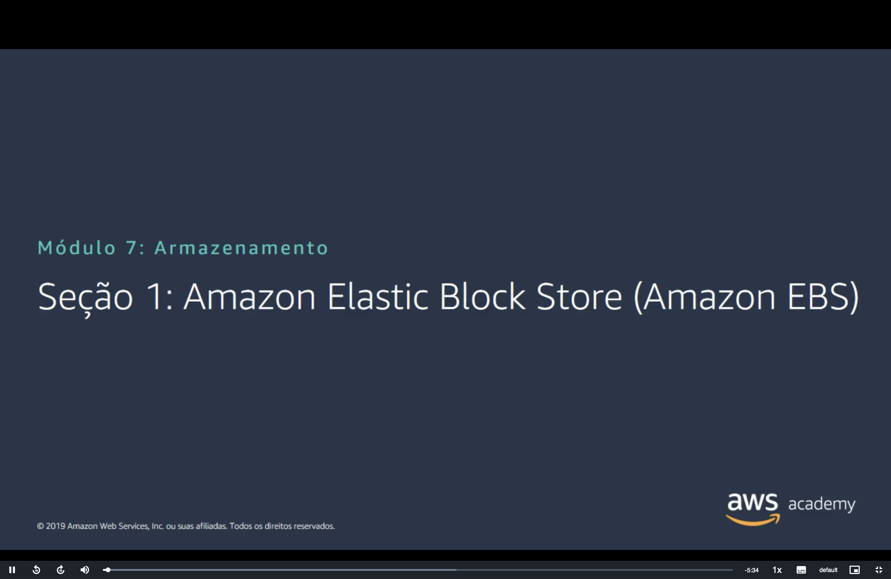
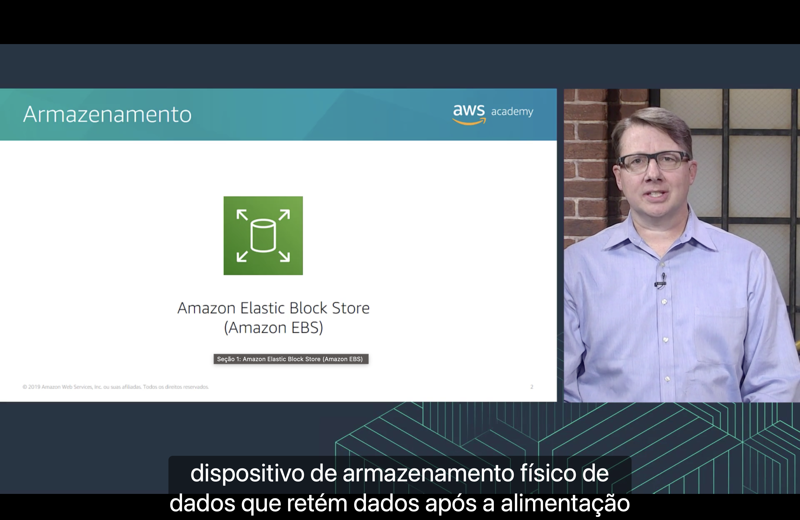
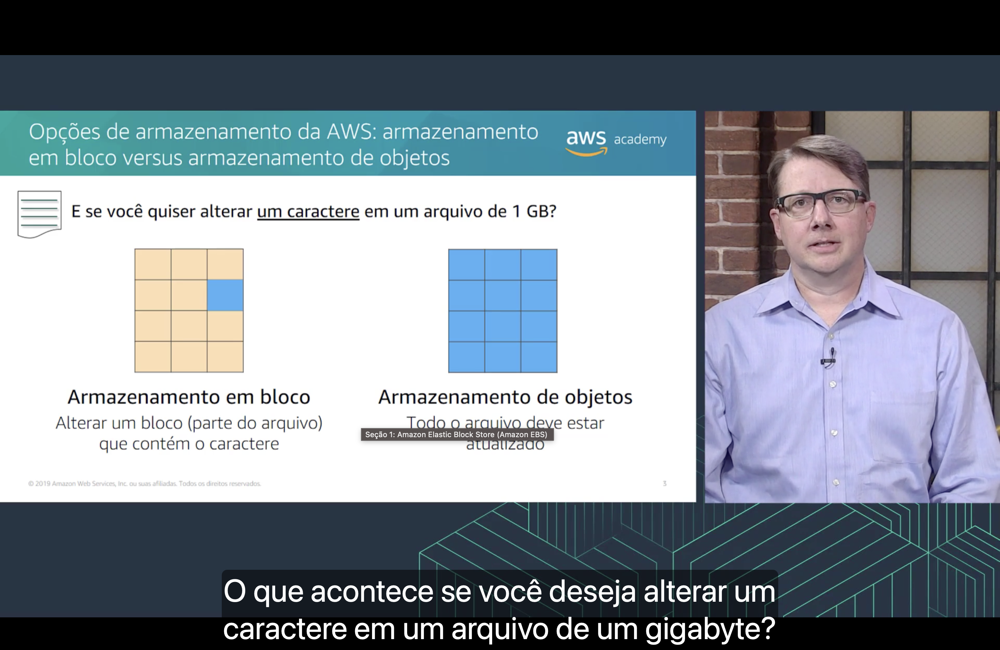
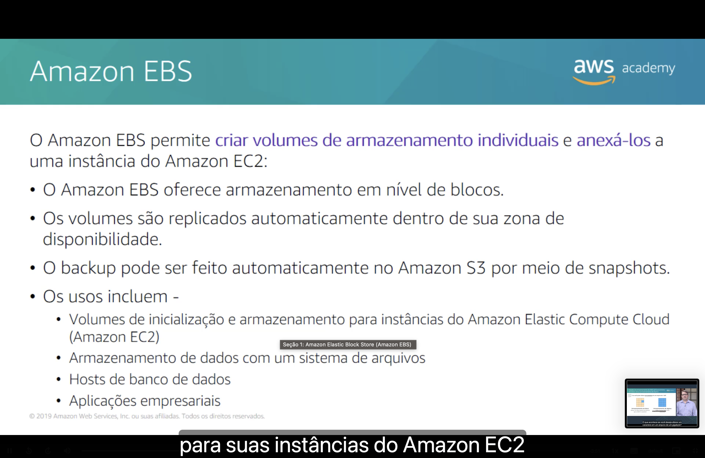
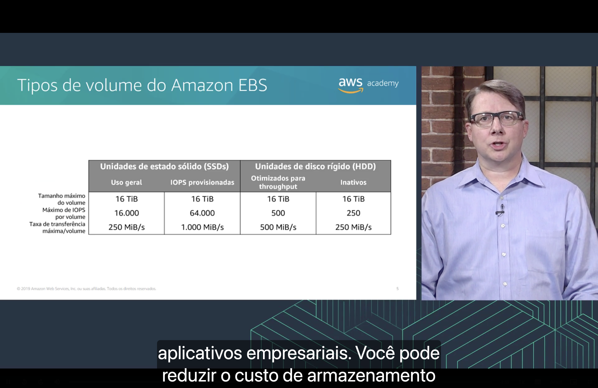
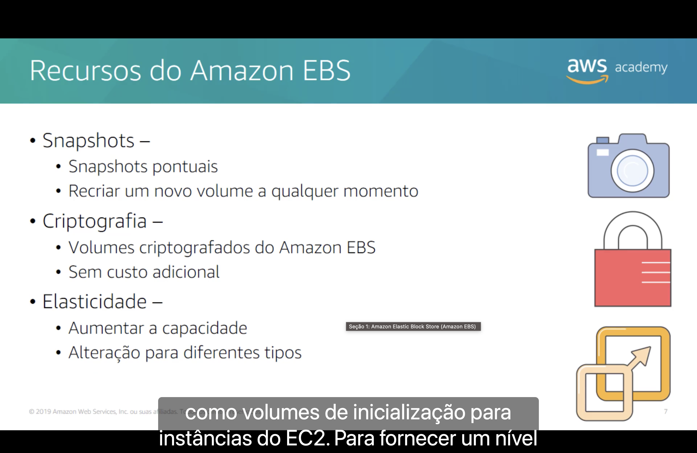
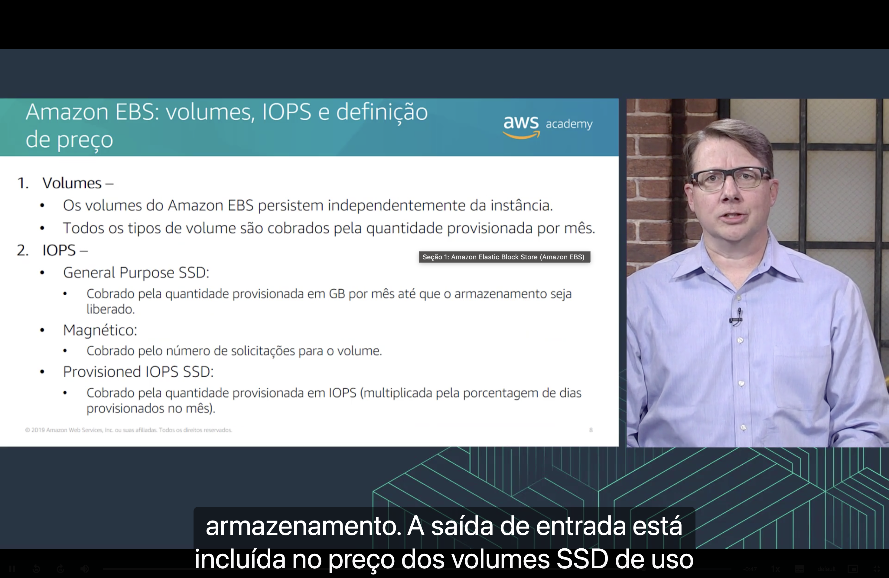
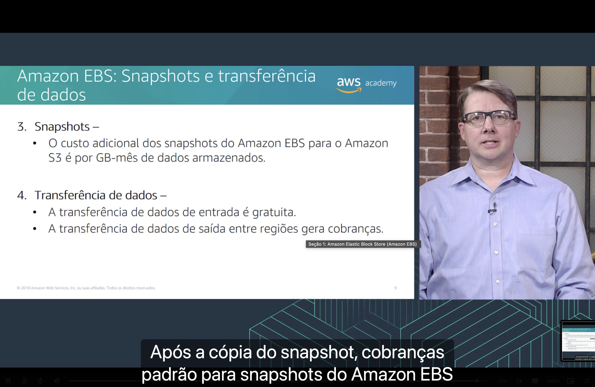

<h1 align="center">💾 Seção 1 – Amazon Elastic Block Store (Amazon EBS)</h1>

  
  
   
  
  
  

  <a href="../README.md">🏠 Início</a> &nbsp;•&nbsp;
  <a href="./Seção%202%20-%20Amazon%20Simple%20Storage%20Service%20(Amazon%20S3).md">Próxima: Amazon S3 ➡️</a>

> [!NOTE]
> Esta seção abre o Módulo 7, sobre **armazenamento**, com o **Amazon EBS**: o armazenamento em bloco que já apareceu no Módulo 6 como [opção de armazenamento do EC2](../MÓDULO%206/Seção%203%20-%20Amazon%20EC2%20Parte%202.md#opcoes). Agora o foco é o próprio serviço: como ele funciona, quais tipos de volume existem e como é cobrado.

## 📑 Sumário

| # | Tópico |
|:---:|---|
| 1 | [💾 Armazenamento: Amazon EBS](#armazenamento) |
| 2 | [🧱 Armazenamento em bloco versus armazenamento de objetos](#bloco-vs-objetos) |
| 3 | [🧲 Amazon EBS](#ebs) |
| 4 | [📊 Tipos de volume do Amazon EBS](#tipos) |
| 5 | [🧰 Recursos do Amazon EBS](#recursos) |
| 6 | [💲 Volumes, IOPS e definição de preço](#preco) |
| 7 | [📸 Snapshots e transferência de dados](#snapshots) |
| 🎯 | [Principais conclusões](#conclusoes) |

---

## 1. 💾 Armazenamento: Amazon EBS

O **Amazon Elastic Block Store (Amazon EBS)** fornece **volumes de armazenamento em bloco persistentes** para usar com instâncias do **Amazon EC2**.

Segundo a narração, **armazenamento persistente** é qualquer dispositivo de armazenamento físico de dados que **retém os dados depois que a alimentação é desligada**. Ele também é chamado de armazenamento **não volátil**.

| Opção | Persistente? |
|---|---|
| 🧱 **Volume do Amazon EBS** | ✅ Sim. Os dados continuam lá quando a instância é interrompida e iniciada de novo. |
| ⚡ **Armazenamento de instâncias** | ❌ Não. Os dados são perdidos quando a instância é interrompida, hibernada ou encerrada. |

> [!TIP]
> Essa é a mesma comparação da [Seção 3 do Módulo 6](../MÓDULO%206/Seção%203%20-%20Amazon%20EC2%20Parte%202.md#opcoes). Ela também explica por que só instâncias **baseadas no EBS** podem ser [interrompidas e hibernadas](../MÓDULO%206/Seção%204%20-%20Amazon%20EC2%20Parte%203.md#ciclo-vida) sem perder o volume raiz.

## 2. 🧱 Armazenamento em bloco versus armazenamento de objetos

O slide propõe uma pergunta: **e se você quiser alterar um caractere em um arquivo de 1 GB?**

| | 🟧 Armazenamento em bloco | 🟦 Armazenamento de objetos |
|---|---|---|
| **Como guarda o arquivo** | Divide o arquivo em **blocos** | Trata o arquivo como **um único objeto** |
| **Para alterar um caractere** | Altera **só o bloco** (parte do arquivo) que contém o caractere | **Todo o arquivo** deve ser atualizado |
| **Exemplo na AWS** | **Amazon EBS** | **Amazon S3** |

No diagrama, isso aparece como **um único quadrado azul** no armazenamento em bloco (só o bloco alterado) e **todos os quadrados azuis** no armazenamento de objetos (o objeto inteiro).

> [!TIP]
> Essa diferença afeta **throughput, latência e custo**. Em geral, o armazenamento em bloco é **mais rápido** e usa **menos largura de banda** para pequenas alterações, mas **custa mais** que o armazenamento de objetos. Por isso o EBS serve bem para **sistemas operacionais e bancos de dados**, que alteram pequenos trechos o tempo todo.

## 3. 🧲 Amazon EBS

O Amazon EBS permite **criar volumes de armazenamento individuais** e **anexá-los a uma instância do Amazon EC2**:

- 🧱 oferece **armazenamento em nível de blocos**;
- 🔁 os volumes são **replicados automaticamente dentro de sua Zona de Disponibilidade**;
- 📸 o **backup** pode ser feito no **Amazon S3** por meio de **snapshots**.

Os usos incluem:

| Uso | Exemplo |
|---|---|
| 🚀 **Volumes de inicialização e armazenamento** | Volume raiz e volumes de dados de instâncias do **EC2** |
| 📂 **Armazenamento de dados com um sistema de arquivos** | Um volume formatado e montado como um disco da instância |
| 🗃️ **Hosts de banco de dados** | Bancos de dados instalados em instâncias do EC2 |
| 🏢 **Aplicações empresariais** | Sistemas que precisam de armazenamento em bloco com baixa latência |

> [!IMPORTANT]
> A replicação acontece **só dentro da [Zona de Disponibilidade](../MÓDULO%203/Seção%201%20-%20Infraestrutura%20global%20da%20AWS.md#zonas)**. Ela protege contra a falha de um componente, mas **não contra a falha da AZ inteira**. Além disso, o volume e a instância precisam estar **na mesma AZ**. Para levar os dados a outra AZ ou Região, crie um **snapshot** e, a partir dele, um novo volume.

> [!NOTE]
> Os snapshots não são criados sozinhos. Para que o backup seja **automático**, como diz o slide, é preciso agendá-los com o **Amazon Data Lifecycle Manager** ou o **AWS Backup**. Os snapshots ficam no S3, mas são **gerenciados pela AWS**: eles não aparecem nos seus buckets.

## 4. 📊 Tipos de volume do Amazon EBS

| | 🟩 SSD: Uso geral (`gp2`) | 🟩 SSD: IOPS provisionadas (`io1`) | 🟫 HDD: Otimizados para throughput (`st1`) | 🟫 HDD: Inativos (`sc1`) |
|---|:---:|:---:|:---:|:---:|
| **Tamanho máximo do volume** | 16 TiB | 16 TiB | 16 TiB | 16 TiB |
| **Máximo de IOPS por volume** | 16.000 | 64.000 | 500 | 250 |
| **Taxa de transferência máxima por volume** | 250 MiB/s | 1.000 MiB/s | 500 MiB/s | 250 MiB/s |

- 🟩 **Unidades de estado sólido (SSDs):** otimizadas para **muitas operações pequenas** de leitura e gravação. Quem manda é o **IOPS**.
- 🟫 **Unidades de disco rígido (HDDs):** otimizadas para **leituras e gravações grandes e sequenciais**. Quem manda é a **taxa de transferência (throughput)**.

> [!NOTE]
> "Inativos" é a tradução de **Cold HDD** (`sc1`), o HDD mais barato, para dados **acessados com pouca frequência**. "Otimizados para throughput" é o **Throughput Optimized HDD** (`st1`), para cargas como **big data, data warehouses e processamento de logs**. **IOPS** significa operações de entrada/saída por segundo.

> [!TIP]
> Nos HDDs, cada operação conta como um bloco de **1 MiB**. Por isso o `st1` tem só **500 IOPS**, mas chega a **500 MiB/s** (500 × 1 MiB). Volumes HDD **não podem ser volume raiz**, como já visto no [Pilar 4 da otimização de custos](../MÓDULO%206/Seção%205%20-%20Otimização%20de%20custos%20do%20Amazon%20EC2.md#pilar4).

> [!NOTE]
> O slide é de 2019, e surgiram tipos novos:
> - **`gp3`** (2020): inclui **3.000 IOPS e 125 MiB/s** de base, qualquer que seja o tamanho, e permite provisionar mais performance separadamente. Desde **setembro de 2025**, chega a **64 TiB, 80.000 IOPS e 2.000 MiB/s** por volume.
> - **`io2` Block Express**: chega a **64 TiB, 256.000 IOPS e 4.000 MiB/s** por volume, em instâncias baseadas no **AWS Nitro System**.
> - Os quatro tipos do slide (`gp2`, `io1`, `st1` e `sc1`) continuam disponíveis com os mesmos limites.

## 5. 🧰 Recursos do Amazon EBS

| Recurso | O que oferece |
|---|---|
| 📸 **Snapshots** | **Snapshots pontuais** (*point-in-time*) do volume. Com eles, você pode **recriar um novo volume a qualquer momento**. |
| 🔒 **Criptografia** | **Volumes criptografados** do Amazon EBS, **sem custo adicional**. |
| 📈 **Elasticidade** | **Aumentar a capacidade** e **alterar para diferentes tipos** de volume. |

- 📸 **Snapshots** são **incrementais**: depois do primeiro, cada snapshot guarda só os **blocos alterados** desde o anterior. É o armazenamento em bloco da [Seção 2](#bloco-vs-objetos) trabalhando a favor do custo.
- 🔒 A **criptografia** usa chaves do [**AWS KMS**](../MÓDULO%204/Seção%204%20-%20Proteção%20de%20contas.md#kms) e protege os **dados em repouso** no volume, os **dados em trânsito** entre a instância e o volume e os **snapshots** criados a partir dele.
- 📈 A **elasticidade** vem do recurso **Elastic Volumes**: você aumenta o tamanho, troca o tipo ou ajusta a performance **sem desanexar o volume** da instância.

> [!WARNING]
> Um volume do EBS **só pode crescer**. Não é possível reduzir o tamanho: para isso, crie um volume menor e copie os dados. E, depois de aumentar o volume, é preciso **estender o sistema de arquivos** no sistema operacional para usar o espaço novo.

## 6. 💲 Volumes, IOPS e definição de preço

**1. Volumes**

- 🧱 Os volumes do Amazon EBS **persistem independentemente da instância**.
- 📅 Todos os tipos de volume são cobrados pela **quantidade provisionada por mês**.

**2. IOPS**

| Tipo | Como o IOPS é cobrado |
|---|---|
| 🟩 **General Purpose SSD** | Cobrado pela **quantidade provisionada em GB por mês** até que o armazenamento seja liberado. O IOPS **já está incluído** no preço. |
| 🧲 **Magnético** | Cobrado pelo **número de solicitações** para o volume. |
| 🟩 **Provisioned IOPS SSD** | Cobrado pela **quantidade provisionada em IOPS**, multiplicada pela **porcentagem de dias provisionados no mês**. |

> [!NOTE]
> Na legenda, "a saída de entrada está incluída no preço dos volumes SSD de uso geral" é uma tradução literal de *I/O*, ou **entrada/saída**. O sentido é que, no General Purpose SSD, você **não paga por operação**, ao contrário do volume magnético.

> [!TIP]
> "Provisionada" é a palavra-chave: você paga pelo **tamanho que reservou**, não pelo que usa. Um volume de 100 GiB com 10 GiB ocupados é cobrado como 100 GiB. E como o volume **persiste independentemente da instância**, ele continua sendo cobrado mesmo com a instância interrompida, como no [Pilar 2](../MÓDULO%206/Seção%205%20-%20Otimização%20de%20custos%20do%20Amazon%20EC2.md#pilar2).

> [!NOTE]
> O slide é de 2019, e alguns pontos mudaram:
> - O volume **Magnético** (`standard`) é de **geração anterior**. A AWS não o recomenda para cargas novas.
> - No **`gp3`**, você paga por **GB-mês** e, separadamente, pelo IOPS acima de **3.000** e pelo throughput acima de **125 MiB/s**.

## 7. 📸 Snapshots e transferência de dados

**3. Snapshots**

- 💾 O custo adicional dos snapshots do Amazon EBS para o **Amazon S3** é **por GB-mês de dados armazenados**.

**4. Transferência de dados**

| Direção | Custo |
|---|---|
| ⬇️ **Entrada** | **Gratuita** |
| ⬆️ **Saída entre Regiões** | **Gera cobranças** |

Segundo a narração, isso vale, por exemplo, para a **cópia de um snapshot para outra Região**: você paga pela transferência e, depois da cópia, as **cobranças padrão de snapshots do Amazon EBS** se aplicam na Região de destino.

> [!TIP]
> Como os snapshots são **incrementais**, o "GB-mês de dados armazenados" se refere só aos **blocos guardados**, não ao tamanho do volume. Um volume de 100 GiB com 10 GiB de dados gera um primeiro snapshot de cerca de 10 GiB.

> [!NOTE]
> Depois do slide surgiu o **EBS Snapshots Archive** (2021), um nível de arquivamento até **75% mais barato** para snapshots guardados por **90 dias ou mais** e raramente acessados.

---

## 🎯 Principais conclusões

- ✅ O **Amazon EBS** fornece **volumes de armazenamento em bloco persistentes** para instâncias do **EC2**: os dados continuam lá depois que a instância é interrompida.
- ✅ No **armazenamento em bloco** (EBS), alterar um caractere muda **só o bloco** afetado. No **armazenamento de objetos** (S3), **todo o arquivo** precisa ser atualizado.
- ✅ Os volumes são **replicados automaticamente dentro da Zona de Disponibilidade** e precisam estar **na mesma AZ** que a instância.
- ✅ Os usos incluem **volumes de inicialização**, **sistemas de arquivos**, **bancos de dados** e **aplicações empresariais**.
- ✅ Há volumes **SSD** (**uso geral** e **IOPS provisionadas**), focados em IOPS, e volumes **HDD** (**otimizados para throughput** e **inativos**), focados em throughput. HDDs **não servem como volume raiz**.
- ✅ Os recursos principais são **snapshots pontuais**, **criptografia sem custo adicional** e **elasticidade** (aumentar a capacidade e trocar o tipo).
- ✅ Todos os volumes são cobrados pela **quantidade provisionada por mês**. O IOPS está incluído no **General Purpose SSD**, é cobrado por solicitação no **magnético** e por IOPS provisionado no **Provisioned IOPS SSD**.
- ✅ Snapshots custam **por GB-mês armazenado** no S3. A transferência de **entrada é gratuita** e a de **saída entre Regiões é cobrada**.

---

  <a href="../README.md">🏠 Início</a> &nbsp;•&nbsp;
  <a href="./Seção%202%20-%20Amazon%20Simple%20Storage%20Service%20(Amazon%20S3).md">Próxima: Amazon S3 ➡️</a>

