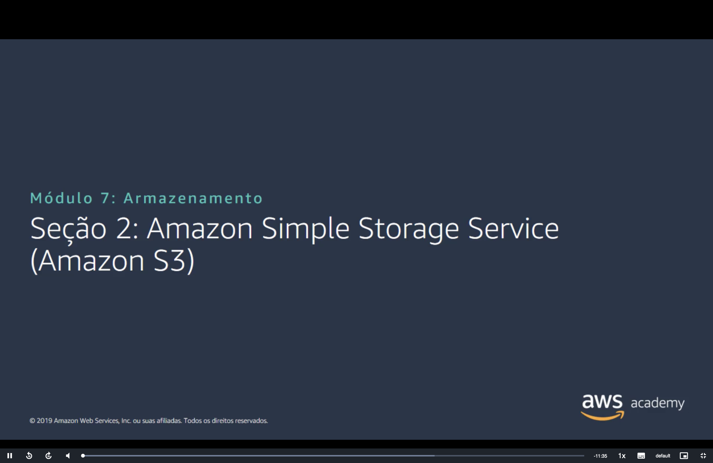
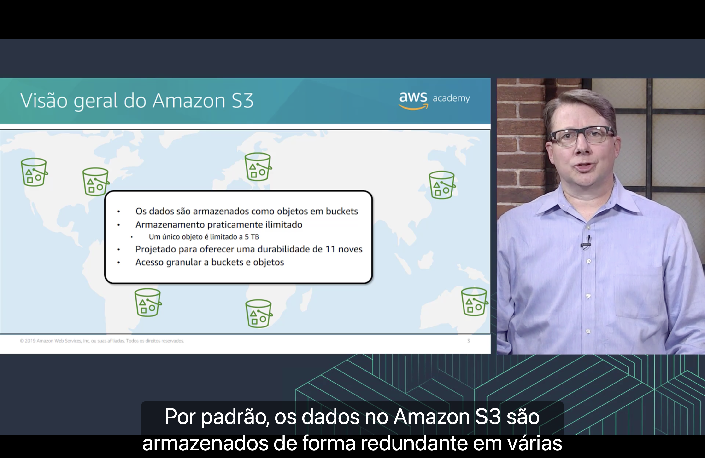
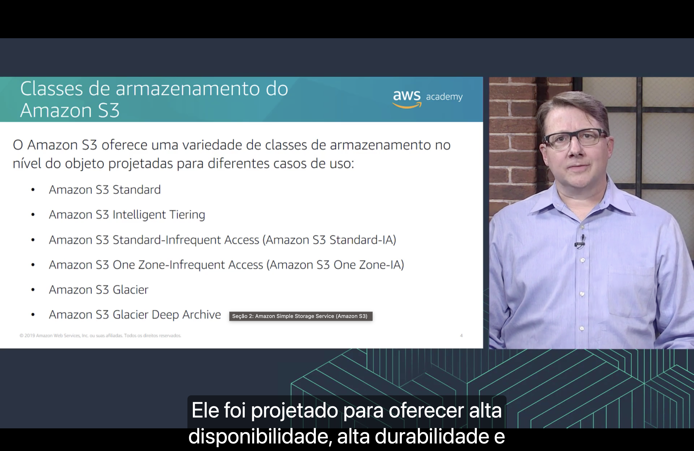
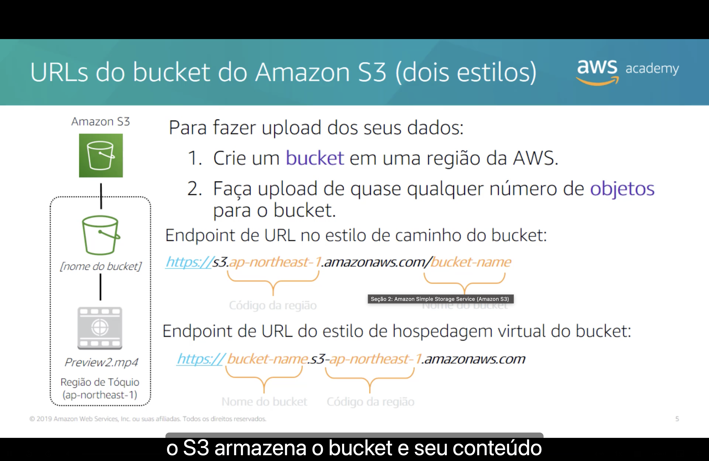
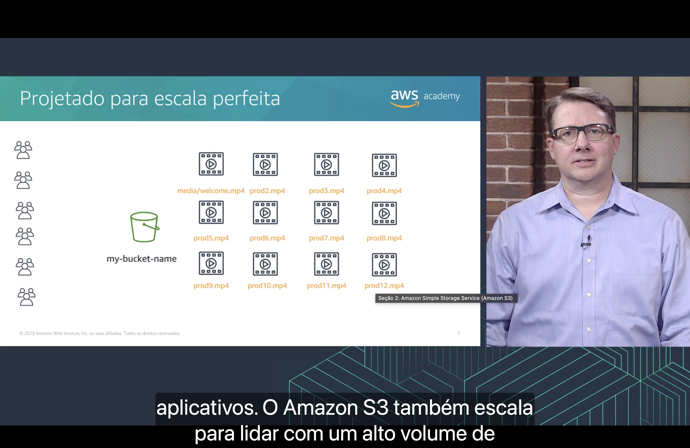
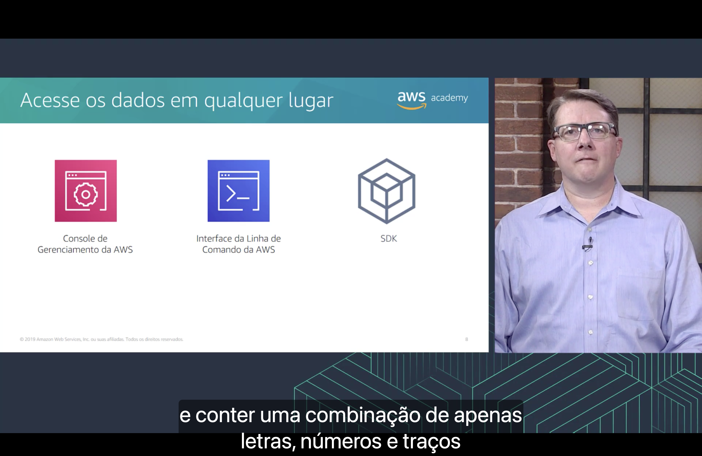
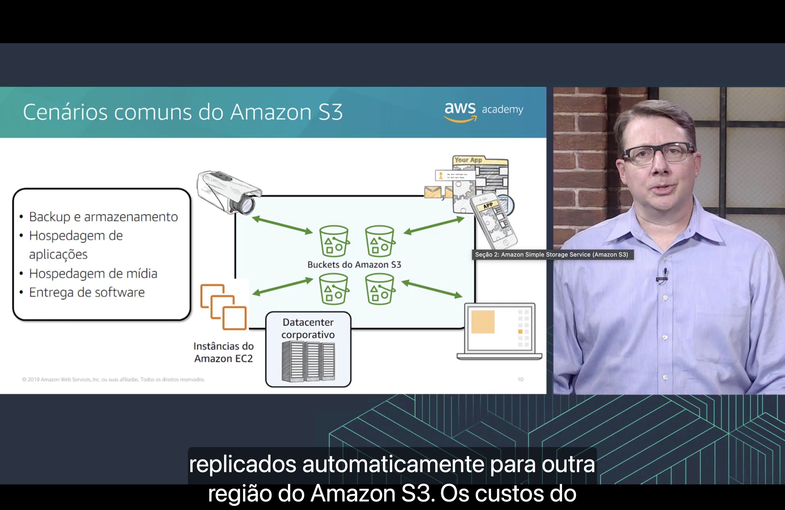
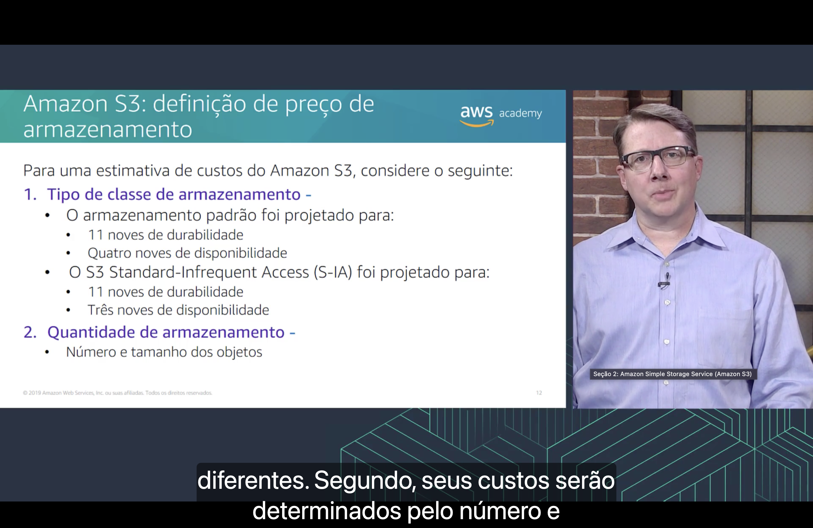
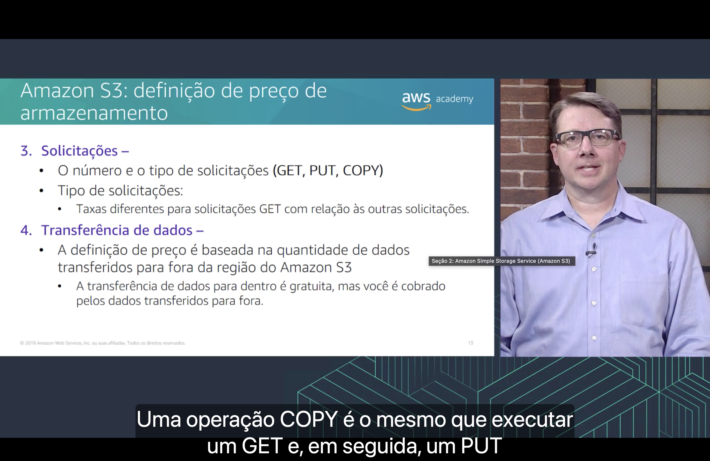

<h1 align="center">🪣 Seção 2 – Amazon Simple Storage Service (Amazon S3)</h1>

<p align="center">
  
  
  <br>
  
  
  
</p>

<p align="center">
  <a href="../README.md">🏠 Início</a> &nbsp;•&nbsp;
  <a href="./Seção%201%20-%20Amazon%20Elastic%20Block%20Store%20(Amazon%20EBS).md">⬅️ Anterior: Amazon EBS</a> &nbsp;•&nbsp;
  <a href="./Seção%203%20-%20Amazon%20Elastic%20File%20System%20(Amazon%20EFS).md">Próxima: Amazon EFS ➡️</a>
</p>



> [!NOTE]
> Depois do armazenamento em bloco da [Seção 1](./Seção%201%20-%20Amazon%20Elastic%20Block%20Store%20(Amazon%20EBS).md), esta seção apresenta o lado do **armazenamento de objetos**: o **Amazon S3**. O foco é como os dados são organizados, quais classes de armazenamento existem, como acessar os dados e como o serviço é cobrado.

## 📑 Sumário

| # | Tópico |
|:---:|---|
| 1 | [🪣 Visão geral do Amazon S3](#visao-geral) |
| 2 | [🗂️ Classes de armazenamento do Amazon S3](#classes) |
| 3 | [🔗 URLs do bucket do Amazon S3 (dois estilos)](#urls) |
| 4 | [📈 Projetado para escala perfeita](#escala) |
| 5 | [🌍 Acesse os dados em qualquer lugar](#acesso) |
| 6 | [🧩 Cenários comuns do Amazon S3](#cenarios) |
| 7 | [💲 Definição de preço: classe e quantidade de armazenamento](#preco-armazenamento) |
| 8 | [💸 Definição de preço: solicitações e transferência de dados](#preco-solicitacoes) |
| 🎯 | [Principais conclusões](#conclusoes) |

---

<a id="visao-geral"></a>
## 1. 🪣 Visão geral do Amazon S3



- 🪣 Os dados são armazenados como **objetos** em **buckets**.
- ♾️ O armazenamento é **praticamente ilimitado**. Um **único objeto** é limitado a **5 TB**.
- 🛡️ É projetado para oferecer **durabilidade de 11 noves** (99,999999999%).
- 🔐 O **acesso é granular**, tanto a buckets quanto a objetos.

Segundo a narração, **por padrão** os dados no Amazon S3 são armazenados de forma **redundante em várias instalações** da Região. É uma diferença importante em relação ao [EBS](./Seção%201%20-%20Amazon%20Elastic%20Block%20Store%20(Amazon%20EBS).md#ebs), cujos volumes são replicados **só dentro de uma Zona de Disponibilidade**.

> [!TIP]
> Para ter uma ideia do que significam 11 noves: se você armazenar **10 milhões de objetos**, pode esperar perder, em média, **um objeto a cada 10 mil anos**.

> [!NOTE]
> O "acesso granular" é feito com **políticas de bucket**, **políticas do IAM** e **listas de controle de acesso (ACLs)**, como visto em [Proteção de buckets e objetos do Amazon S3](../MÓDULO%204/Seção%205%20-%20Proteção%20de%20dados%20na%20AWS.md#s3), no Módulo 4.

> [!NOTE]
> O slide é de 2019, e alguns pontos mudaram:
> - O tamanho máximo de um objeto subiu de **5 TB** para **50 TB** em **dezembro de 2025**.
> - Desde **dezembro de 2020**, o S3 tem **consistência forte de leitura após gravação**: depois de gravar um objeto, a próxima leitura já retorna a versão nova.
> - Desde **janeiro de 2023**, todo objeto novo é **criptografado por padrão** (SSE-S3).
> - Desde **abril de 2023**, buckets novos vêm com o **Bloqueio de Acesso Público** ativado e as **ACLs desativadas** por padrão.

<a id="classes"></a>
## 2. 🗂️ Classes de armazenamento do Amazon S3



O Amazon S3 oferece uma variedade de **classes de armazenamento no nível do objeto**, projetadas para diferentes casos de uso:

| Classe | Indicada para |
|---|---|
| 🟢 **Amazon S3 Standard** | Dados **acessados com frequência**. Segundo a narração, foi projetada para oferecer **alta disponibilidade, alta durabilidade** e alta performance. |
| 🤖 **Amazon S3 Intelligent-Tiering** | Dados com **padrão de acesso desconhecido ou variável**. Move os objetos **automaticamente** entre níveis de acesso conforme o uso. |
| 🟡 **Amazon S3 Standard-Infrequent Access (S3 Standard-IA)** | Dados **acessados com pouca frequência**, mas que precisam de **acesso rápido** quando necessário. |
| 🟠 **Amazon S3 One Zone-Infrequent Access (S3 One Zone-IA)** | Como o Standard-IA, mas em **uma única Zona de Disponibilidade**. Serve para dados que podem ser **recriados**, como cópias secundárias. |
| 🧊 **Amazon S3 Glacier** | **Arquivamento** de dados com baixo custo. |
| 🧊 **Amazon S3 Glacier Deep Archive** | **Arquivamento de longo prazo**, acessado raramente, com o **menor custo** de todos. |

> [!TIP]
> "No nível do objeto" quer dizer que a classe é escolhida **para cada objeto**, não para o bucket inteiro. Um mesmo bucket pode misturar classes, e as **políticas de ciclo de vida** movem os objetos entre elas com o tempo, como no [Pilar 4 da otimização de custos](../MÓDULO%206/Seção%205%20-%20Otimização%20de%20custos%20do%20Amazon%20EC2.md#pilar4).

> [!NOTE]
> O slide é de 2019, e a lista mudou:
> - O **Amazon S3 Glacier** passou a se chamar **S3 Glacier Flexible Retrieval** em **2021**.
> - Na mesma época surgiu o **S3 Glacier Instant Retrieval**, para dados de arquivamento que precisam ser lidos **em milissegundos**.
> - Em **2023** surgiu o **S3 Express One Zone**, com latência de milissegundos de um dígito, em uma única Zona de Disponibilidade.

<a id="urls"></a>
## 3. 🔗 URLs do bucket do Amazon S3 (dois estilos)



Para fazer **upload** dos seus dados:

1. 🪣 crie um **bucket** em uma **Região da AWS**;
2. ⬆️ faça upload de **quase qualquer número de objetos** para o bucket.

No exemplo do slide, o objeto `Preview2.mp4` está em um bucket na **Região de Tóquio** (`ap-northeast-1`). O bucket pode ser acessado por dois estilos de URL:

| Estilo | Formato | Onde fica o nome do bucket |
|---|---|---|
| 🛣️ **Estilo de caminho** (*path-style*) | `https://s3.ap-northeast-1.amazonaws.com/bucket-name` | No **caminho**, depois do domínio |
| 🏠 **Estilo de hospedagem virtual** (*virtual-hosted-style*) | `https://bucket-name.s3-ap-northeast-1.amazonaws.com` | No **domínio**, antes de `s3` |

Nos dois casos, o **código da Região** (`ap-northeast-1`) também faz parte da URL.

> [!TIP]
> O bucket é um recurso **regional**: os objetos ficam na Região escolhida e só saem dela se você transferi-los. Por isso a [escolha da Região](../MÓDULO%203/Seção%201%20-%20Infraestrutura%20global%20da%20AWS.md#selecao-regiao) importa para latência, custo e conformidade.

> [!NOTE]
> O slide é de 2019, e alguns pontos mudaram:
> - Em 2019, a AWS anunciou o fim das URLs no **estilo de caminho**, mas **adiou** a mudança em 2020. As duas formas ainda funcionam, e a recomendada é a de **hospedagem virtual**.
> - O formato com hífen (`s3-ap-northeast-1`) é **legado**. Hoje a AWS recomenda usar ponto: `https://bucket-name.s3.ap-northeast-1.amazonaws.com`.

<a id="escala"></a>
## 4. 📈 Projetado para escala perfeita



O diagrama mostra **muitos grupos de usuários** acessando **um único bucket** (`my-bucket-name`) com **vários objetos de vídeo** (`media/welcome.mp4`, `prod2.mp4` até `prod12.mp4`).

Segundo a narração, o Amazon S3 **escala automaticamente** para lidar com um **alto volume de solicitações**. Você não precisa provisionar armazenamento nem capacidade antecipadamente.

> [!TIP]
> Repare no `media/welcome.mp4`. O S3 não tem pastas de verdade: a estrutura é **plana**, e `media/` é só um **prefixo** que faz parte do nome (a **chave**) do objeto. O console exibe esse prefixo como se fosse uma pasta. Cada prefixo suporta pelo menos **3.500 solicitações PUT/COPY/POST/DELETE** e **5.500 solicitações GET/HEAD por segundo**.

<a id="acesso"></a>
## 5. 🌍 Acesse os dados em qualquer lugar



Os dados do Amazon S3 podem ser acessados pelas [três maneiras de interagir com a AWS](../MÓDULO%201/Seção%203%20-%20Introdução%20à%20Amazon%20Web%20Services%20(AWS).md#interagir):

| Ferramenta | Exemplo de uso no S3 |
|---|---|
| 🖱️ **Console de Gerenciamento da AWS** | Criar buckets e fazer upload de arquivos pelo navegador |
| ⌨️ **Interface da Linha de Comando da AWS (CLI)** | Copiar arquivos por comando ou script |
| 🧑‍💻 **SDK** | Ler e gravar objetos direto do código da aplicação |

Exemplo com a CLI:

```bash
aws s3 mb s3://bucket-name --region ap-northeast-1   # cria o bucket
aws s3 cp Preview2.mp4 s3://bucket-name/             # faz upload do objeto
aws s3 ls s3://bucket-name/                          # lista os objetos
```

Na narração deste slide, o instrutor também fala das **regras de nome do bucket**: o nome deve conter uma combinação de **apenas letras, números e traços**. Pela documentação atual, as regras principais são:

| Regra | Detalhe |
|---|---|
| 🌐 **Único globalmente** | Nenhum outro bucket, em nenhuma conta, pode ter o mesmo nome |
| 📏 **Tamanho** | De **3 a 63** caracteres |
| 🔤 **Caracteres** | **Letras minúsculas**, números, hifens (`-`) e pontos (`.`) |
| 🔚 **Início e fim** | Começar e terminar com **letra ou número** |

> [!TIP]
> O nome precisa ser único globalmente porque ele vira parte de um **nome DNS**, como você viu nas [URLs da seção 3](#urls). Evite pontos no nome: eles causam problemas de certificado HTTPS no estilo de hospedagem virtual.

<a id="cenarios"></a>
## 6. 🧩 Cenários comuns do Amazon S3



| Cenário | Exemplo |
|---|---|
| 💾 **Backup e armazenamento** | Cópias de segurança dos dados de um **datacenter corporativo** ou de **instâncias do EC2** |
| 📱 **Hospedagem de aplicações** | Arquivos usados por **aplicações web e móveis** |
| 🎬 **Hospedagem de mídia** | **Vídeos, fotos e músicas** para upload e download, como os de uma câmera de vigilância |
| 📦 **Entrega de software** | Aplicações e atualizações que os clientes **baixam** |

O diagrama mostra os **buckets do Amazon S3** no centro, trocando dados com **câmeras**, **aplicativos**, **computadores**, **instâncias do EC2** e um **datacenter corporativo**.

Segundo a narração, no cenário de backup os dados podem ser **replicados automaticamente para outra Região** do Amazon S3.

> [!NOTE]
> Essa replicação entre Regiões (**S3 Cross-Region Replication**) **não é automática por padrão**: você configura uma regra de replicação, e o **versionamento** precisa estar ativado nos buckets de origem e de destino.

<a id="preco-armazenamento"></a>
## 7. 💲 Definição de preço: classe e quantidade de armazenamento



Para uma estimativa de custos do Amazon S3, considere o seguinte:

**1. Tipo de classe de armazenamento**

| Classe | Durabilidade | Disponibilidade |
|---|:---:|:---:|
| 🟢 **Armazenamento padrão** (S3 Standard) | 11 noves (99,999999999%) | **Quatro** noves (99,99%) |
| 🟡 **S3 Standard-Infrequent Access** (S-IA) | 11 noves (99,999999999%) | **Três** noves (99,9%) |

**2. Quantidade de armazenamento**

- 📦 O **número e o tamanho dos objetos**.

> [!TIP]
> As duas classes têm a **mesma durabilidade**: a diferença está na **disponibilidade**. Em um ano, 99,99% permite cerca de **53 minutos** de indisponibilidade, e 99,9% permite cerca de **8,8 horas**. O Standard-IA compensa isso com um armazenamento **mais barato**, mas cobra uma **taxa por GB recuperado**.

> [!IMPORTANT]
> No S3 você paga pelo que está **armazenado**, não por uma capacidade **provisionada**. É o contrário do [EBS](./Seção%201%20-%20Amazon%20Elastic%20Block%20Store%20(Amazon%20EBS).md#preco), em que um volume de 100 GiB é cobrado como 100 GiB mesmo com 10 GiB ocupados.

<a id="preco-solicitacoes"></a>
## 8. 💸 Definição de preço: solicitações e transferência de dados



**3. Solicitações**

- 🔢 O **número e o tipo** de solicitações (**GET, PUT, COPY**).
- 💲 As solicitações **GET** têm **taxas diferentes** das outras solicitações.

Segundo a narração, uma operação **COPY** é o mesmo que executar um **GET** e, em seguida, um **PUT**.

**4. Transferência de dados**

- 🌍 A definição de preço é baseada na quantidade de dados **transferidos para fora da Região** do Amazon S3.

| Direção | Custo |
|---|---|
| ⬇️ **Para dentro** | **Gratuita** |
| ⬆️ **Para fora** | **Cobrada** |

> [!NOTE]
> Na tabela de preços, **PUT, COPY, POST e LIST** ficam na mesma faixa, e **GET e SELECT** em outra, bem mais barata. No S3 Standard da Região Norte da Virgínia, são **US$ 0,005** contra **US$ 0,0004** a cada mil solicitações.

> [!TIP]
> Algumas transferências de saída **não são cobradas**: para o [**Amazon CloudFront**](../MÓDULO%205/Seção%206%20-%20Amazon%20CloudFront.md#preco), para instâncias do **EC2 na mesma Região** e os primeiros **100 GB por mês** para a internet, somando todos os serviços da AWS.

---

<a id="conclusoes"></a>
## 🎯 Principais conclusões

- ✅ O **Amazon S3** armazena dados como **objetos** em **buckets**, com armazenamento **praticamente ilimitado**. Um objeto podia ter até **5 TB** no slide; hoje são **50 TB**.
- ✅ É projetado para **11 noves de durabilidade**, e por padrão guarda os dados de forma **redundante em várias instalações** da Região.
- ✅ As classes **Standard**, **Intelligent-Tiering**, **Standard-IA**, **One Zone-IA**, **Glacier** e **Glacier Deep Archive** atendem a diferentes **padrões de acesso**, e a classe é escolhida **por objeto**.
- ✅ Para fazer upload, você **cria um bucket em uma Região** e envia **quase qualquer número de objetos**.
- ✅ Um bucket pode ser acessado por URL no **estilo de caminho** ou no **estilo de hospedagem virtual**, e o nome do bucket deve ser **único globalmente**.
- ✅ O S3 **escala automaticamente** para um alto volume de solicitações e pode ser acessado pelo **console**, pela **CLI** e pelos **SDKs**.
- ✅ Os cenários comuns são **backup e armazenamento**, **hospedagem de aplicações**, **hospedagem de mídia** e **entrega de software**.
- ✅ O custo depende de **quatro fatores**: **classe de armazenamento**, **quantidade armazenada** (número e tamanho dos objetos), **solicitações** (GET custa diferente das outras) e **transferência de dados** (entrada gratuita, saída da Região cobrada).

---

<p align="center">
  <a href="../README.md">🏠 Início</a> &nbsp;•&nbsp;
  <a href="./Seção%201%20-%20Amazon%20Elastic%20Block%20Store%20(Amazon%20EBS).md">⬅️ Anterior: Amazon EBS</a> &nbsp;•&nbsp;
  <a href="./Seção%203%20-%20Amazon%20Elastic%20File%20System%20(Amazon%20EFS).md">Próxima: Amazon EFS ➡️</a>
</p>
