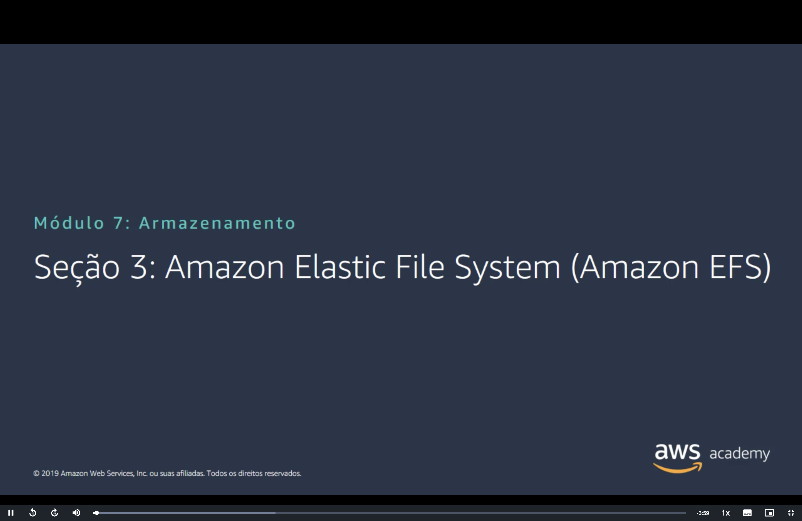
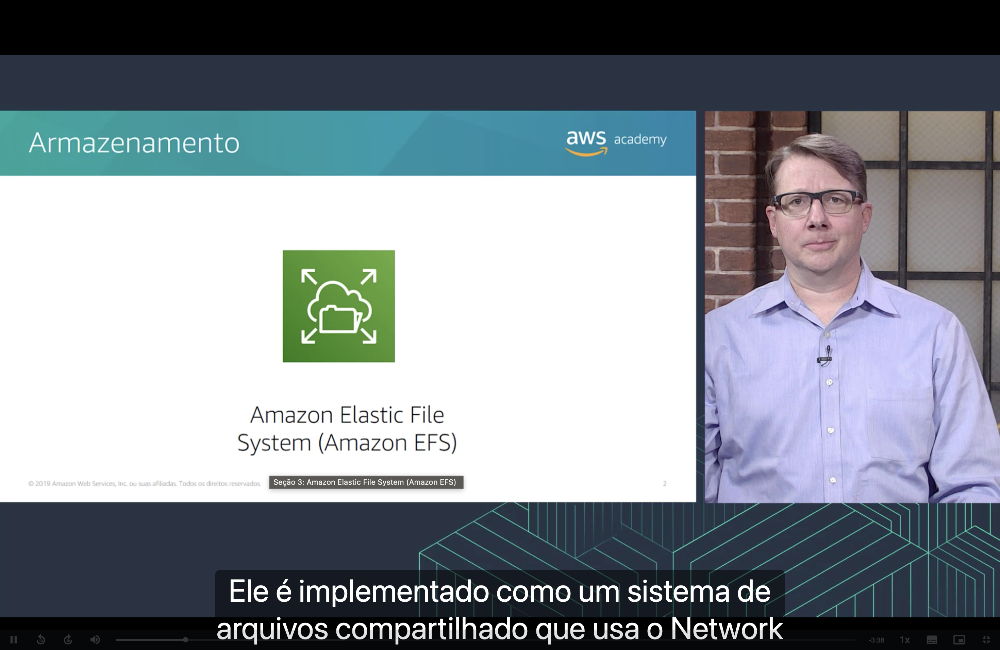
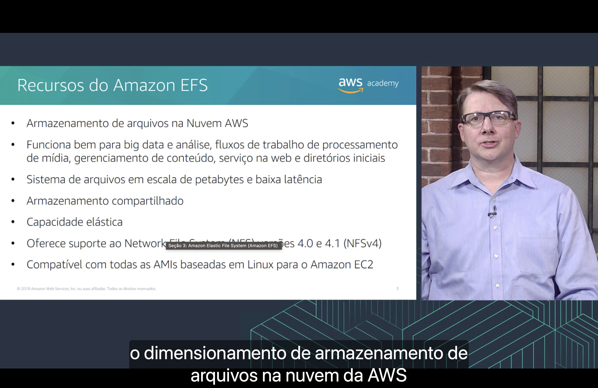
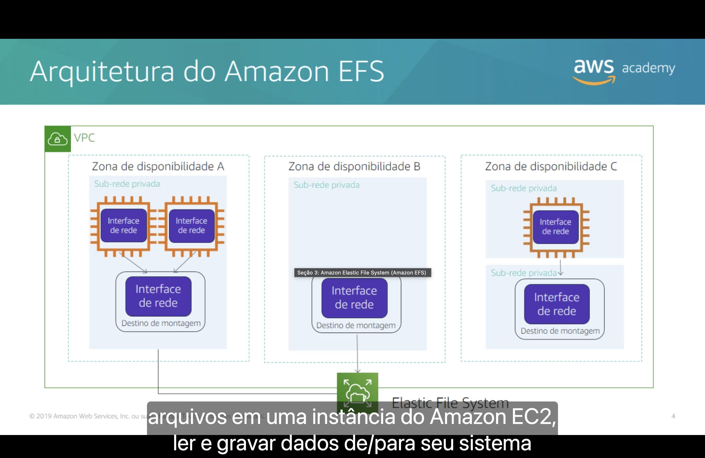
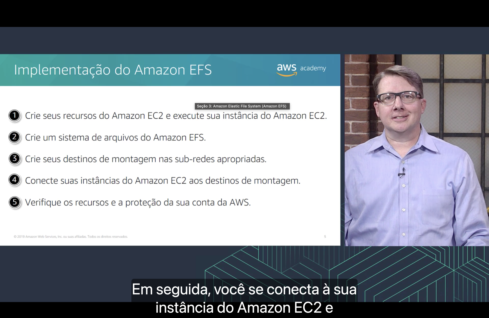
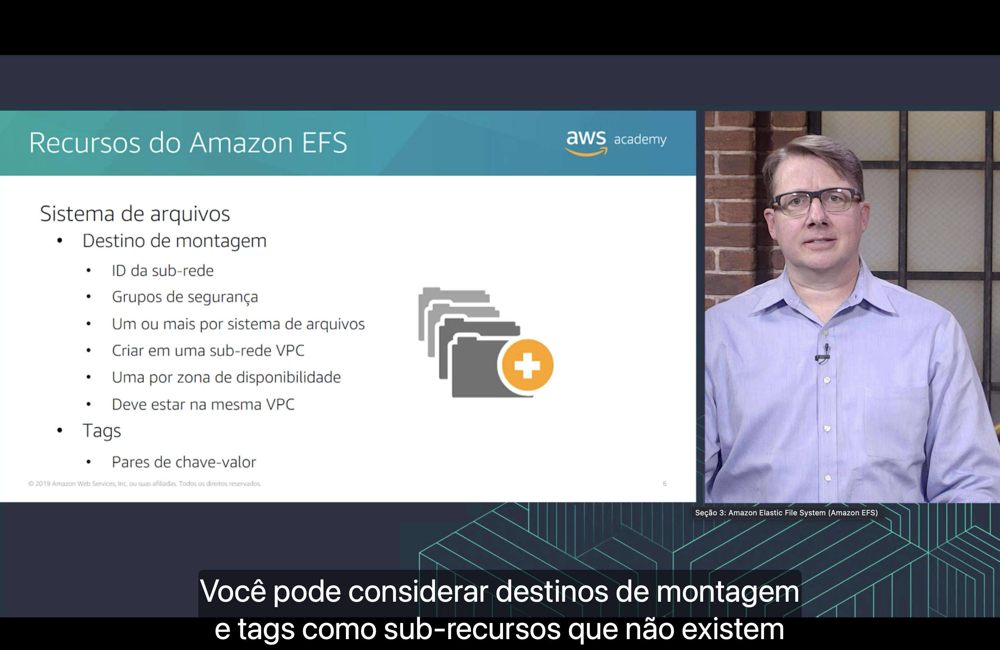

<h1 align="center">📁 Seção 3 – Amazon Elastic File System (Amazon EFS)</h1>

<p align="center">
  
  
  <br>
  
  
  
</p>

<p align="center">
  <a href="../README.md">🏠 Início</a> &nbsp;•&nbsp;
  <a href="./Seção%202%20-%20Amazon%20Simple%20Storage%20Service%20(Amazon%20S3).md">⬅️ Anterior: Amazon S3</a> &nbsp;•&nbsp;
  <a href="./Seção%204%20-%20Amazon%20S3%20Glacier.md">Próxima: Amazon S3 Glacier ➡️</a>
</p>



> [!NOTE]
> Depois do armazenamento em **bloco** ([EBS](./Seção%201%20-%20Amazon%20Elastic%20Block%20Store%20(Amazon%20EBS).md)) e de **objetos** ([S3](./Seção%202%20-%20Amazon%20Simple%20Storage%20Service%20(Amazon%20S3).md)), esta seção completa o trio com o armazenamento de **arquivos**: o **Amazon EFS**, um sistema de arquivos que várias instâncias do EC2 podem usar ao mesmo tempo.

## 📑 Sumário

| # | Tópico |
|:---:|---|
| 1 | [📁 Armazenamento: Amazon EFS](#armazenamento) |
| 2 | [🧰 Recursos do Amazon EFS](#recursos) |
| 3 | [🏗️ Arquitetura do Amazon EFS](#arquitetura) |
| 4 | [🛠️ Implementação do Amazon EFS](#implementacao) |
| 5 | [🧩 Sistema de arquivos, destinos de montagem e tags](#destinos) |
| 🎯 | [Principais conclusões](#conclusoes) |

---

<a id="armazenamento"></a>
## 1. 📁 Armazenamento: Amazon EFS



O **Amazon Elastic File System (Amazon EFS)** oferece **armazenamento de arquivos** para instâncias do **Amazon EC2**.

Segundo a narração, ele é implementado como um **sistema de arquivos compartilhado** que usa o protocolo **Network File System (NFS)**.

> [!TIP]
> Na [categoria de armazenamento do Módulo 3](../MÓDULO%203/Seção%202%20-%20Visão%20geral%20dos%20serviços%20e%20das%20categorias%20de%20serviços%20da%20AWS.md#armazenamento), a associação era **objeto = S3**, **bloco = EBS** e **arquivo = EFS**. No [Módulo 6](../MÓDULO%206/Seção%203%20-%20Amazon%20EC2%20Parte%202.md#opcoes), o EFS apareceu como uma opção de armazenamento do EC2 que **não serve como volume raiz**: ele guarda dados, não o sistema operacional.

<a id="recursos"></a>
## 2. 🧰 Recursos do Amazon EFS



| Recurso | O que significa |
|---|---|
| ☁️ **Armazenamento de arquivos na Nuvem AWS** | Arquivos organizados em **diretórios**, como em um disco comum |
| 🧩 **Casos de uso** | **Big data e análise**, fluxos de trabalho de **processamento de mídia**, **gerenciamento de conteúdo**, **serviço na web** e **diretórios iniciais** |
| 📏 **Escala de petabytes e baixa latência** | O sistema de arquivos pode chegar a **petabytes** sem perder desempenho |
| 🤝 **Armazenamento compartilhado** | **Várias instâncias** acessam os mesmos arquivos **ao mesmo tempo** |
| 📈 **Capacidade elástica** | Cresce e diminui **automaticamente** conforme arquivos são adicionados ou removidos |
| 🔌 **NFS versões 4.0 e 4.1 (NFSv4)** | Usa um protocolo padrão de compartilhamento de arquivos em rede |
| 🐧 **Compatível com todas as AMIs baseadas em Linux** | Funciona com qualquer [AMI](../MÓDULO%206/Seção%202%20-%20Amazon%20EC2%20Parte%201.md#ami) Linux do Amazon EC2 |

> [!NOTE]
> "Diretórios iniciais" é a tradução de *home directories*: as **pastas pessoais** dos usuários, como `/home/usuario` no Linux. "Serviço na web" é *web serving*, ou seja, servir os arquivos de um site.

> [!TIP]
> "Capacidade elástica" é a grande diferença em relação ao EBS. No [EBS](./Seção%201%20-%20Amazon%20Elastic%20Block%20Store%20(Amazon%20EBS).md#preco), você **provisiona** o tamanho do volume e paga por ele. No EFS, não há tamanho para escolher: você paga pelo **que está armazenado**, como no S3.

Comparando os três serviços vistos até aqui:

| | 🧱 Amazon EBS | 🪣 Amazon S3 | 📁 Amazon EFS |
|---|---|---|---|
| **Tipo** | Bloco | Objeto | Arquivo |
| **Como é acessado** | **Anexado** a uma instância | Por **URL e API** | **Montado** por várias instâncias, via NFS |
| **Compartilhamento** | Uma instância por vez (exceto Multi-Attach do `io1`/`io2`) | Qualquer cliente com permissão | Várias instâncias ao mesmo tempo |
| **Escopo** | Uma Zona de Disponibilidade | Região | Região (várias AZs) |
| **Cobrança** | Capacidade **provisionada** | Dados **armazenados**, solicitações e transferência | Dados **armazenados** |

> [!NOTE]
> O slide é de 2019, e alguns pontos mudaram:
> - Hoje o EFS tem três classes de armazenamento: **EFS Standard**, **EFS Infrequent Access (IA)** e **EFS Archive** (2023). As **políticas de ciclo de vida** movem os arquivos entre elas automaticamente.
> - O modo **Elastic Throughput** (2022) é o padrão: a taxa de transferência acompanha a carga de trabalho, e você paga só pelo que usar.
> - Além do EC2, o EFS pode ser montado por funções do **AWS Lambda** e por contêineres do **Amazon ECS** e do **Amazon EKS**.
> - O EFS continua sem suporte a **Windows**. Para compartilhamento de arquivos no Windows, a AWS oferece o **Amazon FSx for Windows File Server**.

<a id="arquitetura"></a>
## 3. 🏗️ Arquitetura do Amazon EFS



O diagrama mostra uma **VPC** com três **Zonas de Disponibilidade** (A, B e C), cada uma com **sub-redes privadas**:

| Zona | O que tem |
|---|---|
| 🅰️ **Zona de Disponibilidade A** | **Duas instâncias do EC2** e um **destino de montagem**, na mesma sub-rede privada |
| 🅱️ **Zona de Disponibilidade B** | Só um **destino de montagem**, sem instâncias |
| ©️ **Zona de Disponibilidade C** | **Uma instância do EC2** em uma sub-rede privada e o **destino de montagem** em **outra** sub-rede privada |

Todos os **destinos de montagem** se conectam ao mesmo **Elastic File System**. Segundo a narração, depois de montar o sistema de arquivos em uma instância do Amazon EC2, você pode **ler e gravar dados** nele como em um disco local.

> [!TIP]
> Repare que cada destino de montagem é uma **[interface de rede](../MÓDULO%205/Seção%202%20-%20Amazon%20VPC.md#eni)**, com um endereço IP na sub-rede. As instâncias acessam o EFS pelo destino de montagem **da própria AZ**, mesmo quando ele está em outra sub-rede, como na Zona C. A Zona B mostra que você pode criar o destino de montagem antes de ter instâncias ali.

> [!IMPORTANT]
> É por causa dessa arquitetura que o EFS é **altamente disponível**: o mesmo sistema de arquivos fica acessível em **várias AZs ao mesmo tempo**. Compare com o [EBS](./Seção%201%20-%20Amazon%20Elastic%20Block%20Store%20(Amazon%20EBS).md#ebs), cujo volume fica preso a **uma única AZ**.

<a id="implementacao"></a>
## 4. 🛠️ Implementação do Amazon EFS



| Passo | O que fazer |
|:---:|---|
| 1️⃣ | Crie seus **recursos do Amazon EC2** e execute sua **instância** do Amazon EC2. |
| 2️⃣ | Crie um **sistema de arquivos** do Amazon EFS. |
| 3️⃣ | Crie seus **destinos de montagem** nas **sub-redes** apropriadas. |
| 4️⃣ | **Conecte** suas instâncias do Amazon EC2 aos destinos de montagem. |
| 5️⃣ | **Verifique os recursos** e a **proteção** da sua conta da AWS. |

Segundo a narração, no passo 4 você **se conecta à instância** do Amazon EC2 e **monta o sistema de arquivos** nela. Um exemplo no Amazon Linux, com o auxiliar de montagem do EFS:

```bash
sudo dnf install -y amazon-efs-utils       # instala o auxiliar de montagem
sudo mkdir /mnt/efs                        # cria a pasta onde o EFS vai aparecer
sudo mount -t efs fs-12345678:/ /mnt/efs   # monta o sistema de arquivos
```

> [!WARNING]
> O [grupo de segurança](../MÓDULO%205/Seção%204%20-%20Segurança%20da%20VPC.md#sg) do destino de montagem precisa **permitir tráfego de entrada na porta TCP 2049** (NFS), vindo das instâncias. Sem essa regra, o comando `mount` fica esperando até expirar.

> [!NOTE]
> No original em inglês, o passo 5 é *Clean up resources and protect your AWS account*. A ideia é **excluir os recursos** criados no teste, para não continuar pagando por eles.

<a id="destinos"></a>
## 5. 🧩 Sistema de arquivos, destinos de montagem e tags



O **sistema de arquivos** é o recurso principal do Amazon EFS. Ligados a ele, existem:

**Destino de montagem**

| Característica | Detalhe |
|---|---|
| 🆔 **ID da sub-rede** | Cada destino de montagem é criado **em uma sub-rede** específica |
| 🛡️ **Grupos de segurança** | Controlam **quem pode acessar** o destino de montagem |
| 🔢 **Um ou mais por sistema de arquivos** | Um sistema de arquivos pode ter **vários** destinos de montagem |
| 🌐 **Criar em uma [sub-rede VPC](../MÓDULO%205/Seção%202%20-%20Amazon%20VPC.md#vpc-subredes)** | O destino de montagem vive **dentro da VPC** |
| 🗺️ **Um por Zona de Disponibilidade** | No máximo **um destino de montagem por AZ** |
| 🔒 **Deve estar na mesma VPC** | Todos os destinos de montagem de um sistema de arquivos ficam **na mesma VPC** |

**Tags**

- 🏷️ **Pares de chave-valor**, como as [tags do EC2](../MÓDULO%206/Seção%204%20-%20Amazon%20EC2%20Parte%203.md#tags).

Segundo a narração, destinos de montagem e tags podem ser considerados **sub-recursos**: eles **não existem** sem estar associados a um sistema de arquivos.

> [!TIP]
> "Um por AZ" e "deve estar na mesma VPC" juntos explicam o diagrama da [arquitetura](#arquitetura): três AZs, três destinos de montagem, todos na mesma VPC.

> [!NOTE]
> Depois do slide, surgiu outro sub-recurso: os **pontos de acesso** (*access points*, 2020). Eles definem uma **pasta raiz** e um **usuário** fixos para cada aplicação que acessa o sistema de arquivos.

---

<a id="conclusoes"></a>
## 🎯 Principais conclusões

- ✅ O **Amazon EFS** oferece **armazenamento de arquivos** compartilhado para instâncias do EC2, usando o protocolo **NFS** (versões 4.0 e 4.1).
- ✅ Funciona bem para **big data e análise**, **processamento de mídia**, **gerenciamento de conteúdo**, **serviço na web** e **diretórios iniciais**.
- ✅ É um sistema de arquivos em **escala de petabytes**, com **baixa latência**, **armazenamento compartilhado** e **capacidade elástica**.
- ✅ É compatível com todas as **AMIs baseadas em Linux** do Amazon EC2.
- ✅ As instâncias acessam o EFS por **destinos de montagem**: **interfaces de rede** criadas em sub-redes da VPC, **uma por Zona de Disponibilidade** e todas **na mesma VPC**.
- ✅ Para implementar: execute a instância do EC2, crie o sistema de arquivos, crie os destinos de montagem, conecte as instâncias e verifique os recursos e a proteção da conta.
- ✅ **Destinos de montagem** e **tags** são **sub-recursos** que só existem associados a um sistema de arquivos.
- ✅ Resumindo o módulo até aqui: **EBS = bloco**, **S3 = objeto** e **EFS = arquivo**.

---

<p align="center">
  <a href="../README.md">🏠 Início</a> &nbsp;•&nbsp;
  <a href="./Seção%202%20-%20Amazon%20Simple%20Storage%20Service%20(Amazon%20S3).md">⬅️ Anterior: Amazon S3</a> &nbsp;•&nbsp;
  <a href="./Seção%204%20-%20Amazon%20S3%20Glacier.md">Próxima: Amazon S3 Glacier ➡️</a>
</p>
