<h1 align="center">🧊 Seção 4 – Amazon S3 Glacier</h1>

  
  
   
  
  
  

  <a href="../README.md">🏠 Início</a> &nbsp;•&nbsp;
  <a href="./Seção%203%20-%20Amazon%20Elastic%20File%20System%20(Amazon%20EFS).md">⬅️ Anterior: Amazon EFS</a>

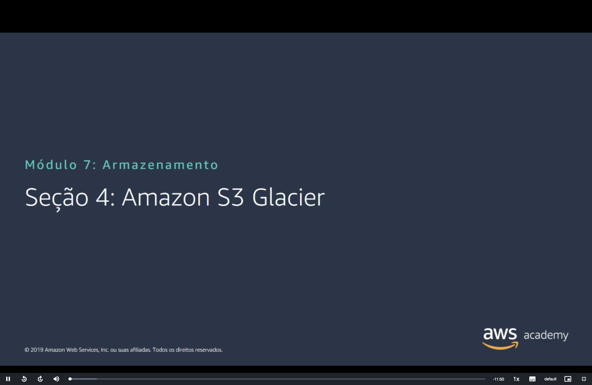

> [!NOTE]
> O **Amazon S3 Glacier** já apareceu como uma das [classes de armazenamento do S3](./Seção%202%20-%20Amazon%20Simple%20Storage%20Service%20(Amazon%20S3).md#classes). Esta seção fecha o módulo com o lado do **arquivamento**: guardar dados por anos, com custo muito baixo, aceitando esperar de minutos a horas para recuperá-los.

## 📑 Sumário

| # | Tópico |
|:---:|---|
| 1 | [🧊 Análise do Amazon S3 Glacier](#analise) |
| 2 | [⏳ Arquivamento e opções de recuperação](#recuperacao) |
| 3 | [🧩 Casos de uso do Amazon S3 Glacier](#casos-de-uso) |
| 4 | [🔌 Uso do Amazon S3 Glacier](#uso) |
| 5 | [🔄 Políticas de ciclo de vida](#ciclo-de-vida) |
| 6 | [🗂️ Classes de armazenamento do Amazon S3](#classes) |
| 7 | [⚖️ Comparação de armazenamento](#comparacao) |
| 8 | [🔐 Criptografia no lado do servidor](#criptografia) |
| 9 | [🛡️ Segurança com o Amazon S3 Glacier](#seguranca) |
| 🎯 | [Principais conclusões](#conclusoes) |

---

## 1. 🧊 Análise do Amazon S3 Glacier

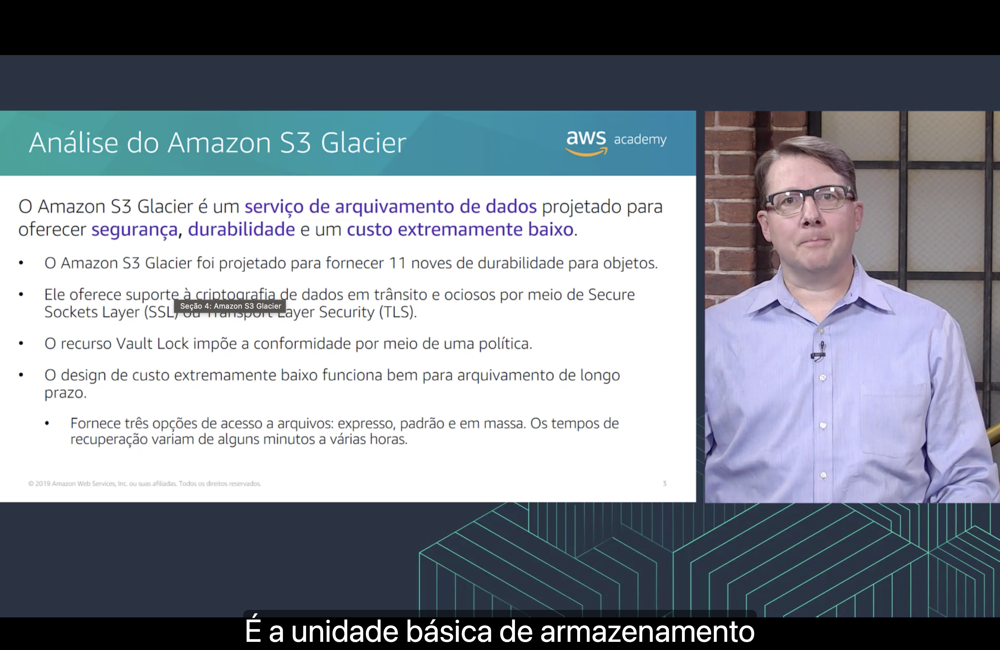

O Amazon S3 Glacier é um **serviço de arquivamento de dados** projetado para oferecer **segurança**, **durabilidade** e um **custo extremamente baixo**:

- 🛡️ foi projetado para fornecer **11 noves de durabilidade** para objetos, a mesma do [S3](./Seção%202%20-%20Amazon%20Simple%20Storage%20Service%20(Amazon%20S3).md#visao-geral);
- 🔐 oferece suporte à **criptografia de dados em trânsito e em repouso**, por meio de **SSL** ou **TLS**;
- 🔒 o recurso **Vault Lock** impõe a **conformidade** por meio de uma **política**;
- 💲 o design de custo extremamente baixo funciona bem para **arquivamento de longo prazo**. Há **três opções de acesso** a arquivos: **expressa**, **padrão** e **em massa**, com tempos de recuperação que vão de **alguns minutos a várias horas**.

Segundo a narração, o **arquivo** (*archive*) é a **unidade básica de armazenamento** do S3 Glacier. Os termos do serviço são:

| Termo | O que é |
|---|---|
| 📄 **Arquivo** (*archive*) | Qualquer objeto guardado no Glacier, como uma foto, um vídeo ou um documento. Cada arquivo tem um **ID exclusivo** |
| 🗄️ **Cofre** (*vault*) | O **contêiner** que guarda os arquivos, criado em uma Região. É o equivalente ao bucket do S3 |
| 📜 **Política de acesso do cofre** | Define **quem pode acessar** o cofre e **quais operações** pode fazer |
| 🔒 **Política do Vault Lock** | Uma política que, depois de **bloqueada**, **não pode mais ser alterada**. É ela que garante a conformidade |

> [!NOTE]
> No slide, "dados em trânsito e ociosos" é uma tradução literal de *in transit and at rest*. O termo usual em português é **em repouso**, como no [Módulo 4](../MÓDULO%204/Seção%205%20-%20Proteção%20de%20dados%20na%20AWS.md#repouso).

> [!TIP]
> O **Vault Lock** serve para regras como "nenhum arquivo pode ser excluído antes de 7 anos", exigidas por normas de conformidade. Como a política fica imutável, **nem o administrador da conta** consegue afrouxá-la depois. É o modelo **WORM** (*write once, read many*).

> [!NOTE]
> O slide é de 2019, e alguns pontos mudaram:
> - O "Glacier" do slide é, na verdade, o **serviço original baseado em cofres**. Ele **deixou de aceitar clientes novos em 15 de dezembro de 2025**. Quem já usava continua com acesso aos dados.
> - Para arquivamento novo, a AWS recomenda as **classes de armazenamento S3 Glacier**, usadas direto em buckets do S3. A classe "S3 Glacier" virou **S3 Glacier Flexible Retrieval** em 2021.
> - Nas classes do S3, o equivalente ao Vault Lock é o **S3 Object Lock**.

## 2. ⏳ Arquivamento e opções de recuperação

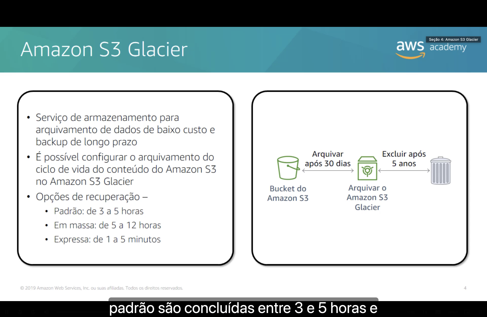

- 🧊 É um serviço de armazenamento para **arquivamento de dados de baixo custo** e **backup de longo prazo**.
- 🔄 É possível configurar o **arquivamento do ciclo de vida** do conteúdo do Amazon S3 no Amazon S3 Glacier.

As **opções de recuperação**, da mais rápida para a mais lenta:

| Opção | Tempo de recuperação |
|---|:---:|
| ⚡ **Expressa** | 1 a 5 **minutos** |
| 🕒 **Padrão** | 3 a 5 **horas** |
| 📦 **Em massa** | 5 a 12 **horas** |

O diagrama mostra um ciclo completo: um objeto no **bucket do Amazon S3** é **arquivado no S3 Glacier após 30 dias** e **excluído após 5 anos**.

> [!TIP]
> Quanto mais rápida a recuperação, **mais cara** ela é. A opção **em massa** serve para recuperar grandes volumes sem pressa, e a **expressa** para emergências pontuais.

> [!NOTE]
> Na classe **S3 Glacier Flexible Retrieval**, os tempos continuam os mesmos, e a recuperação **em massa** passou a ser **gratuita**. No **S3 Glacier Deep Archive**, não existe a opção expressa: a padrão leva até **12 horas**, e a em massa, até **48 horas**.

## 3. 🧩 Casos de uso do Amazon S3 Glacier

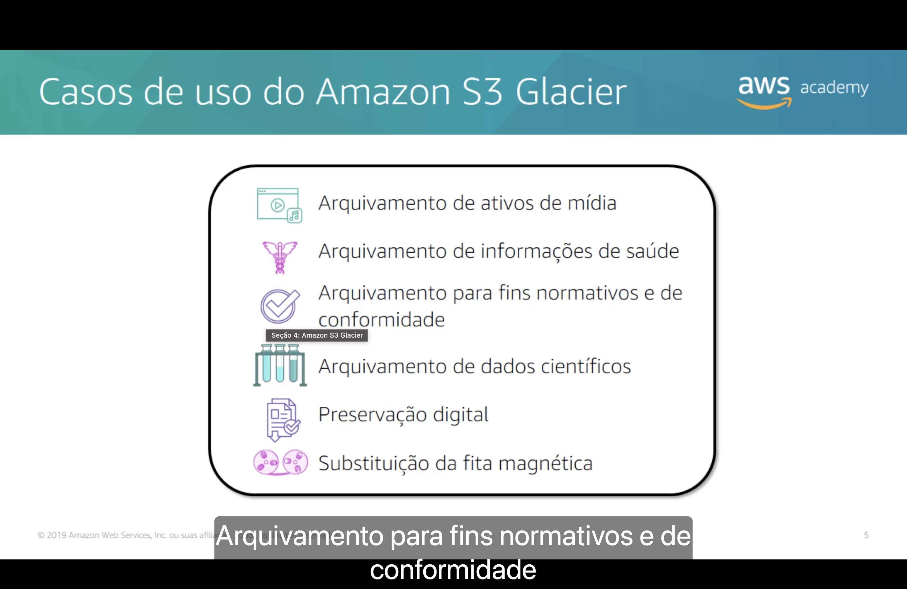

| Caso de uso | Exemplo |
|---|---|
| 🎬 **Arquivamento de ativos de mídia** | Gravações originais de vídeo e áudio, raramente reabertas |
| ⚕️ **Arquivamento de informações de saúde** | Prontuários e exames que a lei manda guardar por anos |
| ✅ **Arquivamento para fins normativos e de conformidade** | Registros financeiros e documentos exigidos por auditorias |
| 🧪 **Arquivamento de dados científicos** | Resultados de pesquisas e experimentos |
| 📜 **Preservação digital** | Acervos de bibliotecas, museus e órgãos públicos |
| 📼 **Substituição da fita magnética** | Troca de backups em fita por armazenamento na nuvem |

> [!TIP]
> O que todos têm em comum: dados que **precisam ser guardados por muito tempo**, mas são **lidos raramente**. É exatamente para esse padrão que o Glacier troca recuperação rápida por custo baixo.

## 4. 🔌 Uso do Amazon S3 Glacier

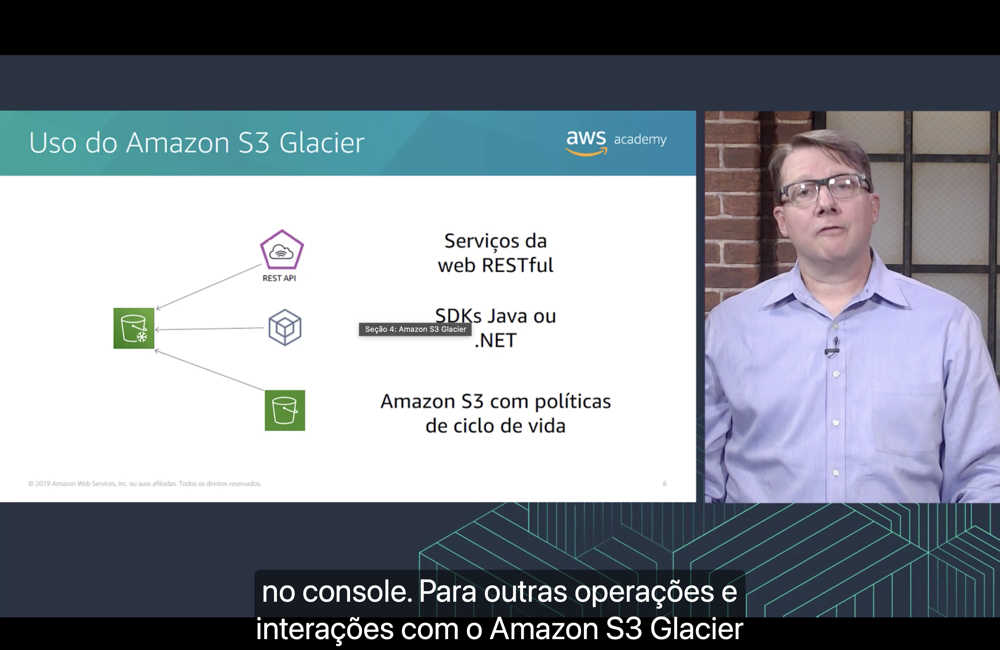

Há três formas de interagir com o Amazon S3 Glacier:

| Forma | Como funciona |
|---|---|
| 🌐 **Serviços da web RESTful** | Chamadas diretas à **API REST** do serviço |
| 🧑‍💻 **SDKs Java ou .NET** | Acesso pelo **código da aplicação** |
| 🪣 **Amazon S3 com políticas de ciclo de vida** | O S3 **move os objetos** para o Glacier automaticamente |

Segundo a narração, o **console** serve só para algumas operações. Para **outras operações e interações** com o Amazon S3 Glacier, é preciso usar a API, os SDKs ou a CLI.

> [!WARNING]
> No serviço original baseado em cofres, o console permite **criar e excluir cofres**, mas **não fazer upload** de arquivos. Para enviar dados, é preciso usar código, a CLI ou o caminho mais simples: as **políticas de ciclo de vida do S3**.

## 5. 🔄 Políticas de ciclo de vida

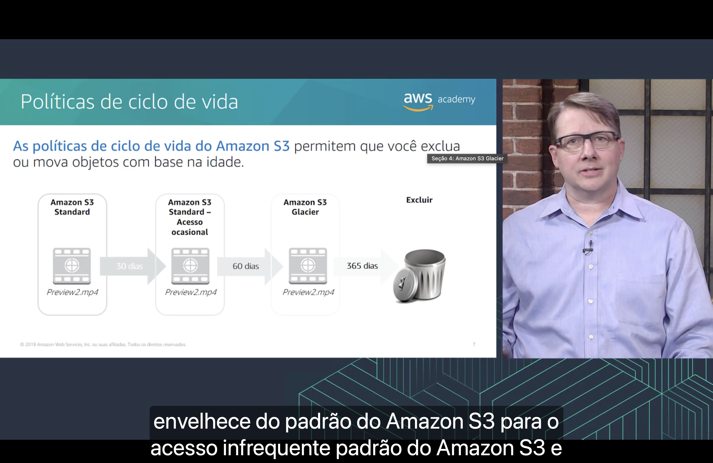

As **políticas de ciclo de vida do Amazon S3** permitem **excluir** ou **mover** objetos **com base na idade**.

No exemplo, o objeto `Preview2.mp4` passa por esta sequência:

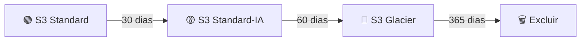

Segundo a narração, o objeto **envelhece** do Amazon S3 Standard para o Amazon S3 Standard-Infrequent Access e depois para o S3 Glacier, até ser excluído.

> [!NOTE]
> No slide, "Acesso ocasional" é a tradução de **Standard-Infrequent Access** (Standard-IA).

> [!TIP]
> Nas regras de ciclo de vida, os dias são contados **a partir da criação do objeto**, não do passo anterior. Lido assim, o diagrama mantém o objeto **30 dias no Standard**, mais **30 no Standard-IA** e o restante do primeiro ano no **Glacier**. É o mesmo mecanismo citado no [Pilar 4 da otimização de custos](../MÓDULO%206/Seção%205%20-%20Otimização%20de%20custos%20do%20Amazon%20EC2.md#pilar4).

> [!WARNING]
> As classes mais baratas têm **duração mínima de armazenamento**: **30 dias** no Standard-IA, **90** no Glacier Flexible Retrieval e **180** no Glacier Deep Archive. Excluir ou mover um objeto antes disso gera cobrança pelos dias restantes.

## 6. 🗂️ Classes de armazenamento do Amazon S3

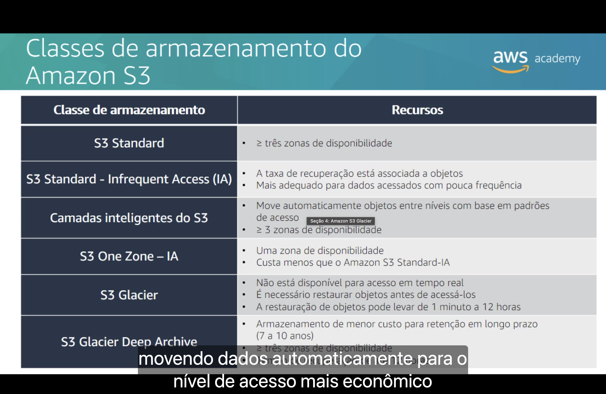

Esta tabela detalha a [lista de classes da Seção 2](./Seção%202%20-%20Amazon%20Simple%20Storage%20Service%20(Amazon%20S3).md#classes):

| Classe de armazenamento | Recursos |
|---|---|
| 🟢 **S3 Standard** | Dados em **três ou mais Zonas de Disponibilidade** |
| 🟡 **S3 Standard-Infrequent Access (IA)** | A **taxa de recuperação** está associada aos objetos. Mais adequado para dados **acessados com pouca frequência** |
| 🤖 **S3 Intelligent-Tiering** | **Move automaticamente** objetos entre níveis com base em **padrões de acesso**. Três ou mais AZs |
| 🟠 **S3 One Zone-IA** | **Uma** Zona de Disponibilidade. **Custa menos** que o Standard-IA |
| 🧊 **S3 Glacier** | **Não está disponível para acesso em tempo real**. É preciso **restaurar** os objetos antes de acessá-los, o que pode levar de **1 minuto a 12 horas** |
| 🧊 **S3 Glacier Deep Archive** | Armazenamento de **menor custo** para **retenção de longo prazo** (7 a 10 anos). Três ou mais AZs. Recuperação em até **12 horas** |

Segundo a narração, o Intelligent-Tiering otimiza custos **movendo os dados automaticamente para o nível de acesso mais econômico**.

> [!NOTE]
> "Camadas inteligentes do S3", no slide, é a tradução de **S3 Intelligent-Tiering**. As mudanças desde 2019 (o Glacier Flexible Retrieval, o Glacier Instant Retrieval e o S3 Express One Zone) estão na [Seção 2](./Seção%202%20-%20Amazon%20Simple%20Storage%20Service%20(Amazon%20S3).md#classes).

## 7. ⚖️ Comparação de armazenamento

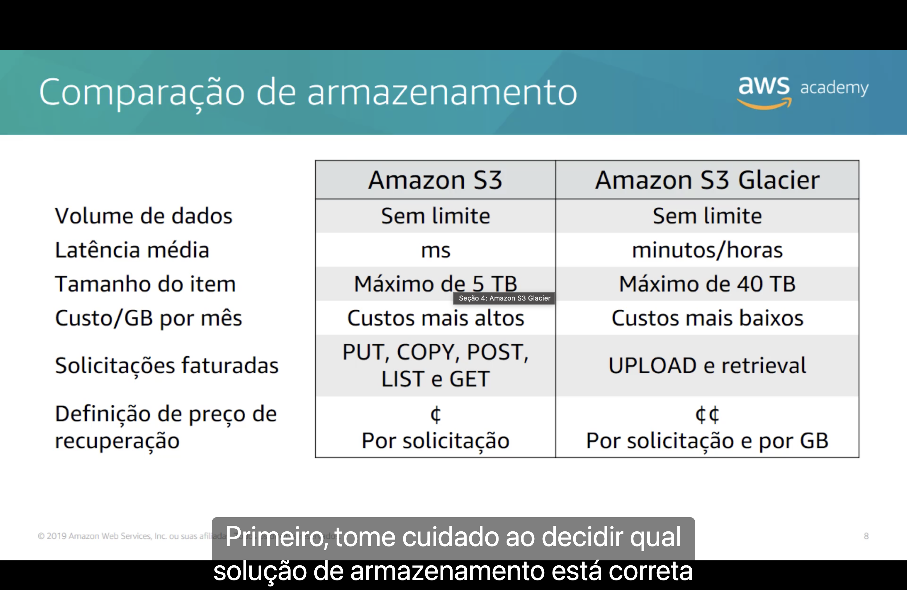

| | 🪣 Amazon S3 | 🧊 Amazon S3 Glacier |
|---|:---:|:---:|
| **Volume de dados** | Sem limite | Sem limite |
| **Latência média** | **Milissegundos** | **Minutos ou horas** |
| **Tamanho do item** | Máximo de **5 TB** | Máximo de **40 TB** |
| **Custo por GB por mês** | Mais alto | **Mais baixo** |
| **Solicitações faturadas** | PUT, COPY, POST, LIST e GET | **UPLOAD** e **recuperação** |
| **Definição de preço de recuperação** | ¢ por solicitação | ¢¢ por solicitação **e por GB** |

Segundo a narração, **primeiro** é preciso tomar cuidado ao decidir **qual solução de armazenamento está correta** para as suas necessidades.

> [!TIP]
> A tabela resume a troca: o Glacier é **mais barato para guardar**, mas **mais caro e mais lento para ler**. Se os dados são lidos com frequência, o custo de recuperação anula a economia no armazenamento.

> [!NOTE]
> O limite de **40 TB** vale para um arquivo no **serviço Glacier baseado em cofres**. No S3, o limite de um objeto subiu para **50 TB** em dezembro de 2025, como visto na [Seção 2](./Seção%202%20-%20Amazon%20Simple%20Storage%20Service%20(Amazon%20S3).md#visao-geral).

## 8. 🔐 Criptografia no lado do servidor

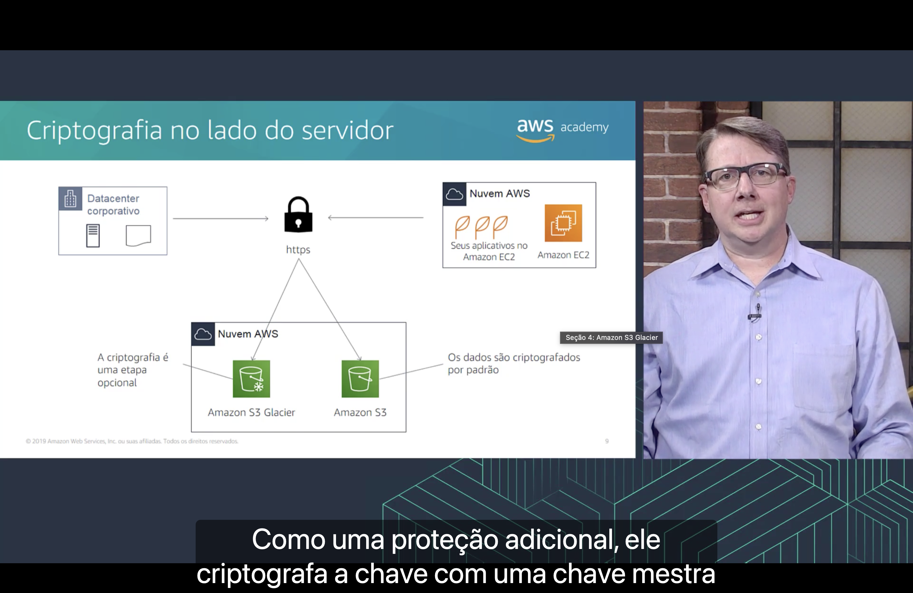

O diagrama mostra dados vindos de um **datacenter corporativo** e de **aplicativos no Amazon EC2**, enviados por **HTTPS** (criptografia **em trânsito**) para o **Amazon S3 Glacier** e o **Amazon S3**, na Nuvem AWS.

| Serviço (como desenhado no slide) | Rótulo |
|---|---|
| 🧊 **Amazon S3 Glacier** | "A criptografia é uma etapa opcional" |
| 🪣 **Amazon S3** | "Os dados são criptografados por padrão" |

Segundo a narração, cada objeto é criptografado com uma **chave exclusiva**. Como **proteção adicional**, essa chave também é criptografada com uma **chave mestra**, que a AWS alterna regularmente.

> [!WARNING]
> No diagrama, as linhas dos rótulos parecem **trocadas**. Em 2019, era o **Glacier** que criptografava **sempre, por padrão** (como diz o [próximo slide](#seguranca)), e no **S3** a criptografia era **opcional**. Hoje a diferença deixou de existir: desde **janeiro de 2023**, o S3 também criptografa **todos os objetos novos** por padrão.

> [!TIP]
> Esse esquema de "chave que protege a chave" se chama **criptografia de envelope**. É o mesmo modelo usado pelo [AWS KMS](../MÓDULO%204/Seção%204%20-%20Proteção%20de%20contas.md#kms).

## 9. 🛡️ Segurança com o Amazon S3 Glacier

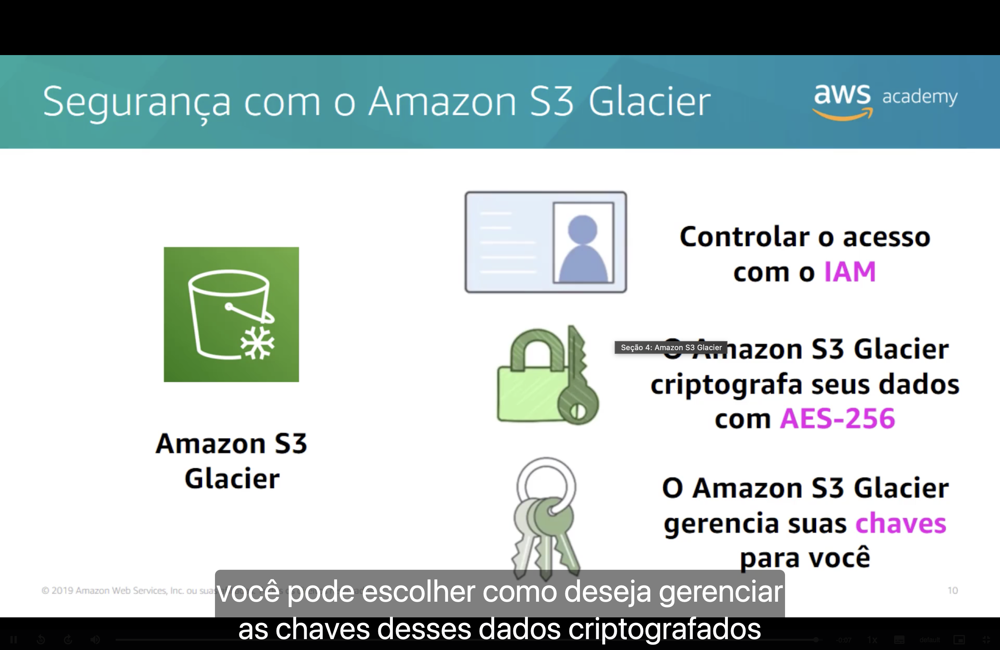

| Recurso | O que faz |
|---|---|
| 🪪 **Controlar o acesso com o [IAM](../MÓDULO%204/Seção%202%20-%20AWS%20Identity%20and%20Access%20Management%20(IAM).md#iam)** | Políticas definem quem pode acessar os cofres e o que pode fazer |
| 🔒 **Criptografia com AES-256** | O Amazon S3 Glacier **criptografa seus dados** com o padrão **AES-256** |
| 🔑 **Gerenciamento de chaves** | O Amazon S3 Glacier **gerencia suas chaves para você** |

Segundo a narração, você também pode **escolher como deseja gerenciar as chaves** desses dados criptografados.

> [!NOTE]
> Nas classes S3 Glacier usadas em buckets do S3, as opções de chave são as do próprio S3:
> - **SSE-S3**: a AWS gerencia as chaves (padrão).
> - **SSE-KMS**: as chaves ficam no [AWS KMS](../MÓDULO%204/Seção%204%20-%20Proteção%20de%20contas.md#kms), com mais controle e auditoria.
> - **SSE-C**: você fornece a chave em cada solicitação.

---

## 🎯 Principais conclusões

- ✅ O **Amazon S3 Glacier** é um serviço de **arquivamento de dados** com **segurança**, **11 noves de durabilidade** e **custo extremamente baixo**.
- ✅ Os dados ficam em **arquivos** (*archives*), guardados em **cofres** (*vaults*). O **Vault Lock** impõe a conformidade com uma política que não pode ser alterada.
- ✅ Há três opções de recuperação: **expressa** (1 a 5 minutos), **padrão** (3 a 5 horas) e **em massa** (5 a 12 horas).
- ✅ Os casos de uso típicos são **mídia**, **saúde**, **conformidade**, **dados científicos**, **preservação digital** e **substituição de fita magnética**.
- ✅ É possível usar o Glacier pela **API REST**, pelos **SDKs Java ou .NET** e pelas **políticas de ciclo de vida do S3**, que movem ou excluem objetos **com base na idade**.
- ✅ Comparado ao S3, o Glacier tem **latência de minutos a horas**, **custo de armazenamento mais baixo** e cobra a recuperação **por solicitação e por GB**.
- ✅ O Glacier **criptografa os dados com AES-256** e **gerencia as chaves** para você, e o acesso é controlado com o **IAM**.
- ✅ Resumindo o módulo: **EBS = bloco**, **S3 = objeto**, **EFS = arquivo** e **S3 Glacier = arquivamento**.

---

  <a href="../README.md">🏠 Início</a> &nbsp;•&nbsp;
  <a href="./Seção%203%20-%20Amazon%20Elastic%20File%20System%20(Amazon%20EFS).md">⬅️ Anterior: Amazon EFS</a>

