<h1 align="center">🛢️ Seção 1 – Amazon Relational Database Service (Amazon RDS)</h1>

  
  
   
  
  
  

  <a href="../README.md">🏠 Início</a> &nbsp;•&nbsp;
  <a href="./Seção%202%20-%20Amazon%20DynamoDB.md">Próxima: Amazon DynamoDB ➡️</a>

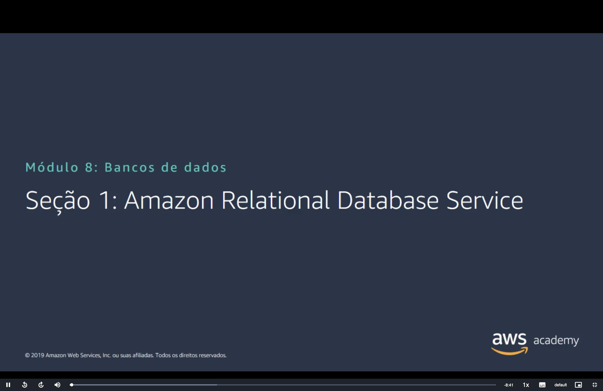

> [!NOTE]
> Esta seção abre o Módulo 8, sobre **bancos de dados**, com o **Amazon RDS**. Ele já apareceu na [categoria de banco de dados](../MÓDULO%203/Seção%202%20-%20Visão%20geral%20dos%20serviços%20e%20das%20categorias%20de%20serviços%20da%20AWS.md#banco-de-dados) e como exemplo de **PaaS** no [modelo de responsabilidade compartilhada](../MÓDULO%204/Seção%201%20-%20Modelo%20de%20responsabilidade%20compartilhada%20da%20AWS.md#iaas-paas). Agora o foco é o próprio serviço: o que a AWS gerencia por você, como a instância fica protegida dentro de uma VPC, como ganhar alta disponibilidade e desempenho de leitura e como o serviço é cobrado.

## 📑 Sumário

| # | Tópico |
|:---:|---|
| 1 | [⚖️ Serviços não gerenciados versus serviços gerenciados](#gerenciados) |
| 2 | [🧗 Desafios dos bancos de dados relacionais](#desafios) |
| 3 | [🤝 Responsabilidades de serviços gerenciados](#responsabilidades) |
| 4 | [🧩 Instâncias de banco de dados do Amazon RDS](#instancias) |
| 5 | [☁️ Amazon RDS em uma VPC](#vpc) |
| 6 | [🏢 Alta disponibilidade com implantação Multi-AZ](#multi-az) |
| 7 | [📖 Réplicas de leitura do Amazon RDS](#replicas) |
| 8 | [🧭 Quando usar o Amazon RDS](#quando-usar) |
| 9 | [💳 Tipo de compra e várias instâncias](#compra) |
| 10 | [💲 Tipo de implantação e transferência de dados](#implantacao) |
| 🎯 | [Principais conclusões](#conclusoes) |

---

## 1. ⚖️ Serviços não gerenciados versus serviços gerenciados

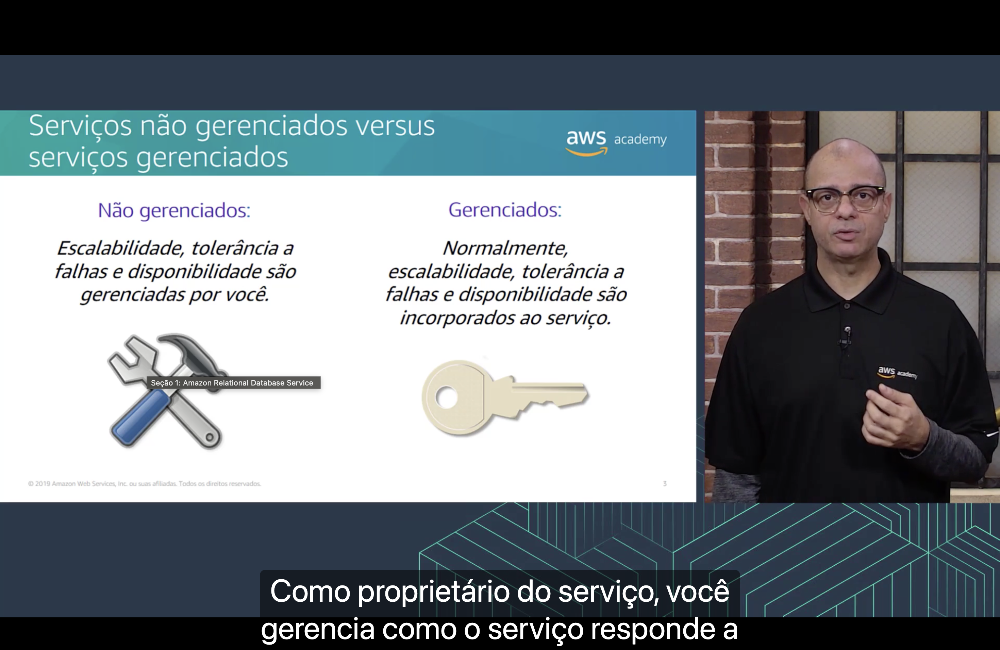

O slide compara dois tipos de serviço a partir de uma pergunta: **quem cuida da escalabilidade, da tolerância a falhas e da disponibilidade?**

| | 🛠️ Não gerenciados | 🔑 Gerenciados |
|---|---|---|
| **Escalabilidade, tolerância a falhas e disponibilidade** | São **gerenciadas por você** | **Normalmente** são **incorporadas ao serviço** |
| **Ícone do slide** | Ferramentas: você monta e mantém | Chave: você recebe pronto e usa |

Segundo a narração, no serviço não gerenciado **você é o proprietário do serviço** e gerencia como ele responde a mudanças, como aumento de carga, erros e recursos que ficam indisponíveis.

> [!TIP]
> Um banco de dados que você instala em uma instância do **Amazon EC2** é **não gerenciado**: se a carga crescer ou a instância falhar, a reação depende de você. No **Amazon RDS**, que é **gerenciado**, boa parte disso já vem pronta. É a mesma diferença entre [IaaS e PaaS](../MÓDULO%204/Seção%201%20-%20Modelo%20de%20responsabilidade%20compartilhada%20da%20AWS.md#iaas-paas) do Módulo 4: quanto mais gerenciado o serviço, **menos trabalho** você tem e **menos controle** também.

## 2. 🧗 Desafios dos bancos de dados relacionais

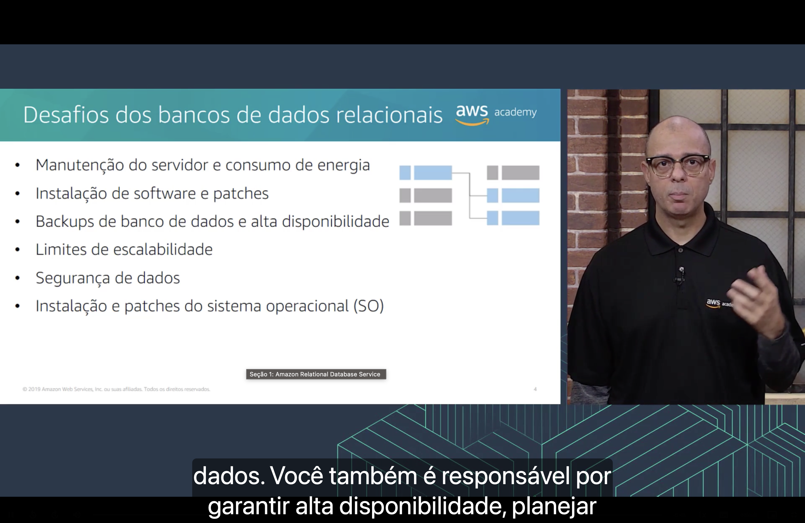

Quem roda o próprio banco de dados relacional, seja em um datacenter local, seja em uma instância do EC2, precisa cuidar de:

| Área | Desafio |
|---|---|
| 🏭 **Infraestrutura** | Manutenção do servidor e consumo de energia |
| 💿 **Software** | Instalação de software e patches · Instalação e patches do sistema operacional (SO) |
| 🛡️ **Operação** | Backups de banco de dados e alta disponibilidade · Limites de escalabilidade · Segurança de dados |

Segundo a narração, além das tarefas de manutenção, instalação e backup, **você também é responsável por garantir alta disponibilidade**, planejar a escalabilidade e proteger os dados.

> [!NOTE]
> O desenho do slide mostra o que define um banco **relacional**: os dados ficam em **tabelas**, com linhas e colunas, e as tabelas se **relacionam** por chaves. A linha azul da tabela da esquerda se liga a duas linhas azuis da tabela da direita, uma relação **um para muitos**. Esse tipo de banco é consultado com **SQL**.

## 3. 🤝 Responsabilidades de serviços gerenciados

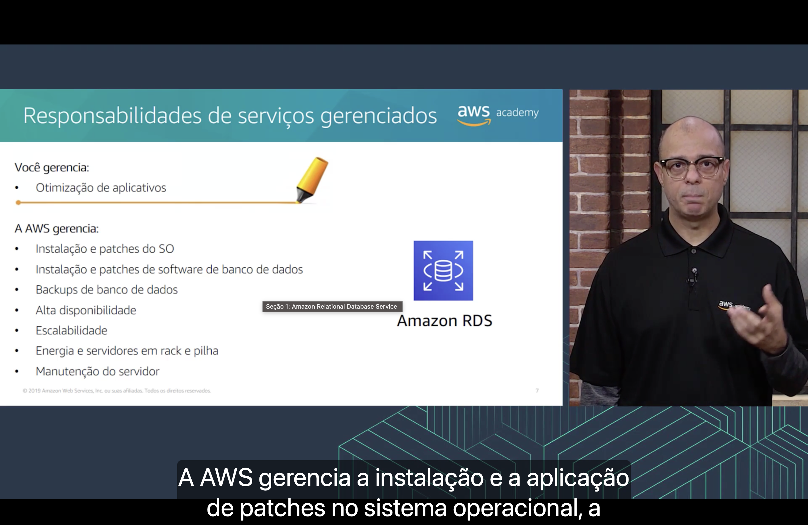

Com o **Amazon RDS**, a divisão fica assim:

**🧑‍💻 Você gerencia:**

- ⚙️ a **otimização de aplicativos**.

**🟠 A AWS gerencia:**

- 🖥️ a instalação e os patches do **SO**;
- 🛢️ a instalação e os patches do **software de banco de dados**;
- 💾 os **backups** de banco de dados;
- 🏢 a **alta disponibilidade**;
- 📈 a **escalabilidade**;
- 🔌 a **energia** e os servidores em **rack e pilha**;
- 🔧 a **manutenção do servidor**.

Comparando com os [desafios](#desafios) do tópico anterior, quase tudo passa para a AWS:

| Desafio do banco próprio | Com o Amazon RDS |
|---|---|
| 🔌 Manutenção do servidor e consumo de energia | 🟠 **AWS** |
| 💿 Instalação de software e patches | 🟠 **AWS** |
| 🖥️ Instalação e patches do SO | 🟠 **AWS** |
| 💾 Backups de banco de dados e alta disponibilidade | 🟠 **AWS** executa. Você define a retenção dos backups e se usa [Multi-AZ](#multi-az). |
| 📈 Limites de escalabilidade | 🟠 **AWS** executa. Você escolhe a [classe e o armazenamento](#instancias) da instância. |
| 🔐 Segurança de dados | 🤝 **Compartilhada** (veja abaixo) |

> [!NOTE]
> "Energia e servidores em rack e pilha" é a tradução literal de *rack and stack*: instalar e ligar os servidores físicos nos racks do datacenter.

> [!IMPORTANT]
> A **segurança de dados** não aparece em nenhuma das duas listas do slide, e ela continua sendo **sua**. É o lado da [segurança *na* nuvem](../MÓDULO%204/Seção%201%20-%20Modelo%20de%20responsabilidade%20compartilhada%20da%20AWS.md#cliente): você decide **quem acessa** a instância (grupos de segurança, usuários do banco e IAM), se os dados ficam **criptografados** com o [AWS KMS](../MÓDULO%204/Seção%204%20-%20Proteção%20de%20contas.md#kms) e o que fica guardado nas tabelas.

> [!TIP]
> "A AWS gerencia" não significa que a AWS decide tudo sozinha. Os **patches** são aplicados em uma **janela de manutenção** semanal que você escolhe. Os **backups automáticos** ficam guardados por um **período de retenção** que você define, de até **35 dias**, e permitem restaurar o banco para **qualquer momento** dentro desse período.

## 4. 🧩 Instâncias de banco de dados do Amazon RDS

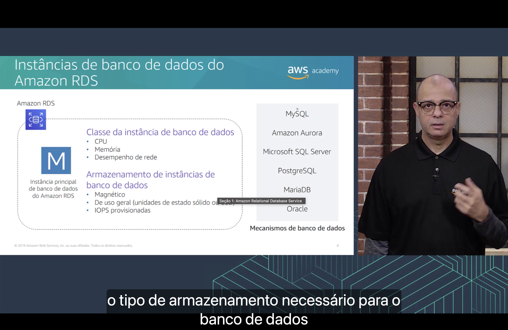

O bloco básico do RDS é a **instância de banco de dados**: um ambiente de banco de dados isolado, executado na nuvem. Uma única instância pode conter **vários bancos de dados** criados por você.

No slide, a **instância principal** (o "M") é definida por três escolhas:

| Escolha | O que define | Opções no slide |
|---|---|---|
| 🧠 **Classe da instância de banco de dados** | Capacidade de processamento | **CPU**, **memória** e **desempenho de rede** |
| 💾 **Armazenamento de instâncias de banco de dados** | Tipo de disco | **Magnético**, **de uso geral** (unidades de estado sólido, ou SSD) e **IOPS provisionadas** |
| 🛢️ **Mecanismo de banco de dados** | Software do banco | **MySQL**, **Amazon Aurora**, **Microsoft SQL Server**, **PostgreSQL**, **MariaDB** e **Oracle** |

> [!TIP]
> As duas primeiras escolhas lembram o EC2. As **classes** seguem a mesma [nomeação dos tipos de instância](../MÓDULO%206/Seção%202%20-%20Amazon%20EC2%20Parte%201.md#nomeacao), com o prefixo `db.` (por exemplo, `db.m5.large`). E os tipos de armazenamento são os [volumes do EBS](../MÓDULO%207/Seção%201%20-%20Amazon%20Elastic%20Block%20Store%20(Amazon%20EBS).md#tipos) do Módulo 7: **Magnético** (`standard`), **Uso geral** (`gp2`) e **IOPS provisionadas** (`io1`).

> [!NOTE]
> O **Amazon Aurora** aparece na lista de mecanismos, mas não usa esses tipos de armazenamento: ele tem uma camada de armazenamento própria, que guarda **seis cópias** dos dados em **três Zonas de Disponibilidade**.

> [!NOTE]
> O slide é de 2019, e algumas coisas mudaram:
> - Surgiu o **Amazon RDS for Db2** (2023), e a IBM **Db2** entrou na lista de mecanismos.
> - O RDS ganhou os volumes **`gp3`** e **`io2` Block Express**. Com o `io2`, uma instância chega a **256.000 IOPS**.
> - O armazenamento **magnético** virou **legado** e não é recomendado: ele vai só até **3 TiB** e **1.000 IOPS**.
> - O tamanho máximo é de **64 TiB** para Db2, MySQL, MariaDB e PostgreSQL. Oracle e SQL Server chegam a **256 TiB** com volumes de armazenamento adicionais.

## 5. ☁️ Amazon RDS em uma VPC

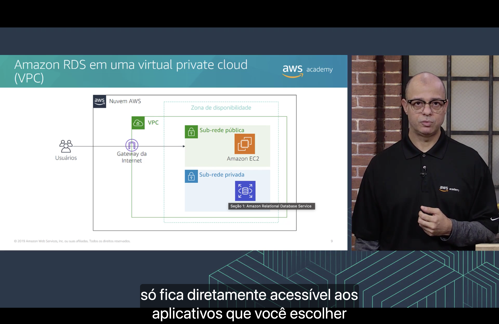

O diagrama mostra o caminho de uma requisição dentro da **Nuvem AWS**, em uma única Zona de Disponibilidade:

1. 👥 Os **usuários** chegam pela internet ao [gateway da internet](../MÓDULO%205/Seção%203%20-%20Redes%20VPC.md#igw) da VPC.
2. 🖥️ O gateway encaminha o tráfego para a instância do **Amazon EC2**, na **sub-rede pública**.
3. 🛢️ Só a instância do EC2 conversa com o **Amazon RDS**, que fica na **sub-rede privada**.

Segundo a narração, a instância de banco de dados fica isolada na sub-rede privada e **só fica diretamente acessível aos aplicativos que você escolher**.

> [!TIP]
> Na prática, quem "escolhe os aplicativos" é o [grupo de segurança](../MÓDULO%205/Seção%204%20-%20Segurança%20da%20VPC.md#sg) do banco. A regra típica libera a porta do mecanismo (por exemplo, **3306** no MySQL) **só para o grupo de segurança das instâncias do EC2**, e não para a internet.

> [!NOTE]
> Cada [sub-rede pertence a uma única Zona de Disponibilidade](../MÓDULO%205/Seção%202%20-%20Amazon%20VPC.md#vpc-subredes), então escolher a sub-rede também define **em que AZ** a instância vai rodar. Por isso o RDS pede um **grupo de sub-redes de banco de dados** (*DB subnet group*) com sub-redes em **pelo menos duas AZs**, o que já prepara o terreno para a [implantação Multi-AZ](#multi-az).

## 6. 🏢 Alta disponibilidade com implantação Multi-AZ

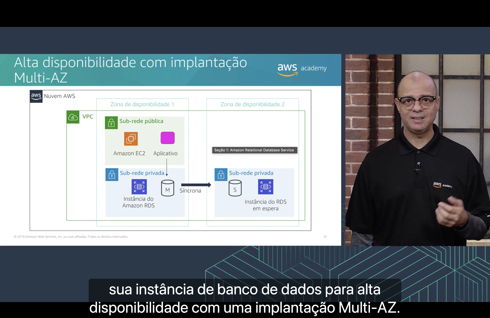

Segundo a narração, um dos recursos do RDS é configurar **sua instância de banco de dados para alta disponibilidade com uma implantação Multi-AZ**. No diagrama, a VPC se estende por duas Zonas de Disponibilidade:

| | Zona de disponibilidade 1 | Zona de disponibilidade 2 |
|---|---|---|
| **Sub-rede pública** | **Amazon EC2** com o **aplicativo** | – |
| **Sub-rede privada** | **Instância do Amazon RDS** principal (**M**) | **Instância do RDS em espera** (**S**, de *standby*) |

- 🔁 O RDS cria e mantém a cópia **em espera** sozinho, em **outra AZ** da mesma VPC.
- ⚡ A replicação é **síncrona**: cada gravação só é confirmada depois de chegar às **duas** cópias. Por isso a cópia em espera está sempre **atualizada**.
- 🧭 O aplicativo se conecta **só à instância principal**: a seta do aplicativo aponta para o "M".

> [!IMPORTANT]
> Se a instância principal falhar, o RDS faz o **failover** automático: promove a instância em espera a principal, normalmente em **60 a 120 segundos**. O aplicativo continua usando o **mesmo endpoint** (nome DNS) do banco, que passa a apontar para a nova principal, então não é preciso mudar o código. É a ideia das [Zonas de Disponibilidade](../MÓDULO%203/Seção%201%20-%20Infraestrutura%20global%20da%20AWS.md#zonas) do Módulo 3: uma AZ pode falhar sem derrubar o sistema.

> [!WARNING]
> A instância em espera **não atende leituras** nem gravações: ela só fica pronta para assumir. Para escalar leituras, o recurso certo são as [réplicas de leitura](#replicas).

> [!TIP]
> Compare com o EBS do Módulo 7, que [replica só dentro da AZ](../MÓDULO%207/Seção%201%20-%20Amazon%20Elastic%20Block%20Store%20(Amazon%20EBS).md#ebs). O Multi-AZ do RDS protege justamente contra a **falha da AZ inteira**.

> [!NOTE]
> O slide é de 2019. Em 2022 surgiu uma segunda opção, o **cluster de banco de dados Multi-AZ**, para **MySQL** e **PostgreSQL**: uma instância de gravação e **duas instâncias em espera legíveis**, em **três AZs**. Nessa opção, as instâncias em espera **atendem leituras**, a replicação é **semissíncrona** (basta uma das duas confirmar a gravação) e o failover costuma levar **menos de 35 segundos**.

## 7. 📖 Réplicas de leitura do Amazon RDS

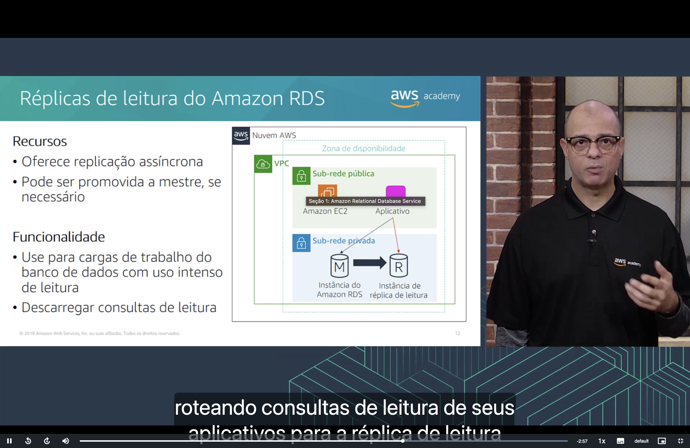

**Recursos**

- 🔁 oferece **replicação assíncrona**;
- ⬆️ pode ser **promovida a mestre** (a instância principal), se necessário.

**Funcionalidade**

- 📚 use para cargas de trabalho do banco de dados com **uso intenso de leitura**;
- 📤 **descarregar consultas de leitura** da instância principal.

No diagrama, o aplicativo **grava** na instância principal (**M**), que copia os dados para a **instância de réplica de leitura** (**R**). A seta vermelha mostra o aplicativo **lendo** direto da réplica. Segundo a narração, você alivia a instância principal **roteando consultas de leitura de seus aplicativos para a réplica de leitura**.

> [!NOTE]
> "Assíncrona" significa que a réplica recebe as alterações **depois** que a gravação já foi confirmada na principal. Por isso ela pode ficar alguns instantes **atrasada** (*replica lag*), e uma leitura feita logo após uma gravação pode ainda não ver o dado novo.

Multi-AZ e réplica de leitura são fáceis de confundir:

| | 🏢 Multi-AZ (instância em espera) | 📖 Réplica de leitura |
|---|---|---|
| **Objetivo** | **Alta disponibilidade** | **Desempenho** de leitura |
| **Replicação** | Síncrona | Assíncrona |
| **Atende leituras?** | ❌ Não | ✅ Sim |
| **Quando a principal falha** | **Failover automático** | **Promoção manual** |
| **Onde fica** | Outra AZ, na mesma Região | Mesma AZ, outra AZ ou **outra Região** |

> [!TIP]
> Uma réplica promovida vira uma instância **independente**: a replicação para e ela passa a aceitar gravações. A promoção é **manual** justamente porque a replicação é assíncrona e os dados mais recentes podem não ter chegado à réplica. Réplicas em **outra Região** também servem para **recuperação de desastres** e para deixar as leituras mais **perto dos usuários**.

> [!NOTE]
> O slide é de 2019. Desde 2022, **MySQL**, **MariaDB** e **PostgreSQL** aceitam até **15 réplicas de leitura** por instância (antes eram 5). O **Oracle** aceita até **5**. Réplicas em outra Região funcionam em todos os mecanismos do RDS, **menos no SQL Server**.

## 8. 🧭 Quando usar o Amazon RDS

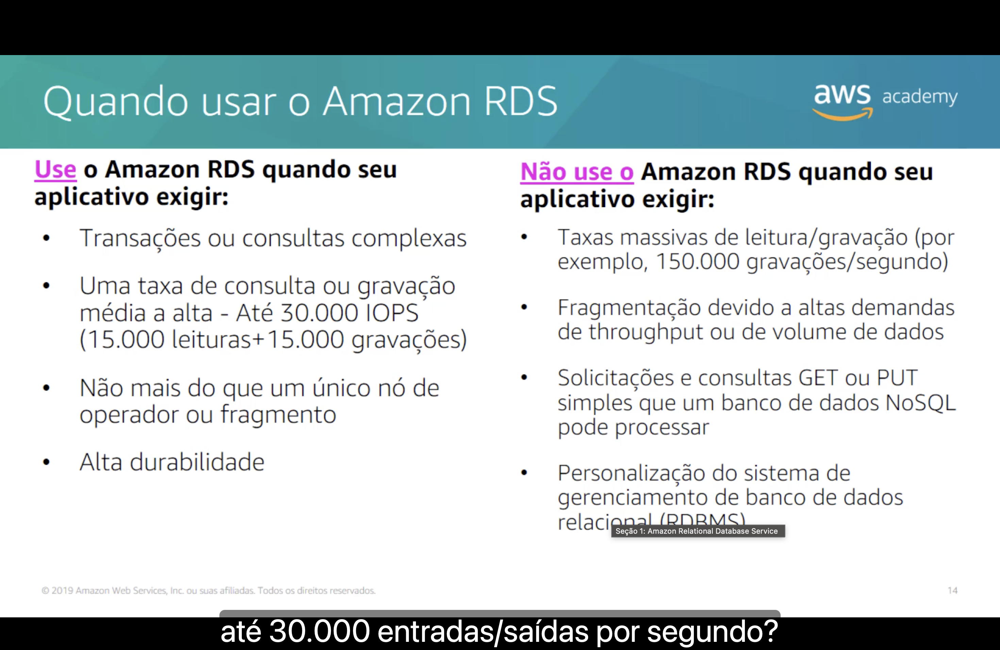

| ✅ **Use** o Amazon RDS quando seu aplicativo exigir | ❌ **Não use** o Amazon RDS quando seu aplicativo exigir |
|---|---|
| **Transações ou consultas complexas** | **Taxas massivas** de leitura/gravação (por exemplo, **150.000 gravações/segundo**) |
| Uma taxa de consulta ou gravação **média a alta**: até **30.000 IOPS** (15.000 leituras + 15.000 gravações) | **Fragmentação** devido a altas demandas de throughput ou de volume de dados |
| **Não mais do que um único nó** de operador ou fragmento | Solicitações e consultas **GET ou PUT simples** que um banco de dados **NoSQL** pode processar |
| **Alta durabilidade** | **Personalização** do sistema de gerenciamento de banco de dados relacional (**RDBMS**) |

A narração apresenta o slide como perguntas sobre o aplicativo. Por exemplo: ele exige uma taxa de **até 30.000 entradas/saídas por segundo**?

> [!NOTE]
> Alguns termos vêm de tradução literal. **Nó de operador** é *worker node*, e **fragmento** é *shard*. **Fragmentação** (*sharding*) é dividir os dados entre **vários servidores** de banco quando um só não dá conta. No RDS, todas as **gravações** vão para **uma única instância principal**: ele atende bem até certo volume, mas não foi feito para cargas que precisam espalhar gravações por vários nós.

> [!TIP]
> Para os casos da coluna "não use", a alternativa é um banco **NoSQL**, como o **Amazon DynamoDB** da [próxima seção](./Seção%202%20-%20Amazon%20DynamoDB.md), ou rodar o banco relacional em instâncias do **EC2**. No EC2 você tem **acesso total** para personalizar o RDBMS, mas volta a cuidar de todos os [desafios](#desafios) listados acima.

> [!NOTE]
> O slide é de 2019, e os limites cresceram:
> - O teto de **30.000 IOPS** ficou para trás: com volumes **`io2` Block Express**, o RDS chega a **256.000 IOPS**.
> - Para personalizar o RDBMS sem abrir mão de um serviço gerenciado, surgiu o **Amazon RDS Custom** (2021), que dá acesso ao **sistema operacional** e ao banco. Ele continua disponível para **SQL Server**. A versão para **Oracle** está sendo descontinuada, com suporte até **31 de março de 2027**.

## 9. 💳 Tipo de compra e várias instâncias

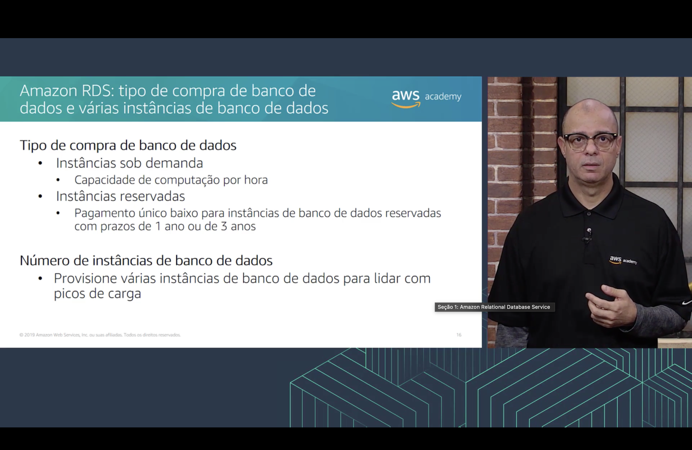

**Tipo de compra de banco de dados**

| Opção | Como funciona |
|---|---|
| 🕐 **Instâncias sob demanda** | Você paga pela **capacidade de computação por hora** |
| 📅 **Instâncias reservadas** | **Pagamento único baixo** para instâncias de banco de dados reservadas, com prazos de **1 ano ou 3 anos** |

**Número de instâncias de banco de dados**

- 🧮 Provisione **várias instâncias** de banco de dados para lidar com **picos de carga**.

> [!TIP]
> É a mesma lógica dos [modelos de preço do EC2](../MÓDULO%206/Seção%205%20-%20Otimização%20de%20custos%20do%20Amazon%20EC2.md#modelos) e do princípio [pague menos ao fazer reserva](../MÓDULO%202/Seção%201%20-%20Fundamentos%20da%20definição%20de%20preço.md#reserva): sob demanda para testes e cargas **variáveis**, reservadas para bancos que ficam **ligados o tempo todo**, que é o caso mais comum. Diferente do EC2, o RDS **não tem instâncias spot**.

> [!TIP]
> O slide fala só em "pagamento único baixo", mas as instâncias reservadas têm três formas de pagamento: **sem adiantamento**, **adiantamento parcial** ou **adiantamento integral**. Quanto mais você paga adiantado, maior o desconto. E cada [réplica de leitura](#replicas) é cobrada como uma instância de banco de dados comum.

> [!NOTE]
> O slide é de 2019. Hoje:
> - O preço continua listado **por hora**, mas a cobrança é feita **por segundo**, com **mínimo de 10 minutos**.
> - Existem os **Database Savings Plans** (dezembro de 2025): um compromisso de gasto em US$/hora por **1 ano**, **sem pagamento adiantado**, com até **35% de desconto**. Eles valem para RDS, Aurora, DynamoDB e outros bancos da AWS, qualquer que seja o mecanismo, a família, o tamanho, o tipo de implantação ou a Região. Não dá para somá-los a instâncias reservadas do RDS na mesma carga.

## 10. 💲 Tipo de implantação e transferência de dados

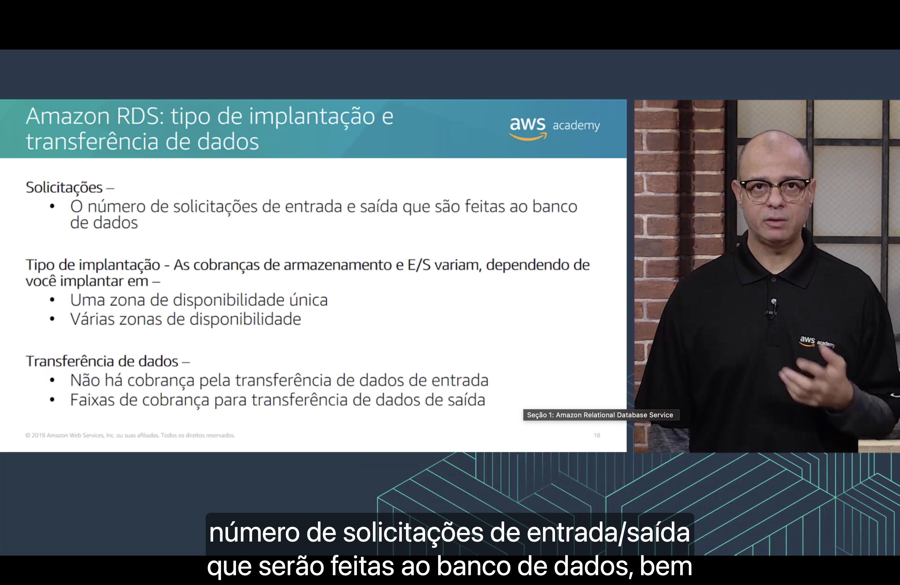

| Fator | O que pesa no custo |
|---|---|
| 🔢 **Solicitações** | O **número de solicitações de entrada e saída** feitas ao banco de dados |
| 🏢 **Tipo de implantação** | As cobranças de **armazenamento e E/S** variam se você implanta em **uma zona de disponibilidade única** ou em **várias zonas de disponibilidade** |
| 🚚 **Transferência de dados** | **Não há cobrança** pela transferência de dados de **entrada**. A transferência de dados de **saída** tem **faixas de cobrança** |

Segundo a narração, a estimativa de custo considera o **número de solicitações de entrada/saída que serão feitas ao banco de dados**.

> [!TIP]
> Na implantação em **várias AZs** ([Multi-AZ](#multi-az)), você paga também pela **instância em espera** e pelo armazenamento dela, então o custo fica perto do **dobro** de uma implantação em AZ única. Em compensação, a **transferência de dados da replicação** entre as AZs **não é cobrada**.

> [!TIP]
> "Faixas de cobrança" quer dizer que o preço por GB **cai** conforme o volume de saída cresce, como no princípio [pague menos usando mais](../MÓDULO%202/Seção%201%20-%20Fundamentos%20da%20definição%20de%20preço.md#usando-mais) do Módulo 2. Uma [réplica de leitura](#replicas) em **outra Região** também gera cobrança de transferência entre Regiões.

> [!NOTE]
> Na prática, as **solicitações de E/S** só são cobradas no armazenamento **magnético**, que é legado. Nos volumes de **uso geral** e de **IOPS provisionadas** não há cobrança por solicitação, como no [EBS](../MÓDULO%207/Seção%201%20-%20Amazon%20Elastic%20Block%20Store%20(Amazon%20EBS).md#preco). No **Aurora**, a cobrança por E/S existe na configuração **Standard**. A configuração **I/O-Optimized** (2023) elimina essa cobrança em troca de um preço maior de instância e armazenamento.

---

## 🎯 Principais conclusões

- ✅ Em serviços **não gerenciados**, escalabilidade, tolerância a falhas e disponibilidade ficam com **você**. Em serviços **gerenciados**, como o **Amazon RDS**, elas normalmente vêm **incorporadas ao serviço**.
- ✅ Rodar o próprio banco relacional exige cuidar de servidor, energia, patches do SO e do software, backups, alta disponibilidade, escalabilidade e segurança.
- ✅ No RDS, **você** cuida da **otimização de aplicativos** e da segurança dos seus dados. A **AWS** cuida de patches, backups, alta disponibilidade, escalabilidade, energia e manutenção do servidor.
- ✅ Uma **instância de banco de dados** é definida pela **classe** (CPU, memória e rede), pelo **armazenamento** (magnético, uso geral ou IOPS provisionadas) e pelo **mecanismo** (MySQL, Aurora, SQL Server, PostgreSQL, MariaDB ou Oracle).
- ✅ A instância fica em uma **sub-rede privada** da VPC e só fica acessível aos **aplicativos que você escolher**.
- ✅ A **implantação Multi-AZ** mantém uma **instância em espera** em outra AZ, com replicação **síncrona** e **failover automático**. Ela serve para **alta disponibilidade**.
- ✅ As **réplicas de leitura** usam replicação **assíncrona**, recebem **consultas de leitura** e podem ser **promovidas** a principal. Elas servem para **desempenho de leitura**.
- ✅ Use o RDS para **transações e consultas complexas** e taxas **médias a altas**. Para taxas **massivas**, **fragmentação** ou acessos **GET/PUT simples**, prefira um banco **NoSQL**.
- ✅ O custo depende do **tipo de compra** (sob demanda ou reservada), do **número de instâncias**, das **solicitações**, do **tipo de implantação** (uma ou várias AZs) e da **transferência de dados**: **entrada gratuita** e **saída em faixas**.

---

  <a href="../README.md">🏠 Início</a> &nbsp;•&nbsp;
  <a href="./Seção%202%20-%20Amazon%20DynamoDB.md">Próxima: Amazon DynamoDB ➡️</a>

