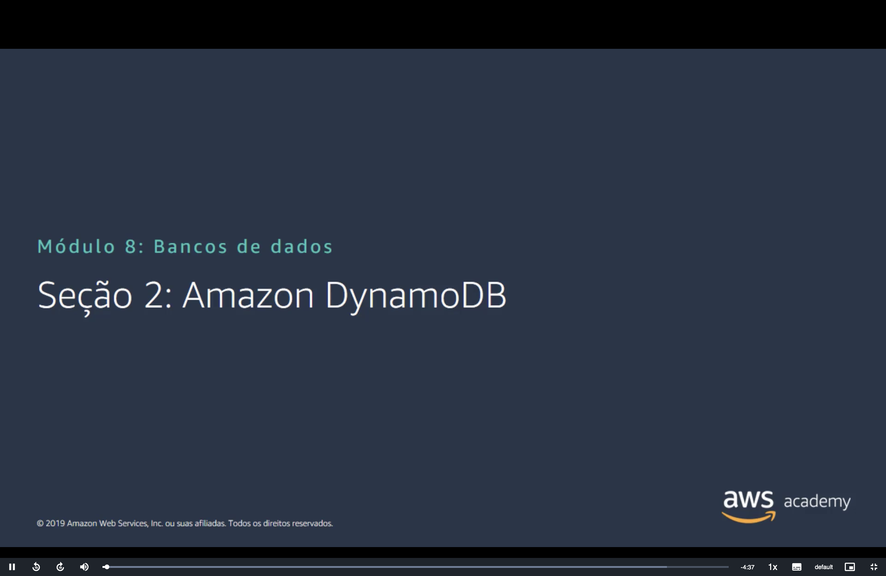
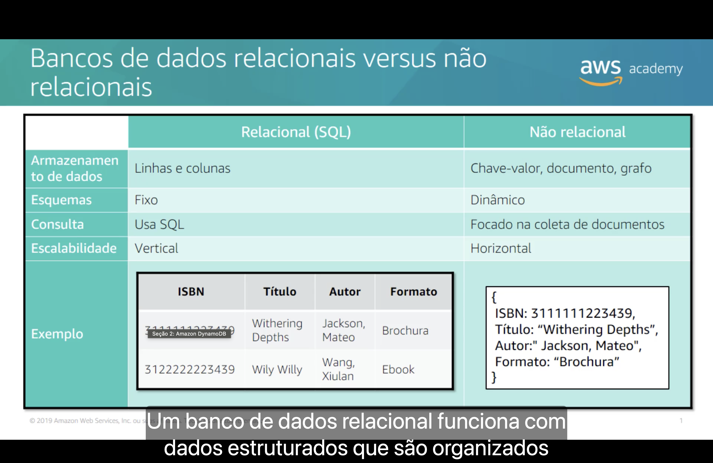
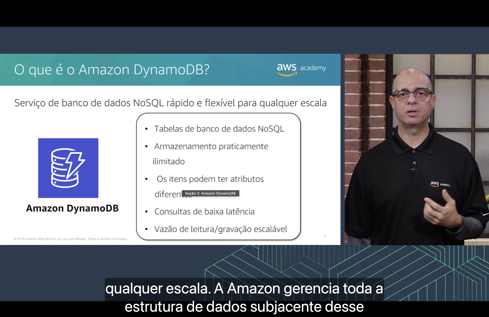
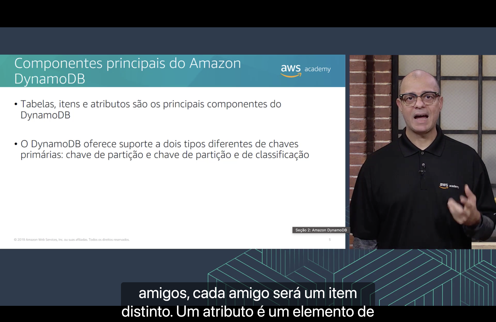
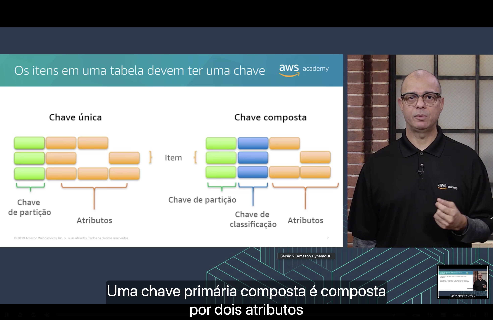

<h1 align="center">⚡ Seção 2 – Amazon DynamoDB</h1>

<p align="center">
  
  
  <br>
  
  
  
</p>

<p align="center">
  <a href="../README.md">🏠 Início</a> &nbsp;•&nbsp;
  <a href="./Seção%201%20-%20Amazon%20Relational%20Database%20Service.md">⬅️ Anterior: Amazon RDS</a> &nbsp;•&nbsp;
  <a href="./Seção%203%20-%20Amazon%20Redshift.md">Próxima: Amazon Redshift ➡️</a>
</p>



> [!NOTE]
> A [Seção 1](./Seção%201%20-%20Amazon%20Relational%20Database%20Service.md#quando-usar) terminou dizendo quando **não** usar o Amazon RDS: taxas massivas de leitura e gravação, fragmentação e consultas GET ou PUT simples. Esta seção apresenta a alternativa para esses casos: o **Amazon DynamoDB**, um banco de dados **NoSQL** que já apareceu na [categoria de banco de dados](../MÓDULO%203/Seção%202%20-%20Visão%20geral%20dos%20serviços%20e%20das%20categorias%20de%20serviços%20da%20AWS.md#banco-de-dados) do Módulo 3.

## 📑 Sumário

| # | Tópico |
|:---:|---|
| 1 | [🆚 Bancos de dados relacionais versus não relacionais](#relacional-vs-nao-relacional) |
| 2 | [⚡ O que é o Amazon DynamoDB?](#dynamodb) |
| 3 | [🧱 Componentes principais do Amazon DynamoDB](#componentes) |
| 4 | [🔑 Os itens em uma tabela devem ter uma chave](#chaves) |
| 🎯 | [Principais conclusões](#conclusoes) |

---

<a id="relacional-vs-nao-relacional"></a>
## 1. 🆚 Bancos de dados relacionais versus não relacionais



| | 🗃️ Relacional (SQL) | 🧩 Não relacional |
|---|---|---|
| **Armazenamento de dados** | Linhas e colunas | Chave-valor, documento, grafo |
| **Esquemas** | Fixo | Dinâmico |
| **Consulta** | Usa SQL | Focado na coleta de documentos |
| **Escalabilidade** | Vertical | Horizontal |

Segundo a narração, **um banco de dados relacional funciona com dados estruturados** que são organizados em tabelas. O exemplo do slide guarda os mesmos livros dos dois jeitos:

- 🗃️ **Relacional:** uma tabela com as colunas **ISBN**, **Título**, **Autor** e **Formato**. Cada livro é uma **linha**, e todas as linhas têm as mesmas colunas.
- 🧩 **Não relacional:** cada livro é um **documento**, com pares de nome e valor.

```json
{
  "ISBN": 3111111223439,
  "Título": "Withering Depths",
  "Autor": "Jackson, Mateo",
  "Formato": "Brochura"
}
```

Duas linhas da tabela merecem atenção:

- 📐 **Esquema fixo × dinâmico:** no relacional, as colunas são definidas antes, e toda linha segue esse formato. No não relacional, cada item pode ter **atributos diferentes**: um ebook poderia ter um atributo "Tamanho do arquivo" que a brochura não tem.
- 📈 **Escalabilidade vertical × horizontal:** escalar na **vertical** é trocar por um servidor **maior**, como escolher uma [classe de instância](./Seção%201%20-%20Amazon%20Relational%20Database%20Service.md#instancias) maior no RDS. Escalar na **horizontal** é acrescentar **mais servidores** e dividir os dados entre eles, a **fragmentação** que aparecia na coluna "não use" do [RDS](./Seção%201%20-%20Amazon%20Relational%20Database%20Service.md#quando-usar).

> [!NOTE]
> "Focado na coleta de documentos" é tradução literal de *focuses on collection of documents*: "coleta" aqui é **coleção**. Em um banco de documentos, a consulta busca dentro de uma **coleção de documentos**, normalmente pela chave, em vez de cruzar tabelas com SQL.

> [!TIP]
> **NoSQL** costuma ser lido como *not only SQL* ("não só SQL"). Dos tipos do slide, o DynamoDB é **chave-valor e documento**, como já dizia o [Módulo 3](../MÓDULO%203/Seção%202%20-%20Visão%20geral%20dos%20serviços%20e%20das%20categorias%20de%20serviços%20da%20AWS.md#banco-de-dados).

> [!NOTE]
> O slide é de 2019. Desde 2020, o DynamoDB também aceita **PartiQL**, uma linguagem **compatível com SQL** para consultar, inserir, atualizar e excluir dados. A sintaxe lembra SQL, mas o modelo continua não relacional: não há junções (*JOIN*) entre tabelas.

<a id="dynamodb"></a>
## 2. ⚡ O que é o Amazon DynamoDB?



O **Amazon DynamoDB** é um **serviço de banco de dados NoSQL rápido e flexível para qualquer escala**:

| Característica | O que significa |
|---|---|
| 🗂️ **Tabelas de banco de dados NoSQL** | Os dados ficam em tabelas, mas sem esquema fixo |
| ♾️ **Armazenamento praticamente ilimitado** | Não há limite para o número de itens em uma tabela |
| 🧩 **Os itens podem ter atributos diferentes** | Cada item tem os próprios atributos, além da chave: é o esquema dinâmico do [tópico anterior](#relacional-vs-nao-relacional) |
| ⚡ **Consultas de baixa latência** | Respostas em **milissegundos de um dígito**, como visto no [Módulo 3](../MÓDULO%203/Seção%202%20-%20Visão%20geral%20dos%20serviços%20e%20das%20categorias%20de%20serviços%20da%20AWS.md#banco-de-dados) |
| 📈 **Vazão de leitura/gravação escalável** | A capacidade de leitura e gravação (*throughput*) cresce ou diminui conforme a demanda |

Segundo a narração, a AWS gerencia **toda a estrutura de dados subjacente** do serviço.

> [!TIP]
> Compare com a [instância do RDS](./Seção%201%20-%20Amazon%20Relational%20Database%20Service.md#instancias): no DynamoDB **não existe instância**. Você não escolhe classe, armazenamento nem mecanismo, não aplica patches e não configura [Multi-AZ](./Seção%201%20-%20Amazon%20Relational%20Database%20Service.md#multi-az). Os dados ficam em SSDs e são **replicados automaticamente em várias Zonas de Disponibilidade** da Região. Você só cria a **tabela** e usa.

> [!WARNING]
> "Praticamente ilimitado" vale para a **tabela**, não para o item: cada item tem no máximo **400 KB**, somando os nomes e os valores dos atributos. Para dados maiores, a prática é guardar o arquivo no [Amazon S3](../MÓDULO%207/Seção%202%20-%20Amazon%20Simple%20Storage%20Service%20(Amazon%20S3).md) e salvar no item só a referência a ele.

> [!NOTE]
> O slide é de 2019, e algumas coisas mudaram:
> - Em **novembro de 2024**, o preço do modo de capacidade **sob demanda** caiu **50%**, e ele passou a ser o modo **padrão e recomendado** para a maioria das cargas. Nesse modo, a vazão escala sozinha e você paga **por solicitação**, sem provisionar capacidade.
> - Em **dezembro de 2025**, o DynamoDB entrou nos **Database Savings Plans**, vistos na [Seção 1](./Seção%201%20-%20Amazon%20Relational%20Database%20Service.md#compra).

<a id="componentes"></a>
## 3. 🧱 Componentes principais do Amazon DynamoDB



- 🧱 **Tabelas, itens e atributos** são os principais componentes do DynamoDB.
- 🔑 O DynamoDB oferece suporte a **dois tipos diferentes de chaves primárias**: **chave de partição** e **chave de partição e de classificação**.

| Componente | O que é | Equivalente no relacional | No exemplo dos livros |
|---|---|---|---|
| 🗂️ **Tabela** | Uma coleção de itens | Tabela | A tabela de livros |
| 📄 **Item** | Um grupo de atributos que se distingue de todos os outros itens | Linha (registro) | Um livro |
| 🏷️ **Atributo** | Um elemento de dado fundamental, que não precisa ser dividido em partes menores | Coluna (campo) | ISBN, Título, Autor, Formato |

Segundo a narração, em uma tabela de amigos, **cada amigo será um item distinto**.

> [!TIP]
> A equivalência com o relacional ajuda, mas não é exata. Em um item, só os atributos da **chave primária** são obrigatórios: os demais podem variar de um item para outro. Um atributo também pode guardar estruturas **aninhadas**, como listas e mapas, algo que uma coluna comum não faz.

<a id="chaves"></a>
## 4. 🔑 Os itens em uma tabela devem ter uma chave



Toda tabela do DynamoDB tem uma **chave primária**, que identifica cada item de forma única. O slide mostra os dois formatos possíveis:

| | 🟩 Chave única | 🟩🟦 Chave composta |
|---|---|---|
| **Formada por** | **Um** atributo: a **chave de partição** | **Dois** atributos: a **chave de partição** e a **chave de classificação** |
| **Regra de unicidade** | Dois itens **não podem** ter a mesma chave de partição | Vários itens podem ter a **mesma chave de partição**, desde que a **chave de classificação** seja diferente |
| **No diagrama** | 🟩 verde + 🟧 atributos | 🟩 verde + 🟦 azul + 🟧 atributos |

Segundo a narração, **uma chave primária composta é composta por dois atributos**.

No diagrama, cada linha é um **item**. Os blocos laranja, que são os **atributos**, variam de um item para outro e deixam lacunas: é o **esquema dinâmico** em ação. Já os blocos da chave, verde e azul, aparecem em **todos** os itens.

> [!NOTE]
> "Chave única" aqui quer dizer chave primária **simples**, formada por um único atributo, e não uma restrição de unicidade. "Chave de classificação" é a *sort key*. Em textos mais antigos, a chave de partição e a de classificação aparecem como *hash key* e *range key*.

> [!TIP]
> Os nomes explicam o funcionamento. O DynamoDB passa o valor da **chave de partição** por uma **função hash** interna, e o resultado decide em qual **partição** física o item fica guardado. Na chave composta, os itens com a mesma chave de partição ficam juntos, **ordenados** pela chave de classificação.

> [!TIP]
> No exemplo dos livros, o **ISBN** já identifica cada livro sozinho, então serve como **chave simples**. Para listar os livros de cada autor, uma opção seria a **chave composta**, com **Autor** como chave de partição e **Título** como chave de classificação (desde que o mesmo autor não repita um título). Assim, todos os livros do mesmo autor ficam juntos, em ordem de título.

> [!IMPORTANT]
> A chave primária é definida **na criação da tabela** e **não pode ser alterada** depois. Escolher bem a chave é a principal decisão de modelagem no DynamoDB.

---

<a id="conclusoes"></a>
## 🎯 Principais conclusões

- ✅ Bancos **relacionais** guardam dados em **linhas e colunas**, com **esquema fixo**, consulta em **SQL** e escalabilidade **vertical**.
- ✅ Bancos **não relacionais** usam **chave-valor, documento ou grafo**, com **esquema dinâmico** e escalabilidade **horizontal**.
- ✅ O **Amazon DynamoDB** é um serviço de banco de dados **NoSQL** rápido e flexível para **qualquer escala**, e a AWS gerencia toda a estrutura por trás dele.
- ✅ Ele oferece **armazenamento praticamente ilimitado**, **consultas de baixa latência** e **vazão de leitura/gravação escalável**, e os itens podem ter **atributos diferentes**.
- ✅ Os componentes principais são **tabelas** (coleções de itens), **itens** (grupos de atributos) e **atributos** (elementos de dado).
- ✅ Todo item precisa de uma **chave primária**: **simples** (só a chave de partição) ou **composta** (chave de partição + chave de classificação).
- ✅ Na chave simples, a chave de partição não se repete. Na composta, vários itens podem ter a mesma chave de partição, desde que a **chave de classificação** seja diferente.

---

<p align="center">
  <a href="../README.md">🏠 Início</a> &nbsp;•&nbsp;
  <a href="./Seção%201%20-%20Amazon%20Relational%20Database%20Service.md">⬅️ Anterior: Amazon RDS</a> &nbsp;•&nbsp;
  <a href="./Seção%203%20-%20Amazon%20Redshift.md">Próxima: Amazon Redshift ➡️</a>
</p>
