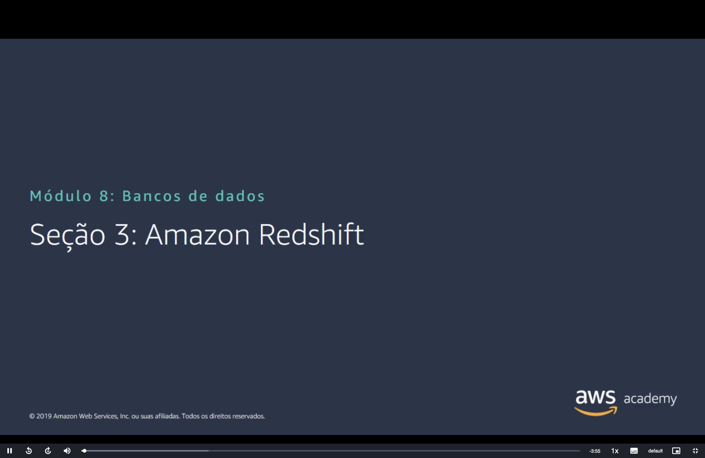
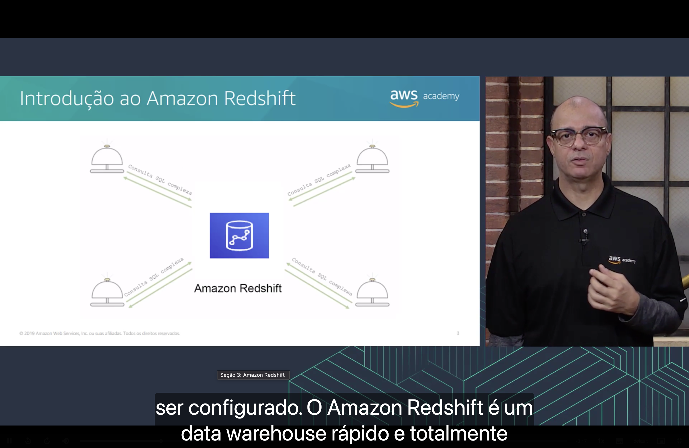
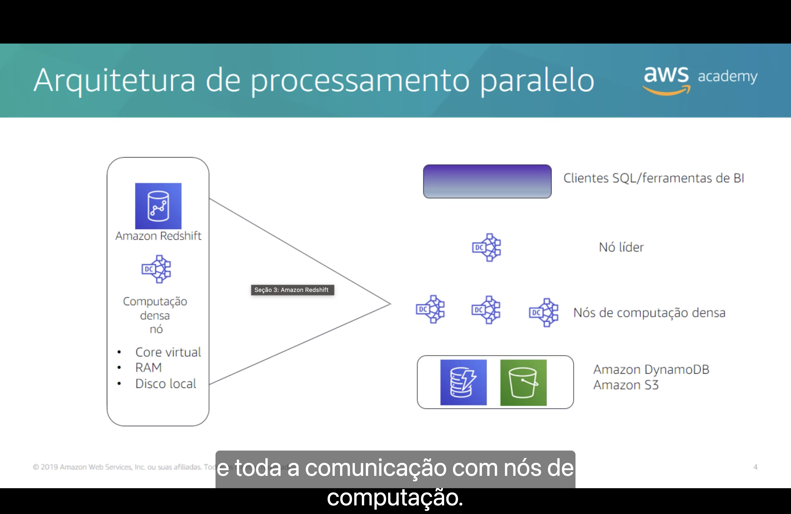
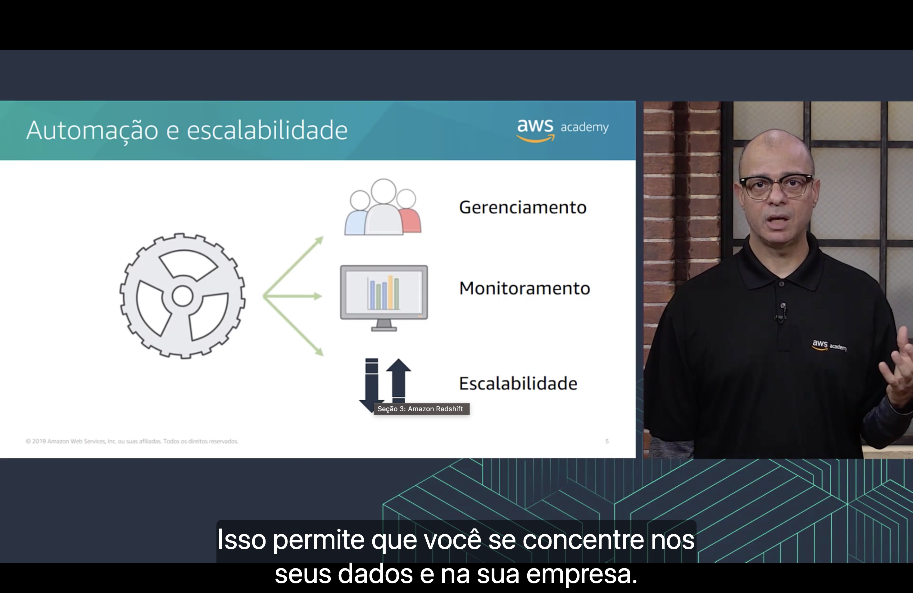
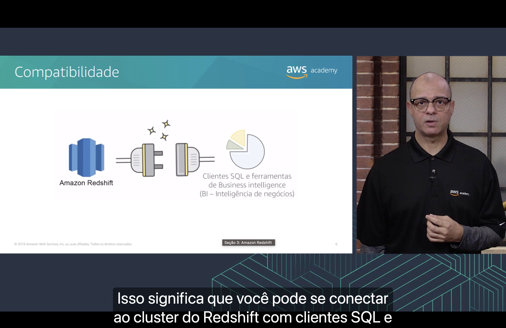
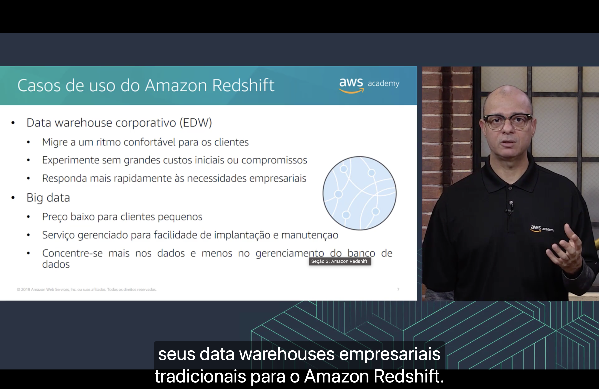
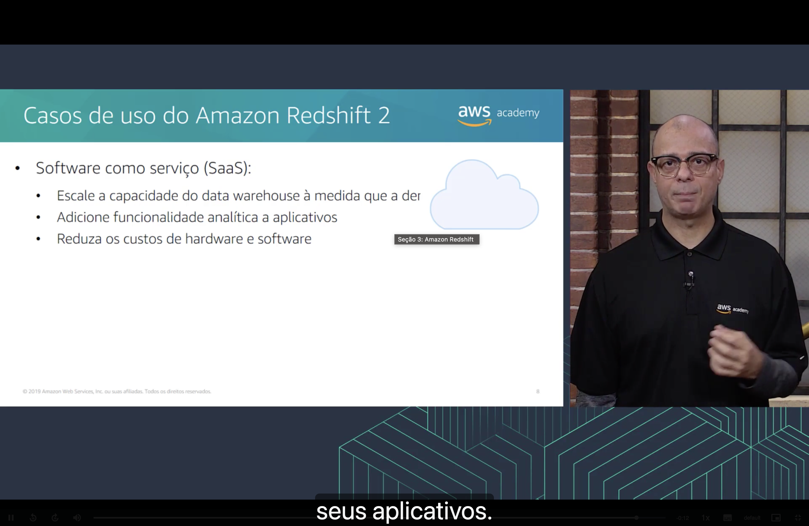

<h1 align="center">📊 Seção 3 – Amazon Redshift</h1>

<p align="center">
  
  
  <br>
  
  
  
</p>

<p align="center">
  <a href="../README.md">🏠 Início</a> &nbsp;•&nbsp;
  <a href="./Seção%202%20-%20Amazon%20DynamoDB.md">⬅️ Anterior: Amazon DynamoDB</a> &nbsp;•&nbsp;
  <a href="./Seção%204%20-%20Amazon%20Aurora.md">Próxima: Amazon Aurora ➡️</a>
</p>



> [!NOTE]
> O [Amazon RDS](./Seção%201%20-%20Amazon%20Relational%20Database%20Service.md) e o [Amazon DynamoDB](./Seção%202%20-%20Amazon%20DynamoDB.md) são bancos que **rodam o aplicativo**: registram pedidos, cadastros e pagamentos. Esta seção apresenta outro tipo de banco, feito para **analisar** esses dados: o **Amazon Redshift**, o *data warehouse* da AWS. Ele já apareceu na [categoria de banco de dados](../MÓDULO%203/Seção%202%20-%20Visão%20geral%20dos%20serviços%20e%20das%20categorias%20de%20serviços%20da%20AWS.md#banco-de-dados) do Módulo 3, como o serviço que executa **consultas analíticas** sobre **petabytes** de dados.

## 📑 Sumário

| # | Tópico |
|:---:|---|
| 1 | [🛎️ Introdução ao Amazon Redshift](#introducao) |
| 2 | [🧮 Arquitetura de processamento paralelo](#processamento-paralelo) |
| 3 | [⚙️ Automação e escalabilidade](#automacao) |
| 4 | [🔌 Compatibilidade](#compatibilidade) |
| 5 | [🏢 Casos de uso do Amazon Redshift](#casos-de-uso) |
| 6 | [☁️ Casos de uso do Amazon Redshift 2](#casos-de-uso-2) |
| 🎯 | [Principais conclusões](#conclusoes) |

---

<a id="introducao"></a>
## 1. 🛎️ Introdução ao Amazon Redshift



A narração começa pelo problema: montar um *data warehouse* por conta própria é **complexo e caro**, e ele pode levar meses para **ser configurado**. Segundo a narração, **o Amazon Redshift é um data warehouse rápido e totalmente gerenciado**, que analisa os dados com **SQL padrão** e com as ferramentas de BI que você já usa.

No diagrama, o Redshift fica no centro, e quatro campainhas de balcão trocam com ele **consultas SQL complexas**. As setas vão e voltam: cada campainha faz um pedido (a consulta) e recebe a resposta.

Uma "consulta SQL complexa", aqui, é uma pergunta sobre o negócio que precisa varrer **muitos dados de uma vez**:

```sql
-- Os 10 produtos que mais venderam em cada região desde 2023
SELECT regiao, produto, SUM(valor) AS total_vendido
FROM vendas
WHERE data_venda >= '2023-01-01'
GROUP BY regiao, produto
ORDER BY total_vendido DESC
LIMIT 10;
```

> [!TIP]
> **Banco transacional × *data warehouse*:** os dois guardam tabelas e usam SQL, mas resolvem problemas diferentes.
>
> | | 🛢️ Banco transacional (RDS, DynamoDB) | 📊 *Data warehouse* (Redshift) |
> |---|---|---|
> | **Para quê** | Rodar o aplicativo | Analisar o negócio: relatórios, tendências e painéis |
> | **Operação típica** | Muitas leituras e gravações **pequenas e rápidas** ("grave este pedido") | Poucas consultas **grandes**, que varrem milhões de linhas ("some as vendas de 3 anos") |
> | **Dados** | O estado **atual** | O **histórico**, reunido de várias fontes |
> | **Sigla** | **OLTP** (*online transaction processing*) | **OLAP** (*online analytical processing*) |
>
> Rodar a consulta acima no banco de produção do RDS faria os relatórios disputarem recursos com os clientes que estão comprando. Por isso os dados são copiados para um *data warehouse*, e as análises rodam lá.

> [!NOTE]
> *Data warehouse* quer dizer "armazém de dados". "Totalmente gerenciado" tem o mesmo sentido da [Seção 1](./Seção%201%20-%20Amazon%20Relational%20Database%20Service.md#gerenciados): a AWS cuida da infraestrutura, dos patches e dos backups, e você cuida dos dados e das consultas.

<a id="processamento-paralelo"></a>
## 2. 🧮 Arquitetura de processamento paralelo



O slide mostra o Redshift como um **cluster** em camadas. À esquerda, uma lupa sobre um **nó de computação densa**, que tem os próprios **cores virtuais**, **RAM** e **disco local**. À direita, as camadas de cima para baixo:

| Camada | Papel |
|---|---|
| 🧑‍💻 **Clientes SQL/ferramentas de BI** | Enviam as consultas e recebem os resultados |
| 👑 **Nó líder** | Recebe a consulta, monta o **plano de execução**, divide o trabalho entre os nós de computação e junta os resultados |
| 🧮 **Nós de computação densa** | Cada um processa **a sua parte dos dados** ao mesmo tempo que os outros |
| 🗄️ **Amazon DynamoDB e Amazon S3** | Fontes de onde os dados são **carregados** para o cluster |

Segundo a narração, **o nó líder gerencia a comunicação com os programas clientes e toda a comunicação com os nós de computação**. O caminho de uma consulta fica assim:

1. 📨 O cliente envia a consulta SQL ao **nó líder**.
2. 🗺️ O nó líder monta o plano e distribui as etapas entre os **nós de computação**.
3. ⚡ Cada nó de computação processa **a sua fatia dos dados**, todos ao mesmo tempo.
4. 🧩 Os nós devolvem resultados parciais, e o nó líder faz a **agregação final**.
5. 📬 O nó líder devolve o resultado ao cliente.

> [!NOTE]
> "Computação densa nó" é a tradução palavra por palavra de *dense compute node*: o certo seria **nó de computação densa**. O "DC" nos ícones vem daí. Em 2019, o Redshift tinha duas famílias de nós: **DC** (*dense compute*, com SSD, para desempenho) e **DS** (*dense storage*, com HDD, para muito volume).

> [!TIP]
> Pense em uma **apuração de votos**: em vez de uma pessoa contar todas as urnas, cada mesa conta as suas, e alguém soma os totais no fim. Esse modelo se chama **MPP** (*massively parallel processing*, processamento massivamente paralelo). Para ficar mais rápido, basta acrescentar mais "mesas", ou seja, mais nós.

> [!TIP]
> O aplicativo conversa **só com o nó líder**: os nós de computação ficam invisíveis para ele. E o Redshift guarda os dados **por coluna**, e não por linha. Para somar a coluna `valor` da consulta da [introdução](#introducao), ele lê só essa coluna, sem passar pelas outras. É um dos motivos de ele ser rápido em análises.

> [!TIP]
> O DynamoDB e o S3 na base do diagrama são as fontes de **carga**. O comando `COPY` importa dados de uma tabela do [DynamoDB](./Seção%202%20-%20Amazon%20DynamoDB.md) ou de arquivos no [S3](../MÓDULO%207/Seção%202%20-%20Amazon%20Simple%20Storage%20Service%20(Amazon%20S3).md), com todos os nós trabalhando em paralelo. Com o **Redshift Spectrum**, também dá para consultar arquivos no S3 **sem carregá-los** no cluster.

> [!NOTE]
> O slide é de 2019, e algumas coisas mudaram:
> - Em **dezembro de 2019**, chegaram os nós **RA3**, que **separam computação e armazenamento**: os dados ficam no armazenamento gerenciado do Redshift (apoiado no S3), e o disco local vira cache. Os nós DC, da imagem, ainda existem (DC2), mas a AWS recomenda os RA3 para clusters novos.
> - Em **julho de 2022**, chegou o **Amazon Redshift Serverless**. Nele não há cluster nem nós para escolher: a capacidade é medida em **RPUs** (*Redshift Processing Units*), ajusta-se sozinha, e você paga por segundo, **só enquanto as consultas rodam**.
> - Desde o fim de **2023**, as integrações **zero-ETL** copiam os dados do **Aurora MySQL** para o Redshift automaticamente, quase em tempo real, sem montar um processo de carga. Em **2024**, o recurso chegou ao **RDS for MySQL** e ao **DynamoDB**.

<a id="automacao"></a>
## 3. ⚙️ Automação e escalabilidade



A engrenagem do slide se divide em três frentes:

| Frente | Exemplos no Redshift |
|---|---|
| 👥 **Gerenciamento** | Patches e **snapshots automáticos**, sem intervenção do administrador |
| 📊 **Monitoramento** | Métricas do cluster e desempenho de cada consulta, direto no console |
| ↕️ **Escalabilidade** | Aumentar ou diminuir o cluster com **alguns cliques** no console |

Segundo a narração, é simples automatizar a maior parte das tarefas de **gerenciar, monitorar e escalar** o cluster, e **isso permite que você se concentre nos seus dados e na sua empresa**.

> [!TIP]
> Os snapshots automáticos funcionam como os [snapshots do EBS](../MÓDULO%207/Seção%201%20-%20Amazon%20Elastic%20Block%20Store%20(Amazon%20EBS).md#snapshots): são **incrementais** e ficam guardados no S3. No Redshift, eles vêm **ligados por padrão** e são tirados a cada **8 horas** ou a cada **5 GB** de dados alterados por nó, o que acontecer primeiro.

> [!TIP]
> A [Seção 2](./Seção%202%20-%20Amazon%20DynamoDB.md#relacional-vs-nao-relacional) disse que bancos relacionais escalam na **vertical**. O Redshift é relacional, mas também escala na **horizontal**: o **redimensionamento elástico** acrescenta ou remove nós do cluster em minutos. Para picos de muitas consultas ao mesmo tempo, o **Concurrency Scaling** liga capacidade extra temporária e a desliga quando o pico passa.

> [!NOTE]
> O slide é de 2019 e não fala de segurança, mas ela também vem incorporada: o Redshift oferece criptografia dos dados [em repouso](../MÓDULO%204/Seção%205%20-%20Proteção%20de%20dados%20na%20AWS.md#repouso), com o [AWS KMS](../MÓDULO%204/Seção%204%20-%20Proteção%20de%20contas.md#kms), e [em trânsito](../MÓDULO%204/Seção%205%20-%20Proteção%20de%20dados%20na%20AWS.md#transito), com SSL. Desde **janeiro de 2025**, os clusters novos já nascem **criptografados**, **sem acesso público** e **exigindo conexões SSL**. Antes, era preciso configurar esses três itens à mão.

<a id="compatibilidade"></a>
## 4. 🔌 Compatibilidade



O slide mostra uma tomada encaixando o **Amazon Redshift** nos **clientes SQL e ferramentas de Business Intelligence** (BI, inteligência de negócios).

Segundo a narração, **isso significa que você pode se conectar ao cluster do Redshift com clientes SQL e** ferramentas de BI. Isso funciona por dois motivos:

- 🗣️ O Redshift aceita **SQL padrão**: quem já escreve consultas para o RDS escreve para o Redshift.
- 🔌 Ele oferece conectores **JDBC** e **ODBC**, os "plugues" padrão que clientes SQL (como DBeaver) e ferramentas de BI (como Tableau e Power BI) usam para se conectar a bancos de dados.

> [!TIP]
> As ferramentas de BI são o "último passo" do *data warehouse*: elas transformam o resultado das consultas em **gráficos e painéis** para quem decide. O gráfico de pizza do slide representa isso. O Redshift é a origem dos dados, e a ferramenta de BI é a vitrine.

> [!NOTE]
> O slide é de 2019. Hoje também dá para consultar o Redshift **sem instalar nada**: o **Query Editor v2** roda SQL direto no console, e a **Data API** executa consultas por chamadas HTTPS, sem driver nem conexão aberta.

<a id="casos-de-uso"></a>
## 5. 🏢 Casos de uso do Amazon Redshift



| Caso de uso | O que o slide destaca |
|---|---|
| 🏢 **Data warehouse corporativo (EDW)** | Migre **a um ritmo confortável** para os clientes · Experimente **sem grandes custos iniciais ou compromissos** · Responda **mais rapidamente** às necessidades empresariais |
| 🌐 **Big data** | **Preço baixo** para clientes pequenos · **Serviço gerenciado** para facilidade de implantação e manutenção · Concentre-se **mais nos dados** e menos no gerenciamento do banco de dados |

Segundo a narração, muitos clientes migram **seus data warehouses empresariais tradicionais para o Amazon Redshift**. O ganho é **agilidade**: começar na escala que quiser e experimentar com os dados sem esperar o departamento de TI comprar e preparar hardware e software.

- 🏢 **EDW:** é o *data warehouse* que reúne os dados da **empresa inteira** (vendas, finanças, estoque, RH). Antes da nuvem, ele exigia comprar servidores e licenças caras de uma vez. No Redshift, a empresa começa pequeno e migra aos poucos.
- 🌐 **Big data:** são volumes de dados tão grandes que **esgotam os sistemas existentes**. Um cliente pequeno não teria verba para o hardware nem para os especialistas. Com o Redshift, ele monta um *data warehouse* a um preço baixo, e a AWS cuida da implantação e da manutenção, tarefas que normalmente exigiriam um administrador de banco de dados.

> [!TIP]
> Os itens do EDW são as [vantagens da nuvem](../MÓDULO%201/Seção%202%20-%20Vantagens%20da%20Computação%20em%20Nuvem.md) do Módulo 1 aplicadas a um *data warehouse*. "Sem grandes custos iniciais" é [trocar despesas de capital por despesas variáveis](../MÓDULO%201/Seção%202%20-%20Vantagens%20da%20Computação%20em%20Nuvem.md#despesas), e "responder mais rapidamente" é [aumentar a velocidade e a agilidade](../MÓDULO%201/Seção%202%20-%20Vantagens%20da%20Computação%20em%20Nuvem.md#agilidade).

> [!NOTE]
> "Preço baixo para clientes pequenos" ficou ainda mais literal com o **Redshift Serverless** (2022), visto no [tópico da arquitetura](#processamento-paralelo): quem roda poucas consultas paga só pelos segundos em que elas rodam, sem manter um cluster ligado.

<a id="casos-de-uso-2"></a>
## 6. ☁️ Casos de uso do Amazon Redshift 2



O terceiro caso de uso é o **software como serviço (SaaS)**:

- 📈 Escale a capacidade do *data warehouse* à medida que a **demanda aumenta**.
- 📊 Adicione **funcionalidade analítica** a aplicativos.
- 💰 Reduza os **custos de hardware e software**.

Segundo a narração, empresas que vendem software como serviço podem usar o Redshift para criar recursos de análise para os clientes **dos seus aplicativos**.

> [!NOTE]
> No slide, o primeiro item fica cortado pela ilustração da nuvem: "à medida que a der...". O texto completo é "à medida que a **demanda** aumenta" (*as demand grows*).

> [!TIP]
> **SaaS** é o modelo de serviço em que o cliente só **usa o software pronto**, visto nos [modelos de serviço](../MÓDULO%201/Seção%201%20-%20%20Introdução%20à%20computação%20em%20nuvem.md#servico) do Módulo 1. Um exemplo: uma plataforma de lojas virtuais mostra, para cada lojista, um painel com as vendas do mês. As consultas desse painel vão para o Redshift, e o banco de produção fica livre para atender os pedidos.

---

<a id="conclusoes"></a>
## 🎯 Principais conclusões

- ✅ O **Amazon Redshift** é um *data warehouse* **rápido e totalmente gerenciado**, feito para **analisar** grandes volumes de dados com **consultas SQL complexas**.
- ✅ Bancos como RDS e DynamoDB rodam o aplicativo (**OLTP**). O Redshift analisa o histórico do negócio (**OLAP**).
- ✅ Ele usa uma **arquitetura de processamento paralelo**: o **nó líder** recebe as consultas, distribui o trabalho e junta os resultados, e os **nós de computação** processam cada um a sua parte dos dados ao mesmo tempo.
- ✅ O **nó líder** gerencia toda a comunicação com os clientes e com os nós de computação. Os dados podem ser carregados do **Amazon S3** e do **Amazon DynamoDB**.
- ✅ **Gerenciamento**, **monitoramento** e **escalabilidade** do cluster são automatizados, o que deixa você se concentrar nos dados e na empresa.
- ✅ Ele é **compatível** com **SQL padrão** e com os **clientes SQL e ferramentas de BI** que você já usa, por meio de conectores JDBC e ODBC.
- ✅ Os casos de uso são o **data warehouse corporativo (EDW)**, o **big data** e o **software como serviço (SaaS)**.

---

<p align="center">
  <a href="../README.md">🏠 Início</a> &nbsp;•&nbsp;
  <a href="./Seção%202%20-%20Amazon%20DynamoDB.md">⬅️ Anterior: Amazon DynamoDB</a> &nbsp;•&nbsp;
  <a href="./Seção%204%20-%20Amazon%20Aurora.md">Próxima: Amazon Aurora ➡️</a>
</p>
