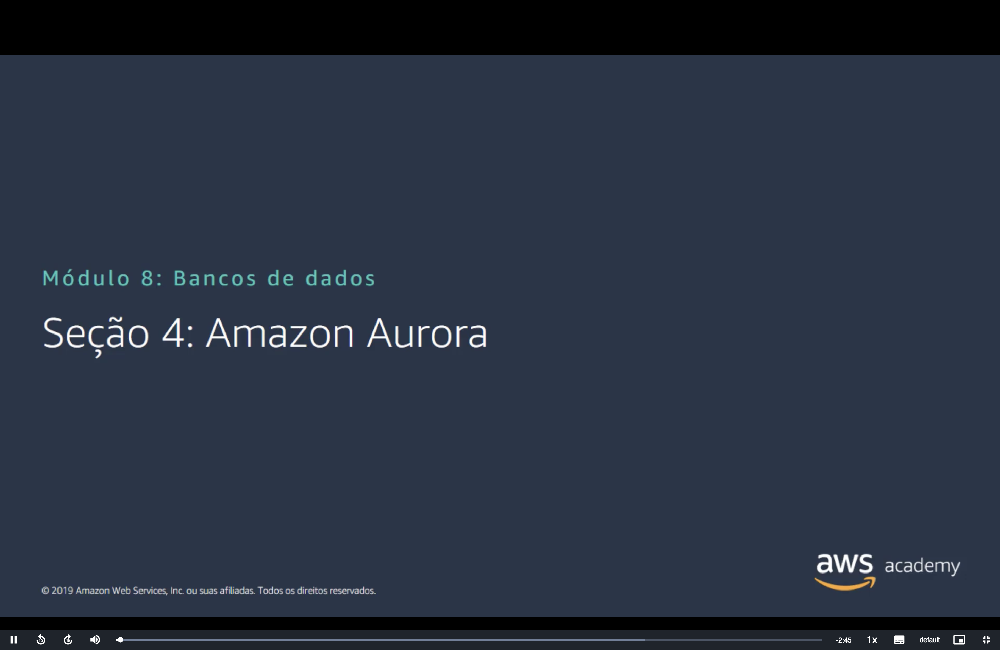
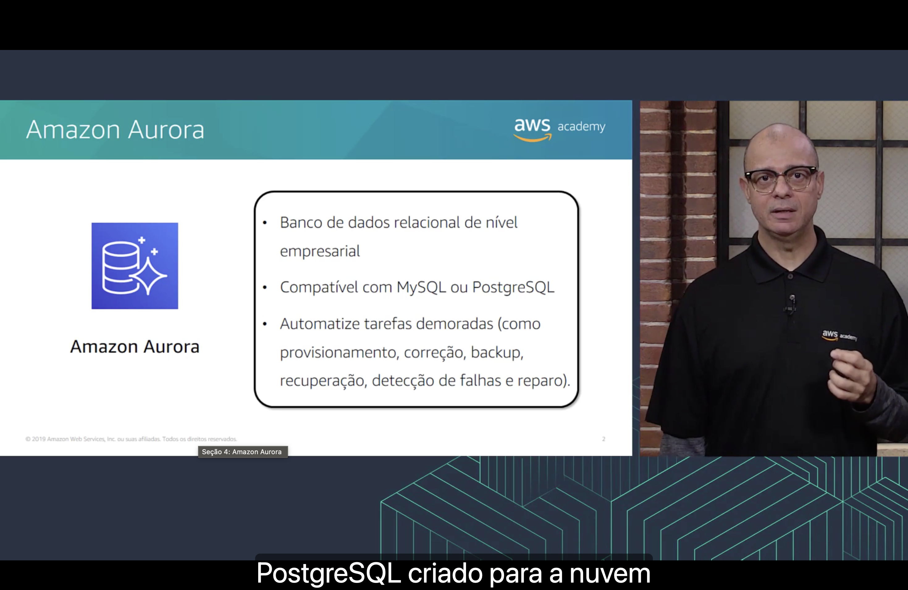
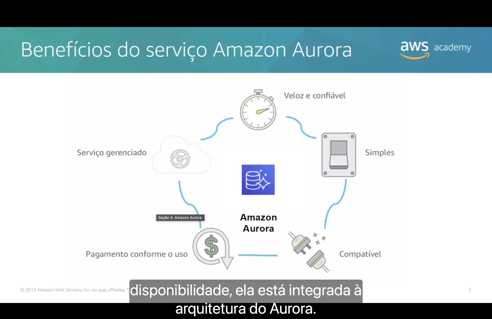
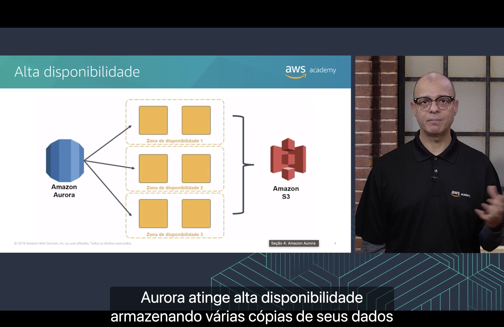
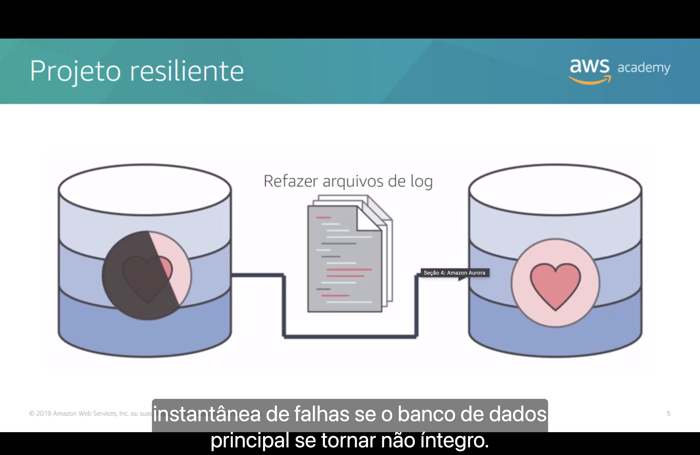

<h1 align="center">✨ Seção 4 – Amazon Aurora</h1>

<p align="center">
  
  
  <br>
  
  
  
</p>

<p align="center">
  <a href="../README.md">🏠 Início</a> &nbsp;•&nbsp;
  <a href="./Seção%203%20-%20Amazon%20Redshift.md">⬅️ Anterior: Amazon Redshift</a>
</p>



> [!NOTE]
> O **Amazon Aurora** já apareceu duas vezes: na [categoria de banco de dados](../MÓDULO%203/Seção%202%20-%20Visão%20geral%20dos%20serviços%20e%20das%20categorias%20de%20serviços%20da%20AWS.md#banco-de-dados) do Módulo 3 e na lista de [mecanismos do Amazon RDS](./Seção%201%20-%20Amazon%20Relational%20Database%20Service.md#instancias) da Seção 1. Esta seção fecha o módulo com ele: um banco **relacional**, como os do RDS, mas que a AWS **reconstruiu para a nuvem**, com um armazenamento próprio que guarda **seis cópias** dos dados.

## 📑 Sumário

| # | Tópico |
|:---:|---|
| 1 | [✨ Amazon Aurora](#aurora) |
| 2 | [🎁 Benefícios do serviço Amazon Aurora](#beneficios) |
| 3 | [🏢 Alta disponibilidade](#alta-disponibilidade) |
| 4 | [❤️‍🩹 Projeto resiliente](#projeto-resiliente) |
| 🎯 | [Principais conclusões](#conclusoes) |

---

<a id="aurora"></a>
## 1. ✨ Amazon Aurora



O slide resume o Aurora em três pontos:

- 🏢 Banco de dados relacional de **nível empresarial**.
- 🔌 **Compatível com MySQL ou PostgreSQL**.
- 🤖 **Automatiza tarefas demoradas**, como **provisionamento**, **correção**, **backup**, **recuperação**, **detecção de falhas** e **reparo**.

Segundo a narração, o Aurora é um banco de dados relacional compatível com MySQL e **PostgreSQL criado para a nuvem**.

"Nível empresarial" é a promessa central do serviço: o **desempenho** e a **disponibilidade** dos bancos comerciais (como Oracle e SQL Server) com a **simplicidade** e o **custo** dos bancos de código aberto.

"Compatível" quer dizer que o Aurora **fala o mesmo protocolo** do MySQL ou do PostgreSQL. Por dentro, ele é um mecanismo da própria AWS, mas o aplicativo, os drivers e as ferramentas continuam os mesmos. Para migrar, basta trocar o endereço do banco:

```bash
# O mesmo cliente do MySQL se conecta ao Aurora MySQL: só muda o endpoint
mysql -h meu-cluster.cluster-abc123xyz.us-east-1.rds.amazonaws.com -u admin -p
```

> [!NOTE]
> "Correção", no slide, é a tradução de *patching*: aplicar **patches** (correções de segurança e de bugs) no software do banco. É a mesma lista de tarefas que o [serviço gerenciado assume](./Seção%201%20-%20Amazon%20Relational%20Database%20Service.md#responsabilidades) no RDS.

> [!TIP]
> A grande diferença do Aurora está na arquitetura. Ele **separa a computação do armazenamento**:
>
> | Camada | O que tem |
> |---|---|
> | 🧠 **Instâncias** | Uma **instância principal**, que lê e grava, e até **15 réplicas do Aurora**, que só leem |
> | 💾 **Volume do cluster** | Um único armazenamento, **compartilhado** por todas as instâncias, que **cresce sozinho** conforme os dados aumentam |
>
> No RDS da Seção 1, cada instância tem o **seu próprio** volume do EBS, e você escolhe o tamanho dele. No Aurora, não há disco para escolher: você paga pelo armazenamento que **usa**. O endpoint do exemplo acima, com `.cluster-`, sempre aponta para a instância principal. As réplicas ficam atrás de outro endpoint, o de leitura (`.cluster-ro-`).

> [!NOTE]
> O slide é de 2019, e algumas coisas mudaram:
> - O volume do cluster tinha limite de **64 TiB**. Ele passou a **128 TiB** e, em **julho de 2025**, a **256 TiB**, no Aurora MySQL e no Aurora PostgreSQL (em versões recentes do mecanismo).
> - Em **outubro de 2024**, chegou o **Aurora PostgreSQL Limitless Database**, que divide os dados entre várias instâncias de gravação (*sharding*) quando uma só não dá conta. Ou seja, o Aurora PostgreSQL também passou a escalar gravações **na horizontal**, o que a [Seção 2](./Seção%202%20-%20Amazon%20DynamoDB.md#relacional-vs-nao-relacional) apontava como ponto forte dos bancos não relacionais.

<a id="beneficios"></a>
## 2. 🎁 Benefícios do serviço Amazon Aurora



O slide arranja cinco benefícios em círculo, ao redor do ícone do Aurora:

| Benefício | Ícone | O que significa |
|---|---|---|
| ⏱️ **Veloz e confiável** | Cronômetro | Segundo a AWS, até **5x** a vazão do MySQL padrão e **3x** a do PostgreSQL padrão, com alta disponibilidade embutida |
| 🎚️ **Simples** | Interruptor | O banco é criado e configurado com poucos cliques no console do RDS |
| 🔌 **Compatível** | Plugues se encaixando | Aceita aplicativos e ferramentas do **MySQL** e do **PostgreSQL** sem reescrever código |
| 💲 **Pagamento conforme o uso** | Cifrão com seta circular | Sem pagamento adiantado nem contrato: horas de instância, armazenamento usado e E/S |
| ⚙️ **Serviço gerenciado** | Nuvem com engrenagem | A AWS cuida da infraestrutura, dos patches e dos backups |

Segundo a narração, a alta **disponibilidade** do Aurora **está integrada à arquitetura do Aurora**: os dados já nascem replicados, sem precisar ligar um recurso à parte. O [próximo tópico](#alta-disponibilidade) mostra como.

> [!TIP]
> "Pagamento conforme o uso" é o princípio [pague pelo que usar](../MÓDULO%202/Seção%201%20-%20Fundamentos%20da%20definição%20de%20preço.md#pague-uso) do Módulo 2, e "serviço gerenciado" tem o mesmo sentido da [Seção 1](./Seção%201%20-%20Amazon%20Relational%20Database%20Service.md#gerenciados). O "5x" e o "3x" já apareceram na [tabela de bancos](../MÓDULO%203/Seção%202%20-%20Visão%20geral%20dos%20serviços%20e%20das%20categorias%20de%20serviços%20da%20AWS.md#banco-de-dados) do Módulo 3. São números da própria AWS, medidos em testes de vazão; o ganho real depende da carga.

> [!NOTE]
> O slide é de 2019, e o pagamento conforme o uso ficou mais literal:
> - Em **abril de 2022**, chegou o **Aurora Serverless v2**: em vez de escolher uma classe de instância, você define uma faixa de **ACUs** (*Aurora Capacity Units*), e a capacidade se ajusta em segundos conforme a carga. Desde **novembro de 2024**, o mínimo pode ser **0 ACU**: o banco **pausa** sozinho quando fica ocioso, e a instância deixa de ser cobrada (o armazenamento continua sendo).
> - Em **maio de 2023**, chegou a configuração **Aurora I/O-Optimized**, que elimina a cobrança por E/S, como visto no [tópico de preços](./Seção%201%20-%20Amazon%20Relational%20Database%20Service.md#implantacao) da Seção 1.

<a id="alta-disponibilidade"></a>
## 3. 🏢 Alta disponibilidade



No diagrama, o **Amazon Aurora** manda os dados para **três Zonas de Disponibilidade**, e cada zona guarda **duas cópias** (os quadrados amarelos). Um sinal de chave (`}`) junta as três zonas e aponta para o **Amazon S3**, onde ficam os backups.

Segundo a narração, o **Aurora atinge alta disponibilidade armazenando várias cópias de seus dados**:

- 🧮 **6 cópias** de cada dado: **2 em cada uma de 3 AZs**.
- ✍️ Uma gravação é confirmada quando **4 das 6 cópias** a recebem, e uma leitura precisa de **3 das 6**. Com isso, o Aurora continua **gravando** mesmo sem 2 cópias (uma AZ inteira fora do ar) e continua **lendo** mesmo sem 3.
- 🩹 O armazenamento é **autorreparável**: as cópias são verificadas o tempo todo, e uma cópia com defeito é refeita a partir das outras.
- ☁️ O backup é **contínuo e incremental** no Amazon S3, sem pausar o banco. Ele permite restaurar o banco para **qualquer segundo** do período de retenção (de 1 a 35 dias).

> [!TIP]
> Compare com a [implantação Multi-AZ](./Seção%201%20-%20Amazon%20Relational%20Database%20Service.md#multi-az) e as [réplicas de leitura](./Seção%201%20-%20Amazon%20Relational%20Database%20Service.md#replicas) do RDS:
>
> | | 🛢️ RDS Multi-AZ | ✨ Aurora |
> |---|---|---|
> | **Cópias dos dados** | 2 (principal e em espera), em **2 AZs** | **6**, em **3 AZs** |
> | **Onde a replicação acontece** | Entre instâncias, cada uma com o seu volume | Na camada de armazenamento, compartilhada |
> | **A cópia de reserva atende leituras?** | Não: a instância em espera só aguarda o failover | Sim: as **réplicas do Aurora** atendem leituras **e** são o alvo do failover |
> | **Atraso das réplicas** | Réplicas de leitura assíncronas, cada uma com os próprios dados | Normalmente **menos de 100 ms**, porque todas leem o **mesmo volume** |
> | **Failover** | Normalmente **60 a 120 segundos** | Normalmente **menos de 60 segundos**, muitas vezes **menos de 30** |

> [!IMPORTANT]
> As 6 cópias protegem os **dados**, não a **instância**. Para um failover rápido, o cluster precisa de pelo menos **uma réplica do Aurora em outra AZ**: se a principal falhar, o Aurora promove a réplica e o endpoint do cluster passa a apontar para ela. Sem réplica, o Aurora precisa **criar uma instância nova**, o que costuma levar até **10 minutos**. Os dados não se perdem, mas o banco fica fora do ar até lá.

> [!TIP]
> Os backups no S3 aproveitam a durabilidade de [11 noves](../MÓDULO%207/Seção%202%20-%20Amazon%20Simple%20Storage%20Service%20(Amazon%20S3).md#visao-geral) vista no Módulo 7. E a ideia das 3 AZs é a mesma das [Zonas de Disponibilidade](../MÓDULO%203/Seção%201%20-%20Infraestrutura%20global%20da%20AWS.md#zonas) do Módulo 3: uma zona pode falhar sem derrubar o sistema.

> [!NOTE]
> O slide é de 2019 e para nas AZs de uma só Região. Hoje também dá para ir além:
> - O **Aurora Global Database** replica o banco para **outras Regiões**, com atraso normalmente **menor que 1 segundo**. Se a Região principal cair, uma Região secundária assume.
> - O **Amazon Aurora DSQL**, disponível desde **maio de 2025**, é um banco **sem servidor** e **distribuído**, compatível com PostgreSQL, que aceita **gravações em mais de uma Região ao mesmo tempo** (ativo-ativo), com **99,999%** de disponibilidade na configuração multi-Região.

<a id="projeto-resiliente"></a>
## 4. ❤️‍🩹 Projeto resiliente



O diagrama mostra dois bancos de dados. O da esquerda tem um **coração meio apagado**: é o banco que **falhou**. No meio, os **arquivos de redo log** ligam os dois, e o banco da direita aparece com o **coração inteiro**: é o banco **recuperado**.

Segundo a narração, o Aurora foi projetado para a **recuperação instantânea de falhas se o banco de dados principal se tornar não íntegro**.

O **redo log** é o diário de alterações do banco: antes de mudar os dados, o banco anota no log **o que vai mudar**. Se ele cair no meio do caminho, o log permite **refazer** as alterações que ainda não tinham chegado aos dados.

| | 🐢 Banco tradicional | ✨ Aurora |
|---|---|---|
| **Depois de uma falha** | Relê o redo log desde o último **checkpoint** e reaplica tudo **antes de abrir** | O armazenamento aplica o redo log **o tempo todo**, em paralelo, então o banco **abre quase na hora** |
| **Tempo de recuperação** | Pode levar **minutos**, conforme o volume do log | Na maioria dos casos, **menos de 60 segundos** |
| **Cache depois do reinício** | Começa **vazio**: o banco fica lento até "esquentar" | O cache de páginas fica **fora do processo do banco** e **sobrevive** ao reinício |

> [!NOTE]
> "Refazer arquivos de log" é a tradução palavra por palavra de *redo log files*: "refazer" virou verbo. O certo seria **arquivos de redo log** (ou "log de refazer").

> [!TIP]
> Pense em um **livro-caixa**: cada movimentação é anotada no diário antes de o saldo ser atualizado. Se a luz acabar, basta reler o diário para reconstruir o saldo. O banco tradicional relê todo o diário desde o último fechamento antes de reabrir o caixa. O Aurora vai passando o diário a limpo **o tempo todo**, então reabre logo.

> [!TIP]
> O redo log também explica parte da velocidade do Aurora: as instâncias mandam para o armazenamento **só os registros do log**, e não páginas inteiras de dados. Cada uma das 6 cópias monta as páginas a partir desses registros. Menos dados trafegando pela rede significa gravações mais rápidas.

---

<a id="conclusoes"></a>
## 🎯 Principais conclusões

- ✅ O **Amazon Aurora** é um banco de dados relacional de **nível empresarial**, **compatível com MySQL e PostgreSQL** e **criado para a nuvem**.
- ✅ Como serviço gerenciado, ele **automatiza** provisionamento, patches, backup, recuperação, detecção de falhas e reparo.
- ✅ Os benefícios do slide são: **veloz e confiável**, **simples**, **compatível**, **pagamento conforme o uso** e **serviço gerenciado**.
- ✅ Ele **separa computação e armazenamento**: as instâncias (uma principal e até 15 réplicas) compartilham um volume que **cresce sozinho**.
- ✅ A **alta disponibilidade** está integrada à arquitetura: **6 cópias** dos dados em **3 Zonas de Disponibilidade** e **backup contínuo** no **Amazon S3**.
- ✅ O **projeto resiliente** usa o **redo log** para a **recuperação quase instantânea** quando o banco principal deixa de ser íntegro.
- ✅ Resumindo o módulo: **RDS = relacional gerenciado**, **DynamoDB = NoSQL**, **Redshift = data warehouse** e **Aurora = relacional criado para a nuvem**.

---

<p align="center">
  <a href="../README.md">🏠 Início</a> &nbsp;•&nbsp;
  <a href="./Seção%203%20-%20Amazon%20Redshift.md">⬅️ Anterior: Amazon Redshift</a>
</p>
