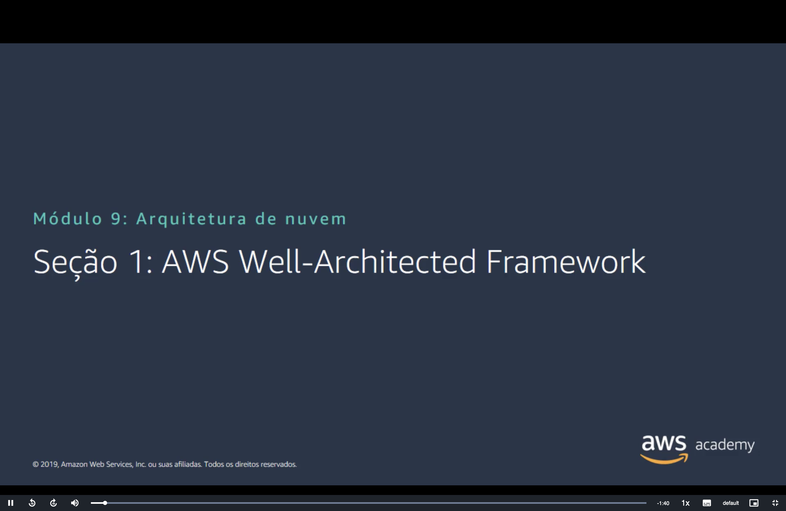
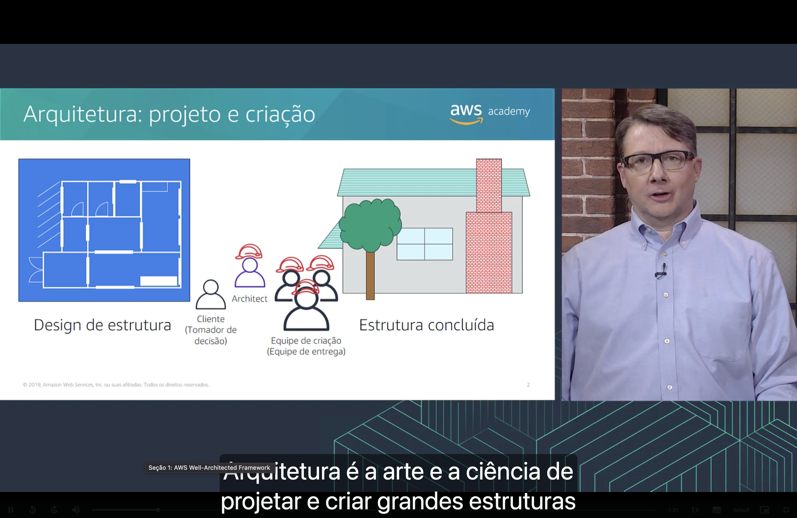
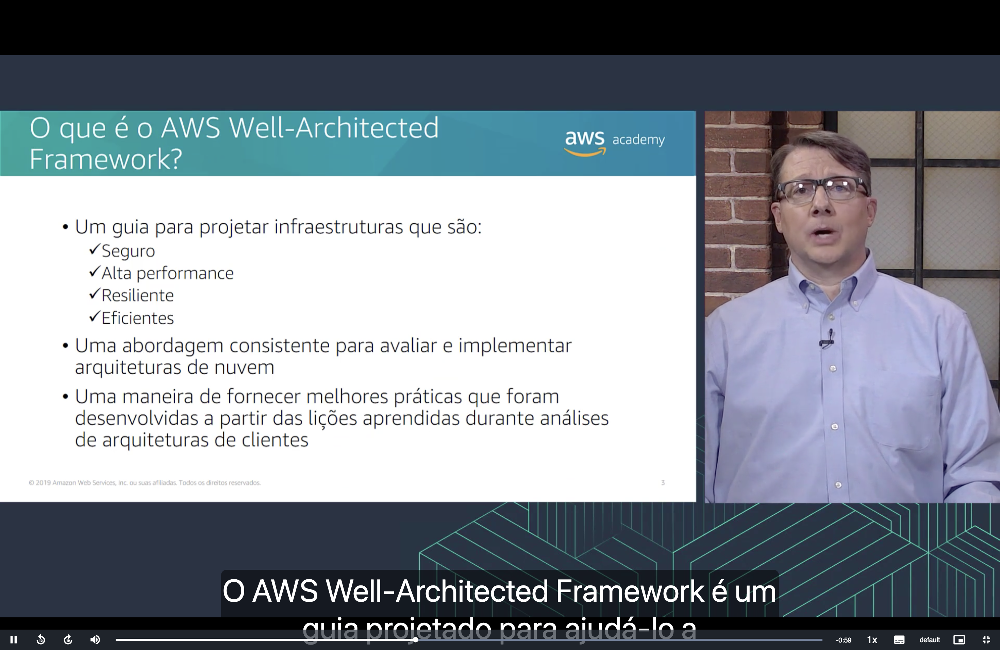
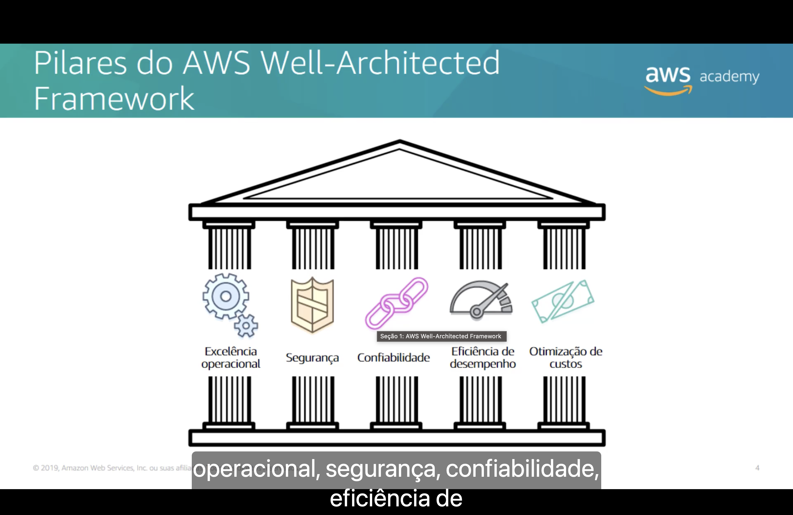
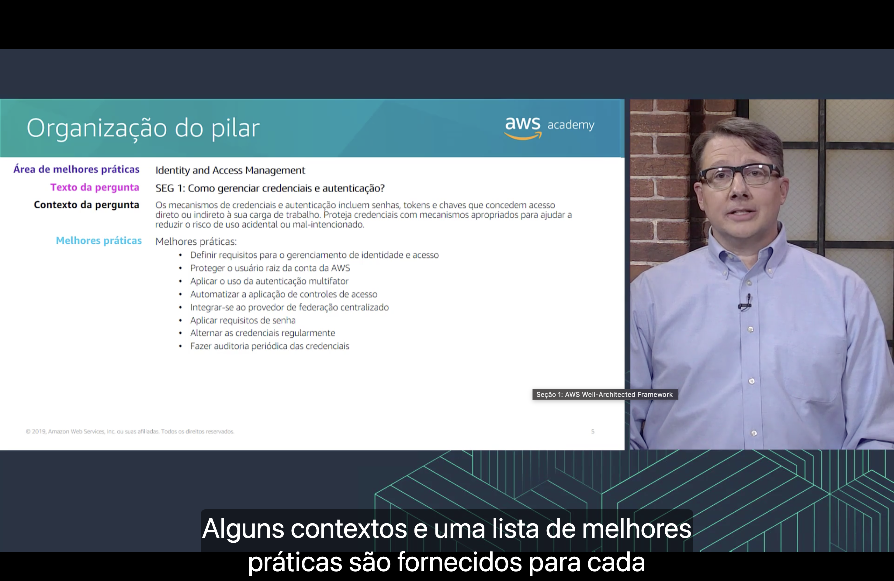
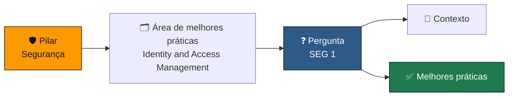

<h1 align="center">🏛️ Seção 1 – AWS Well-Architected Framework</h1>

  
  
   
  
  
  

  <a href="../README.md">🏠 Início</a> &nbsp;•&nbsp;
  <a href="./Seção%202%20-%20Pilar%20Excelência%20operacional.md">Próxima: Pilar Excelência operacional ➡️</a>

> [!NOTE]
> Esta seção abre o Módulo 9, sobre **arquitetura de nuvem**, com o **AWS Well-Architected Framework**. Ele já apareceu de passagem no Módulo 3, na [categoria de gerenciamento e governança](../MÓDULO%203/Seção%202%20-%20Visão%20geral%20dos%20serviços%20e%20das%20categorias%20de%20serviços%20da%20AWS.md#gerenciamento), por meio da **AWS Well-Architected Tool**. Até aqui o curso apresentou os serviços um a um. Agora a pergunta muda: como juntar esses serviços em uma arquitetura **bem feita**, e como saber se ela está bem feita?

## 📑 Sumário

| # | Tópico |
|:---:|---|
| 1 | [🏗️ Arquitetura: projeto e criação](#arquitetura) |
| 2 | [❓ O que é o AWS Well-Architected Framework?](#o-que-e) |
| 3 | [🏛️ Pilares do AWS Well-Architected Framework](#pilares) |
| 4 | [🗂️ Organização do pilar](#organizacao) |
| 🎯 | [Principais conclusões](#conclusoes) |

---

## 1. 🏗️ Arquitetura: projeto e criação

Segundo a narração, **arquitetura é a arte e a ciência de projetar e criar grandes estruturas**.

O slide usa a construção de uma casa como exemplo, da esquerda para a direita:

1. 📐 O **design de estrutura**: a planta da casa.
2. 🧑‍💼 O **cliente**, que é o **tomador de decisão**.
3. 👷 O **arquiteto**, que fica entre o cliente e quem constrói.
4. 👷‍♂️ A **equipe de criação**, ou **equipe de entrega**.
5. 🏠 A **estrutura concluída**.

Levando a analogia para a nuvem:

| Na construção | Na nuvem |
|---|---|
| 📐 **Design de estrutura** (a planta) | O **diagrama de arquitetura**: quais serviços entram, como se conectam e onde ficam, como no diagrama do [Amazon RDS em uma VPC](../MÓDULO%208/Seção%201%20-%20Amazon%20Relational%20Database%20Service.md#vpc) |
| 🧑‍💼 **Cliente** (tomador de decisão) | Quem define o **objetivo de negócio** e aprova o projeto |
| 👷 **Arquiteto** | O **arquiteto de nuvem**, que transforma o objetivo do cliente em um projeto técnico |
| 👷‍♂️ **Equipe de criação** (equipe de entrega) | Desenvolvedores e equipe de operações, que **implantam** o projeto |
| 🏠 **Estrutura concluída** | A **carga de trabalho** rodando na AWS |

> [!NOTE]
> O slide deixou o papel do meio em inglês: **Architect** é o **arquiteto**.

> [!TIP]
> Uma casa só fica de pé se o projeto seguir boas normas de construção. Com a nuvem é igual: o arquiteto precisa de critérios para saber se o projeto é bom. O AWS Well-Architected Framework, do próximo tópico, reúne esses critérios.

## 2. ❓ O que é o AWS Well-Architected Framework?

O AWS Well-Architected Framework é:

- 📘 **um guia para projetar infraestruturas** que são:
  - ✔️ **seguras**;
  - ✔️ de **alta performance**;
  - ✔️ **resilientes**;
  - ✔️ **eficientes**.
- 📏 **uma abordagem consistente** para **avaliar e implementar** arquiteturas de nuvem;
- 💡 **uma maneira de fornecer melhores práticas** que foram desenvolvidas a partir das **lições aprendidas** durante análises de arquiteturas de clientes.

> [!TIP]
> Os quatro adjetivos já antecipam os [pilares](#pilares) do próximo tópico: **seguro** leva à segurança, **alta performance** à eficiência de desempenho e **resiliente** à confiabilidade. **Eficiente** aparece tanto na operação quanto nos custos.

> [!NOTE]
> O framework fala sempre em **carga de trabalho** (*workload*): o conjunto de recursos e código que entrega valor ao negócio, como um site de comércio eletrônico ou um processo de back-end. A avaliação é feita **por carga de trabalho**, e não para a conta da AWS inteira.

O nome lembra o **AWS CAF** do Módulo 1, mas os dois respondem a perguntas diferentes:

| | 🧭 [AWS CAF](../MÓDULO%201/Seção%204%20-%20Mudança%20para%20a%20Nuvem%20AWS%20–%20AWS%20Cloud%20Adoption%20Framework%20(AWS%20CAF).md#o-que-e) | 🏛️ AWS Well-Architected Framework |
|---|---|---|
| **Pergunta central** | Como a **organização** adota a nuvem? | Como **projetar e avaliar** uma carga de trabalho na nuvem? |
| **Organizado em** | **6 perspectivas** | **Pilares** (5 no slide, 6 hoje) |
| **Quem usa** | Toda a organização: negócios, pessoas, governança, plataforma, segurança e operações | Arquitetos, desenvolvedores e equipes de operações |

> [!WARNING]
> Não abrevie o framework como **AWS WAF**. Esse nome é de outro serviço, o **AWS WAF** (*Web Application Firewall*), o firewall de aplicativos web que aparece integrado ao [Amazon CloudFront](../MÓDULO%205/Seção%206%20-%20Amazon%20CloudFront.md#beneficios) no Módulo 5.

> [!TIP]
> Para aplicar o framework na prática existe a **AWS Well-Architected Tool**, **gratuita** no console. Você descreve uma carga de trabalho, responde às perguntas de cada pilar e recebe um relatório com os **problemas de alto risco** e de **médio risco** encontrados, além de um plano de melhoria. Além das perguntas gerais, a ferramenta oferece **lentes** (*lenses*) com perguntas para cenários específicos, como aplicativos sem servidor (*serverless*).

## 3. 🏛️ Pilares do AWS Well-Architected Framework

O slide desenha o framework como um templo grego sustentado por **cinco pilares**, que a narração lista na mesma ordem:

| Pilar | Ícone no slide | O que busca | Onde já apareceu no curso |
|---|---|---|---|
| ⚙️ **Excelência operacional** | Engrenagens | **Executar e monitorar** sistemas para entregar valor ao negócio e **melhorar continuamente** os processos e procedimentos | Monitoramento com o [Amazon CloudWatch](../MÓDULO%206/Seção%204%20-%20Amazon%20EC2%20Parte%203.md#cloudwatch) e auditoria com o [AWS CloudTrail](../MÓDULO%204/Seção%203%20-%20Proteção%20de%20uma%20nova%20conta%20da%20AWS.md#etapa3). Detalhado na [próxima seção](./Seção%202%20-%20Pilar%20Excelência%20operacional.md) |
| 🛡️ **Segurança** | Escudo | **Proteger** informações, sistemas e ativos, com avaliação de riscos e estratégias de mitigação | O Módulo 4 inteiro, do [modelo de responsabilidade compartilhada](../MÓDULO%204/Seção%201%20-%20Modelo%20de%20responsabilidade%20compartilhada%20da%20AWS.md#modelo) ao [IAM](../MÓDULO%204/Seção%202%20-%20AWS%20Identity%20and%20Access%20Management%20(IAM).md#iam). Detalhado na [Seção 3](./Seção%203%20-%20Pilar%20Segurança.md) |
| 🔗 **Confiabilidade** | Corrente | **Recuperar-se** de falhas na infraestrutura ou nos serviços, **obter recursos** de computação conforme a demanda e reduzir interrupções, como configurações erradas ou problemas temporários de rede | [Zonas de Disponibilidade](../MÓDULO%203/Seção%201%20-%20Infraestrutura%20global%20da%20AWS.md#zonas) e a [implantação Multi-AZ](../MÓDULO%208/Seção%201%20-%20Amazon%20Relational%20Database%20Service.md#multi-az) do RDS. Detalhado na [Seção 4](./Seção%204%20-%20Pilar%20Confiabilidade.md) |
| ⏱️ **Eficiência de desempenho** | Velocímetro | **Usar os recursos de computação com eficiência** para atender aos requisitos e manter essa eficiência conforme a demanda muda e a tecnologia evolui | Escolha do [tipo de instância](../MÓDULO%206/Seção%202%20-%20Amazon%20EC2%20Parte%201.md#tipo-instancia) do EC2. Detalhado na [Seção 5](./Seção%205%20-%20Pilar%20Eficiência%20de%20desempenho.md) |
| 💲 **Otimização de custos** | Dinheiro | Executar sistemas que entregam valor ao negócio **pelo menor preço** | Os [quatro pilares da otimização de custos](../MÓDULO%206/Seção%205%20-%20Otimização%20de%20custos%20do%20Amazon%20EC2.md#pilares) do EC2 |

> [!IMPORTANT]
> Os pilares **puxam em direções diferentes**, e o arquiteto precisa escolher um equilíbrio de acordo com o negócio. A [implantação Multi-AZ](../MÓDULO%208/Seção%201%20-%20Amazon%20Relational%20Database%20Service.md#implantacao) do RDS, por exemplo, ganha em **confiabilidade** e custa perto do **dobro**. Em um ambiente de desenvolvimento, pode valer abrir mão de confiabilidade para economizar. Em um sistema crítico, vale pagar mais. Segundo o próprio framework, **segurança** e **excelência operacional** em geral **não entram nessa troca**.

> [!NOTE]
> O slide é de 2019. Em **dezembro de 2021** (no re:Invent), a AWS acrescentou um **sexto pilar**, a **sustentabilidade**: melhorar continuamente o impacto ambiental da carga de trabalho, reduzindo o consumo de energia e usando melhor os recursos provisionados. Junto com ele veio um **modelo de responsabilidade compartilhada da sustentabilidade**, com a mesma lógica do [Módulo 4](../MÓDULO%204/Seção%201%20-%20Modelo%20de%20responsabilidade%20compartilhada%20da%20AWS.md#modelo): a AWS cuida da sustentabilidade **da** nuvem (datacenters e energia), e o cliente cuida da sustentabilidade **na** nuvem (escolher recursos eficientes e desligar o que não usa). Hoje são **seis pilares**, e é essa a conta que vale para a prova **AWS Certified Cloud Practitioner**.

## 4. 🗂️ Organização do pilar

Cada pilar é dividido em **áreas de melhores práticas**. Cada área tem **perguntas**, e cada pergunta vem com um **contexto** e uma **lista de melhores práticas**. O slide mostra um exemplo do pilar de **segurança**:

| Elemento | Exemplo do slide |
|---|---|
| 🗂️ **Área de melhores práticas** | Identity and Access Management |
| ❓ **Texto da pergunta** | **SEG 1:** Como gerenciar credenciais e autenticação? |
| 📄 **Contexto da pergunta** | Os mecanismos de credenciais e autenticação incluem **senhas**, **tokens** e **chaves** que concedem acesso direto ou indireto à sua carga de trabalho. Proteja credenciais com mecanismos apropriados para ajudar a reduzir o risco de uso **acidental** ou **mal-intencionado**. |
| ✅ **Melhores práticas** | Oito itens, listados abaixo |

> [!NOTE]
> **SEG** é a sigla em português de *SEC* (*security*). E "Identity and Access Management", aqui, é o nome da **área** inteira de identidade e acesso, e não só do serviço IAM.

As melhores práticas da SEG 1 são quase todas velhas conhecidas do Módulo 4:

| Melhor prática | Onde já vimos |
|---|---|
| 📋 **Definir requisitos** para o gerenciamento de identidade e acesso | Decidir **quem precisa de qual acesso** antes de criar usuários, seguindo o [princípio do privilégio mínimo](../MÓDULO%204/Seção%202%20-%20AWS%20Identity%20and%20Access%20Management%20(IAM).md#autorizacao) |
| 👑 **Proteger o usuário raiz** da conta da AWS | [Etapa 1: parar de usar o usuário raiz](../MÓDULO%204/Seção%203%20-%20Proteção%20de%20uma%20nova%20conta%20da%20AWS.md#etapa1) o mais rápido possível |
| 📱 **Aplicar o uso da autenticação multifator** | [MFA do IAM](../MÓDULO%204/Seção%202%20-%20AWS%20Identity%20and%20Access%20Management%20(IAM).md#mfa) e a [Etapa 2](../MÓDULO%204/Seção%203%20-%20Proteção%20de%20uma%20nova%20conta%20da%20AWS.md#etapa2) da proteção de uma nova conta |
| 🤖 **Automatizar** a aplicação de controles de acesso | Regras aplicadas automaticamente a várias contas, como as [SCPs do AWS Organizations](../MÓDULO%204/Seção%204%20-%20Proteção%20de%20contas.md#scps) |
| 🔗 **Integrar-se ao provedor de federação centralizado** | A **federação de identidades** do [IAM](../MÓDULO%204/Seção%203%20-%20Proteção%20de%20uma%20nova%20conta%20da%20AWS.md#raiz-vs-iam): as pessoas entram com o login que já usam na empresa |
| 🔑 **Aplicar requisitos de senha** | A **política de senha** do passo 4 da [Etapa 1](../MÓDULO%204/Seção%203%20-%20Proteção%20de%20uma%20nova%20conta%20da%20AWS.md#etapa1) |
| 🔄 **Alternar as credenciais regularmente** | O item *Rotate your access keys* do [status de segurança](../MÓDULO%204/Seção%20Bônus%20-%20Demonstração%20-%20IAM.md#security-status) na demonstração do IAM |
| 🔍 **Fazer auditoria periódica** das credenciais | Revisar quem tem senha, chave de acesso e MFA ativa e remover o que não é usado. O IAM gera um **relatório de credenciais** com essa lista |

> [!TIP]
> Esse é o espírito do framework: transformar as melhores práticas em **perguntas** sobre a sua carga de trabalho. Se a resposta para um item for "não fazemos isso", ele vira um **ponto de melhoria**. É exatamente o que a Well-Architected Tool registra como risco.

> [!NOTE]
> O slide é de 2019, e o pilar de segurança foi reorganizado:
> - Hoje ele tem **sete áreas de melhores práticas**: fundamentos de segurança, gerenciamento de identidade e acesso, detecção, proteção da infraestrutura, proteção de dados, resposta a incidentes e segurança de aplicativos.
> - A **SEC 1** passou a ser "Como você opera sua carga de trabalho com segurança?", na área de **fundamentos de segurança**. Proteger o usuário raiz virou a prática **SEC01-BP02**.
> - Credenciais e autenticação foram para a **SEC 2**, que trata de identidades de **pessoas e máquinas** (como instâncias do EC2 e funções do Lambda). As práticas dela são: usar mecanismos de login fortes, usar **credenciais temporárias**, armazenar e usar segredos com segurança, usar um provedor de identidade centralizado, auditar e alternar credenciais periodicamente e usar grupos de usuários e atributos.
> - Cada melhor prática ganhou um código, como **SEC02-BP01**.

> [!TIP]
> A maior mudança da lista nova é a preferência por **credenciais temporárias**. Em vez de chaves de acesso que valem para sempre, a recomendação é usar [funções do IAM](../MÓDULO%204/Seção%202%20-%20AWS%20Identity%20and%20Access%20Management%20(IAM).md#funcoes), como a que dá permissões a uma [instância do EC2](../MÓDULO%206/Seção%203%20-%20Amazon%20EC2%20Parte%202.md#iam). Assim, não sobra chave para alternar nem para vazar.

---

## 🎯 Principais conclusões

- ✅ **Arquitetura** é a arte e a ciência de projetar e criar grandes estruturas. O **arquiteto** traduz o que o **cliente** (tomador de decisão) precisa em um projeto que a **equipe de entrega** constrói.
- ✅ O **AWS Well-Architected Framework** é um guia para projetar infraestruturas **seguras**, de **alta performance**, **resilientes** e **eficientes**, uma **abordagem consistente** para avaliar arquiteturas e um conjunto de **melhores práticas** tiradas de análises de arquiteturas de clientes.
- ✅ O slide mostra **cinco pilares**: **excelência operacional**, **segurança**, **confiabilidade**, **eficiência de desempenho** e **otimização de custos**. Desde 2021, a **sustentabilidade** é o sexto.
- ✅ Os pilares exigem **equilíbrio**: ganhar confiabilidade pode custar mais, por exemplo. Segurança e excelência operacional em geral não entram nessa troca.
- ✅ Cada pilar se divide em **áreas de melhores práticas**, cada área tem **perguntas**, e cada pergunta vem com **contexto** e uma **lista de melhores práticas**.
- ✅ O exemplo **SEG 1** (credenciais e autenticação) repete o Módulo 4: proteger o usuário raiz, exigir MFA, aplicar política de senha, alternar e auditar credenciais.
- ✅ Não confunda o framework com o **AWS CAF**, que trata da adoção da nuvem pela organização, nem o abrevie como **AWS WAF**, que é o firewall de aplicativos web.

---

  <a href="../README.md">🏠 Início</a> &nbsp;•&nbsp;
  <a href="./Seção%202%20-%20Pilar%20Excelência%20operacional.md">Próxima: Pilar Excelência operacional ➡️</a>

