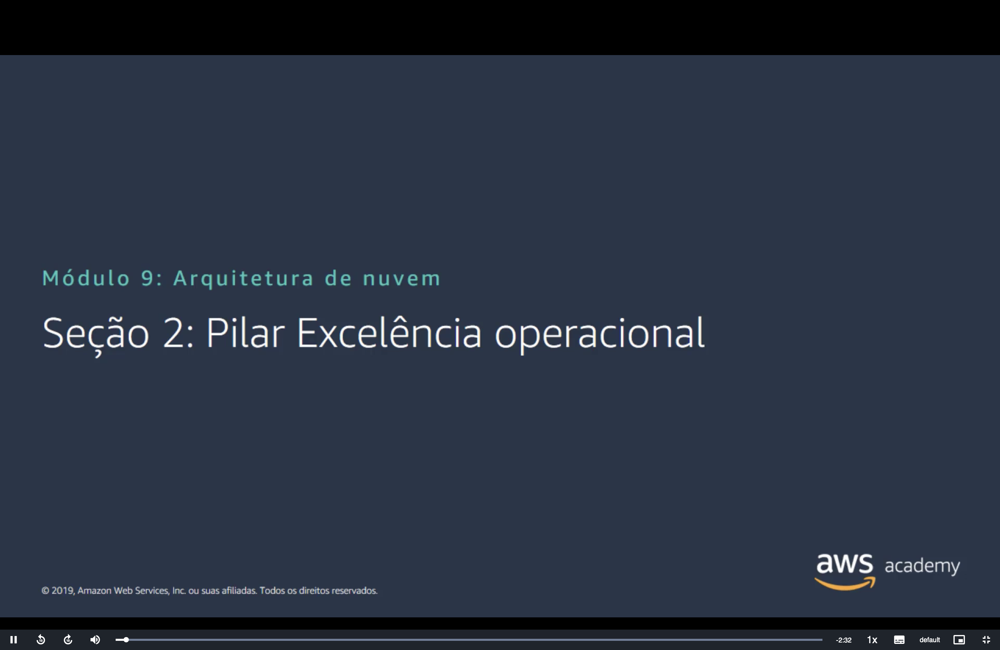
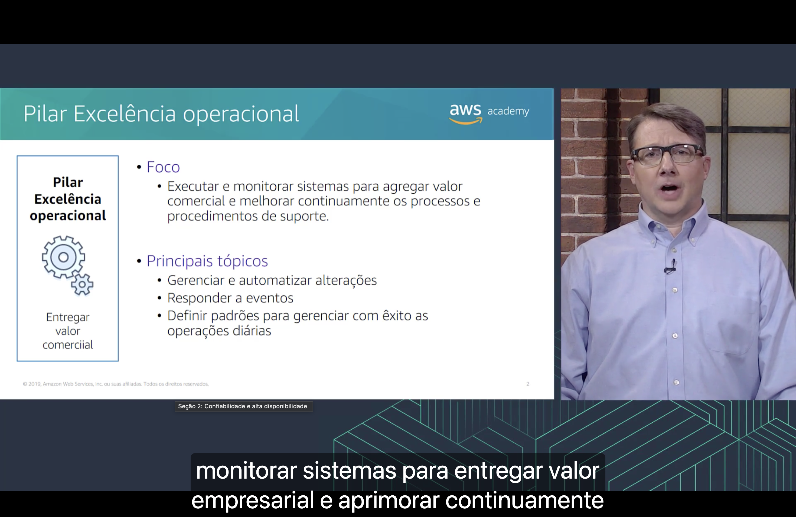
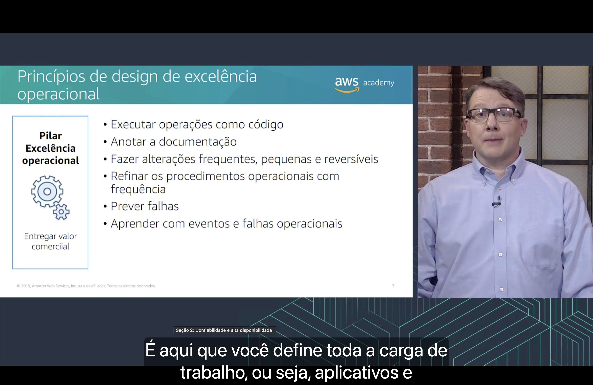
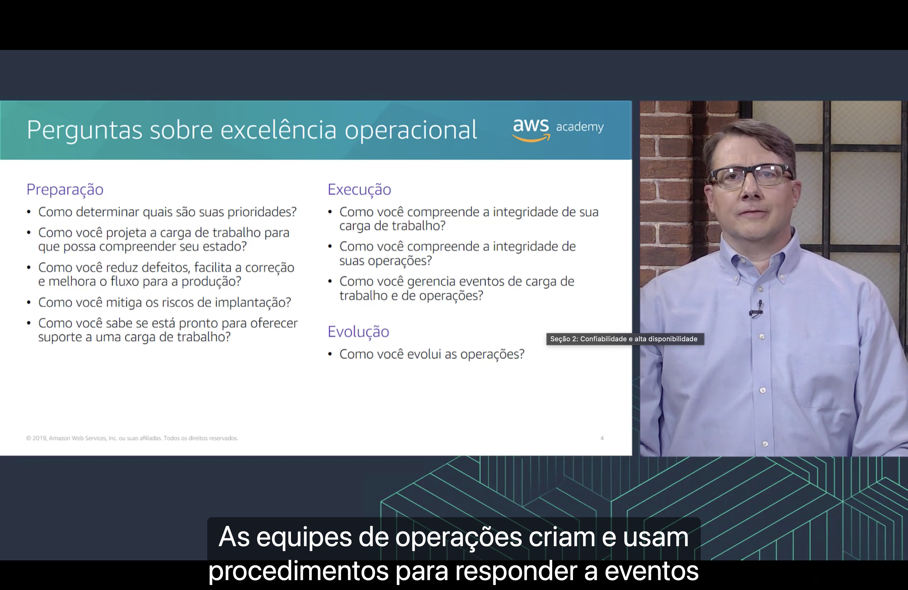
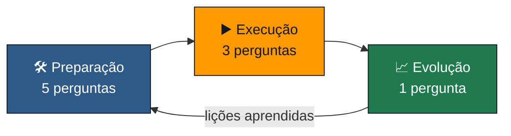

<h1 align="center">⚙️ Seção 2 – Pilar Excelência operacional</h1>

  
  
   
  
  
  

  <a href="../README.md">🏠 Início</a> &nbsp;•&nbsp;
  <a href="./Seção%201%20-%20AWS%20Well-Architected%20Framework.md">⬅️ Anterior: AWS Well-Architected Framework</a> &nbsp;•&nbsp;
  <a href="./Seção%203%20-%20Pilar%20Segurança.md">Próxima: Pilar Segurança ➡️</a>

> [!NOTE]
> A [Seção 1](./Seção%201%20-%20AWS%20Well-Architected%20Framework.md#pilares) apresentou os pilares do AWS Well-Architected Framework e mostrou como cada um se [organiza](./Seção%201%20-%20AWS%20Well-Architected%20Framework.md#organizacao) em áreas, perguntas e melhores práticas. Esta seção detalha o primeiro pilar, a **excelência operacional**: o que ele busca, seus **princípios de design** e as **perguntas** que ele faz sobre a carga de trabalho.

## 📑 Sumário

| # | Tópico |
|:---:|---|
| 1 | [🎯 Pilar Excelência operacional](#pilar) |
| 2 | [🧭 Princípios de design de excelência operacional](#principios) |
| 3 | [❓ Perguntas sobre excelência operacional](#perguntas) |
| 🎯 | [Principais conclusões](#conclusoes) |

---

## 1. 🎯 Pilar Excelência operacional

O quadro à esquerda resume o objetivo do pilar: **entregar valor comercial**.

**Foco**

- 📊 **Executar e monitorar sistemas** para agregar valor comercial e **melhorar continuamente** os processos e procedimentos de suporte.

**Principais tópicos**

- 🔄 **Gerenciar e automatizar** alterações;
- 🚨 **Responder** a eventos;
- 📏 **Definir padrões** para gerenciar com êxito as operações diárias.

A narração repete o foco do slide: monitorar sistemas para **entregar valor empresarial** e **aprimorar continuamente** os processos.

Vários serviços que já apareceram no curso ajudam em cada tópico:

| Tópico | Onde já vimos |
|---|---|
| 🔄 **Gerenciar e automatizar alterações** | O [AWS Config](../MÓDULO%204/Seção%206%20-%20Trabalhar%20para%20garantir%20a%20conformidade.md#config) registra **o que mudou** na configuração de cada recurso, e o [AWS CloudTrail](../MÓDULO%204/Seção%203%20-%20Proteção%20de%20uma%20nova%20conta%20da%20AWS.md#etapa3) registra **quem fez** a alteração |
| 🚨 **Responder a eventos** | O [Amazon CloudWatch](../MÓDULO%206/Seção%204%20-%20Amazon%20EC2%20Parte%203.md#cloudwatch) acompanha as métricas, e os **alarmes** dele avisam a equipe ou disparam uma ação automática quando uma métrica passa do limite |
| 📏 **Definir padrões para as operações diárias** | Uma regra do AWS Config, como a `required-tags` do [painel de exemplo](../MÓDULO%204/Seção%206%20-%20Trabalhar%20para%20garantir%20a%20conformidade.md#config), verifica automaticamente se todos os recursos seguem o padrão de [tags](../MÓDULO%206/Seção%204%20-%20Amazon%20EC2%20Parte%203.md#tags) |

> [!NOTE]
> O quadro do slide tem um erro de digitação: "comerciial" é **comercial**.

> [!TIP]
> Esse pilar não trata de um serviço específico, e sim de **como a equipe trabalha** depois que a carga de trabalho entra no ar: como faz mudanças, como reage a problemas e como melhora com o tempo.

## 2. 🧭 Princípios de design de excelência operacional

O slide lista **seis princípios de design**:

| Princípio | O que significa |
|---|---|
| 💻 **Executar operações como código** | Segundo a narração, é aqui que você define **toda a carga de trabalho**, ou seja, os aplicativos e a infraestrutura, **como código**. As operações também viram código, e não cliques no console |
| 📝 **Anotar a documentação** | Gerar a documentação **automaticamente** a cada alteração, em vez de escrevê-la à mão e deixá-la desatualizar |
| 🔁 **Fazer alterações frequentes, pequenas e reversíveis** | Mudar pouco de cada vez, de um jeito fácil de **desfazer** se algo der errado |
| 🔧 **Refinar os procedimentos operacionais com frequência** | Revisar os procedimentos sempre que a carga de trabalho mudar e testá-los em simulações periódicas (*game days*) |
| 🔮 **Prever falhas** | Identificar o que pode falhar **antes** que falhe (um exercício de "pré-morte") e testar esses cenários |
| 📚 **Aprender com eventos e falhas operacionais** | Transformar cada incidente em melhoria e **compartilhar** o que foi aprendido com as outras equipes |

> [!NOTE]
> "Anotar a documentação" é a tradução literal de *annotate documentation*. A ideia é que a documentação seja **criada ou complementada automaticamente**, por exemplo, a cada nova versão implantada.

> [!TIP]
> Você já fez "operações como código" no curso: a instância do EC2 executada pela [CLI da AWS](../MÓDULO%206/Seção%204%20-%20Amazon%20EC2%20Parte%203.md#cli) e o [script de dados do usuário](../MÓDULO%206/Seção%203%20-%20Amazon%20EC2%20Parte%202.md#dados-usuario) que configura a instância ao iniciar. O passo seguinte é o **AWS CloudFormation**, que aparece entre os [serviços sem custo](../MÓDULO%202/Seção%201%20-%20Fundamentos%20da%20definição%20de%20preço.md#sem-custo) do Módulo 2: você descreve todos os recursos em um arquivo de modelo (*template*), e o serviço cria tudo de uma vez.

> [!IMPORTANT]
> Os princípios se reforçam. Um ambiente descrito **como código** pode ficar em um repositório Git, ser **revisado** antes de ir para produção e ser recriado igual em outra conta ou Região. E, se uma mudança der errado, basta **voltar para a versão anterior** do código. É isso que torna as alterações **pequenas e reversíveis** na prática.

> [!NOTE]
> O slide é de 2019. Hoje a lista tem **oito princípios**:
> - **Organizar as equipes em torno dos resultados de negócio**;
> - **Implementar observabilidade** para obter informações que levem a ações;
> - **Automatizar com segurança sempre que possível**, que absorveu "executar operações como código";
> - **Fazer alterações frequentes, pequenas e reversíveis**;
> - **Refinar os procedimentos operacionais com frequência**;
> - **Prever falhas**;
> - **Aprender com todos os eventos e métricas operacionais**;
> - **Usar serviços gerenciados**, como o [Amazon RDS](../MÓDULO%208/Seção%201%20-%20Amazon%20Relational%20Database%20Service.md#gerenciados), para tirar trabalho operacional da equipe.
>
> "Anotar a documentação" saiu da lista.

## 3. ❓ Perguntas sobre excelência operacional

As perguntas do pilar se dividem em **três áreas de melhores práticas**, que formam um ciclo:

**🛠️ Preparação**

| Pergunta | Em outras palavras |
|---|---|
| Como determinar quais são suas **prioridades**? | O que importa para o negócio, para os clientes e para a conformidade, antes de decidir onde investir esforço |
| Como você projeta a carga de trabalho para que possa **compreender seu estado**? | A carga de trabalho já nasce gerando **métricas** e **logs**, como os que vão para o [CloudWatch](../MÓDULO%206/Seção%204%20-%20Amazon%20EC2%20Parte%203.md#cloudwatch) |
| Como você **reduz defeitos**, facilita a correção e melhora o fluxo para a produção? | Controle de versão, testes automatizados e mudanças pequenas |
| Como você **mitiga os riscos de implantação**? | Implantar aos poucos, testar e ter um plano para **reverter** (*rollback*) |
| Como você sabe se está **pronto para oferecer suporte** a uma carga de trabalho? | Equipe treinada e procedimentos escritos antes de a carga de trabalho entrar no ar |

**▶️ Execução**

| Pergunta | Em outras palavras |
|---|---|
| Como você compreende a **integridade de sua carga de trabalho**? | Acompanhar métricas técnicas e de negócio, com painéis e alarmes |
| Como você compreende a **integridade de suas operações**? | Medir as próprias operações, como o tempo para resolver um incidente ou a taxa de implantações com falha |
| Como você **gerencia eventos** de carga de trabalho e de operações? | Ter procedimentos prontos para responder a alertas e incidentes |

**📈 Evolução**

| Pergunta | Em outras palavras |
|---|---|
| Como você **evolui as operações**? | Reservar tempo para melhorias contínuas e analisar cada incidente depois que ele acontece |

Segundo a narração, **as equipes de operações criam e usam procedimentos para responder a eventos**.

> [!NOTE]
> Esses procedimentos costumam ser escritos como ***runbooks***: roteiros passo a passo para uma tarefa ou um problema conhecido, como "o que fazer quando o disco da instância encher". Seguindo o princípio de [operações como código](#principios), o ideal é que os passos do runbook sejam **automatizados**.

> [!TIP]
> As perguntas são os princípios de design aplicados à carga de trabalho. "Como você **mitiga os riscos de implantação**?" cobra as alterações **pequenas e reversíveis**. "Como você **evolui as operações**?" cobra **aprender com eventos e falhas**. E as duas perguntas sobre **integridade** dependem de a carga de trabalho ter sido projetada para mostrar seu estado.

> [!NOTE]
> O slide é de 2019. Hoje o pilar tem **11 perguntas** (OPS 1 a OPS 11) em **quatro áreas**:
> - **Organização** (OPS 1 a 3), área nova: a pergunta sobre **prioridades** passou para cá, junto com duas novas, sobre como a **estrutura** da organização e a **cultura organizacional** apoiam os resultados de negócio.
> - **Preparação** (OPS 4 a 7): "compreender o estado" virou "**implementar observabilidade** na carga de trabalho".
> - **Operação** (OPS 8 a 10), que é a antiga execução: "integridade da carga de trabalho" virou "**usar a observabilidade** da carga de trabalho na organização".
> - **Evolução** (OPS 11): continua com a mesma pergunta.
>
> A definição do pilar também mudou. Hoje ele é descrito como o **compromisso de construir software corretamente** enquanto se entrega, de forma consistente, uma **ótima experiência ao cliente**.

---

## 🎯 Principais conclusões

- ✅ O pilar **excelência operacional** busca **entregar valor comercial**: executar e monitorar sistemas e melhorar continuamente os processos e procedimentos de suporte.
- ✅ Seus principais tópicos são **gerenciar e automatizar alterações**, **responder a eventos** e **definir padrões** para as operações diárias.
- ✅ Os seis princípios de design do slide são: **operações como código**, **anotar a documentação**, **alterações frequentes, pequenas e reversíveis**, **refinar os procedimentos**, **prever falhas** e **aprender com eventos e falhas**.
- ✅ Operações como código tornam as mudanças **revisáveis, repetíveis e reversíveis**. Na AWS, isso vai da CLI e dos dados do usuário até o **AWS CloudFormation**.
- ✅ As perguntas do pilar formam um ciclo: **preparação** (5), **execução** (3) e **evolução** (1).
- ✅ Hoje são **oito princípios** e **11 perguntas**, com uma área nova de **organização** e o foco em **observabilidade**.

---

  <a href="../README.md">🏠 Início</a> &nbsp;•&nbsp;
  <a href="./Seção%201%20-%20AWS%20Well-Architected%20Framework.md">⬅️ Anterior: AWS Well-Architected Framework</a> &nbsp;•&nbsp;
  <a href="./Seção%203%20-%20Pilar%20Segurança.md">Próxima: Pilar Segurança ➡️</a>

