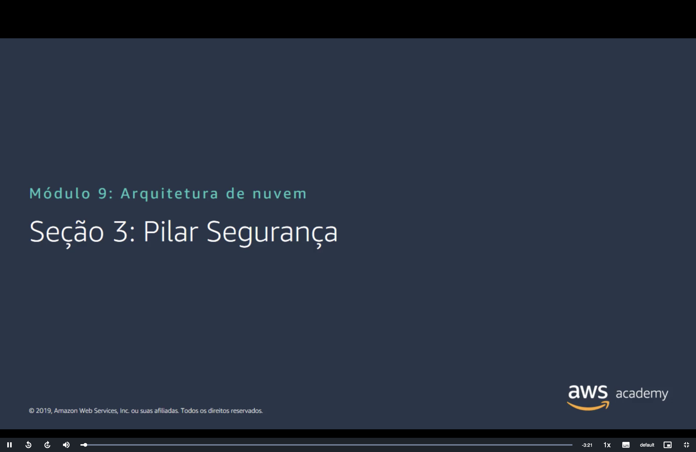
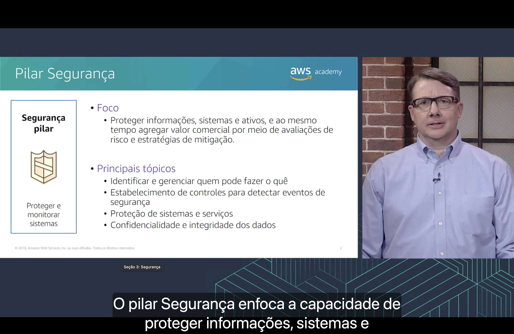
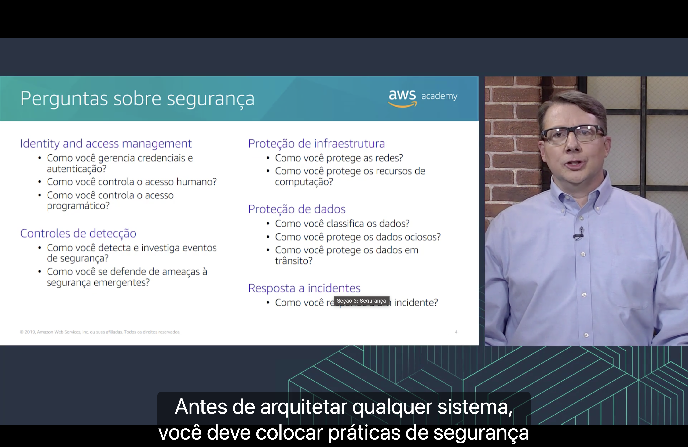
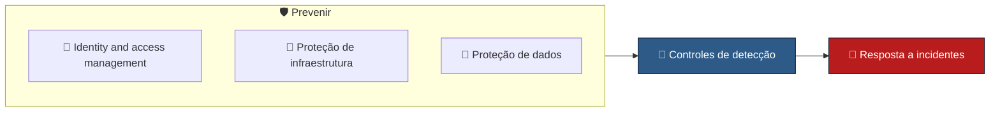

<h1 align="center">🛡️ Seção 3 – Pilar Segurança</h1>

  
  
   
  
  
  

  <a href="../README.md">🏠 Início</a> &nbsp;•&nbsp;
  <a href="./Seção%202%20-%20Pilar%20Excelência%20operacional.md">⬅️ Anterior: Pilar Excelência operacional</a> &nbsp;•&nbsp;
  <a href="./Seção%204%20-%20Pilar%20Confiabilidade.md">Próxima: Pilar Confiabilidade ➡️</a>

> [!NOTE]
> Depois da [excelência operacional](./Seção%202%20-%20Pilar%20Excelência%20operacional.md), o módulo detalha o segundo pilar do AWS Well-Architected Framework: a **segurança**. Quase tudo aqui já foi visto no [Módulo 4](../MÓDULO%204/Seção%201%20-%20Modelo%20de%20responsabilidade%20compartilhada%20da%20AWS.md), sobre segurança na nuvem, e na [segurança da VPC](../MÓDULO%205/Seção%204%20-%20Segurança%20da%20VPC.md) do Módulo 5. A novidade é ver esses serviços organizados como **perguntas** que você responde sobre a sua carga de trabalho.

## 📑 Sumário

| # | Tópico |
|:---:|---|
| 1 | [🎯 Pilar Segurança](#pilar) |
| 2 | [❓ Perguntas sobre segurança](#perguntas) |
| 🎯 | [Principais conclusões](#conclusoes) |

---

## 1. 🎯 Pilar Segurança

O quadro à esquerda resume o objetivo do pilar: **proteger e monitorar sistemas**.

**Foco**

- 🛡️ **Proteger informações, sistemas e ativos** e, ao mesmo tempo, agregar valor comercial por meio de **avaliações de risco** e **estratégias de mitigação**.

**Principais tópicos**

- 👤 **Identificar e gerenciar** quem pode fazer o quê;
- 🔎 Estabelecimento de **controles para detectar** eventos de segurança;
- 🧱 **Proteção** de sistemas e serviços;
- 🔐 **Confidencialidade e integridade** dos dados.

Segundo a narração, o pilar Segurança enfoca a **capacidade de proteger** informações, sistemas e ativos.

Cada tópico corresponde a serviços que já apareceram no curso:

| Tópico | Onde já vimos |
|---|---|
| 👤 **Quem pode fazer o quê** | O [IAM](../MÓDULO%204/Seção%202%20-%20AWS%20Identity%20and%20Access%20Management%20(IAM).md#iam), com usuários, grupos, funções e políticas, seguindo o [princípio do privilégio mínimo](../MÓDULO%204/Seção%202%20-%20AWS%20Identity%20and%20Access%20Management%20(IAM).md#autorizacao) |
| 🔎 **Detectar eventos de segurança** | O [AWS CloudTrail](../MÓDULO%204/Seção%203%20-%20Proteção%20de%20uma%20nova%20conta%20da%20AWS.md#etapa3) registra as chamadas de API, e o [AWS Config](../MÓDULO%204/Seção%206%20-%20Trabalhar%20para%20garantir%20a%20conformidade.md#config) aponta configurações fora do padrão |
| 🧱 **Proteger sistemas e serviços** | [Grupos de segurança](../MÓDULO%205/Seção%204%20-%20Segurança%20da%20VPC.md#sg), [ACLs de rede](../MÓDULO%205/Seção%204%20-%20Segurança%20da%20VPC.md#nacl), [sub-redes privadas](../MÓDULO%208/Seção%201%20-%20Amazon%20Relational%20Database%20Service.md#vpc) e o [AWS Shield](../MÓDULO%204/Seção%204%20-%20Proteção%20de%20contas.md#shield) contra ataques DDoS |
| 🔐 **Confidencialidade e integridade dos dados** | Criptografia [em repouso](../MÓDULO%204/Seção%205%20-%20Proteção%20de%20dados%20na%20AWS.md#repouso) e [em trânsito](../MÓDULO%204/Seção%205%20-%20Proteção%20de%20dados%20na%20AWS.md#transito), com as chaves gerenciadas pelo [AWS KMS](../MÓDULO%204/Seção%204%20-%20Proteção%20de%20contas.md#kms) |

> [!IMPORTANT]
> O pilar trata da **sua** parte do [modelo de responsabilidade compartilhada](../MÓDULO%204/Seção%201%20-%20Modelo%20de%20responsabilidade%20compartilhada%20da%20AWS.md#modelo). A AWS cuida da [segurança **da** nuvem](../MÓDULO%204/Seção%201%20-%20Modelo%20de%20responsabilidade%20compartilhada%20da%20AWS.md#aws): datacenters, hardware e a rede global. As perguntas do framework são sobre a [segurança **na** nuvem](../MÓDULO%204/Seção%201%20-%20Modelo%20de%20responsabilidade%20compartilhada%20da%20AWS.md#cliente): quem acessa, como a rede está configurada e como os dados ficam protegidos.

> [!NOTE]
> O slide é de 2019. Hoje a definição do pilar não fala mais em avaliações de risco: segurança é a **capacidade de proteger dados, sistemas e ativos** aproveitando as tecnologias de nuvem para **melhorar a segurança**.

## 2. ❓ Perguntas sobre segurança

Segundo a narração, as práticas de segurança precisam estar definidas **antes** de arquitetar qualquer sistema. As perguntas se dividem em **cinco áreas de melhores práticas**, que podem ser lidas em três momentos:

**👤 Identity and access management**

| Pergunta | Onde já vimos |
|---|---|
| Como você gerencia **credenciais e autenticação**? | É a **SEG 1**, que a [Seção 1](./Seção%201%20-%20AWS%20Well-Architected%20Framework.md#organizacao) usou de exemplo: proteger o usuário raiz, exigir MFA, aplicar política de senha e alternar as credenciais |
| Como você controla o **acesso humano**? | Usuários do IAM organizados em [grupos](../MÓDULO%204/Seção%202%20-%20AWS%20Identity%20and%20Access%20Management%20(IAM).md#grupos), com MFA e privilégio mínimo |
| Como você controla o **acesso programático**? | As [chaves de acesso](../MÓDULO%204/Seção%202%20-%20AWS%20Identity%20and%20Access%20Management%20(IAM).md#autenticacao) da CLI e dos SDKs ou, melhor ainda, as [funções do IAM](../MÓDULO%204/Seção%202%20-%20AWS%20Identity%20and%20Access%20Management%20(IAM).md#funcoes), como a que dá permissões a uma [instância do EC2](../MÓDULO%206/Seção%203%20-%20Amazon%20EC2%20Parte%202.md#iam) |

**🔎 Controles de detecção**

| Pergunta | Onde já vimos |
|---|---|
| Como você **detecta e investiga** eventos de segurança? | Coletando e analisando registros: o [CloudTrail](../MÓDULO%204/Seção%203%20-%20Proteção%20de%20uma%20nova%20conta%20da%20AWS.md#etapa3) mostra quem fez o quê, o [AWS Config](../MÓDULO%204/Seção%206%20-%20Trabalhar%20para%20garantir%20a%20conformidade.md#config) mostra o que mudou e o [CloudWatch](../MÓDULO%206/Seção%204%20-%20Amazon%20EC2%20Parte%203.md#cloudwatch) dispara alarmes |
| Como você se defende de **ameaças à segurança emergentes**? | Acompanhando novas ameaças e recomendações, aplicando patches e avaliando novos serviços de segurança |

**🧱 Proteção de infraestrutura**

| Pergunta | Onde já vimos |
|---|---|
| Como você protege as **redes**? | Em camadas: [sub-redes públicas e privadas](../MÓDULO%205/Seção%202%20-%20Amazon%20VPC.md#vpc-subredes), [ACLs de rede](../MÓDULO%205/Seção%204%20-%20Segurança%20da%20VPC.md#nacl) na sub-rede e [grupos de segurança](../MÓDULO%205/Seção%204%20-%20Segurança%20da%20VPC.md#sg) na instância |
| Como você protege os **recursos de computação**? | Mantendo o sistema operacional com patches, usando AMIs confiáveis e configurando o [grupo de segurança](../MÓDULO%206/Seção%204%20-%20Amazon%20EC2%20Parte%203.md#grupo-seguranca) e o [par de chaves](../MÓDULO%206/Seção%204%20-%20Amazon%20EC2%20Parte%203.md#par-chaves) de cada instância |

**🔐 Proteção de dados**

| Pergunta | Onde já vimos |
|---|---|
| Como você **classifica** os dados? | Separando os dados por nível de sensibilidade (por exemplo, público, interno e confidencial) para decidir quanta proteção cada um precisa |
| Como você protege os **dados ociosos**? | Com a [criptografia em repouso](../MÓDULO%204/Seção%205%20-%20Proteção%20de%20dados%20na%20AWS.md#repouso) e o controle de acesso, como nos [buckets do S3](../MÓDULO%204/Seção%205%20-%20Proteção%20de%20dados%20na%20AWS.md#s3) |
| Como você protege os **dados em trânsito**? | Com a [criptografia em trânsito](../MÓDULO%204/Seção%205%20-%20Proteção%20de%20dados%20na%20AWS.md#transito), usando TLS e HTTPS |

**🚨 Resposta a incidentes**

| Pergunta | Onde já vimos |
|---|---|
| Como você **responde a um incidente**? | Preparando-se antes: garantir acesso para investigar, deixar procedimentos prontos (os [runbooks](./Seção%202%20-%20Pilar%20Excelência%20operacional.md#perguntas) da Seção 2) e treinar com simulações (os [*game days*](./Seção%202%20-%20Pilar%20Excelência%20operacional.md#principios)) |

> [!NOTE]
> Alguns termos do slide vêm de tradução literal:
> - **Dados ociosos** são os *data at rest*. No [Módulo 4](../MÓDULO%204/Seção%205%20-%20Proteção%20de%20dados%20na%20AWS.md#repouso), o curso usa "dados **em repouso**".
> - **Controles de detecção** são os *detective controls*.
> - A última pergunta fica parcialmente coberta pelo rótulo do player no print. O texto completo é "Como você **responde a um incidente**?".

> [!TIP]
> Repare que os quatro [principais tópicos](#pilar) do slide anterior são as quatro primeiras áreas de perguntas: **quem pode fazer o quê** (IAM), **detectar eventos** (controles de detecção), **proteger sistemas** (proteção de infraestrutura) e **confidencialidade dos dados** (proteção de dados). A quinta área, **resposta a incidentes**, cobre o que fazer quando as outras quatro não bastam.

> [!NOTE]
> O slide é de 2019. Hoje o pilar tem **11 perguntas** (SEC 1 a SEC 11) em **sete áreas**:
>
> | Área no slide (2019) | Hoje |
> |---|---|
> | – | **Fundamentos de segurança** (SEC 1): como você opera a carga de trabalho com segurança. A defesa contra **ameaças emergentes** virou uma prática daqui: manter-se atualizado sobre ameaças e recomendações |
> | **Identity and access management**: credenciais, acesso humano e acesso programático | **Gerenciamento de identidade e acesso** (SEC 2 e 3): **identidades** e **permissões** de **pessoas e máquinas** |
> | **Controles de detecção** | **Detecção** (SEC 4): detectar e investigar eventos de segurança |
> | **Proteção de infraestrutura** | Igual (SEC 5 e 6): recursos de **rede** e de **computação** |
> | **Proteção de dados** | Igual (SEC 7 a 9): **classificar** os dados e protegê-los **em repouso** e **em trânsito** |
> | **Resposta a incidentes** | **Resposta a incidentes** (SEC 10): **prever**, responder e **se recuperar** de incidentes |
> | – | **Segurança de aplicativos** (SEC 11): incorporar e validar a segurança dos aplicativos em todo o ciclo de **design, desenvolvimento e implantação** |

---

## 🎯 Principais conclusões

- ✅ O pilar **segurança** busca **proteger e monitorar sistemas**: proteger informações, sistemas e ativos, com **avaliações de risco** e **estratégias de mitigação**.
- ✅ Seus principais tópicos são **quem pode fazer o quê**, **detectar eventos de segurança**, **proteger sistemas e serviços** e garantir a **confidencialidade e a integridade dos dados**.
- ✅ O pilar cobre a parte do **cliente** no modelo de responsabilidade compartilhada: a segurança **na** nuvem.
- ✅ As práticas de segurança vêm **antes** da arquitetura, e não depois.
- ✅ No slide, as perguntas se dividem em cinco áreas: **identity and access management**, **controles de detecção**, **proteção de infraestrutura**, **proteção de dados** e **resposta a incidentes**.
- ✅ Hoje são **sete áreas** e **11 perguntas**, com **fundamentos de segurança** e **segurança de aplicativos** como novidades.

---

  <a href="../README.md">🏠 Início</a> &nbsp;•&nbsp;
  <a href="./Seção%202%20-%20Pilar%20Excelência%20operacional.md">⬅️ Anterior: Pilar Excelência operacional</a> &nbsp;•&nbsp;
  <a href="./Seção%204%20-%20Pilar%20Confiabilidade.md">Próxima: Pilar Confiabilidade ➡️</a>

