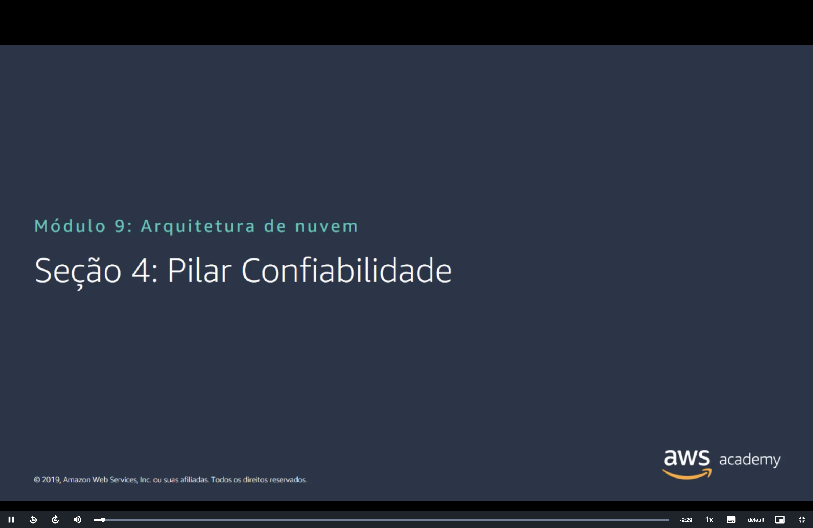
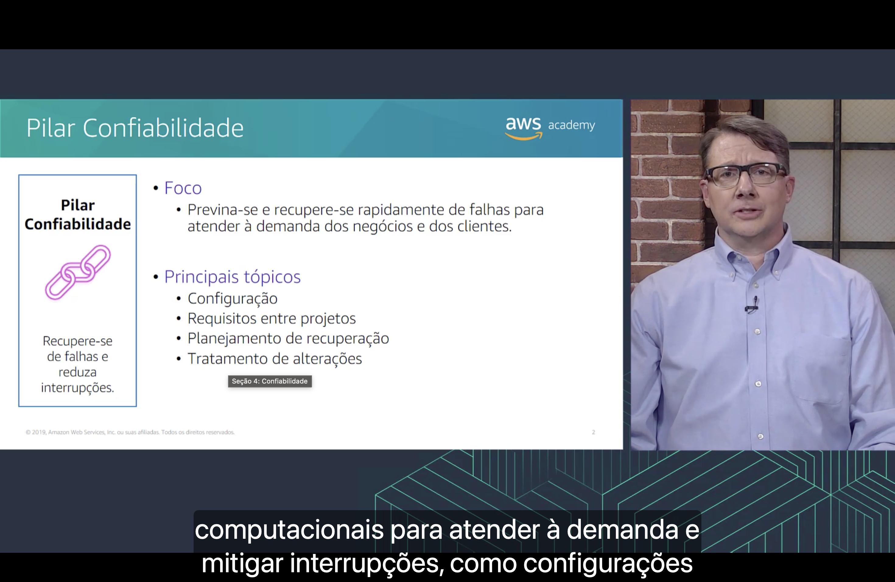
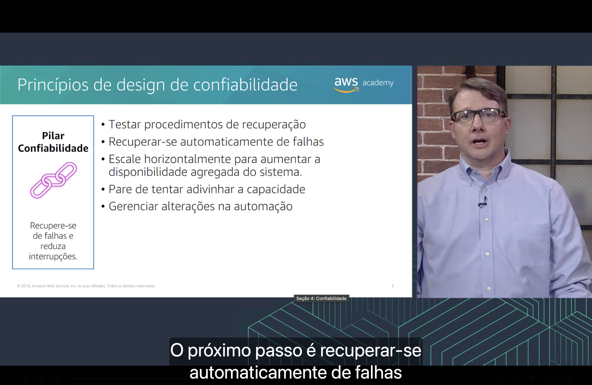
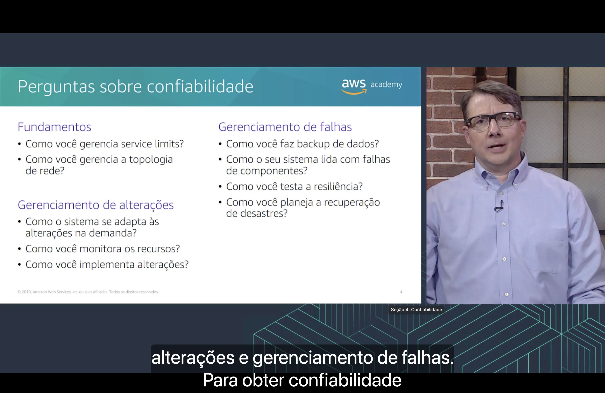

<h1 align="center">🔗 Seção 4 – Pilar Confiabilidade</h1>

  
  
   
  
  
  

  <a href="../README.md">🏠 Início</a> &nbsp;•&nbsp;
  <a href="./Seção%203%20-%20Pilar%20Segurança.md">⬅️ Anterior: Pilar Segurança</a> &nbsp;•&nbsp;
  <a href="./Seção%205%20-%20Pilar%20Eficiência%20de%20desempenho.md">Próxima: Pilar Eficiência de desempenho ➡️</a>

> [!NOTE]
> Esta seção detalha o terceiro pilar do AWS Well-Architected Framework: a **confiabilidade**. Ele já apareceu várias vezes no curso, mesmo sem esse nome: nas [Zonas de Disponibilidade](../MÓDULO%203/Seção%201%20-%20Infraestrutura%20global%20da%20AWS.md#zonas) do Módulo 3, na [implantação Multi-AZ](../MÓDULO%208/Seção%201%20-%20Amazon%20Relational%20Database%20Service.md#multi-az) do Amazon RDS e nas [seis cópias](../MÓDULO%208/Seção%204%20-%20Amazon%20Aurora.md#alta-disponibilidade) do Amazon Aurora.

## 📑 Sumário

| # | Tópico |
|:---:|---|
| 1 | [🎯 Pilar Confiabilidade](#pilar) |
| 2 | [🧭 Princípios de design de confiabilidade](#principios) |
| 3 | [❓ Perguntas sobre confiabilidade](#perguntas) |
| 🎯 | [Principais conclusões](#conclusoes) |

---

## 1. 🎯 Pilar Confiabilidade

O quadro à esquerda resume o objetivo do pilar: **recupere-se de falhas e reduza interrupções**.

**Foco**

- 🛟 **Previna-se e recupere-se rapidamente de falhas** para atender à demanda dos negócios e dos clientes.

**Principais tópicos**

- ⚙️ **Configuração**;
- 🤝 **Requisitos entre projetos**;
- 🗺️ **Planejamento de recuperação**;
- 🔄 **Tratamento de alterações**.

A narração retoma a definição do pilar vista na [Seção 1](./Seção%201%20-%20AWS%20Well-Architected%20Framework.md#pilares): obter **recursos computacionais** para atender à demanda e **mitigar interrupções**, como configurações erradas.

Os tópicos do slide correspondem às áreas de perguntas do [último slide](#perguntas):

| Tópico | Área de perguntas |
|---|---|
| ⚙️ **Configuração** e 🤝 **Requisitos entre projetos** | **Fundamentos**: limites de serviço e topologia de rede, que valem para todos os projetos da conta |
| 🔄 **Tratamento de alterações** | **Gerenciamento de alterações** |
| 🗺️ **Planejamento de recuperação** | **Gerenciamento de falhas** |

> [!NOTE]
> "Configuração", aqui, é a preparação da **base** da carga de trabalho (*setup*), e não a configuração de um serviço específico.

> [!NOTE]
> O slide é de 2019. Hoje a definição do pilar mudou: confiabilidade é a **capacidade de uma carga de trabalho de executar sua função corretamente e de forma consistente** quando se espera que ela o faça, incluindo operar e testar a carga de trabalho durante todo o seu ciclo de vida.

## 2. 🧭 Princípios de design de confiabilidade

O slide lista **cinco princípios de design**:

| Princípio | O que significa | Onde já vimos |
|---|---|---|
| 🧪 **Testar procedimentos de recuperação** | No datacenter local, os testes costumam provar que o sistema **funciona**, e não que ele **se recupera**. Na nuvem, dá para simular falhas e conferir a recuperação antes de precisar dela | As simulações periódicas (*game days*) da [excelência operacional](./Seção%202%20-%20Pilar%20Excelência%20operacional.md#principios) |
| 🤖 **Recuperar-se automaticamente de falhas** | Monitorar indicadores e disparar a recuperação **sem intervenção humana** quando um limite é ultrapassado | O **failover automático** do [Multi-AZ](../MÓDULO%208/Seção%201%20-%20Amazon%20Relational%20Database%20Service.md#multi-az) e os alarmes do [CloudWatch](../MÓDULO%206/Seção%204%20-%20Amazon%20EC2%20Parte%203.md#cloudwatch) |
| ↔️ **Escale horizontalmente para aumentar a disponibilidade agregada do sistema** | Trocar um recurso grande por **vários recursos pequenos**, para que uma falha atinja só uma parte do sistema | Instâncias espalhadas por várias [Zonas de Disponibilidade](../MÓDULO%203/Seção%201%20-%20Infraestrutura%20global%20da%20AWS.md#zonas) |
| 🎯 **Pare de tentar adivinhar a capacidade** | Acompanhar a demanda e **adicionar ou remover recursos** automaticamente, em vez de estimar com antecedência | Uma das [seis vantagens da nuvem](../MÓDULO%201/Seção%202%20-%20Vantagens%20da%20Computação%20em%20Nuvem.md#capacidade) do Módulo 1 e o pilar [aumentar a elasticidade](../MÓDULO%206/Seção%205%20-%20Otimização%20de%20custos%20do%20Amazon%20EC2.md#pilar2) do EC2 |
| 🔄 **Gerenciar alterações na automação** | Fazer as mudanças na infraestrutura **por automação**, que pode ser rastreada e revisada | As [operações como código](./Seção%202%20-%20Pilar%20Excelência%20operacional.md#principios) da Seção 2 |

Segundo a narração, depois de testar os procedimentos de recuperação, o próximo passo é **recuperar-se automaticamente de falhas**.

"Disponibilidade agregada" é a disponibilidade do sistema **como um todo**. Comparando as duas formas de escalar:

| | ⬆️ Escala vertical | ↔️ Escala horizontal |
|---|---|---|
| **Como** | Trocar a instância por uma **maior** | Adicionar **mais** instâncias |
| **Se uma instância falha** | O sistema perde **100%** da capacidade | Com quatro instâncias, o sistema perde **25%** e continua no ar |
| **Onde ficam** | Em uma única Zona de Disponibilidade | Espalhadas por **várias** Zonas de Disponibilidade |

> [!TIP]
> "Pare de tentar adivinhar a capacidade" aparece tanto aqui quanto entre as vantagens da nuvem do Módulo 1. Lá, o argumento era **custo** (não pagar por servidores ociosos). Aqui, é **confiabilidade**: um sistema com capacidade subestimada fica sobrecarregado e pode cair.

> [!NOTE]
> O slide é de 2019. Hoje os princípios são os **mesmos cinco**, com duas mudanças: **recuperar-se automaticamente de falhas** passou para o primeiro lugar, e "gerenciar alterações na automação" virou "gerenciar alterações **por meio da** automação" (*through automation*), deixando claro que a automação é o meio de fazer as mudanças.

## 3. ❓ Perguntas sobre confiabilidade

Segundo a narração, as perguntas se dividem em **fundamentos**, **gerenciamento de alterações** e **gerenciamento de falhas**.

**⚙️ Fundamentos**

| Pergunta | Onde já vimos |
|---|---|
| Como você gerencia **service limits**? | Cada conta tem **limites** por serviço e por Região, como as [execuções simultâneas do Lambda](../MÓDULO%206/Seção%207%20-%20Introdução%20ao%20AWS%20Lambda.md#limites). É preciso acompanhá-los e pedir aumento **antes** que a carga de trabalho chegue neles |
| Como você gerencia a **topologia de rede**? | Planejando a [VPC e as sub-redes](../MÓDULO%205/Seção%202%20-%20Amazon%20VPC.md#vpc-subredes) em várias AZs, com blocos CIDR sem sobreposição (exigência do [emparelhamento de VPC](../MÓDULO%205/Seção%203%20-%20Redes%20VPC.md#peering)) e conexões com o datacenter local, como [VPN](../MÓDULO%205/Seção%203%20-%20Redes%20VPC.md#vpn) e [Direct Connect](../MÓDULO%205/Seção%203%20-%20Redes%20VPC.md#direct-connect) |

**🔄 Gerenciamento de alterações**

| Pergunta | Onde já vimos |
|---|---|
| Como o sistema se **adapta às alterações na demanda**? | Escalando automaticamente, como no pilar [aumentar a elasticidade](../MÓDULO%206/Seção%205%20-%20Otimização%20de%20custos%20do%20Amazon%20EC2.md#pilar2) do EC2 |
| Como você **monitora** os recursos? | Com as métricas, os logs e os alarmes do [CloudWatch](../MÓDULO%206/Seção%204%20-%20Amazon%20EC2%20Parte%203.md#cloudwatch) |
| Como você **implementa alterações**? | Por automação, com alterações [pequenas e reversíveis](./Seção%202%20-%20Pilar%20Excelência%20operacional.md#principios) |

**🛟 Gerenciamento de falhas**

| Pergunta | Onde já vimos |
|---|---|
| Como você faz **backup** de dados? | Com [snapshots do EBS](../MÓDULO%207/Seção%201%20-%20Amazon%20Elastic%20Block%20Store%20(Amazon%20EBS).md#snapshots), os [backups automáticos do RDS](../MÓDULO%208/Seção%201%20-%20Amazon%20Relational%20Database%20Service.md#responsabilidades) e o arquivamento no [Amazon S3 Glacier](../MÓDULO%207/Seção%204%20-%20Amazon%20S3%20Glacier.md#casos-de-uso) |
| Como o seu sistema **lida com falhas de componentes**? | Com redundância em várias AZs, como o [Multi-AZ do RDS](../MÓDULO%208/Seção%201%20-%20Amazon%20Relational%20Database%20Service.md#multi-az) e as [seis cópias do Aurora](../MÓDULO%208/Seção%204%20-%20Amazon%20Aurora.md#alta-disponibilidade) |
| Como você **testa a resiliência**? | Provocando falhas de propósito, em um ambiente controlado, e conferindo se a recuperação funciona |
| Como você planeja a **recuperação de desastres**? | Definindo quanto tempo fora do ar e quanta perda de dados o negócio aceita (veja abaixo) e mantendo uma cópia em outra Região, como uma [réplica de leitura entre Regiões](../MÓDULO%208/Seção%201%20-%20Amazon%20Relational%20Database%20Service.md#replicas) |

> [!NOTE]
> **Service limits** ficou em inglês no slide: são os **limites de serviço**, hoje chamados de **cotas de serviço** (*service quotas*). Alguns podem ser aumentados a pedido, e outros são fixos, como os limites **flexíveis** e **rígidos** do Lambda.

O planejamento de **recuperação de desastres** começa por dois números:

| Sigla | Pergunta que responde | Exemplo |
|---|---|---|
| ⏱️ **RTO** (*Recovery Time Objective*) | Por **quanto tempo** o sistema pode ficar fora do ar? | "Voltar a funcionar em até 4 horas" |
| 💾 **RPO** (*Recovery Point Objective*) | **Quantos dados** o negócio aceita perder? | "Perder no máximo 1 hora de dados" |

> [!TIP]
> Quanto menores o RTO e o RPO, mais cara é a estratégia. As opções vão da mais barata e lenta à mais cara e rápida: **backup e restauração**, **luz piloto** (*pilot light*: só o essencial ligado na outra Região), **espera semiativa** (*warm standby*: uma cópia menor sempre rodando) e **ativo/ativo em vários locais** (*multi-site active/active*). É o equilíbrio entre pilares da [Seção 1](./Seção%201%20-%20AWS%20Well-Architected%20Framework.md#pilares): mais confiabilidade custa mais.

> [!NOTE]
> O slide é de 2019. Hoje o pilar tem **13 perguntas** (REL 1 a REL 13) em **quatro áreas**:
>
> | Área no slide (2019) | Hoje |
> |---|---|
> | **Fundamentos**: service limits e topologia de rede | Igual (REL 1 e 2), agora com **cotas de serviço e restrições** |
> | – | **Arquitetura da carga de trabalho** (REL 3 a 5), área nova: como projetar a arquitetura de serviços e as interações em um sistema distribuído para **evitar** falhas e **suportá-las** |
> | **Gerenciamento de alterações**: demanda, monitoramento e implementação | Igual (REL 6 a 8) |
> | **Gerenciamento de falhas**: backup, falhas de componentes, testes e recuperação de desastres | Ganhou uma pergunta sobre **isolamento de falhas** (REL 9 a 13) |
>
> Os testes de resiliência agora incluem **engenharia do caos** (*chaos engineering*: injetar falhas de propósito) e *game days* regulares. Para injetar as falhas, a AWS tem o **AWS Fault Injection Service** (AWS FIS).

---

## 🎯 Principais conclusões

- ✅ O pilar **confiabilidade** busca **recuperar-se de falhas e reduzir interrupções**: prevenir e se recuperar rapidamente de falhas para atender à demanda.
- ✅ Seus principais tópicos são **configuração**, **requisitos entre projetos**, **planejamento de recuperação** e **tratamento de alterações**.
- ✅ Os cinco princípios de design são: **testar a recuperação**, **recuperar-se automaticamente**, **escalar horizontalmente**, **parar de adivinhar a capacidade** e **gerenciar alterações por automação**.
- ✅ Escalar **horizontalmente**, com várias instâncias em várias AZs, faz uma falha derrubar só uma parte do sistema.
- ✅ As perguntas se dividem em **fundamentos** (limites de serviço e rede), **gerenciamento de alterações** (demanda, monitoramento e implementação) e **gerenciamento de falhas** (backup, falhas de componentes, testes e recuperação de desastres).
- ✅ A recuperação de desastres parte do **RTO** (quanto tempo fora do ar) e do **RPO** (quantos dados perdidos). Quanto menores, mais cara a estratégia.
- ✅ Hoje são **13 perguntas** em **quatro áreas**, com a nova área de **arquitetura da carga de trabalho**.

---

  <a href="../README.md">🏠 Início</a> &nbsp;•&nbsp;
  <a href="./Seção%203%20-%20Pilar%20Segurança.md">⬅️ Anterior: Pilar Segurança</a> &nbsp;•&nbsp;
  <a href="./Seção%205%20-%20Pilar%20Eficiência%20de%20desempenho.md">Próxima: Pilar Eficiência de desempenho ➡️</a>

