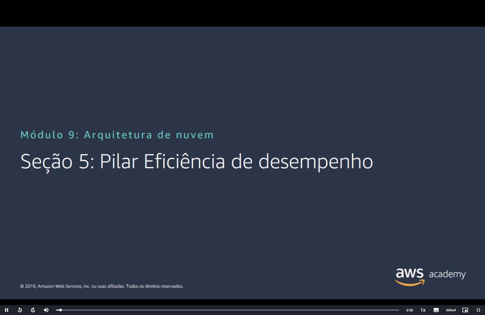
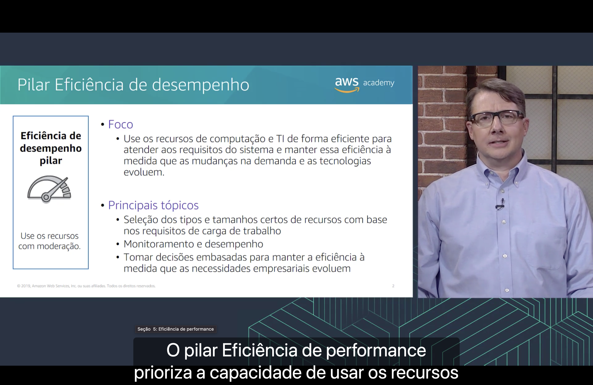
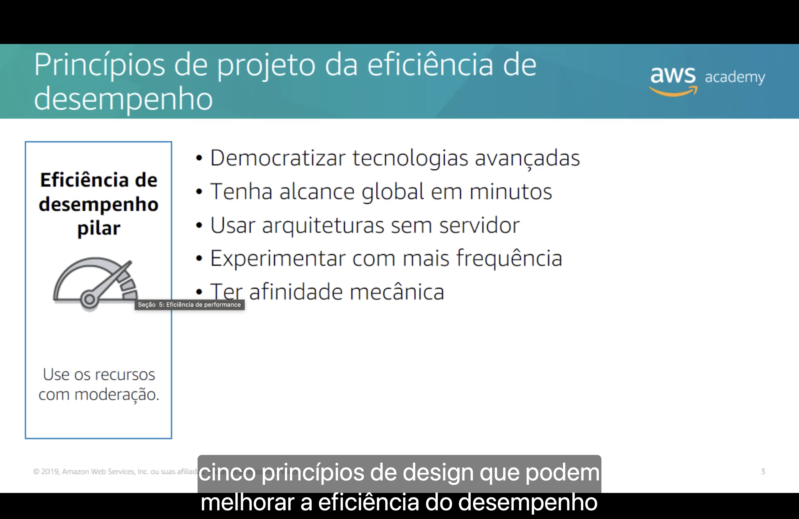
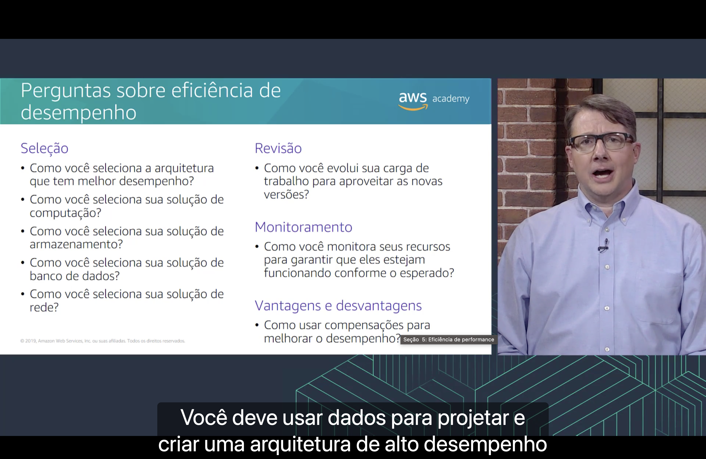

<h1 align="center">⏱️ Seção 5 – Pilar Eficiência de desempenho</h1>

  
  
   
  
  
  

  <a href="../README.md">🏠 Início</a> &nbsp;•&nbsp;
  <a href="./Seção%204%20-%20Pilar%20Confiabilidade.md">⬅️ Anterior: Pilar Confiabilidade</a> &nbsp;•&nbsp;
  <a href="./Seção%206%20-%20Pilar%20Otimização%20de%20custos.md">Próxima: Pilar Otimização de custos ➡️</a>

> [!NOTE]
> Esta seção detalha o quarto pilar do AWS Well-Architected Framework: a **eficiência de desempenho**. A pergunta central é **escolher o recurso certo** para cada parte da carga de trabalho, algo que o curso fez serviço por serviço nos módulos de [computação](../MÓDULO%206/Seção%201%20-%20Visão%20geral%20dos%20serviços%20de%20computação.MD#escolher), [armazenamento](../MÓDULO%207/Seção%201%20-%20Amazon%20Elastic%20Block%20Store%20(Amazon%20EBS).md#bloco-vs-objetos) e [bancos de dados](../MÓDULO%208/Seção%202%20-%20Amazon%20DynamoDB.md#relacional-vs-nao-relacional).

## 📑 Sumário

| # | Tópico |
|:---:|---|
| 1 | [🎯 Pilar Eficiência de desempenho](#pilar) |
| 2 | [🧭 Princípios de projeto da eficiência de desempenho](#principios) |
| 3 | [❓ Perguntas sobre eficiência de desempenho](#perguntas) |
| 🎯 | [Principais conclusões](#conclusoes) |

---

## 1. 🎯 Pilar Eficiência de desempenho

O quadro à esquerda resume o objetivo do pilar: **use os recursos com moderação**, ou seja, só o necessário, sem desperdício.

**Foco**

- ⚡ **Use os recursos de computação e TI de forma eficiente** para atender aos requisitos do sistema e **manter essa eficiência** à medida que a demanda muda e as tecnologias evoluem.

**Principais tópicos**

- 📐 **Seleção dos tipos e tamanhos certos** de recursos com base nos requisitos de carga de trabalho;
- 📊 **Monitoramento** e desempenho;
- 🧠 **Tomar decisões embasadas** para manter a eficiência à medida que as necessidades empresariais evoluem.

Segundo a narração, o pilar **prioriza a capacidade de usar os recursos** de forma eficiente.

| Tópico | Onde já vimos |
|---|---|
| 📐 **Tipos e tamanhos certos** | Os [tipos de instância](../MÓDULO%206/Seção%202%20-%20Amazon%20EC2%20Parte%201.md#tipo-instancia) do EC2 e o pilar [tamanho certo](../MÓDULO%206/Seção%205%20-%20Otimização%20de%20custos%20do%20Amazon%20EC2.md#pilar1) da otimização de custos |
| 📊 **Monitoramento e desempenho** | As métricas e os alarmes do [Amazon CloudWatch](../MÓDULO%206/Seção%204%20-%20Amazon%20EC2%20Parte%203.md#cloudwatch) |
| 🧠 **Decisões embasadas** | Escolher com base em **medições**, e não em palpites, como a narração reforça nas [perguntas](#perguntas) |

> [!NOTE]
> A narração e o rótulo do player chamam o pilar de "eficiência de **performance**", e os slides, de "eficiência de **desempenho**". As duas são traduções de *performance efficiency*.

> [!IMPORTANT]
> O "tamanho certo" aparece neste pilar e no de **otimização de custos**, mas por motivos opostos. Uma instância **grande demais** desperdiça dinheiro, e uma **pequena demais** deixa o sistema lento. O tamanho certo atende os dois pilares ao mesmo tempo.

> [!NOTE]
> O slide é de 2019. A definição atual é quase a mesma, só que fala em usar os **recursos de nuvem** com eficiência para atender aos **requisitos de desempenho**.

## 2. 🧭 Princípios de projeto da eficiência de desempenho

Segundo a narração, são **cinco princípios de design** que podem melhorar a eficiência do desempenho:

| Princípio | O que significa | Onde já vimos |
|---|---|---|
| 🎓 **Democratizar tecnologias avançadas** | Em vez de a equipe aprender a instalar e operar uma tecnologia complexa, ela **consome a tecnologia como serviço**, e a complexidade fica com a AWS | Banco NoSQL e data warehouse prontos para usar: o [Amazon DynamoDB](../MÓDULO%208/Seção%202%20-%20Amazon%20DynamoDB.md#dynamodb) e o [Amazon Redshift](../MÓDULO%208/Seção%203%20-%20Amazon%20Redshift.md#introducao) |
| 🌍 **Tenha alcance global em minutos** | Implantar a carga de trabalho em **várias Regiões**, perto dos usuários, para reduzir a latência | A [vantagem da nuvem](../MÓDULO%201/Seção%202%20-%20Vantagens%20da%20Computação%20em%20Nuvem.md#global) com o mesmo nome, o [roteamento por latência](../MÓDULO%205/Seção%205%20-%20Amazon%20Route%2053.md#multirregiao) do Route 53 e o [Amazon CloudFront](../MÓDULO%205/Seção%206%20-%20Amazon%20CloudFront.md#cloudfront) |
| ⚡ **Usar arquiteturas sem servidor** | Não ter servidores para administrar: o serviço escala sozinho e você paga pelo uso | O [AWS Lambda](../MÓDULO%206/Seção%207%20-%20Introdução%20ao%20AWS%20Lambda.md#lambda) |
| 🧪 **Experimentar com mais frequência** | Como os recursos são virtuais, dá para testar rapidamente outro tipo de instância, de armazenamento ou de configuração e **comparar os resultados** | A vantagem [aumente a velocidade e a agilidade](../MÓDULO%201/Seção%202%20-%20Vantagens%20da%20Computação%20em%20Nuvem.md#agilidade) do Módulo 1 |
| ⚙️ **Ter afinidade mecânica** | Entender **como cada serviço funciona** e escolher a tecnologia que combina com o objetivo. Por exemplo, considerar como os dados serão acessados antes de escolher o banco ou o armazenamento | [Quando usar o Amazon RDS](../MÓDULO%208/Seção%201%20-%20Amazon%20Relational%20Database%20Service.md#quando-usar) ou um banco NoSQL e a diferença entre [armazenamento em bloco e de objetos](../MÓDULO%207/Seção%201%20-%20Amazon%20Elastic%20Block%20Store%20(Amazon%20EBS).md#bloco-vs-objetos) |

> [!NOTE]
> **Afinidade mecânica** é a tradução de *mechanical sympathy*, uma expressão que vem do automobilismo: o piloto que entende como o carro funciona consegue tirar mais dele. Na nuvem, quem entende como o serviço funciona por dentro escolhe melhor.

> [!TIP]
> Dois dos cinco princípios repetem as [vantagens da nuvem](../MÓDULO%201/Seção%202%20-%20Vantagens%20da%20Computação%20em%20Nuvem.md) do Módulo 1: **alcance global em minutos** e **agilidade**, que é o que permite experimentar com frequência. O framework transforma essas vantagens em **regras de projeto**.

> [!NOTE]
> O slide é de 2019. Hoje os princípios são os **mesmos cinco**, na mesma ordem. Só o último mudou de nome: virou "**considerar** a afinidade mecânica".

## 3. ❓ Perguntas sobre eficiência de desempenho

Segundo a narração, você deve **usar dados** para projetar e criar uma arquitetura de alto desempenho. As perguntas se dividem em quatro áreas:

**🔍 Seleção**

| Pergunta | Onde já vimos |
|---|---|
| Como você seleciona a **arquitetura** que tem melhor desempenho? | Combinando abordagens, como instâncias, contêineres e funções, conforme cada parte da carga de trabalho (veja [como escolher o serviço de computação](../MÓDULO%206/Seção%201%20-%20Visão%20geral%20dos%20serviços%20de%20computação.MD#escolher)) |
| Como você seleciona sua solução de **computação**? | [Tipos de instância](../MÓDULO%206/Seção%202%20-%20Amazon%20EC2%20Parte%201.md#tipo-instancia) do EC2, [contêineres](../MÓDULO%206/Seção%206%20-%20Serviços%20de%20contêiner.md#ecs) ou [funções do Lambda](../MÓDULO%206/Seção%207%20-%20Introdução%20ao%20AWS%20Lambda.md#lambda) |
| Como você seleciona sua solução de **armazenamento**? | Em bloco com os [tipos de volume do EBS](../MÓDULO%207/Seção%201%20-%20Amazon%20Elastic%20Block%20Store%20(Amazon%20EBS).md#tipos), de objetos com as [classes do S3](../MÓDULO%207/Seção%202%20-%20Amazon%20Simple%20Storage%20Service%20(Amazon%20S3).md#classes) ou de arquivos com o [Amazon EFS](../MÓDULO%207/Seção%203%20-%20Amazon%20Elastic%20File%20System%20(Amazon%20EFS).md#armazenamento) |
| Como você seleciona sua solução de **banco de dados**? | Relacional ([RDS](../MÓDULO%208/Seção%201%20-%20Amazon%20Relational%20Database%20Service.md#quando-usar)), NoSQL ([DynamoDB](../MÓDULO%208/Seção%202%20-%20Amazon%20DynamoDB.md#relacional-vs-nao-relacional)) ou data warehouse ([Redshift](../MÓDULO%208/Seção%203%20-%20Amazon%20Redshift.md#introducao)) |
| Como você seleciona sua solução de **rede**? | [Região perto dos usuários](../MÓDULO%203/Seção%201%20-%20Infraestrutura%20global%20da%20AWS.md#selecao-regiao), [CloudFront](../MÓDULO%205/Seção%206%20-%20Amazon%20CloudFront.md#cloudfront) para entregar conteúdo da borda e [Direct Connect](../MÓDULO%205/Seção%203%20-%20Redes%20VPC.md#direct-connect) para a conexão com o datacenter local |

**🔄 Revisão**

| Pergunta | Onde já vimos |
|---|---|
| Como você evolui sua carga de trabalho para **aproveitar as novas versões**? | A AWS lança novos recursos com frequência, como novas **gerações** de instância (o número da geração aparece no [nome do tipo](../MÓDULO%206/Seção%202%20-%20Amazon%20EC2%20Parte%201.md#nomeacao)). Revisar a arquitetura de tempos em tempos evita ficar preso a uma escolha antiga |

**📊 Monitoramento**

| Pergunta | Onde já vimos |
|---|---|
| Como você **monitora** seus recursos para garantir que eles estejam funcionando conforme o esperado? | Com métricas e alarmes do [CloudWatch](../MÓDULO%206/Seção%204%20-%20Amazon%20EC2%20Parte%203.md#cloudwatch), para perceber a queda de desempenho **antes** dos usuários |

**⚖️ Vantagens e desvantagens**

| Pergunta | Onde já vimos |
|---|---|
| Como usar **compensações** para melhorar o desempenho? | Abrir mão de uma coisa para ganhar velocidade. As [réplicas de leitura](../MÓDULO%208/Seção%201%20-%20Amazon%20Relational%20Database%20Service.md#replicas) aceleram as leituras, mas podem estar alguns instantes atrasadas. O cache do [CloudFront](../MÓDULO%205/Seção%206%20-%20Amazon%20CloudFront.md#cloudfront) entrega o conteúdo mais rápido, mas pode servir uma versão um pouco antiga |

> [!NOTE]
> **Vantagens e desvantagens** e **compensações** são as duas traduções que o slide usa para *trade-offs*. **Revisão** é *review*.

> [!TIP]
> "Usar dados", na prática, é **medir**: fazer testes comparativos (*benchmarks*) e testes de carga antes de escolher um recurso, em vez de escolher por palpite. É o princípio de [experimentar com mais frequência](#principios) aplicado à seleção.

> [!NOTE]
> O slide é de 2019. Hoje o pilar tem só **5 perguntas** (PERF 1 a PERF 5), uma por área:
> - **Seleção de arquitetura** (PERF 1): como escolher os recursos de nuvem e a arquitetura certos.
> - **Computação e hardware** (PERF 2).
> - **Gerenciamento de dados** (PERF 3): armazenamento e banco de dados viraram uma pergunta só, sobre como armazenar, gerenciar e acessar os dados.
> - **Rede e entrega de conteúdo** (PERF 4).
> - **Processo e cultura** (PERF 5), área nova: como as práticas e a cultura da organização contribuem para a eficiência de desempenho.
>
> Revisão, monitoramento e compensações deixaram de ser áreas separadas.

---

## 🎯 Principais conclusões

- ✅ O pilar **eficiência de desempenho** busca **usar os recursos com moderação**: usar computação e TI de forma eficiente e manter essa eficiência conforme a demanda e as tecnologias mudam.
- ✅ Seus principais tópicos são **escolher o tipo e o tamanho certos**, **monitorar** e **tomar decisões embasadas**.
- ✅ O tamanho certo atende ao mesmo tempo este pilar e o de **otimização de custos**.
- ✅ Os cinco princípios de design são: **democratizar tecnologias avançadas**, **alcance global em minutos**, **arquiteturas sem servidor**, **experimentar com mais frequência** e **afinidade mecânica**.
- ✅ As perguntas se dividem em **seleção** (arquitetura, computação, armazenamento, banco de dados e rede), **revisão**, **monitoramento** e **vantagens e desvantagens**.
- ✅ A arquitetura de alto desempenho se escolhe com **dados**, medindo e testando.
- ✅ Hoje são **5 perguntas**, uma por área, com a nova área de **processo e cultura**.

---

  <a href="../README.md">🏠 Início</a> &nbsp;•&nbsp;
  <a href="./Seção%204%20-%20Pilar%20Confiabilidade.md">⬅️ Anterior: Pilar Confiabilidade</a> &nbsp;•&nbsp;
  <a href="./Seção%206%20-%20Pilar%20Otimização%20de%20custos.md">Próxima: Pilar Otimização de custos ➡️</a>

