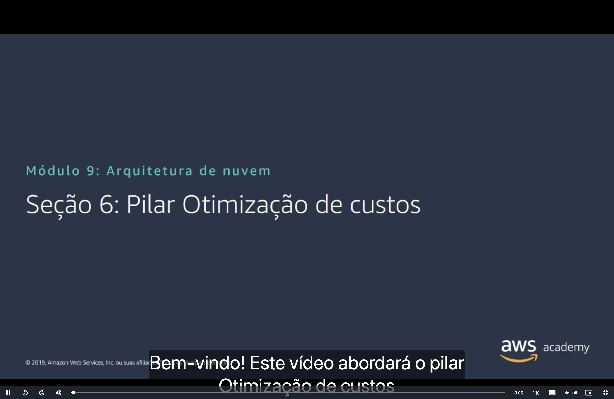
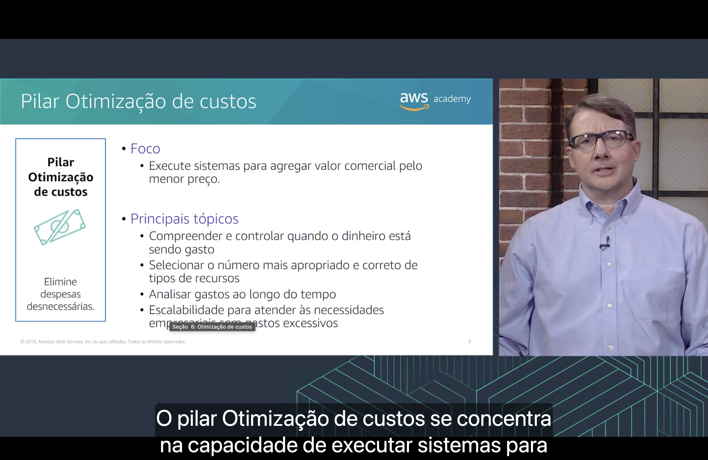
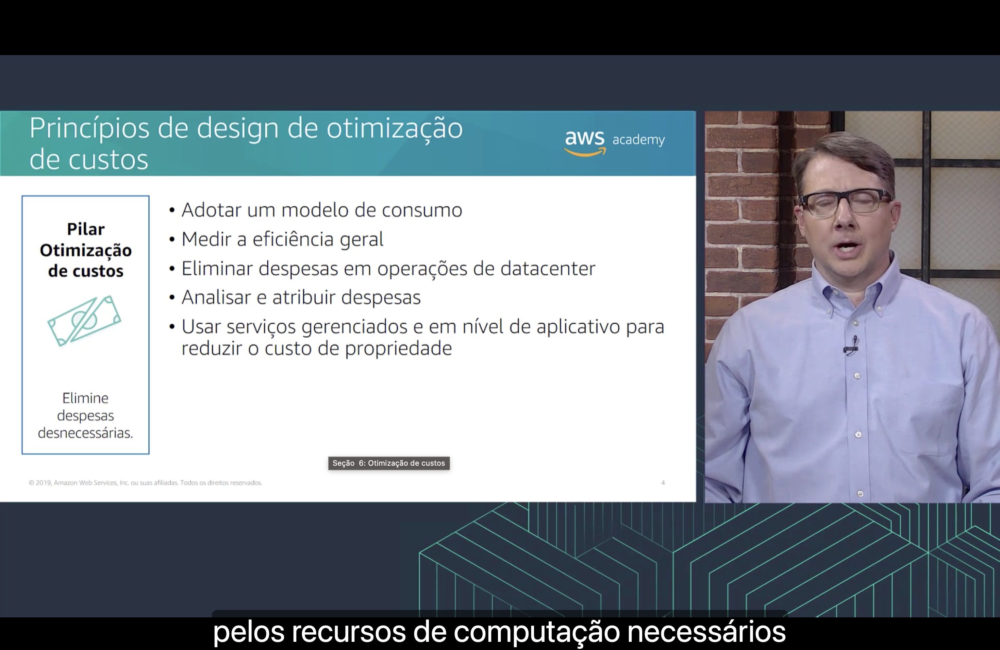
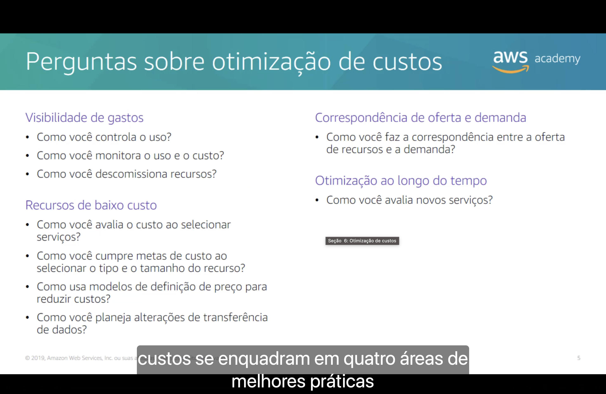

<h1 align="center">💲 Seção 6 – Pilar Otimização de custos</h1>

  
  
   
  
  
  

  <a href="../README.md">🏠 Início</a> &nbsp;•&nbsp;
  <a href="./Seção%205%20-%20Pilar%20Eficiência%20de%20desempenho.md">⬅️ Anterior: Pilar Eficiência de desempenho</a> &nbsp;•&nbsp;
  <a href="./Seção%207%20-%20Confiabilidade%20e%20disponibilidade.md">Próxima: Confiabilidade e disponibilidade ➡️</a>

> [!NOTE]
> Esta seção detalha o quinto e último pilar do slide da [Seção 1](./Seção%201%20-%20AWS%20Well-Architected%20Framework.md#pilares): a **otimização de custos**. É o pilar que o curso mais trabalhou até aqui. O Módulo 2 inteiro tratou de [preço](../MÓDULO%202/Seção%201%20-%20Fundamentos%20da%20definição%20de%20preço.md#modelo), [TCO](../MÓDULO%202/Seção%202%20-%20Custo%20total%20de%20propriedade.md#tco) e [faturamento](../MÓDULO%202/Seção%204%20-%20AWS%20Billing%20and%20Cost%20Management.md#painel), e o Módulo 6 mostrou os [quatro pilares da otimização de custos](../MÓDULO%206/Seção%205%20-%20Otimização%20de%20custos%20do%20Amazon%20EC2.md#pilares) do EC2.

## 📑 Sumário

| # | Tópico |
|:---:|---|
| 1 | [🎯 Pilar Otimização de custos](#pilar) |
| 2 | [🧭 Princípios de design de otimização de custos](#principios) |
| 3 | [❓ Perguntas sobre otimização de custos](#perguntas) |
| 🎯 | [Principais conclusões](#conclusoes) |

---

## 1. 🎯 Pilar Otimização de custos

O quadro à esquerda resume o objetivo do pilar: **elimine despesas desnecessárias**.

**Foco**

- 💰 **Execute sistemas para agregar valor comercial pelo menor preço.**

**Principais tópicos**

- 🔍 **Compreender e controlar** quando o dinheiro está sendo gasto;
- 📐 **Selecionar o número mais apropriado e correto** de tipos de recursos;
- 📈 **Analisar gastos** ao longo do tempo;
- ↕️ **Escalabilidade** para atender às necessidades empresariais sem gastos excessivos.

Segundo a narração, o pilar se concentra na **capacidade de executar sistemas** que entregam valor ao negócio pelo menor preço, a mesma definição vista na [Seção 1](./Seção%201%20-%20AWS%20Well-Architected%20Framework.md#pilares).

| Tópico | Onde já vimos |
|---|---|
| 🔍 **Compreender e controlar os gastos** | O [Cost Explorer](../MÓDULO%202/Seção%204%20-%20AWS%20Billing%20and%20Cost%20Management.md#cost-explorer), que mostra quanto cada serviço custou, e as [tags de alocação de custos](../MÓDULO%206/Seção%205%20-%20Otimização%20de%20custos%20do%20Amazon%20EC2.md#medir) |
| 📐 **Número e tipos certos de recursos** | O pilar [tamanho certo](../MÓDULO%206/Seção%205%20-%20Otimização%20de%20custos%20do%20Amazon%20EC2.md#pilar1) do EC2 |
| 📈 **Analisar gastos ao longo do tempo** | O [AWS Budgets](../MÓDULO%202/Seção%204%20-%20AWS%20Billing%20and%20Cost%20Management.md#budgets), que prevê e rastreia os custos, e os [relatórios de uso e de custo](../MÓDULO%202/Seção%204%20-%20AWS%20Billing%20and%20Cost%20Management.md#relatorios) |
| ↕️ **Escalar sem gastar demais** | O pilar [aumentar a elasticidade](../MÓDULO%206/Seção%205%20-%20Otimização%20de%20custos%20do%20Amazon%20EC2.md#pilar2) do EC2 |

> [!NOTE]
> No original em inglês, o primeiro tópico é *where money is being spent*: **onde** o dinheiro está sendo gasto (em qual serviço, conta ou projeto), e não **quando**.

> [!TIP]
> Os [quatro pilares da otimização de custos](../MÓDULO%206/Seção%205%20-%20Otimização%20de%20custos%20do%20Amazon%20EC2.md#pilares) do Módulo 6 são este pilar aplicado ao EC2: **tamanho certo** e **otimizar o armazenamento** escolhem os recursos certos, **aumentar a elasticidade** escala sem gastar demais, e o **modelo de preço ideal** reaparece nas [perguntas](#perguntas).

> [!NOTE]
> O slide é de 2019. A definição atual do pilar é a mesma: a capacidade de executar sistemas para entregar valor ao negócio **pelo menor preço**.

## 2. 🧭 Princípios de design de otimização de custos

O slide lista **cinco princípios de design**. Segundo a narração, adotar um modelo de consumo significa pagar só **pelos recursos de computação necessários**.

| Princípio | O que significa | Onde já vimos |
|---|---|---|
| 📊 **Adotar um modelo de consumo** | Pagar **só pelo que usa** e aumentar ou diminuir o uso conforme o negócio, em vez de prever a demanda e comprar com antecedência | A vantagem [troque despesas de capital por despesas variáveis](../MÓDULO%201/Seção%202%20-%20Vantagens%20da%20Computação%20em%20Nuvem.md#despesas) do Módulo 1 |
| 📏 **Medir a eficiência geral** | Medir o que a carga de trabalho **entrega ao negócio** e quanto custa entregar isso. Assim dá para saber se um ganho veio de mais resultado, de mais funcionalidade ou de menos custo | As métricas e as metas de [meça, monitore e melhore](../MÓDULO%206/Seção%205%20-%20Otimização%20de%20custos%20do%20Amazon%20EC2.md#medir) |
| 🏢 **Eliminar despesas em operações de datacenter** | A AWS cuida de montar, ligar e manter os servidores, e a equipe se concentra nos clientes e no negócio | A vantagem [pare de gastar dinheiro com datacenters](../MÓDULO%201/Seção%202%20-%20Vantagens%20da%20Computação%20em%20Nuvem.md#datacenters) do Módulo 1 |
| 🏷️ **Analisar e atribuir despesas** | Identificar com precisão o uso e o custo de cada sistema e **atribuir** os custos de TI a quem é dono de cada carga de trabalho. Com isso, cada equipe enxerga o próprio gasto, e dá para medir o retorno do investimento | As [tags](../MÓDULO%206/Seção%204%20-%20Amazon%20EC2%20Parte%203.md#tags), o [Cost Explorer](../MÓDULO%202/Seção%204%20-%20AWS%20Billing%20and%20Cost%20Management.md#cost-explorer) e o [faturamento consolidado](../MÓDULO%202/Seção%203%20-%20AWS%20Organizations.md#recursos) do AWS Organizations |
| 🧩 **Usar serviços gerenciados e em nível de aplicativo para reduzir o custo de propriedade** | Serviços gerenciados tiram da equipe o trabalho de manter servidores para tarefas como enviar e-mails ou administrar bancos de dados. Como operam na escala da nuvem, podem custar menos por transação | [Serviços gerenciados versus não gerenciados](../MÓDULO%208/Seção%201%20-%20Amazon%20Relational%20Database%20Service.md#gerenciados), o [AWS Lambda](../MÓDULO%206/Seção%207%20-%20Introdução%20ao%20AWS%20Lambda.md#lambda) e o [custo total de propriedade (TCO)](../MÓDULO%202/Seção%202%20-%20Custo%20total%20de%20propriedade.md#tco) |

> [!TIP]
> O exemplo clássico do modelo de consumo são os ambientes de **desenvolvimento e teste**, usados em geral **8 horas por dia** nos dias úteis. Uma semana tem 168 horas (7 × 24), e o ambiente só precisa ficar ligado 40 (5 × 8). Desligando-o no resto do tempo, a economia é de cerca de **75%**. Lembre que, no EC2, uma instância interrompida ainda paga pelos [volumes do EBS](../MÓDULO%206/Seção%205%20-%20Otimização%20de%20custos%20do%20Amazon%20EC2.md#pilar2).

> [!NOTE]
> O slide é de 2019. Hoje os princípios continuam **cinco**, mas mudaram:
> - Entrou um primeiro princípio novo: **implementar o gerenciamento financeiro da nuvem** (*Cloud Financial Management*). É investir em pessoas, processos e ferramentas para gerenciar custos, como a empresa já faz com segurança e operações.
> - "Eliminar despesas em operações de datacenter" virou "**parar de gastar dinheiro com trabalho pesado indiferenciado**" (*undifferentiated heavy lifting*): tarefas que toda empresa precisa fazer, mas que não a diferenciam dos concorrentes. Além do datacenter, inclui manter sistemas operacionais e aplicativos, que os serviços gerenciados tiram da equipe.
> - Por isso, "usar serviços gerenciados" deixou de ser um princípio separado.
>
> **Adotar um modelo de consumo**, **medir a eficiência geral** e **analisar e atribuir despesas** continuam iguais, e o exemplo dos 75% ainda está lá.

## 3. ❓ Perguntas sobre otimização de custos

Segundo a narração, as perguntas sobre otimização de custos se enquadram em **quatro áreas de melhores práticas**:

**👁️ Visibilidade de gastos**

| Pergunta | Onde já vimos |
|---|---|
| Como você **controla o uso**? | Com regras que impedem o gasto antes que ele aconteça, como as [SCPs](../MÓDULO%204/Seção%204%20-%20Proteção%20de%20contas.md#scps) do AWS Organizations, que podem bloquear serviços em uma conta inteira |
| Como você **monitora o uso e o custo**? | Com o [Cost Explorer](../MÓDULO%202/Seção%204%20-%20AWS%20Billing%20and%20Cost%20Management.md#cost-explorer), os alertas do [AWS Budgets](../MÓDULO%202/Seção%204%20-%20AWS%20Billing%20and%20Cost%20Management.md#budgets) e os [relatórios de uso e de custo](../MÓDULO%202/Seção%204%20-%20AWS%20Billing%20and%20Cost%20Management.md#relatorios), separados por [tags](../MÓDULO%206/Seção%204%20-%20Amazon%20EC2%20Parte%203.md#tags) |
| Como você **descomissiona** recursos? | Encontrando e removendo o que ninguém usa: [encerrar instâncias](../MÓDULO%206/Seção%204%20-%20Amazon%20EC2%20Parte%203.md#ciclo-vida), [excluir snapshots do EBS](../MÓDULO%206/Seção%205%20-%20Otimização%20de%20custos%20do%20Amazon%20EC2.md#pilar4) desnecessários e usar [políticas de ciclo de vida](../MÓDULO%207/Seção%204%20-%20Amazon%20S3%20Glacier.md#ciclo-de-vida) para mover ou excluir objetos antigos do S3 |

**💲 Recursos de baixo custo**

| Pergunta | Onde já vimos |
|---|---|
| Como você **avalia o custo ao selecionar serviços**? | Comparando o custo **total**, e não só o preço por hora. Um [serviço gerenciado](../MÓDULO%208/Seção%201%20-%20Amazon%20Relational%20Database%20Service.md#gerenciados) pode custar mais por hora e sair mais barato, porque elimina trabalho de administração. É a lógica do [TCO](../MÓDULO%202/Seção%202%20-%20Custo%20total%20de%20propriedade.md#tco) |
| Como você cumpre **metas de custo ao selecionar o tipo e o tamanho** do recurso? | Com o [tamanho certo](../MÓDULO%206/Seção%205%20-%20Otimização%20de%20custos%20do%20Amazon%20EC2.md#pilar1), escolhido com base nas métricas do CloudWatch |
| Como usa **modelos de definição de preço** para reduzir custos? | Os [modelos do EC2](../MÓDULO%206/Seção%205%20-%20Otimização%20de%20custos%20do%20Amazon%20EC2.md#modelos) (sob demanda, reservadas e spot), [combinados](../MÓDULO%206/Seção%205%20-%20Otimização%20de%20custos%20do%20Amazon%20EC2.md#pilar3) conforme a carga de trabalho |
| Como você planeja **alterações de transferência de dados**? | A transferência de dados de **entrada** em geral não é cobrada, e a de **saída** é, como no [modelo de preço da AWS](../MÓDULO%202/Seção%201%20-%20Fundamentos%20da%20definição%20de%20preço.md#modelo), no [Amazon S3](../MÓDULO%207/Seção%202%20-%20Amazon%20Simple%20Storage%20Service%20(Amazon%20S3).md#preco-solicitacoes) e no [Amazon RDS](../MÓDULO%208/Seção%201%20-%20Amazon%20Relational%20Database%20Service.md#implantacao) |

**⚖️ Correspondência de oferta e demanda**

| Pergunta | Onde já vimos |
|---|---|
| Como você faz a **correspondência entre a oferta de recursos e a demanda**? | Fazendo a capacidade **acompanhar** a demanda, com [escalabilidade automática](../MÓDULO%206/Seção%205%20-%20Otimização%20de%20custos%20do%20Amazon%20EC2.md#pilar2) ou com serviços que escalam sozinhos, como o [Lambda](../MÓDULO%206/Seção%207%20-%20Introdução%20ao%20AWS%20Lambda.md#lambda). É a vantagem [pare de tentar adivinhar a capacidade](../MÓDULO%201/Seção%202%20-%20Vantagens%20da%20Computação%20em%20Nuvem.md#capacidade) aplicada ao custo |

**🔄 Otimização ao longo do tempo**

| Pergunta | Onde já vimos |
|---|---|
| Como você **avalia novos serviços**? | A AWS lança opções mais baratas com frequência. Um exemplo do curso é o volume [`gp3`](../MÓDULO%206/Seção%205%20-%20Otimização%20de%20custos%20do%20Amazon%20EC2.md#pilar4), cerca de 20% mais barato por GB que o `gp2` |

> [!NOTE]
> Na última pergunta de recursos de baixo custo, "alterações" é um erro de tradução. O original é *data transfer **charges***, ou seja, as **cobranças** de transferência de dados. **Descomissionar** (*decommission*) é desativar e remover um recurso que não é mais necessário.

> [!TIP]
> A pergunta sobre **novos serviços** tem uma irmã no pilar de [eficiência de desempenho](./Seção%205%20-%20Pilar%20Eficiência%20de%20desempenho.md#perguntas): lá, revisar a arquitetura busca **velocidade**; aqui, busca **economia**. Muitas vezes uma geração nova de instância ou de volume entrega os dois.

> [!NOTE]
> O slide é de 2019. Hoje o pilar tem **11 perguntas** (COST 1 a COST 11) em **cinco áreas**:
>
> | Área no slide (2019) | Hoje |
> |---|---|
> | – | **Praticar o gerenciamento financeiro da nuvem** (COST 1), área nova: como você implementa o gerenciamento financeiro da nuvem? |
> | **Visibilidade de gastos**: controlar, monitorar e descomissionar | **Conscientização de despesas e uso** (COST 2 a 4). "Como você controla o uso?" virou "Como você **governa** o uso?" |
> | **Recursos de baixo custo**: quatro perguntas | **Recursos econômicos** (COST 5 a 8), com as mesmas quatro perguntas |
> | **Correspondência de oferta e demanda** | **Gerenciar a demanda e fornecer recursos** (COST 9) |
> | **Otimização ao longo do tempo**: novos serviços | Igual (COST 10 e 11), com uma pergunta nova: como você **avalia o custo do esforço**? Ou seja, se vale a pena gastar horas de trabalho para economizar pouco |

---

## 🎯 Principais conclusões

- ✅ O pilar **otimização de custos** busca **eliminar despesas desnecessárias**: executar sistemas que entregam valor ao negócio **pelo menor preço**.
- ✅ Seus principais tópicos são **entender e controlar onde o dinheiro é gasto**, **escolher o número e os tipos certos de recursos**, **analisar os gastos ao longo do tempo** e **escalar sem gastar demais**.
- ✅ Os cinco princípios de design são: **adotar um modelo de consumo**, **medir a eficiência geral**, **eliminar despesas com datacenter**, **analisar e atribuir despesas** e **usar serviços gerenciados**.
- ✅ Desligar ambientes de desenvolvimento e teste fora do horário de uso economiza cerca de **75%**.
- ✅ As perguntas se dividem em **visibilidade de gastos**, **recursos de baixo custo**, **correspondência de oferta e demanda** e **otimização ao longo do tempo**.
- ✅ Hoje são **11 perguntas** em **cinco áreas**, com a nova área de **gerenciamento financeiro da nuvem**, que também virou o primeiro princípio de design.

---

  <a href="../README.md">🏠 Início</a> &nbsp;•&nbsp;
  <a href="./Seção%205%20-%20Pilar%20Eficiência%20de%20desempenho.md">⬅️ Anterior: Pilar Eficiência de desempenho</a> &nbsp;•&nbsp;
  <a href="./Seção%207%20-%20Confiabilidade%20e%20disponibilidade.md">Próxima: Confiabilidade e disponibilidade ➡️</a>

