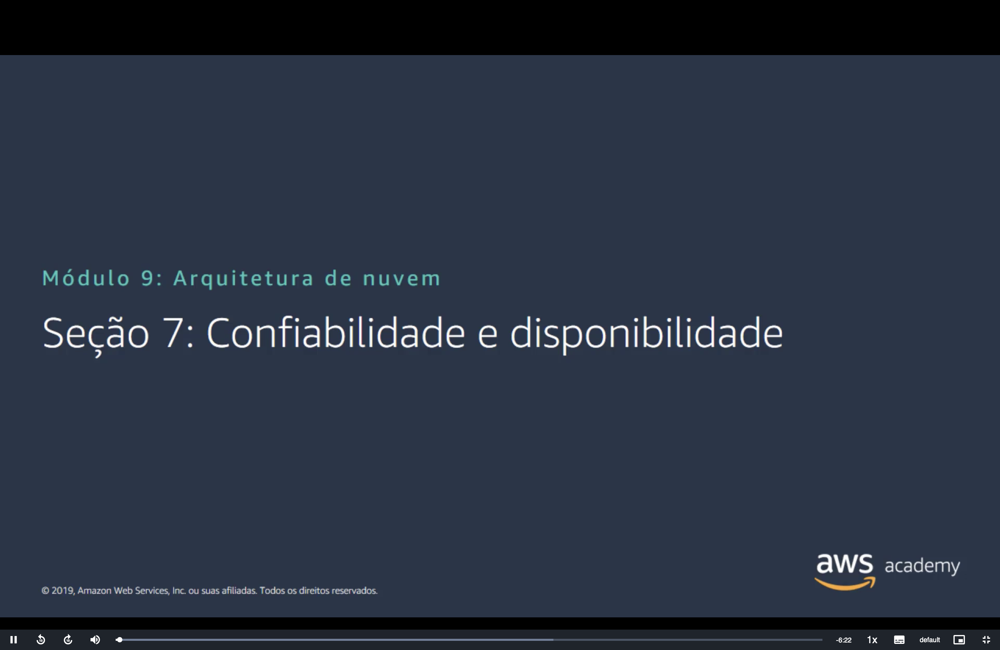
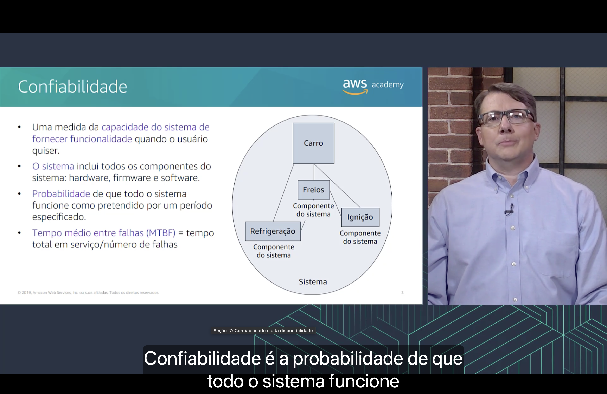
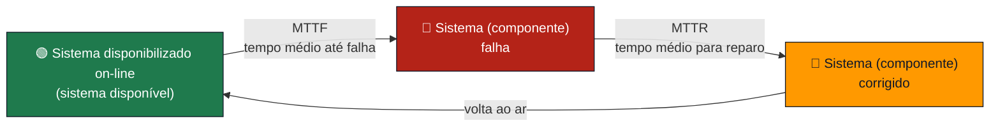
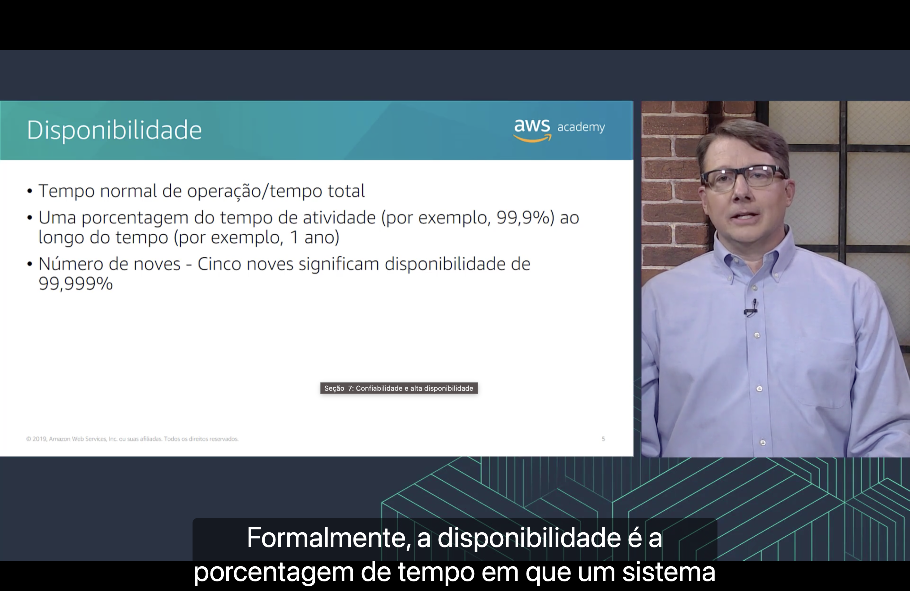
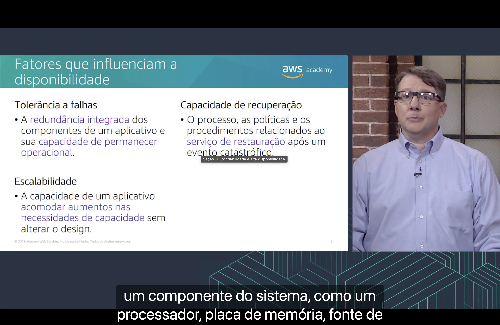

<h1 align="center">🟢 Seção 7 – Confiabilidade e disponibilidade</h1>

  
  
   
  
  
  

  <a href="../README.md">🏠 Início</a> &nbsp;•&nbsp;
  <a href="./Seção%206%20-%20Pilar%20Otimização%20de%20custos.md">⬅️ Anterior: Pilar Otimização de custos</a> &nbsp;•&nbsp;
  <a href="./Seção%208%20-%20AWS%20Trusted%20Advisor.md">Próxima: AWS Trusted Advisor ➡️</a>

> [!NOTE]
> Depois dos cinco pilares, esta seção aprofunda dois conceitos ligados ao [pilar confiabilidade](./Seção%204%20-%20Pilar%20Confiabilidade.md): **confiabilidade** e **disponibilidade**, com as métricas usadas para medi-las. O curso já aplicou essas ideias na [implantação Multi-AZ](../MÓDULO%208/Seção%201%20-%20Amazon%20Relational%20Database%20Service.md#multi-az) do Amazon RDS e nas [seis cópias](../MÓDULO%208/Seção%204%20-%20Amazon%20Aurora.md#alta-disponibilidade) do Amazon Aurora.

> [!NOTE]
> A capa chama a seção de "Confiabilidade e disponibilidade", e o rótulo do player, de "Confiabilidade e **alta** disponibilidade".

## 📑 Sumário

| # | Tópico |
|:---:|---|
| 1 | [💥 "Tudo falha, o tempo todo"](#tudo-falha) |
| 2 | [🔗 Confiabilidade](#confiabilidade) |
| 3 | [📏 Noções básicas sobre métricas de confiabilidade](#metricas) |
| 4 | [⏱️ Disponibilidade](#disponibilidade) |
| 5 | [🟢 Alta disponibilidade](#alta-disponibilidade) |
| 6 | [📊 Níveis de disponibilidade](#niveis) |
| 7 | [🧱 Fatores que influenciam a disponibilidade](#fatores) |
| 🎯 | [Principais conclusões](#conclusoes) |

---

## 1. 💥 "Tudo falha, o tempo todo"

O slide traz uma frase de **Werner Vogels**, diretor de tecnologia (CTO) da Amazon.com: **"Tudo falha, o tempo todo"** (*Everything fails, all the time*).

Segundo a narração, uma ideia central do Well-Architected Framework é **planejar a falha** e o tempo de inatividade que ela causa. Em vez de tentar evitar toda falha, o que é impossível, o arquiteto parte do princípio de que discos, servidores e até datacenters inteiros **vão** falhar e projeta o sistema para continuar funcionando quando isso acontecer.

O curso já mostrou essa ideia aplicada:

| O que falha | Como o sistema continua no ar |
|---|---|
| 🏢 **Um datacenter inteiro** | Recursos espalhados por várias [Zonas de Disponibilidade](../MÓDULO%203/Seção%201%20-%20Infraestrutura%20global%20da%20AWS.md#zonas), isoladas umas das outras |
| 🗄️ **A instância principal do banco** | O [failover automático do Multi-AZ](../MÓDULO%208/Seção%201%20-%20Amazon%20Relational%20Database%20Service.md#multi-az) promove a instância em espera em 60 a 120 segundos |
| 💾 **Cópias do armazenamento** | O [Aurora](../MÓDULO%208/Seção%204%20-%20Amazon%20Aurora.md#alta-disponibilidade) guarda seis cópias em três AZs e continua gravando mesmo sem uma AZ inteira |
| 🌐 **O site principal** | O [failover de DNS](../MÓDULO%205/Seção%205%20-%20Amazon%20Route%2053.md#failover) do Route 53 manda o tráfego para um site de backup |

> [!TIP]
> É o raciocínio por trás dos princípios [testar procedimentos de recuperação e recuperar-se automaticamente de falhas](./Seção%204%20-%20Pilar%20Confiabilidade.md#principios) do pilar confiabilidade: se a falha é certa, a recuperação precisa ser **testada** e **automática**.

## 2. 🔗 Confiabilidade

- 🎯 Uma medida da **capacidade do sistema de fornecer funcionalidade** quando o usuário quiser.
- 🧩 **O sistema** inclui todos os componentes do sistema: hardware, firmware e software.
- 🎲 **Probabilidade** de que todo o sistema funcione como pretendido por um período especificado.
- 🔁 **Tempo médio entre falhas (MTBF)** = tempo total em serviço / número de falhas.

Segundo a narração, confiabilidade é a **probabilidade** de que **todo o sistema** funcione como pretendido.

O diagrama usa um **carro** como exemplo de sistema. **Freios**, **refrigeração** e **ignição** são **componentes do sistema**, e o carro só funciona se **todos** funcionarem: com os freios quebrados, não adianta a ignição estar perfeita.

> [!NOTE]
> **Firmware** é o software gravado no próprio hardware, que controla o dispositivo, como o da placa-mãe de um servidor ou o de um disco.

> [!TIP]
> Por isso a confiabilidade do sistema é **menor** que a de cada componente. Se três componentes indispensáveis funcionam 99% do tempo cada um, o conjunto funciona cerca de **97%** do tempo (0,99 × 0,99 × 0,99). A conta volta nos [fatores que influenciam a disponibilidade](#fatores).

Um exemplo do **MTBF** (números ilustrativos): um sistema que ficou 1.000 horas em serviço e falhou 4 vezes tem MTBF de **250 horas**. Quanto **maior** o MTBF, mais confiável o sistema.

## 3. 📏 Noções básicas sobre métricas de confiabilidade

O slide desenha o ciclo de vida de um sistema que falha e é consertado:

| Sigla | Nome | O que mede |
|---|---|---|
| ⏳ **MTTF** (*Mean Time To Failure*) | Tempo médio até falha | Quanto tempo o sistema fica **funcionando** antes de falhar |
| 🔧 **MTTR** (*Mean Time To Repair*) | Tempo médio para reparo | Quanto tempo leva para **consertar** e voltar ao ar |
| 🔁 **MTBF** (*Mean Time Between Failures*) | Tempo médio entre falhas | O ciclo inteiro: **MTBF = MTTF + MTTR** |

A narração usa um exemplo em que o aplicativo fica disponível por **96 horas**. Completando a conta com um reparo de 4 horas (valor ilustrativo): MTTF = 96 h, MTTR = 4 h e MTBF = **100 h**.

> [!NOTE]
> O rótulo do player cobre a sigla no slide: abaixo de "Tempo médio para reparo" está escrito **(MTTR)**.

> [!TIP]
> Para melhorar a confiabilidade há dois caminhos: **aumentar o MTTF** (falhar menos) ou **diminuir o MTTR** (consertar mais rápido). A nuvem ajuda principalmente no segundo: com recuperação automática, como o failover do Multi-AZ, o MTTR cai de horas para minutos.

> [!NOTE]
> O slide é de 2019. Hoje a documentação do pilar de confiabilidade lê **MTTR** como *Mean Time to **Recover*** (tempo médio para **recuperar**), e não para reparar: o que importa é voltar a atender os usuários, mesmo que o componente com defeito ainda não tenha sido consertado. Ela estima a disponibilidade com **MTBF / (MTBF + MTTR)**, usando o MTBF no lugar do tempo em funcionamento (o MTTF do slide). Com MTBF de 150 dias e MTTR de 1 hora, a estimativa é de **99,97%**.

## 4. ⏱️ Disponibilidade

- ➗ **Tempo normal de operação / tempo total**;
- 📅 Uma **porcentagem do tempo de atividade** (por exemplo, 99,9%) ao longo do tempo (por exemplo, 1 ano);
- 9️⃣ **Número de noves**: cinco noves significam disponibilidade de **99,999%**.

Segundo a narração, formalmente, a disponibilidade é a **porcentagem de tempo** em que um sistema funciona normalmente. Com as métricas da [seção anterior](#metricas):

> **Disponibilidade** = tempo normal de operação / tempo total = **MTTF / (MTTF + MTTR)**

No exemplo das 96 horas, a disponibilidade é 96 / (96 + 4) = **96%**.

"Número de noves" é o jeito curto de falar da porcentagem: **três noves** é 99,9%, **quatro noves** é 99,99%, e assim por diante. Cada nove a mais divide o tempo fora do ar por **10** (veja os [níveis](#niveis)).

> [!IMPORTANT]
> Confiabilidade e disponibilidade **não são a mesma coisa**:
>
> | | 🔗 Confiabilidade | ⏱️ Disponibilidade |
> |---|---|---|
> | **Pergunta** | O sistema funciona **sem falhar** durante o período? | Em que **porcentagem do tempo** o sistema está no ar? |
> | **Métrica** | MTBF (tempo entre falhas) | Porcentagem do tempo (número de noves) |
>
> Um sistema que cai **1 segundo a cada hora** tem disponibilidade alta (cerca de 99,97%), mas é pouco confiável, porque falha 24 vezes por dia. Um sistema que nunca falha, mas fica **duas semanas por ano** parado para manutenção, é confiável e tem disponibilidade de só cerca de 96%.

> [!NOTE]
> O slide é de 2019. Hoje a documentação do pilar de confiabilidade define a disponibilidade como **tempo disponível para uso / tempo total** e não recomenda tirar as paradas programadas do tempo total, porque os usuários provavelmente vão querer usar o serviço nesses horários. Para serviços que atendem requisições, ela também pode ser medida como **respostas bem-sucedidas / requisições válidas**, em janelas de 1 ou 5 minutos.

## 5. 🟢 Alta disponibilidade

- 📉 O sistema pode suportar alguma medida de **degradação** e ainda permanecer disponível.
- ⏱️ O **tempo de inatividade** é minimizado.
- 🤖 **Necessidade mínima de intervenção humana.**

Segundo a narração, em um sistema de alta disponibilidade, o tempo de inatividade é minimizado ao **máximo possível** e o **mínimo de intervenção humana** é necessário.

**Degradação** é perder parte da capacidade sem cair: o sistema fica mais lento ou com menos recursos, mas continua no ar.

| Característica | Onde já vimos |
|---|---|
| 📉 **Suportar degradação** | A [escala horizontal](./Seção%204%20-%20Pilar%20Confiabilidade.md#principios): com quatro instâncias, perder uma tira 25% da capacidade, e o sistema continua no ar |
| ⏱️ **Minimizar o tempo de inatividade** | O [failover do Multi-AZ](../MÓDULO%208/Seção%201%20-%20Amazon%20Relational%20Database%20Service.md#multi-az), que leva o banco para a outra AZ em 1 a 2 minutos |
| 🤖 **Mínima intervenção humana** | O princípio [recuperar-se automaticamente de falhas](./Seção%204%20-%20Pilar%20Confiabilidade.md#principios) e o [failover de DNS](../MÓDULO%205/Seção%205%20-%20Amazon%20Route%2053.md#failover) do Route 53, que troca de site sozinho quando a verificação de integridade falha |

> [!TIP]
> A intervenção humana é o que mais aumenta o **MTTR**: alguém precisa ver o alerta, entender o problema e agir, o que leva minutos ou horas. Automatizar a recuperação é o caminho mais direto para reduzir o tempo de inatividade.

## 6. 📊 Níveis de disponibilidade

O slide ficou em inglês. Segundo a narração, a tabela mostra **categorias de aplicativos** e a **duração máxima de interrupções** que pode ocorrer em um ano para cada nível:

| Disponibilidade | Interrupção máxima (por ano) | Categoria de aplicativo |
|:---:|:---:|---|
| **99%** | 3 dias e 15 horas | Processamento em lote, trabalhos de extração, transferência e carga de dados (ETL) |
| **99,9%** | 8 horas e 45 minutos | Ferramentas internas, como gestão do conhecimento e acompanhamento de projetos |
| **99,95%** | 4 horas e 22 minutos | Comércio on-line, ponto de venda |
| **99,99%** | 52 minutos | Entrega de vídeo, sistemas de transmissão |
| **99,999%** | 5 minutos | Transações de caixas eletrônicos, sistemas de telecomunicações |

> [!NOTE]
> O rótulo do player cobre parte da linha de 99,95%. O texto completo, confirmado na documentação do pilar de confiabilidade, é *Online commerce, point of sale* (comércio on-line, ponto de venda).

> [!TIP]
> De onde vêm os números: um ano tem **8.760 horas** (365 × 24). Com 99%, o sistema pode ficar fora 1% disso, ou 87,6 horas, que dão 3 dias e 15 horas. Com 99,9%, são 8,76 horas (8 h 45 min). Com 99,99%, 52,6 minutos. Com 99,999%, 5,3 minutos.

> [!IMPORTANT]
> Cada nove a mais exige mais redundância e mais automação, e por isso **custa mais**. É o equilíbrio entre pilares da [Seção 1](./Seção%201%20-%20AWS%20Well-Architected%20Framework.md#pilares): um processamento em lote não precisa de cinco noves, e pagar por eles iria contra o pilar de [otimização de custos](./Seção%206%20-%20Pilar%20Otimização%20de%20custos.md).

> [!NOTE]
> O slide é de 2019. A tabela continua igual na documentação atual do pilar de confiabilidade. Só a última coluna trocou *systems* por *workloads* (cargas de trabalho) nas linhas de 99,99% e 99,999%.

## 7. 🧱 Fatores que influenciam a disponibilidade

| Fator | Definição no slide | Pergunta que responde | Onde já vimos |
|---|---|---|---|
| 🛡️ **Tolerância a falhas** | A **redundância integrada** dos componentes de um aplicativo e sua **capacidade de permanecer operacional** | Se um componente falhar, o sistema continua? | A instância em espera do [Multi-AZ](../MÓDULO%208/Seção%201%20-%20Amazon%20Relational%20Database%20Service.md#multi-az) e as [seis cópias do Aurora](../MÓDULO%208/Seção%204%20-%20Amazon%20Aurora.md#alta-disponibilidade) |
| 📈 **Escalabilidade** | A capacidade de um aplicativo **acomodar aumentos nas necessidades de capacidade** sem alterar o design | Se a demanda dobrar, o sistema aguenta sem ser reprojetado? | A [escala horizontal](./Seção%204%20-%20Pilar%20Confiabilidade.md#principios) e o Amazon S3, [projetado para escala perfeita](../MÓDULO%207/Seção%202%20-%20Amazon%20Simple%20Storage%20Service%20(Amazon%20S3).md#escala) |
| 🛟 **Capacidade de recuperação** | O processo, as políticas e os procedimentos relacionados ao **serviço de restauração** após um evento catastrófico | Se um desastre derrubar tudo, como e em quanto tempo o serviço volta? | O plano de [recuperação de desastres](./Seção%204%20-%20Pilar%20Confiabilidade.md#perguntas), que começa pelo **RTO** e pelo **RPO** |

A narração dá exemplos de componentes que a tolerância a falhas precisa cobrir, como um **processador**, uma **placa de memória** e uma **fonte de alimentação**.

> [!NOTE]
> "Serviço de restauração" é uma tradução ao pé da letra de *restoring service*: o sentido é **restaurar o serviço**, ou seja, colocar o sistema de volta no ar, e não um serviço da AWS chamado "restauração".

> [!TIP]
> A documentação atual do pilar de confiabilidade mostra por que a **redundância** é o que mais aumenta a disponibilidade:
> - **Componentes em série** (todos indispensáveis, como os do carro): multiplique as disponibilidades. Três componentes de 99,99% dão **99,97%**. O conjunto é **menos** disponível que cada parte.
> - **Componentes redundantes** (um substitui o outro): 100% menos o produto das indisponibilidades. Dois componentes independentes de 99,9% dão 100% − (0,1% × 0,1%) = **99,9999%**. Quando todos os números só têm noves, basta somar os noves: 3 + 3 = 6 noves.

> [!NOTE]
> O slide é de 2019. Hoje a documentação do pilar de confiabilidade gira em torno da **resiliência**: a capacidade de uma carga de trabalho de se recuperar de interrupções de infraestrutura ou de serviço, obter recursos de computação dinamicamente para atender à demanda e reduzir interrupções, como configurações erradas ou problemas temporários de rede. É quase palavra por palavra a definição do pilar confiabilidade de 2019 vista na [Seção 1](./Seção%201%20-%20AWS%20Well-Architected%20Framework.md#pilares). A disponibilidade passou a ser apresentada como a métrica mais usada para **medir** a resiliência.

---

## 🎯 Principais conclusões

- ✅ **"Tudo falha, o tempo todo"**: o Well-Architected Framework manda **planejar a falha**, em vez de tentar evitá-la.
- ✅ **Confiabilidade** é a **probabilidade** de que **todo o sistema** (hardware, firmware e software) funcione como pretendido por um período. Basta um componente indispensável falhar para o sistema falhar.
- ✅ **MTTF** é o tempo até a falha, **MTTR** é o tempo de reparo, e **MTBF = MTTF + MTTR** é o ciclo inteiro.
- ✅ **Disponibilidade** é a **porcentagem do tempo** em que o sistema funciona normalmente: tempo normal de operação / tempo total. Cinco noves são **99,999%**.
- ✅ **Alta disponibilidade** é suportar **degradação** sem cair, **minimizar** o tempo de inatividade e depender o **mínimo possível** de intervenção humana.
- ✅ Cada nove a mais divide o tempo fora do ar por 10: de **3 dias e 15 horas** por ano (99%) a **5 minutos** (99,999%). E custa mais.
- ✅ Os fatores que influenciam a disponibilidade são **tolerância a falhas**, **escalabilidade** e **capacidade de recuperação**.
- ✅ Componentes **em série** diminuem a disponibilidade, e componentes **redundantes** a aumentam.

---

  <a href="../README.md">🏠 Início</a> &nbsp;•&nbsp;
  <a href="./Seção%206%20-%20Pilar%20Otimização%20de%20custos.md">⬅️ Anterior: Pilar Otimização de custos</a> &nbsp;•&nbsp;
  <a href="./Seção%208%20-%20AWS%20Trusted%20Advisor.md">Próxima: AWS Trusted Advisor ➡️</a>

