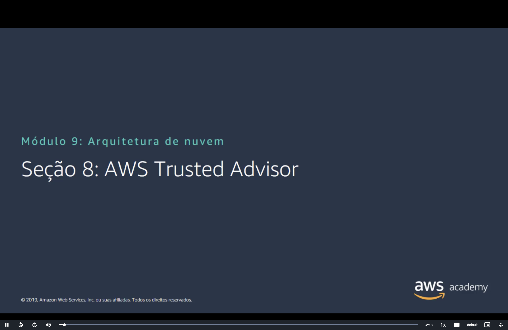
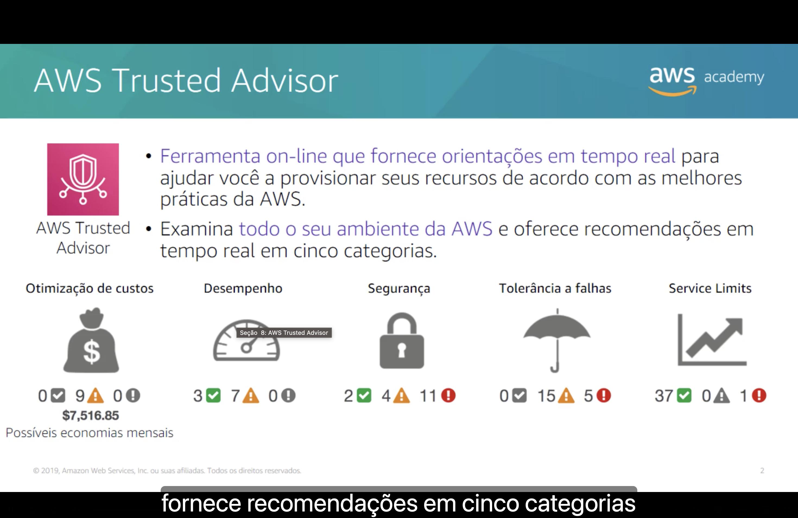

<h1 align="center">✔️ Seção 8 – AWS Trusted Advisor</h1>

  
  
   
  
  
  

  <a href="../README.md">🏠 Início</a> &nbsp;•&nbsp;
  <a href="./Seção%207%20-%20Confiabilidade%20e%20disponibilidade.md">⬅️ Anterior: Confiabilidade e disponibilidade</a>

> [!NOTE]
> O Trusted Advisor já apareceu no [Módulo 2](../MÓDULO%202/Seção%205%20-%20Suporte%20Técnico.md#orientacoes) como o recurso de **melhores práticas** do AWS Support. Aqui ele volta como a ferramenta que **confere automaticamente** os recursos da conta, em categorias que correspondem aos pilares do Well-Architected Framework vistos nas seções anteriores.

## 📑 Sumário

| # | Tópico |
|:---:|---|
| 1 | [✔️ AWS Trusted Advisor](#trusted-advisor) |
| 🎯 | [Principais conclusões](#conclusoes) |

---

## 1. ✔️ AWS Trusted Advisor

- 🧭 **Ferramenta on-line que fornece orientações em tempo real** para ajudar você a provisionar seus recursos de acordo com as melhores práticas da AWS.
- 🔍 **Examina todo o seu ambiente da AWS** e oferece recomendações em tempo real em **cinco categorias**.

Segundo a narração, o Trusted Advisor fornece recomendações em **cinco categorias**:

| Categoria | Ícone no slide | O que verifica | Pilar correspondente |
|---|---|---|---|
| 💲 **Otimização de custos** | Saco de dinheiro | Recursos **sem uso** ou **ociosos** e oportunidades de reduzir a conta | [Otimização de custos](./Seção%206%20-%20Pilar%20Otimização%20de%20custos.md) |
| ⏱️ **Desempenho** | Velocímetro | O que pode melhorar a **velocidade** e a capacidade de resposta dos aplicativos | [Eficiência de desempenho](./Seção%205%20-%20Pilar%20Eficiência%20de%20desempenho.md) |
| 🔒 **Segurança** | Cadeado | Configurações que deixam a solução **mais segura** | [Segurança](./Seção%203%20-%20Pilar%20Segurança.md) |
| ☂️ **Tolerância a falhas** | Guarda-chuva | **Falta de redundância** e recursos sobrecarregados | [Confiabilidade](./Seção%204%20-%20Pilar%20Confiabilidade.md) e o fator [tolerância a falhas](./Seção%207%20-%20Confiabilidade%20e%20disponibilidade.md#fatores) da seção anterior |
| 📈 **Service limits** | Gráfico subindo | Se o uso da conta está **perto** dos limites de serviço ou **passou** deles | A pergunta sobre [service limits](./Seção%204%20-%20Pilar%20Confiabilidade.md#perguntas) do pilar confiabilidade |

> [!NOTE]
> **Service limits** ficou em inglês no slide, como na [Seção 4](./Seção%204%20-%20Pilar%20Confiabilidade.md#perguntas): são os **limites de serviço**, também chamados de **cotas** (*quotas*).

### 📊 Como ler o painel

Embaixo de cada categoria, o slide mostra um painel de exemplo com quantas verificações estão em cada **status**:

| Ícone | Status | Significado |
|:---:|---|---|
| ✅ Verde | **Nenhum problema detectado** | A verificação não encontrou problema |
| ⚠️ Amarelo | **Investigação recomendada** | Há um **possível** problema, que vale investigar |
| ❗ Vermelho | **Ação recomendada** | Há um problema, e o Trusted Advisor recomenda agir |

Os números do exemplo:

| Categoria | ✅ | ⚠️ | ❗ |
|---|:---:|:---:|:---:|
| 💲 Otimização de custos | 0 | 9 | 0 |
| ⏱️ Desempenho | 3 | 7 | 0 |
| 🔒 Segurança | 2 | 4 | **11** |
| ☂️ Tolerância a falhas | 0 | 15 | **5** |
| 📈 Service limits | 37 | 0 | **1** |

Abaixo da otimização de custos aparece **US$ 7.516,85** em **possíveis economias mensais**: quanto a conta deixaria de gastar por mês se seguisse as recomendações de custo. No slide, os ícones com contagem **zero** aparecem em cinza.

> [!TIP]
> Nesse painel, o ponto mais urgente é a **segurança**, com **11** verificações em vermelho, seguida da **tolerância a falhas**, com 5. Service limits está quase todo verde, mas o único vermelho merece atenção: um serviço que chega ao limite **deixa de criar recursos**, e a carga de trabalho pode parar de escalar justamente no pico.

> [!TIP]
> O Trusted Advisor e a [AWS Well-Architected Tool](./Seção%201%20-%20AWS%20Well-Architected%20Framework.md#o-que-e) se completam. A Well-Architected Tool **pergunta** como a carga de trabalho foi projetada, e você responde. O Trusted Advisor **inspeciona** os recursos que existem na conta. Por exemplo, a Well-Architected Tool pergunta se você protege o usuário raiz, e o Trusted Advisor confere se ele **está** com MFA.

> [!NOTE]
> O slide é de 2019, e o Trusted Advisor mudou:
> - Hoje são **seis categorias**: entrou a **excelência operacional**, com recomendações para operar o ambiente da AWS de forma eficaz e em escala. Com ela, todos os cinco pilares do slide da [Seção 1](./Seção%201%20-%20AWS%20Well-Architected%20Framework.md#pilares) têm uma categoria correspondente.
> - O cinza ganhou outro significado no painel: indica verificações com **itens excluídos**, ou seja, recursos que você mandou a verificação ignorar.
> - Quem usa o **AWS Organizations** com um plano que dá acesso a todas as verificações pode ver as verificações de **todas as contas** da organização em um só lugar (visão organizacional).
> - O Trusted Advisor envia por e-mail, **uma vez por semana**, um resumo das verificações.

> [!IMPORTANT]
> Nem todas as verificações estão disponíveis em todos os [planos de suporte](../MÓDULO%202/Seção%205%20-%20Suporte%20Técnico.md#planos). Nos planos **Básico** e **Desenvolvedor**, aparecem só todas as verificações de **service limits** e estas de segurança e tolerância a falhas, que precisam ser atualizadas manualmente:
>
> | Verificação | Onde já vimos |
> |---|---|
> | MFA na conta raiz | A [Etapa 2](../MÓDULO%204/Seção%203%20-%20Proteção%20de%20uma%20nova%20conta%20da%20AWS.md#etapa2) da proteção de uma nova conta |
> | Permissões de bucket do Amazon S3 | A [verificação gratuita](../MÓDULO%204/Seção%205%20-%20Proteção%20de%20dados%20na%20AWS.md#s3) do Módulo 4 |
> | Grupos de segurança com portas específicas sem restrição | Os [grupos de segurança](../MÓDULO%205/Seção%204%20-%20Segurança%20da%20VPC.md#sg) do Módulo 5 |
> | Snapshots públicos do Amazon EBS | Os [snapshots do EBS](../MÓDULO%207/Seção%201%20-%20Amazon%20Elastic%20Block%20Store%20(Amazon%20EBS).md#snapshots) |
> | Snapshots públicos do Amazon RDS | Os [backups do RDS](../MÓDULO%208/Seção%201%20-%20Amazon%20Relational%20Database%20Service.md#responsabilidades) |
> | Uso do endpoint global do AWS STS nas Regiões | O STS é o serviço que emite as credenciais temporárias das [funções do IAM](../MÓDULO%204/Seção%202%20-%20AWS%20Identity%20and%20Access%20Management%20(IAM).md#funcoes) |
>
> As demais exigem um plano pago superior, que também atualiza as verificações automaticamente toda semana. Segundo a página do produto, são **482 verificações** no total.

> [!WARNING]
> Os planos de suporte do Módulo 2 estão mudando. Segundo a documentação do Trusted Advisor, os planos **Developer** e **Business** (e o **Enterprise On-Ramp**, que surgiu depois do curso) serão **descontinuados em 1º de janeiro de 2027**. Para ter todas as verificações, o plano mínimo passa a ser o novo **Business Support+**, a partir de **US$ 29 por mês** por conta. O **Enterprise Support** e o novo **AWS Unified Operations** também dão acesso a todas.

---

## 🎯 Principais conclusões

- ✅ O **AWS Trusted Advisor** é uma ferramenta **on-line** que examina **todo o ambiente da AWS** e dá recomendações **em tempo real**, de acordo com as melhores práticas da AWS.
- ✅ No slide, as recomendações se dividem em **cinco categorias**: **otimização de custos**, **desempenho**, **segurança**, **tolerância a falhas** e **service limits**.
- ✅ Cada verificação tem um status: **verde** (nenhum problema detectado), **amarelo** (investigação recomendada) ou **vermelho** (ação recomendada).
- ✅ A categoria de custos mostra as **possíveis economias mensais**.
- ✅ A Well-Architected Tool **pergunta** sobre o projeto; o Trusted Advisor **inspeciona** os recursos da conta.
- ✅ Hoje são **seis categorias**, com a **excelência operacional**. Os planos Básico e Desenvolvedor só veem as verificações de service limits e algumas de segurança e tolerância a falhas.

---

  <a href="../README.md">🏠 Início</a> &nbsp;•&nbsp;
  <a href="./Seção%207%20-%20Confiabilidade%20e%20disponibilidade.md">⬅️ Anterior: Confiabilidade e disponibilidade</a>

